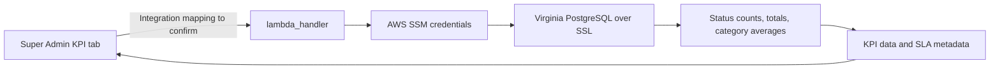

# KPI Tab Documentation

This document addresses [issue #599](https://github.com/saayam-for-all/data/issues/599): the KPI tab in **Super Admin Dashboard → Application Analytics**. It explains the intended dashboard experience, the implementation available in this repository, its development history, and the information still requiring confirmation.

Reviewed against `dev` commit `fb30056` on November 6, 2026. Repository behavior is not proof of the version deployed to the test or production application. No live AWS, database, or authenticated frontend verification was performed.

## Purpose and features

The KPI tab helps administrators understand the state of help requests and how long completed requests take to resolve. The design calls for two widgets:

| Widget | Purpose | Design visualization |
| --- | --- | --- |
| Request status distribution | Compare resolved, pending/unresolved, and in-progress requests | Donut chart |
| Average resolution time by category | Identify help categories with longer resolution times | Column chart, in hours |

The backend also supplies request totals, time buckets, and fixed SLA reference values. Status labels in the database are returned directly; the backend does not map them into the three presentation groups above. The exact frontend mapping needs confirmation.

## Task-by-task development review

The following tasks were read individually, including their issue descriptions, available comments, attachments, and linked implementation PR descriptions/review comments where accessible. An unmerged proposal is evidence of an approach, not evidence that it was deployed.

### 1. Resolution-time analysis — #74

[Issue #74](https://github.com/saayam-for-all/data/issues/74) requested minimum, maximum, and average resolution times and visualizations of improvement. Its [comment](https://github.com/saayam-for-all/data/issues/74#issuecomment-3683368923) describes elapsed time from creation to closure. The current KPI Lambda implements category averages only: minimum, maximum, and an improvement metric are absent. No implementation PR was cross-referenced in the retrieved issue timeline.

### 2. Dashboard design — #82

[Issue #82](https://github.com/saayam-for-all/data/issues/82) places KPIs inside Application Analytics and defines average resolution time by category and resolved/unresolved/in-progress counts. Its [design comment](https://github.com/saayam-for-all/data/issues/82#issuecomment-3579143385) points to the [ML dashboard design wiki](https://github.com/saayam-for-all/ml/wiki/Super-Admin-Dashboard-Analytics-tab-Design); the wiki contents were not independently verified for this document. A [later comment](https://github.com/saayam-for-all/data/issues/82#issuecomment-4120156989) reports dashboard implementation, without identifying a deployed frontend revision. Later documentation PR cross-references do not establish the original UI implementation.

### 3. Initial sample-data approach — #84

[Issue #84](https://github.com/saayam-for-all/data/issues/84) proposed realistic CSV → backend JSON → frontend charts before real data was available, avoiding fake rows in the shared database. Its [handoff comment](https://github.com/saayam-for-all/data/issues/84#issuecomment-4120185370) reports sending JSON to the UI team.

Both attachments were downloaded and inspected:

- [Schema workbook](https://github.com/user-attachments/files/24040548/Table.column.names_data-1764970855601.xlsx): confirms `virginia_dev_saayam_rdbms`, the request/status/category columns used below, and timestamp-without-time-zone date fields.
- [Visualization specification](https://github.com/user-attachments/files/24040571/Types.of.Visualizations.for.Application.Analytics.Dashboard.docx): specifies a category column chart and a resolved/pending/in-progress donut chart for KPIs.

These describe historical design and sample data. The current KPI Lambda queries PostgreSQL directly and does not load CSVs.

### 4. Real database API — #160

[Issue #160](https://github.com/saayam-for-all/data/issues/160) replaces sample data with Virginia PostgreSQL queries, defines the two widgets plus totals/SLA, and requires safe defaults and cleanup. Its printed subtraction formula is reversed; current code correctly uses `serviced_date - submission_date`.

Implementation evidence reviewed:

| PR | Review outcome and significance |
| --- | --- |
| [#169](https://github.com/saayam-for-all/data/pull/169) | Merged May 18, 2026; initial status counts, totals, resolution-time validation, and CSV-based local verification. History also contains a subsequent revert, so merge alone does not establish final behavior. |
| [#173](https://github.com/saayam-for-all/data/pull/173) | Merged June 1, 2026; schema qualification, `help_categories` correction, completed/resolved filtering, and rejection of negative durations. |
| [#180](https://github.com/saayam-for-all/data/pull/180) | Unmerged at review; alternative real API and schema corrections. |
| [#184](https://github.com/saayam-for-all/data/pull/184) | Unmerged at review; alternative SQL implementation and SSM access; live RDS testing still required. |
| [#223](https://github.com/saayam-for-all/data/pull/223) | Unmerged at review; proposes three dashboard statuses and `RESOLVED` only, noting the lookup lacks `COMPLETED`. Those restrictions are not present in the reviewed analytics implementation. |

The [initial testing comment](https://github.com/saayam-for-all/data/issues/160#issuecomment-4381598337) reports safe defaults without credentials. A [later issue comment](https://github.com/saayam-for-all/data/issues/160#issuecomment-4743648744) flags both duplicate source files and the discrepancy between requested statuses and lookup values. These are reported local results, not live deployment validation.

### 5. Date filters — #181

[Issue #181](https://github.com/saayam-for-all/data/issues/181) requests filters on request submission date, preserved KPI/SLA fields, all-history `All`, and validation of custom dates. Its title also mentions request volume/category/region; the detailed scope updates the existing KPI functions and explicitly excludes frontend changes. The sole retrieved comment says “Opened” and supplies no additional implementation detail.

| PR | Review outcome and significance |
| --- | --- |
| [#183](https://github.com/saayam-for-all/data/pull/183) | Unmerged; parameterized custom dates; missing dates fall back to all data. A comment reports force-pushing an updated source file. |
| [#187](https://github.com/saayam-for-all/data/pull/187) | Unmerged; reports local PostgreSQL tests of all ranges and seeded resolved requests. |
| [#190](https://github.com/saayam-for-all/data/pull/190) | Merged July 2, 2026; shared date-filter helper and consistent request alias `r` across queries. |
| [#191](https://github.com/saayam-for-all/data/pull/191) | Unmerged; proposes validation and local environment credentials. Its testing notes explain why stale CSV data can produce empty recent windows. |
| [#192](https://github.com/saayam-for-all/data/pull/192), [#195](https://github.com/saayam-for-all/data/pull/195) | Date-filter merge followed by its revert; both must be considered when tracing behavior. |
| [#193](https://github.com/saayam-for-all/data/pull/193), [#211](https://github.com/saayam-for-all/data/pull/211), [#215](https://github.com/saayam-for-all/data/pull/215) | Unmerged alternatives for the same date-filter task; descriptions do not establish the current contract. |
| [#196](https://github.com/saayam-for-all/data/pull/196) | Unmerged revert-of-revert proposal; describes mocked tests, not proof of tests in the reviewed branch. |

Additional date-filter proposals were reviewed individually: [#220](https://github.com/saayam-for-all/data/pull/220) adds parameterized predicates and a `LOCAL_DB_TEST` path; [#232](https://github.com/saayam-for-all/data/pull/232) describes a `LOCAL_DB` path and seeded PostgreSQL checks against hand-calculated results; [#260](https://github.com/saayam-for-all/data/pull/260) proposes required custom endpoints and an unrestricted `All` range. All three were unmerged at review. Their issue-comment and inline-review-comment endpoints returned no comments. An earlier HTTP 403 was resolved during final verification. Earlier retrieved PR comment endpoints returned no substantive review feedback except the #183 comment noted above; this does not imply approval.

The later [July 26 source update](https://github.com/saayam-for-all/data/commit/271212b561cb268f24e90b624f878a8e83f09d58) introduces the current consolidated buckets and snapshot behavior. This source revision takes precedence over older PR descriptions when documenting the available code.

## User flow and data flow

The intended user journey is to open Super Admin Dashboard, choose Application Analytics, select KPI, inspect the status and resolution-time charts, and choose a preset or custom interval. Exact screen labels, access roles, loading/error states, chart interactions, and the frontend API call site need confirmation in the frontend repository.

The following flow describes the available backend and intended consumer:



For initial loading, invoking the analytics handler with `{}` computes `7D`, `30D`, `1Y`, `All`, and `Snapshot` in one call. A client can select a returned bucket for a preset. For a custom selection, invoke with `time_range: "Custom"` and both dates; the response uses a different, flat shape. This is the backend contract, not a verified account of the deployed UI requests.

## Implementation and data sources

Primary source: [`data-analytics/lambda_functions/kpi_api_analytics.py`](../lambda_functions/kpi_api_analytics.py), with a [pinned source reference](https://github.com/saayam-for-all/data/blob/fb30056/data-analytics/lambda_functions/kpi_api_analytics.py).

- `get_db_connection()` reads decrypted credentials through `boto3` SSM in `us-east-1`, from `/dev/saayam/db/Virginia/Analytics/user`, then connects using `psycopg2` and `sslmode="require"`. No credential values are included here.
- `build_date_filter()` builds the submission-date predicate and binds custom values as SQL parameters.
- `get_grouping()` selects daily, monthly, or unbucketed aggregation.
- Three fetch functions execute SQL with `RealDictCursor`, then convert results to Python integers/floats and dictionaries.
- `lambda_handler()` selects consolidated or custom behavior, catches query errors, and closes cursor/connection in `finally`.
- `build_response()` adds status and JSON/CORS headers; in this file `body` is a Python dictionary, not a serialized JSON string.

| Table | Columns used | Role |
| --- | --- | --- |
| `virginia_dev_saayam_rdbms.request` | `req_id`, `req_status_id`, `req_cat_id`, `submission_date`, `serviced_date` | Request facts, cohort date, elapsed time |
| `virginia_dev_saayam_rdbms.request_status` | `req_status_id`, `req_status` | Current status label, joined on status ID |
| `virginia_dev_saayam_rdbms.help_categories` | `cat_id`, `cat_name` | Category label, joined on category ID |

The repository also includes a [schema workbook](../../database/Saayam_Table.column.names_data.xlsx), [analytics fixtures](../sql/), and a [status CSV](../sql/request_statuses.csv). Fixtures and workbook metadata do not verify the live database contents.

## KPI definitions and calculations

| Output | Calculation and inclusion rules |
| --- | --- |
| `request_status_distribution` | `COUNT(r.req_id)` grouped by current `rs.req_status`, and by submission period when bucketed. An inner status join excludes missing lookup matches. All matching status labels are returned, sorted by period/status or status for Snapshot. |
| `total_requests` | `COUNT(r.req_id)` directly from request, under the same submission-date predicate. No status/category join; therefore it can exceed the summed status distribution if lookup references are missing. |
| `average_resolution_time_by_category` | Mean of `(serviced_date - submission_date)` in hours, rounded to two decimals, grouped by category name and submission period where applicable. Requires both dates, nonnegative duration, matching category/status rows, and `UPPER(req_status)` in `COMPLETED` or `RESOLVED`. Ordered by average descending. |
| `sla` | Fixed metadata: `target_days: 10`, `target_hours: 240`, `warning_days: 8.33`, `warning_hours: 200`. The Lambda calculates no SLA compliance percentage or breach count. |

For example, valid completed requests taking 24 and 48 hours in one category/period yield `avg_hours: 36.0`. A request still open, missing a date, or serviced before submission does not enter that average. Cohorts use **submission date**, not resolution date; status counts reflect current state, not historical transitions. Categories sharing a name are combined by the SQL grouping.

### Time windows as implemented

| Bucket | Submission-date predicate | Grouping |
| --- | --- | --- |
| `7D` | `>= CURRENT_DATE - INTERVAL '7 days'` | Daily, `YYYY-MM-DD` |
| `30D` | `>= CURRENT_DATE - INTERVAL '30 days'` | Daily |
| `1Y` | `>= CURRENT_DATE - INTERVAL '1 year'` | Monthly, `YYYY-MM` |
| `All` | `>= CURRENT_DATE - INTERVAL '2 years'` | Monthly |
| `Custom` | `BETWEEN %s AND %s` if both dates are supplied | Daily |
| `Snapshot` | No date predicate | Unbucketed |

Preset windows have no upper bound, so future-dated rows can qualify. `CURRENT_DATE` follows database session settings. Custom `BETWEEN` includes both supplied endpoints, but a date-only end value on a timestamp column normally means midnight, excluding later times on that final day. Missing custom dates cause no date predicate, rather than a validation error.

## Request and response contract

These are direct Lambda event examples. The handler does not parse an API Gateway `body` or query string; gateway mapping must be confirmed.

Consolidated request:

```json
{}
```

The body contains `7D`, `30D`, `1Y`, `All`, `Custom`, `Snapshot`, and `sla`. `Custom` remains an unpopulated placeholder on this path. Every non-custom event, including `{"time_range":"30D"}` or an unknown range, takes this consolidated path.

Example of one populated bucket (illustrative data):

```json
{
  "request_status_distribution": [
    {"period": "2026-11-01", "status": "RESOLVED", "count": 2}
  ],
  "total_requests": [
    {"period": "2026-11-01", "total_requests": 2}
  ],
  "average_resolution_time_by_category": [
    {"period": "2026-11-01", "category": "Shelter", "avg_hours": 36.0}
  ]
}
```

For Snapshot, rows have no `period`, and `total_requests` is a scalar integer. Successful bucketed total queries return lists (including `[]` when empty), while initialized/error defaults use integer `0`. Missing periods/statuses/categories are not filled with zeros.

Custom request:

```json
{
  "time_range": "Custom",
  "start_date": "2026-11-01",
  "end_date": "2026-11-05"
}
```

The custom response body directly contains `request_status_distribution`, `total_requests`, `average_resolution_time_by_category`, and `sla`, rather than a `Custom` wrapper. It uses daily period rows like the example above. The outer response has `statusCode`, `headers`, and `body` on either path.

## Errors, deployment, and known limitations

1. **Two source variants exist.** [`data-engineering/src/kpi_api_analytics.py`](../../data-engineering/src/kpi_api_analytics.py) is a different implementation: flat all-history output, no date filters, cached SSM access through Lambda Powertools, and a JSON-string body. Confirm which handler/package is deployed before using this document as an integration specification.
2. **Deployment and frontend wiring are unverified.** The [deployment workflow](../../.github/workflows/deploy-lambda.yml) does not establish which of these standalone KPI files powers the running tab. Endpoint URL/method, gateway mappings, authorization, frontend source revision, and Lambda version remain open questions. CORS `*` is not an authorization mechanism.
3. **Requirements and source differ.** #181 specifies all-history `All`, a single selected range/default `All`, and custom-date validation. The current analytics file returns consolidated ranges, restricts `All` to two years, and lacks explicit date-format/order validation. The status presentation mapping and `COMPLETED` versus `RESOLVED` lookup discrepancy remain unresolved.
4. **A successful status does not prove complete data.** Individual query exceptions are logged and leave defaults while the handler can return 200. Connection/setup failure returns 500 with defaults. The response has no per-widget error flag, so empty data and failed queries can look alike. With psycopg2's default transaction behavior, a SQL error can abort the transaction and make subsequent queries fail too; there is no rollback between queries.
5. **Transport serialization needs confirmation.** The analytics implementation's dictionary `body` may need mapping or serialization for an API Gateway proxy integration. The engineering variant serializes it, demonstrating that the two contracts are not interchangeable.
6. **Time and data quality affect interpretation.** Timestamp columns have no stored timezone; business timezone and final-day custom-date semantics need agreement. Recent windows may be empty with stale fixtures. Inner joins can omit orphaned data. A valid average of zero hours is different from no qualifying rows.
7. **Performance is not measured here.** A consolidated call runs 15 sequential aggregate queries over one connection, with no response cache or pagination in the handler. Live latency, indexes, scale, and query plans were not verified.
8. **Some integration evidence remains unverified.** The design wiki, original frontend implementation PR, production deployment history, and full live status lookup need follow-up. The [Test Cases and Acceptance Criteria document](../lambda_functions/Test%20Cases%20and%20Acceptance%20Criteria.docx) was inspected and describes volunteer analytics, not KPI test coverage.

## Verification and review handoff

This change documents existing behavior; it does not modify the Lambda, database, or frontend. Source inspection, local Git history, task/PR evidence, and attachment contents were used to cross-check the document. No live deployment or RDS test result is claimed.

Before approving the integration details, reviewers should confirm the deployed source variant and frontend call site; check default/custom payloads against that deployment; verify the live status vocabulary and submission-date timezone; and decide whether to align `All`, custom validation, and response types with #181. For future local verification, mock AWS/database access and exercise empty data, known elapsed-time rows, all ranges, invalid dates, query errors, and connection errors.

This document is the repository review artifact for #599. The PR description links directly to it for review.
