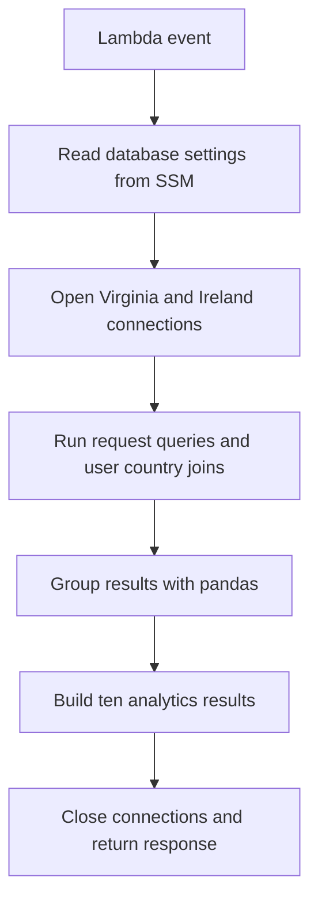

# Beneficiary Tab Documentation

The Beneficiaries tab helps administrators see beneficiary activity over time and where that activity comes from. It sits under **Super Admin Dashboard → Analytics → Application Analytics** and displays a trend chart and a country breakdown.

This document explains how `beneficiariesTrendAnalysis.py` gets its data, calculates those results, and returns them. It also records the work behind the feature and the gaps that remain. It was prepared for [issue #603](https://github.com/saayam-for-all/data/issues/603).

This document uses the **`test` branches of data and webapp**: [data at `a3b3d27`](https://github.com/saayam-for-all/data/tree/a3b3d27abd95e366e6aab4b61b8c01e32be16c75) and [webapp at `388534d90`](https://github.com/saayam-for-all/webapp/tree/388534d902110bac4d4a38f7a4fc1cdbba8ac6ad). The code links below point to these versions.

## 1. Purpose and user flow

[Issue #82](https://github.com/saayam-for-all/data/issues/82), the [dashboard design wiki][design-wiki], and [issue #84](https://github.com/saayam-for-all/data/issues/84) define two views: beneficiary counts over time and a breakdown by country and region.

A Super Admin opens Analytics, selects Application Analytics, then Beneficiaries. Analytics initially opens on Infrastructure, and Application Analytics initially selects Requests. The Admin dashboard also uses the same analytics component. The containing views are in [SuperAdminDashboard.jsx][superadmin], [Dashboard.jsx][dashboard] and [ApplicationAnalytics.jsx][application]; the [role guide][roles-wiki] describes access to those dashboards.

The [Beneficiaries component][frontend] shows a line chart alongside a country bar chart or filled map. Each chart has its own 7D, 30D, 1Y, All and Custom controls. Custom exposes start/end dates and Day/Month grouping. The country view also offers a Top 10 setting. These controls describe what the UI offers; the backend’s supported periods and calculations are explained below.

On opening the tab, the client requests analytics through [getBeneficiariesTrendAnalysis][service]. Preset selection usually reuses the response already loaded. A custom selection requests new data once both dates have been entered. The tab shows a loading message while waiting, an empty-state message when no series is available, and an error message when the trend request fails. Mock chart data was removed following reviewer feedback on [webapp #1518](https://github.com/saayam-for-all/webapp/issues/1518).

## 2. Backend overview

The [Lambda handler][backend] calculates beneficiary trends and country counts. It also calculates help-request trends and country counts in the same invocation. That shared implementation explains why a caller must supply dates for both beneficiaries and help requests.

The processing sequence is:

1. Read Virginia and Ireland connection settings from AWS Systems Manager Parameter Store.
2. Open two PostgreSQL connections and create a cursor for each.
3. Read the custom beneficiary dates from the event.
4. Calculate the four beneficiary trend series and the country breakdown.
5. Read the custom help-request dates and calculate the corresponding five results.
6. Close the connections and return all ten results in one response.



The query functions fetch rows; the `get_*_dic` functions turn those rows into chart data. SQL chooses records and removes the duplicates specified by each query. Pandas then groups and counts the results. The handler does not load CSVs at runtime.

## 3. Data sources and database access

`get_db_config` creates an SSM client in `us-east-1`, requests decrypted parameters at `/dev/saayam/db/Virginia/Analytics/user` and `/dev/saayam/db/Ireland/Analytics/user`, and parses host, port, database, user, and password from fixed line/token positions. The parser depends on the parameter keeping that layout; the live parameter values were not inspected.

Configuration is fetched before the database connection `try/except`. The handler then opens both connections, disables autocommit, and creates two cursors. It executes all fixed and custom calculations on every successful invocation, including help-request analytics.

### Tables and columns

| Constant or source | Value used by the handler |
|---|---|
| Virginia request | `virginia_dev_saayam_rdbms.request` |
| Virginia users | `virginia_dev_saayam_rdbms.users` |
| Virginia country | `virginia_dev_saayam_rdbms.country` |
| Ireland request | **`virginia_dev_saayam_rdbms.request`**, despite the Ireland label |
| Ireland users | `ireland_dev_saayam_rdbms.users` |
| Ireland country | **`virginia_dev_saayam_rdbms.country`**, despite the Ireland label |
| Trend columns | `request.req_user_id`, `request.last_update_date`; help-request trends use `submission_date`. |
| Country joins | `request.req_user_id = users.user_id`, then `users.country_id = country.country_id`; country label is `country.country_name`. |

Ireland trend calls are commented out. Both country functions fetch Ireland rows but assign only Virginia rows to the DataFrame. Therefore **only Virginia rows contribute to returned metrics**, although the Ireland connection is required and Ireland country queries still execute.

The [schema attachment from #84][schema-attachment] records the singular `request` table and the old column names used by this handler. The repository's [requests.csv][requests-csv] instead has `creator_id`, `beneficiary_id`, and `last_updated_at`. The table and column names changed over time.

[Issue #302](https://github.com/saayam-for-all/data/issues/302) reports an August 17 rename to `requests`, a live missing-table error in the separate organization aggregator, and the creator/beneficiary split. Its maintainer comments confirm an aggregator update to `requests` and `beneficiary_id`. The Beneficiary queries still use the earlier names, so their live schema needs confirmation. Also, a request creator can submit for another beneficiary; replacing the table name alone does not resolve the metric definition.

## 4. Metrics and date filters

### 4.1 Beneficiary trend

`aggregate_beneficiaries` selects **distinct `(req_user_id, last_update_date)` pairs**, then retains their timestamps. `get_beneficiaries_dic` converts them with pandas and counts rows per day or month.

| Backend range | SQL predicate | Grouping |
|---|---|---|
| 7 days | `last_update_date > CURRENT_TIMESTAMP - INTERVAL '7 days'` | Daily |
| 1 month | Same predicate with `INTERVAL '1 month'` | Daily |
| 1 year | Same predicate with `INTERVAL '1 year'` | Monthly |
| Custom | `last_update_date BETWEEN '<start>' AND '<end>'` | Daily |

One month is a PostgreSQL calendar interval, not necessarily 30 days. Fixed ranges have an exclusive lower boundary and no explicit upper boundary, so future timestamps can qualify. Custom uses inclusive `BETWEEN`; an end date without a time is normally the start of that day when compared to a timestamp. The code does not extend it to the end of the day or validate its ordering/format. Database timezone and timestamp interpretation were not tested.

The count represents request activity associated with a user, rather than registrations or unique users per day. If user A has request timestamps at 10:00 and 11:00 on April 3, both distinct pairs contribute, even though the user is the same. Identical user/timestamp pairs across requests collapse. A user can contribute again on a later day. Updates to an existing request can move the date on which it is counted.

For the synthetic distinct-pair inputs `(A, April 3 10:00)`, `(A, April 3 11:00)`, `(B, April 4 10:00)`, `(A, May 1 10:00)`, the actual pandas grouping produced daily counts **2, 1, 1** and monthly counts **3, 1**. This validates grouping after query results are supplied, not SQL execution or date filtering against a live server.

Output records use an ISO timestamp at the bucket's midnight and an integer `Count`. Only populated buckets are returned; the function does not generate zero-count dates. The trend has no status, category, country, or region filter.

### 4.2 Beneficiaries by country

`aggregate_beneficiaries_country` selects distinct `(req_user_id, country_name)` pairs after the inner joins described above. `get_beneficiaries_country_dic` groups those pairs by country and counts them. The result is an all-time list such as `[{"country": "India", "Count": 2}]`.

There is no date condition, ranking, percentage calculation, Top 10 restriction, country selection, or regional subdivision in this backend calculation. Inner joins exclude requests without a matching user or country. The country is the requesting user's profile country, not necessarily the request location or the location of a person helped on someone else's behalf. Null country groups are omitted by pandas' default grouping behavior.

Trend and country totals need not reconcile: the trend counts user/timestamp pairs within a window; country counts user/country pairs across all time and also requires successful joins.

### 4.3 Shared help-request calculations

The same handler calculates help-request trends from every returned `submission_date`, with the same fixed intervals and grouping rules as above, plus a custom daily range. It does not use `DISTINCT` for these trends. Help requests by country count joined request rows across all time. This is why the handler requires two sets of custom dates and returns both kinds of analytics.

## 5. Lambda input and response

The handler reads **four required fields directly from the top-level event**. For a direct Lambda invocation, the event is:

```json
{
  "beneficiaries_start_date": "2026-04-01",
  "beneficiaries_end_date": "2026-04-30",
  "help_requests_start_date": "2026-04-01",
  "help_requests_end_date": "2026-04-30"
}
```

All four periods are calculated on each call. Custom grouping is fixed to daily, and there is no All range. The handler does not parse `event.body`. Its own `__main__` example puts the four fields inside a string-valued `body`, so that example fails with a missing-key exception once configuration and connections succeed.

When every query returns no rows, the handler returns the following. This example was checked locally with mocked database responses:

```json
{
  "statusCode": 200,
  "body": {
    "7 days beneficiaries": [],
    "1 month beneficiaries": [],
    "1 year beneficiaries": [],
    "Custom date range beneficiaries": [],
    "Country beneficiaries": [],
    "7 days help requests": [],
    "1 month help requests": [],
    "1 year help requests": [],
    "Custom date range help requests": [],
    "Country help requests": []
  }
}
```

The body is a Python dictionary, not a serialized JSON string. Trend records use `{Date, Count}`; both country lists use `{country, Count}`. The handler supplies no CORS headers. Whether the response is suitable for its deployed integration depends on the unverified Gateway mapping.

## 6. Error handling and frontend integration

### 6.1 Errors and connection cleanup

If either database connection fails, the handler returns:

```json
{
  "status_code": 500,
  "body": "{\"error\": \"Could not connect to databases\"}"
}
```

This differs from the success envelope: the error uses `status_code` and a serialized body, while success uses `statusCode` and a dictionary. The API Gateway response mapping needs to account for that difference.

The query functions handle failures unevenly:

- Trend queries return `[]` when `cursor.execute` fails. This can make a query failure look like a period with no activity.
- Country queries return an error dictionary containing `status_code`, an error message and an empty list. Their callers do not check that dictionary. With pandas 2.2.3, the local check produced empty country arrays and an overall `200` response.
- `fetchall` sits outside those query exception handlers. A fetch failure can escape, as can a configuration failure or a missing event key.

The connection error handler does not cover SSM configuration because configuration is read first. There is also no `finally` block: connections close only after all results have been built, and cursors are never explicitly closed. If Ireland fails to connect after Virginia has connected, the open Virginia connection is left unclosed by the handler.

### 6.2 What the frontend expects

The client sends a POST to **`v1/ml/beneficiariesTrendAnalysis`**, defined in [endpoints.json][endpoints]. It uses the shared [Axios client][api-client] and forwards the JSON payload through [analyticsServices.js][service], following the [API integration guide][api-wiki]. The [MVP API list][api-list] marks this integration as complete.

For presets, the frontend sends `{}`. For custom dates it sends `custom_start_date`, `custom_end_date` and `custom_group_by`. It reads names such as `Beneficiaries count 7 days` and `Beneficiaries count by country all`, including separate country results for each period. Country codes are converted to display names using [isoCountryNames.js][country-util].

Those expectations differ from the handler described in Section 5, which requires four legacy date fields and returns names such as `7 days beneficiaries` and `Country beneficiaries`. The service does not translate them. Connecting these versions directly would fail on missing input fields or leave the expected chart keys absent. The deployed Lambda version and API Gateway transformations have not been checked, so this finding does not establish that the live page is failing.

## 7. How the feature was developed

### 7.1 Data exploration and design

**[#70 — Trend Analysis for Beneficiaries](https://github.com/saayam-for-all/data/issues/70).** Requested help-request time/country/region/category analysis and beneficiary counts. Its November 10 comment links an exploratory `issue#70/issue_70` script; December 4 links the AWS `beneficiariesTrendAnalysis` console function; February 3 supplies [Task_70.ipynb][notebook-attachment]. The notebook attachment reads CSVs, computes unique beneficiary IDs by registration date, and plots request distributions. Its introductory list mentions volunteers and users, but the code reads beneficiary and help-request CSVs. The local `origin/issue#70` notebook generates 500 requests and 200 beneficiary registrations and plots monthly registrations. These are exploratory definitions, distinct from the checked-in request-update metric. Neither notebook was executed during this documentation review; the AWS console code was not accessed. The issue is closed.

**[#81 — Super Admin Dashboard Analytics](https://github.com/saayam-for-all/data/issues/81).** Parent dashboard task; it links #82. The March 24 closing comment reports completion. It covers the overall dashboard and does not specify the Beneficiary API.

**[#82 — Application Analytics design](https://github.com/saayam-for-all/data/issues/82).** Defines the two beneficiary visuals and preset/custom periods. Its November 26 comment links the [design wiki][design-wiki], which was accessible through the data repository after the former `ml` URL redirected. The March 24 comment reports dashboard completion. The later integration work is covered under #1518 below.

**[#84 — Test data and visualization design](https://github.com/saayam-for-all/data/issues/84).** Requests realistic CSVs, backend JSON, no fake records inserted into the shared database, and a stable frontend contract when SQL replaces CSVs. Both the [schema spreadsheet][schema-attachment] and [visualization document][visual-attachment] were read. The Beneficiary specification calls for a time-filtered line chart and filled country/region map, with country clicks filtering the trend. The March 24 comment says JSON objects were sent to the UI team. The review did not locate that delivered JSON as a versioned API fixture.

**[#89 — Plotly dashboard implementation](https://github.com/saayam-for-all/data/issues/89).** Has no issue description. Its January 6 comment reports CSV-to-JSON delivery to the frontend; March 24 reports completion. It is relevant mock-data handoff context, not evidence that the current React charts use Plotly.

**[#77 — Beneficiary retention](https://github.com/saayam-for-all/data/issues/77).** Separately requests first-request monthly cohorts and a retention heatmap. Comments discuss database access and share a cohort attempt. No retention heatmap or cohort metric is present in the reviewed Beneficiaries component, so that work is not included as a feature of this tab. The cohort screenshots were not needed to establish this scope boundary and were not visually reviewed.

**[#96 — Homepage consolidated metrics](https://github.com/saayam-for-all/data/issues/96).** Requests five homepage ticker values including Total Beneficiaries. Its closing comment points to #104. This is a separate homepage feature, not a definition of either chart in this tab.

### 7.2 Database-backed API work

**[#138 — Real Beneficiary API](https://github.com/saayam-for-all/data/issues/138).** Requests removal of fake-data code, Ireland tables, empty-list handling, connection/query error handling, guaranteed cursor/connection cleanup, local tests, an empty-event Lambda test, deployment checks, and removal of embedded credentials. The issue is closed and its visible timeline contains no discussion comments.

The handler removes fake-data code and uses SSM credentials, but does not include Ireland rows, accept an empty event, or guarantee cleanup. The historical task refers to eight keys; the May 29 source adds the two custom series, making ten.

Three associated PRs are open and unmerged:

| PR | Proposed implementation | Review notes |
|---|---|---|
| [#170](https://github.com/saayam-for-all/data/pull/170) | `dev`; new `beneficiary_trend_analysis.py`, requirements, and `src/utils/db_client.py`; one Ireland connection through an environment-configured database abstraction, eight response keys, empty-data checks and `finally` cleanup. | A proposed alternative filename and architecture do not identify the current handler. Its local no-credentials 500 check does not demonstrate successful analytics. Country-query exceptions can still return error dictionaries. |
| [#172](https://github.com/saayam-for-all/data/pull/172) | `main`; changes the existing handler to use a single connection and Virginia/Ireland schema queries joined with `UNION ALL`, eight serialized response lists, tests, and `finally` cleanup. Its diff also contains unrelated archival documentation. | Both schemas must be reachable through that connection; this proposal is not proof of regional database coverage. No description or substantive review feedback was present. |
| [#182](https://github.com/saayam-for-all/data/pull/182) | `main`; combines rows from two regional connections, corrects Ireland constants, accepts body/top-level legacy date fields, supplies empty fallbacks and `finally` cleanup, and adds a mocked local run. | Addresses several old-handler gaps but retains a contract different from the frontend. Its mocked empty-table run does not establish deployment. |

Review and inline-comment API responses for all three PRs were empty. Their general discussion pages were also inspected. No reviewer comments explained why these PRs remained open.

The handler was added and updated in two commits: [`04b5fb4`](https://github.com/saayam-for-all/data/commit/04b5fb4f85a4fee6689dbaa0d6daf1f701e8f44d) creates the combined handler; [`11b5f7b`](https://github.com/saayam-for-all/data/commit/11b5f7b202a758a76d8d805ddf037b30378c2de2) adds SSM configuration, regional connections and custom ranges. These two commits form the handler described here; the three open PR proposals have not been merged.

An additional [alternative at commit `1bc97dc`][alternative] on `origin/vighneshsridhar-beneficiaries_trend_analysis` introduces most of the newer frontend names, All, custom grouping, and country-code time series. It still discards Ireland rows and returns nine keys, omitting `Beneficiaries count by country custom date range`. The commit has not reached the reviewed backend version. This suggests a historical source for parts of the frontend contract, but does not identify a complete deployed implementation.

### 7.3 Frontend task and review decisions

**[webapp #1518 — Integrate Beneficiaries Analysis API](https://github.com/saayam-for-all/webapp/issues/1518)** is the main integration task. The discussion records the main UI decisions:

| Feedback | Result visible in reviewed source/history |
|---|---|
| May 28: keep the two charts side by side and add All/Custom | Implemented in the subsequent layout and range work. |
| June 1: use 7D/30D/1Y instead of Daily/Weekly/Monthly | Current buttons follow that requirement; old weekly views are historical. |
| June 29: country period buttons must match trend order | Both are now 7D/30D/1Y/All/Custom. |
| July 17: Custom must not change the graph until both dates are entered | Committed range state retains the previous selection until both dates exist. |
| July 21 author reply: native picker navigation can issue a request before final end-date selection | Recorded unresolved by the author; current code still reacts immediately to date-input changes and has no debounce. Browser-specific reproduction remains unverified here. |
| August 17 and 24: remove mock/fallback data and show an empty-state message | Mock fallback removed; current component shows the empty state. |

The issue is closed. Its full visible discussion was read. The June 29 comment refers to an example, but no screenshot was exposed in the retrieved text; attempts to retrieve the comments through the API were rate-limited. That visual reference remains unreviewed.

The integration developed through [#1530](https://github.com/saayam-for-all/webapp/pull/1530) (API calls, response parsing and tests), [#1531](https://github.com/saayam-for-all/webapp/pull/1531) (side-by-side charts and All/Custom), and [#1567](https://github.com/saayam-for-all/webapp/pull/1567) (7D/30D/1Y controls). [#1597](https://github.com/saayam-for-all/webapp/pull/1597) introduced the newer request fields and response names described in Section 6. Earlier service work is in [#1348](https://github.com/saayam-for-all/webapp/pull/1348).

Later changes aligned the period buttons in [#1641](https://github.com/saayam-for-all/webapp/pull/1641), improved country data parsing and custom fetching in [#1642](https://github.com/saayam-for-all/webapp/pull/1642), and removed mock fallback data while adding country grouping/loading behavior in [#1811](https://github.com/saayam-for-all/webapp/pull/1811). All of these PRs were merged. The author’s unresolved native date-picker issue is described in #1642 as well as #1518.

The descriptions, discussions and relevant code changes were reviewed. Review/inline API responses were empty for #1530, #1531, #1567, #1597, #1641, #1642 and #1811. Bot coverage reports were historical checks, not evidence of live integration. #1348's public discussion was reviewed, but its inline endpoint was not separately verified.

**[webapp #1057 — Dashboard views and RBAC](https://github.com/saayam-for-all/webapp/issues/1057)** establishes the containing Admin/Super Admin Analytics views. Current parent components were traced directly. The issue's public timeline hides 49 middle activity items behind “Load more”; the comment API was unavailable, so a complete review of that umbrella task's discussion and every associated PR is not claimed. Its unrelated dashboard-table work is not used to define Beneficiary calculations.

## 8. Known limitations and open questions

### Beneficiary definition

The trend counts distinct user/update-timestamp pairs. The exploratory notebooks counted beneficiary registrations, and the country query counts distinct user/country pairs. The team needs to confirm which definition the tab should represent before calling the trend a count of new, active or unique beneficiaries.

### Regional coverage and schema changes

Ireland rows do not contribute to the response, despite the second connection. Two Ireland table constants still name Virginia tables. The handler also uses the earlier singular request table and columns, while #302 and the mock request schema describe later names. The live table layout, intended regional coverage, and whether `creator_id` or `beneficiary_id` should identify the person counted need confirmation.

### Date filters

Custom dates are inserted directly into SQL strings without parameter binding or validation. There is no check for reversed ranges, and a date-only end value can exclude most of its final day. Fixed ranges have no upper bound and can include future-dated rows. Country counts ignore dates entirely. The business timezone and intended date boundaries are not documented in the handler.

### Missing or misleading results

Query failures can become empty arrays in a successful response. Connections are not cleaned up on every failure path, and the error response format differs from success. These behaviors should be addressed before callers rely on an empty chart meaning that no activity occurred.

### Country and region features

The backend returns country counts only. There is no state/city breakdown or country filter for the trend. The [original visualization specification][visual-attachment] asks for a country click to filter the line chart; the frontend currently handles map hover, but has no click-to-filter or regional drill-down handler.

### Integration details

The request fields and response names expected by the frontend need to be reconciled with the serving backend. The deployed source, Gateway mappings, authorization, database permissions and SSM parameter layout were not verified. The frontend’s custom-date picker issue reported in #1518/#1642 also remains unverified in a browser. Its custom inputs check only that both dates are present, and a failed country-specific request can reuse the trend response without showing a separate country error.

## 9. Verification

The backend was exercised locally with pandas 2.2.3 and mocked configuration/database connections. No SQL was sent to PostgreSQL. The checks covered:

- Daily and monthly grouping, including more than one timestamp for the same user on the same day.
- The ten response keys, empty query results, and country counts using Virginia rows only.
- Twelve query calls per successful invocation: ten on the Virginia cursor and two on Ireland, including two custom `BETWEEN` queries in total.
- Empty events, body-wrapped events and frontend-style custom fields raising the missing `beneficiaries_start_date` key.
- Connection failures, configuration failures, fetch failures, and whether the connection/cursor objects were closed.
- Country query errors becoming empty arrays in a `200` response, and trend query errors becoming empty series.

With the supplied timestamps, daily grouping returned counts **2, 1, 1** and monthly grouping returned **3, 1**. Empty query results produced the exact response in Section 5. The mock checks do not simulate PostgreSQL transaction-abort behavior, live date comparisons, or database permissions.

The two existing frontend suites, `BeneficiariesAnalytics.test.jsx` and `analyticsServices.test.js`, passed **32 tests** against unchanged sources matching the reviewed files. Additional checks of the payload and country-parsing functions confirmed the expected inputs, accepted country formats and response names. These tests use mocked API responses.

The schema and visualization attachments were read, and the notebook cells were inspected without running their file-writing code. JSON examples, reference definitions, source paths and whitespace were checked. Source links were checked during the original review; no new URLs were introduced in this rewrite. AWS, live database, authenticated API and deployed UI checks remain outstanding.

## 10. Source links

- [Lambda handler][backend]
- [Beneficiaries component][frontend] and [component tests][frontend-tests]
- [Dashboard navigation][dashboard], [Super Admin view][superadmin] and [Application Analytics tabs][application]
- [Analytics service][service], [endpoint definitions][endpoints] and [Axios client][api-client]
- [Request CSV schema][requests-csv] and [historical schema spreadsheet][schema-attachment]
- [Visualization requirements][visual-attachment], [exploratory notebook][notebook-attachment] and [alternative handler][alternative]

[backend]: https://github.com/saayam-for-all/data/blob/a3b3d27abd95e366e6aab4b61b8c01e32be16c75/data-analytics/lambda_functions/beneficiariesTrendAnalysis.py
[frontend]: https://github.com/saayam-for-all/webapp/blob/388534d902110bac4d4a38f7a4fc1cdbba8ac6ad/src/pages/Dashboard/components/Analytics/BeneficiariesAnalytics.jsx
[frontend-tests]: https://github.com/saayam-for-all/webapp/blob/388534d902110bac4d4a38f7a4fc1cdbba8ac6ad/src/pages/Dashboard/components/Analytics/BeneficiariesAnalytics.test.jsx
[superadmin]: https://github.com/saayam-for-all/webapp/blob/388534d902110bac4d4a38f7a4fc1cdbba8ac6ad/src/pages/Dashboard/views/SuperAdminDashboard.jsx
[dashboard]: https://github.com/saayam-for-all/webapp/blob/388534d902110bac4d4a38f7a4fc1cdbba8ac6ad/src/pages/Dashboard/Dashboard.jsx
[application]: https://github.com/saayam-for-all/webapp/blob/388534d902110bac4d4a38f7a4fc1cdbba8ac6ad/src/pages/Dashboard/components/Analytics/ApplicationAnalytics.jsx
[service]: https://github.com/saayam-for-all/webapp/blob/388534d902110bac4d4a38f7a4fc1cdbba8ac6ad/src/services/analyticsServices.js
[endpoints]: https://github.com/saayam-for-all/webapp/blob/388534d902110bac4d4a38f7a4fc1cdbba8ac6ad/src/services/endpoints.json
[api-client]: https://github.com/saayam-for-all/webapp/blob/388534d902110bac4d4a38f7a4fc1cdbba8ac6ad/src/services/api.js
[country-util]: https://github.com/saayam-for-all/webapp/blob/388534d902110bac4d4a38f7a4fc1cdbba8ac6ad/src/utils/isoCountryNames.js
[requests-csv]: https://github.com/saayam-for-all/data/blob/a3b3d27abd95e366e6aab4b61b8c01e32be16c75/data-analytics/sql/requests.csv
[alternative]: https://github.com/saayam-for-all/data/blob/1bc97dc/data-analytics/lambda_functions/beneficiariesTrendAnalysis.py
[design-wiki]: https://github.com/saayam-for-all/data/wiki/Super-Admin-Dashboard-Analytics-tab-Design
[roles-wiki]: https://github.com/saayam-for-all/docs/wiki/Application-groups,-their-privileges-and-dashboards
[api-wiki]: https://github.com/saayam-for-all/webapp/wiki/REST-API-Integration
[api-list]: https://github.com/saayam-for-all/webapp/wiki/1.0-MVP-API-List
[schema-attachment]: https://github.com/user-attachments/files/24040548/Table.column.names_data-1764970855601.xlsx
[visual-attachment]: https://github.com/user-attachments/files/24040571/Types.of.Visualizations.for.Application.Analytics.Dashboard.docx
[notebook-attachment]: https://github.com/user-attachments/files/25028905/Task_70.ipynb
