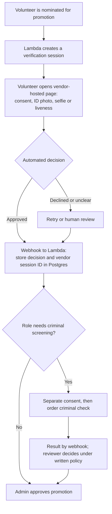

# Identity Verification for Volunteer Onboarding: BRD and Vendor Evaluation

> **How to read this document.** Facts about a provider carry a source link such as [S2]. Each link goes to the page in the appendix and was checked on **2026-11-23**. Text marked **Judgment** is the author's own assessment. Scores, weights, targets and recommendations are judgments. Prices are list prices in USD and can change.

## 1. Document control

| Field | Value |
|---|---|
| Title | Identity Verification for Volunteer Onboarding: BRD and Vendor Evaluation |
| Issue | saayam-for-all/data [#694][S1] |
| Authors | shendu-95 (assignee). Co-assignee: Gyashaswi |
| Date | 2026-11-23 |
| Version | 0.1 |
| Status | Draft |
| Reviewers | To be assigned by the maintainer |
| Scope of work done | Desk research using public pages only. No accounts created, no vendor sales contact, no ID or personal data uploaded, no credentials included. |

## 2. Executive summary

**Problem.** Saayam must verify a volunteer's identity before promoting them. Today this is manual and delegated to an external company [S1]. Volunteers upload many kinds of government ID, so leadership needs an automated provider and a clear rule for criminal-history screening.

**Key finding.** Two different jobs are involved, and no single provider reviewed does both:
1. **Identity check** (document authenticity, selfie or liveness match). Cost is low: about $0.33 to $1.50 per check.
2. **Criminal-record screening.** Cost is 20 to 90 times higher per check: $29.99 or more for a US check, and many countries restrict it.

**Recommendation (Judgment).**
- **Identity check: Didit**, piloted first. It has the lowest published price ($0.33 for document, liveness and face match), a free sandbox, a $10 monthly credit, and a watchlist add-on at $0.20 [S7][S8]. **Runner-up: Veriff** ($0.80 per check, $49 monthly minimum, 15-day trial) [S22].
- **Criminal screening: Checkr**, used only for roles that need it. It has a public API, a staging environment and public international prices [S37][S38][S39]. **Runner-up: Sterling Volunteers**, which is built for nonprofits and lets volunteers share the cost [S43][S44]. This needs a quote.
- **Stripe Identity is not recommended yet.** It is the easiest to integrate because Saayam already has a Stripe account, but its terms exclude identity checks used to decide employment eligibility under the US FCRA [S4]. Written confirmation from Stripe is needed first.

**Estimated monthly cost (list prices).**

| Volumes | Identity + watchlist (Didit) | Plus US criminal check for a share of volunteers |
|---|---|---|
| 100 per month | $43 | about $643 if 20% are screened |
| 500 per month | $255 | about $1,755 if 10% are screened |
| 1,000 per month | $520 | about $3,519 if 10% are screened |

**Main risks.** (1) Criminal checks are costly and can trigger FCRA duties for volunteers. (2) Stripe may not allow this use. (3) Didit is a young vendor and changed its pricing on 2026-11-01. (4) Criminal checks are restricted in some countries. (5) Face-based checks can trigger biometric-privacy laws.

**Decisions needed from leadership.**
1. Approve a pilot with 30 to 50 consenting volunteers.
2. Decide which roles need criminal screening, and who pays.
3. Approve a legal review (FCRA, biometric and GDPR rules).
4. Provide the list of countries where volunteers live.

## 3. Business context and problem statement

- Saayam promotes volunteers into roles that carry more trust. Before promotion it must confirm who the person is [S1].
- **Current process:** manual, delegated to an external company (phase 1) [S1]. Its cost, turnaround time and error rate are not known to the author (see section 17).
- **Cost of doing nothing (Judgment):** manual review does not scale with volunteer growth, reviewers see raw ID images, and Saayam has no consistent record of why a volunteer was approved.
- **Why now:** leadership must choose a provider [S1].

## 4. Objectives and success criteria

All targets are proposals (Judgment) and should be confirmed in the pilot.

| Objective | Metric | Proposed target | Reason |
|---|---|---|---|
| Fast decision | Median time from upload to automated decision | 5 minutes or less | Verification should not delay promotion. |
| Low cost | Identity check cost per verified volunteer | $1.00 or less at list price | Keeps identity checks small compared with criminal screening. |
| Trust | Known fraudulent or mismatched IDs approved in the pilot | 0 | Preventing this is the purpose of the project. |
| Smooth experience | Volunteers who pass on the first attempt | 80% or more | Low pass rates mean lost volunteers and extra manual work. |
| Limited manual work | Sessions sent to human review | 15% or less | Manual review is the cost being replaced. |
| Coverage | Volunteer countries with a working document type | 95% or more of volunteers | Confirmed with real documents only in the pilot. |
| Compliance | Volunteers with recorded consent before any check | 100% | Required by privacy and FCRA rules (section 13). |

## 5. Scope

| In scope | Out of scope |
|---|---|
| Document authenticity check | Building or deploying the integration |
| Selfie or liveness match to the document | Volunteer promotion rules |
| Criminal and watchlist screening | Payment or contract with a vendor |
| Business requirements, vendor evaluation, cost, risk | Legal advice (this document is not legal advice) |

## 6. Stakeholders and users

| Stakeholder | Needs |
|---|---|
| Volunteers | A short, mobile-friendly flow, clear consent, support for their own ID type and language. |
| Reviewers and admins | A clear decision with reason codes, a queue for unclear cases, and no need to handle raw ID images. |
| Leadership | Low and predictable cost, defensible trust decisions, and low legal exposure. |
| Engineering | A documented API, webhooks and a test environment that fit AWS Lambda, API Gateway, Python, Postgres and the web front end [S1]. |
| Maintainer | Approval before any account is created or any vendor is contacted [S1]. |

## 7. Current process and target process

**Current (phase 1):** manual and delegated to an external company [S1].

**Target (Judgment):**

Design choices (Judgment): use the vendor-hosted page so raw ID images do not enter Saayam systems, and store only the decision, reason code, timestamp and vendor session ID in Postgres.

## 8. Business requirements

Priority: Must, Should or Could. Requirements BR-01 to BR-06 cover the five needs in the issue [S1]. BR-07 and later are **proposed**.

| ID | Requirement | Priority | Rationale | Acceptance criterion |
|---|---|---|---|---|
| BR-01 | Check that the ID document is genuine | Must | Trust need in the issue | Provider returns pass or fail with a reason code; 90% or more of sessions decided within 5 minutes in the pilot. |
| BR-02 | Screen for criminal history or pending cases where legally allowed | Must | Trust need in the issue | At least one provider returns a criminal-record result for a pilot volunteer; list of countries where it is unavailable is documented. |
| BR-03 | Keep cost as low as possible | Must | Cost need in the issue | Identity check at $1.00 or less per check at list price; no annual lock-in for the pilot. |
| BR-04 | Support many countries and the document types volunteers upload | Must | Coverage need in the issue | Provider documents supported countries and ID types; pilot pass rate meets the target in section 4. |
| BR-05 | Integrate by API with Lambda, API Gateway, Python and Postgres | Must | Integration need in the issue | REST API, webhooks and a test environment exist, and a signed webhook can be received by a Lambda function. |
| BR-06 | Offer live camera capture (selfie or liveness) matched to the document | Should | Preferred feature in the issue | Selfie match result is part of the decision payload. |
| BR-07 | Screen against sanctions, PEP and adverse-media lists | Should (proposed) | The issue says "criminal or watchlist screening" | Available in the same API or as a clearly priced add-on. |
| BR-08 | Record consent and let Saayam delete a volunteer's data | Must (proposed) | Privacy law and trust | Deletion or redaction by API; configurable retention. |
| BR-09 | Use a vendor-hosted capture page | Should (proposed) | Keeps raw ID images out of Saayam systems | Raw images are not returned to or stored by Saayam by default. |
| BR-10 | Offer a human-review path for unclear cases | Should (proposed) | Avoids wrongly rejecting real volunteers | Review option available or a documented manual fallback. |
| BR-11 | No long-term contract for the pilot | Should (proposed) | Volume is uncertain for a nonprofit | Pay-per-use or monthly plan; no minimum term stated. |
| BR-12 | Keep an audit record of each decision | Should (proposed) | Defend decisions later | Decision, reason code, time and vendor session ID stored in Postgres. |
| BR-13 | Independent security certification | Should (proposed) | Vendor will handle sensitive ID data | SOC 2 Type 2 or ISO 27001 published. |

## 9. Market overview and shortlist

**How providers were found (Judgment).** I started with the three the issue names (Stripe Identity, Didit, ID.me) [S1]. I added three identity vendors that publish pricing and developer documentation (Persona, Veriff, Sumsub) so that at least five identity providers could be compared. The issue says criminal screening may need a separate provider [S1], so I added two screening providers: Checkr, which has an API, and Sterling Volunteers, which is built for volunteer organizations.

**Source rule.** Prices and features come from each vendor's own pricing, documentation or trust pages. Comparison pages written by competitors were not used for facts about the other vendor.

| # | Provider | Job | Why shortlisted |
|---|---|---|---|
| 1 | Stripe Identity | Identity | Named in the issue; Saayam already has a Stripe account [S1]. |
| 2 | Didit | Identity + watchlist | Named in the issue; public per-check prices [S7]. |
| 3 | ID.me | Identity | Named in the issue. |
| 4 | Persona | Identity + watchlist reports | Broad check library; sandbox [S14][S17]. |
| 5 | Veriff | Identity (+ sanctions add-on) | Public self-serve prices; trial [S22]. |
| 6 | Sumsub | Identity (+ AML in higher tier) | Public prices [S29]. |
| 7 | Checkr | Criminal and watchlist screening | API, staging, international prices [S37][S38]. |
| 8 | Sterling Volunteers | Criminal screening | Built for volunteers [S43]. |

Not reviewed (Judgment): other vendors such as Onfido (Entrust), Jumio, iDenfy and AU10TIX were not evaluated in depth. Six identity providers already meet the issue's minimum of five, so this is a scope choice and not a ranking.

## 10. Vendor evaluation

### 10.1 Coverage matrix

Legend: ✔ covered, ◐ partly or with conditions, ✖ not offered in the sources reviewed, ? not confirmed.

| Provider | Document authenticity | Liveness / selfie match | Criminal or pending cases | Watchlist (sanctions, PEP, adverse media) | Public price | API + test env |
|---|---|---|---|---|---|---|
| Stripe Identity | ✔ [S3] | ◐ selfie match and live-capture option; the word "liveness" is not used [S2] | ✖ [S2] | ✖ [S2] | ✔ [S2] | ✔ API [S5]; demo and sample project [S55] |
| Didit | ✔ [S7] | ✔ passive and active [S7] | ✖ lists do not mention criminal records [S7] | ✔ [S7] | ✔ [S8] | ✔ [S11] |
| Persona | ✔ [S14] | ✔ selfie [S14] | ✖ | ◐ report types exist; plan availability unclear [S14] | ◐ only the $250 plan floor [S14] | ✔ sandbox; API on paid plan [S16][S17] |
| Veriff | ✔ [S22] | ✔ [S22] | ✖ | ◐ add-on at +$0.64; plan eligibility unclear [S22] | ✔ [S22] | ✔ [S25] |
| Sumsub | ✔ [S29] | ✔ [S29] | ✖ | ◐ Compliance tier only [S29] | ✔ [S29] | ✔ [S31] |
| ID.me | ✔ US-focused [S35] | ✔ video selfie; agent video call for non-US users [S34] | ? not found | ? | ✖ on request [S36] | ◐ OAuth/OIDC and Services API; partner onboarding [S32][S33] |
| Checkr | ◐ identity document validation in international checks, $22 [S38] | ✖ | ✔ [S37][S38] | ✔ global watchlist [S37][S38] | ✔ [S37] | ✔ staging [S39] |
| Sterling Volunteers | ? | ? | ✔ criminal locator searches [S42] | ? | ◐ one university price list [S42] | ◐ link and partner integrations; direct API not confirmed [S45][S46] |

**Two-provider note.** No provider in the identity group offers criminal-record checks in the sources reviewed. Criminal screening needs Checkr or Sterling Volunteers. Sanctions, PEP and adverse-media lists are **not** the same as a criminal-record search (Judgment).

### 10.2 Weighted score: identity providers

Scale: 1 (weak) to 5 (strong). **All scores and weights are judgments.** Weights follow the order of the needs in the issue: trust, cost, coverage, integration, then live capture [S1]. I added a watchlist criterion because the issue mentions watchlist screening.

| Criterion | Weight | Why this weight |
|---|---|---|
| Trust: document and liveness assurance | 25 | The purpose of the project. |
| Cost at 500 checks per month | 25 | The issue asks for the lowest cost. |
| Country and document coverage | 15 | Volunteers upload varied IDs. |
| Integration fit with the Saayam stack | 15 | One-time effort, so lower than trust and cost. |
| Live camera capture | 10 | Preferred, not required [S1]. |
| Watchlist screening in the same flow | 10 | Useful, but criminal checks are a separate track. |

| Provider | Trust (25) | Cost (25) | Coverage (15) | Integration (15) | Live capture (10) | Watchlist (10) | **Total /100** |
|---|---|---|---|---|---|---|---|
| **Didit** | 3 | 5 | 4 | 4 | 5 | 4 | **82** |
| Persona | 5 | 3 | 4 | 4 | 5 | 3 | **80** |
| Veriff | 4 | 4 | 4 | 4 | 5 | 3 | **80** |
| Stripe Identity | 4 | 3 | 4 | 5 | 4 | 1 | **72** |
| Sumsub | 4 | 3 | 3 | 4 | 5 | 3 | **72** |
| ID.me | 5 | 1 | 2 | 2 | 4 | 1 | **52** |

Total = sum of (score × weight) ÷ 5.

**Scoring rules (Judgment).**
- *Cost:* 5 = $200 or less at 500 checks per month; 4 = $201 to $450; 3 = $451 to $800, or price not public but a plan floor exists; 1 = no public price.
- *Trust:* based on check breadth, published certifications and track record. Didit scores lowest of the mature options because its SOC 2 Type 2 report is only from July 2026 and most evidence is vendor-published [S9][S10].
- *Coverage:* every vendor states a large country count, so public data cannot separate them. Sumsub scores 3 because its own pages reviewed did not state coverage.
- *Integration:* 5 = existing Stripe account, API, webhooks and test mode; 4 = API, webhooks and a test environment; 2 = partner onboarding with redirect login.

**Sensitivity check.** The top three change little when weights change:

| Weight set | 1st | 2nd | 3rd |
|---|---|---|---|
| Base (above) | Didit 82 | Persona 80 | Veriff 80 (tie) |
| Cost-heavy (cost 40, trust 20) | Didit 86 | Veriff 80 | Persona 76 |
| Trust-heavy (trust 40, cost 10) | Persona 86 | Veriff 80 | Didit 76 |
| Equal weights | Didit 83 | Persona 80 | Veriff 80 (tie) |

**Judgment.** The gap between the top three is small. Veriff is in the top three under every weight set. Didit leads when cost matters more, and Persona leads when trust matters most.

### 10.3 Weighted score: criminal-screening providers

| Criterion | Weight | Checkr | Sterling Volunteers |
|---|---|---|---|
| Depth of criminal search | 30 | 4 | 3 |
| International reach and legal fit | 20 | 4 | 3 |
| Cost | 25 | 2 | 4 |
| API integration | 15 | 5 | 3 |
| Fit for volunteers and nonprofits | 10 | 3 | 5 |
| **Total /100** | | **71** | **69** |

With cost-heavy weights (cost 40, other weights scaled down) Sterling Volunteers leads, 72 to 64. With integration-heavy weights (integration 30, others scaled down) Checkr leads, 76 to 68. **Judgment:** this is close to a tie, and only a quote from Sterling Volunteers can settle it.

### 10.4 Provider profiles

**Stripe Identity**
- *Strengths:* $1.50 per verification, first 50 free [S2]; same Stripe account and API style; webhooks and data redaction by API [S5].
- *Limits:* terms bar using it to decide whether someone is eligible for employment, housing, credit, insurance or other FCRA purposes [S4]; no criminal or watchlist screening [S2]; it does not extract document fields written in Arabic, Chinese, Cyrillic, Greek, Hebrew, Korean, Tamil or Thai scripts [S3]; verification of under-16s, and of people in or linked to certain jurisdictions, is not allowed [S4].
- *Surprise:* Stripe says it keeps a copy of verification data [S6], and redaction can take up to 7 days [S5].

**Didit**
- *Strengths:* $0.33 full check; watchlist screening $0.20; free unlimited sandbox; hosted session link plus SDKs; webhooks [S8][S11]. SOC 2 Type 2 (issued 2026-07-30) and ISO 27001 [S9][S10].
- *Limits:* free credit is $10 per month, about 30 full checks, and does not roll over [S8]. Free API limit is 10 requests per minute [S12]. Watchlist lists cover sanctions, PEP and adverse media; the pricing page does not mention criminal-record lists [S7].
- *Surprises:* pricing changed on 2026-11-01. The free allowance moved from 500 free checks per month to a $10 credit [S8]. A March 2026 Didit blog post still describes free unlimited core KYC [S13], so older vendor content can be wrong. Didit's own pages disagree on the iBeta level (Level 1 on some, Level 1 and 2 on another) [S9][S10]; ask for the report.

**Persona**
- *Strengths:* broad check library (government ID, selfie, database checks, watchlist and adverse-media reports) [S14]; sandbox with forced pass or fail; hosted flow and webhooks [S17][S18][S19]; SOC 2 Type II, ISO 27001 and Kantara listed [S20]; maximum biometric retention of 3 years, confirmed by an independent code review [S21]; US or EU data center choice [S53].
- *Limits:* Essential starts at $250 per month with a 12-month minimum; per-verification price not public [S14]. The free Starter plan gives 500 government ID checks with optional selfie per month, but the page warns it may be out of date [S15]. Another Persona page lists API access under the Essential plan, so the free plan may have no API [S16].

**Veriff**
- *Strengths:* public prices: Essential $0.80 (minimum $49 per month), Plus $1.39 ($99), Premium $1.89 ($209) [S22]. 15-day trial with 50 free live verifications and unlimited sandbox [S22]. ISO 27001:2022, SOC 2 Type II and iBeta ISO 30107-3 Level 2 listed [S27]. 230+ countries and 12,500+ documents stated [S23].
- *Limits:* human review starts at the Plus plan [S22]. PEP and sanctions screening is +$0.64 per check, and the page does not make plan eligibility clear [S22]. Test sessions are not verified, and the tester must set decisions manually [S25].

**Sumsub**
- *Strengths:* public plans; free 14-day trial with 50 checks; charged for successful verifications only [S29]. SOC 2 Type 2, ISO 27001 and an iBeta Level 2 report listed [S30]. Sandbox and webhooks documented [S31].
- *Limits:* Basic $1.35 with a $149 monthly minimum; Compliance (adds AML) $1.85 with a $299 minimum [S29]. Both cost more than Didit and Veriff at low volume.

**ID.me**
- *Strengths:* high-assurance identity network used by government [S35].
- *Limits:* price on request [S36]. Access is through OAuth/OIDC and a Services API after partner onboarding; sandbox access is arranged by email [S32][S33]. Users outside the US verify by video call with an agent [S34]. A third-party review says it is weak for broad international coverage [S35]. No criminal screening was found.

**Checkr**
- *Strengths:* REST API, staging environment, webhooks [S39]; criminal checks in 200+ countries [S40]; public prices; ISO 27001 and SOC reports listed [S41].
- *Limits:* US Basic+ from $29.99 per check; a county search adds $15 when a possible record is found; pass-through fees apply [S37]. Self-serve is for fewer than 300 checks per year, and higher volume needs sales [S37]. Production access needs account approval, while staging is free and needs none (third-party report [S58]; confirm with Checkr).
- *Surprise:* in 24 locations only adverse-media screening is offered, because criminal information is restricted [S38].

**Sterling Volunteers**
- *Strengths:* built for volunteer programs; volunteers can share a check with other member nonprofits [S43]; volunteers can pay all or part of the cost [S44]; integrates with volunteer-management tools [S45][S46].
- *Limits:* the only public price found is a university's list: $19 (Level 2) and $39 (Level 3) per screening [S42]. This is not a Saayam price. Contents of each level, international coverage and direct API access were not confirmed.

## 11. Cost analysis

### 11.1 Pricing models (facts)

| Provider | Model | Price | Free allowance | Minimum |
|---|---|---|---|---|
| Stripe Identity | Per completed verification | $1.50 (ID + selfie); $0.50 US ID-number lookup | First 50 | None stated; custom pricing above 2,000 identities per month [S2] |
| Didit | Per check, prepaid credit | $0.33 full check; $0.20 watchlist | $10 credit per month | None; optional Growth $99 and Scale $299 plans [S7][S8] |
| Persona | Plans, pay per successful verification | Not public | Starter: 500 per month (may be outdated) [S15] | Essential from $250 per month, 12 months [S14] |
| Veriff | Per verification plus monthly minimum | $0.80 / $1.39 / $1.89 | 50 trial verifications | $49 / $99 / $209 per month [S22] |
| Sumsub | Per verification plus monthly minimum | $1.35 / $1.85 | 50 trial checks | $149 / $299 per month [S29] |
| ID.me | Contact sales | Not public [S36] | Unknown | Unknown |
| Checkr | Per report | US from $29.99; international from $32 [S37] | None | Self-serve under 300 checks per year [S37] |
| Sterling Volunteers | Per screening | $19 / $39 (university list) [S42] | None | Unknown |

### 11.2 Estimated monthly cost

Assumption: one verification = one completed ID document check with selfie or liveness. List prices; taxes excluded. Where a minimum applies, cost = the larger of the minimum and volume × price. **Calculated by the author** from the prices above.

| Monthly volume | Stripe Identity | Didit | Didit + watchlist | Veriff Essential | Sumsub Basic | Persona Essential | ID.me |
|---|---|---|---|---|---|---|---|
| 100 | $150 | $23 | $43 | $80 | $149 | at least $250 | on request |
| 500 | $750 | $155 | $255 | $400 | $675 | at least $250 | on request |
| 1,000 | $1,500 | $320 | $520 | $800 | $1,350 | at least $250 | on request |

Notes: Stripe's first 50 free verifications would lower month 1 by $75. Didit's figures subtract the $10 monthly credit. At 1,000 per month, Didit's Growth plan would cost about $301 instead of $320. Persona's per-check price is not public, so only the plan floor is shown.

**Criminal screening (separate, per check, US):**

| Monthly volume screened | Checkr US Basic+ ($29.99) | Sterling Level 2 ($19) | Sterling Level 3 ($39) |
|---|---|---|---|
| 100 | $2,999 | $1,900 | $3,900 |
| 500 | $14,995 | $9,500 | $19,500 |
| 1,000 | $29,990 | $19,000 | $39,000 |

Checkr adds $15 for a county search when needed, plus pass-through fees [S37]. International checks cost more in many countries: for example Canada $27, India $32, UK $68, Australia $81 [S38].

**Judgment:** screening every volunteer is unlikely to be affordable. Screening only the roles that need it keeps cost manageable. Example with Didit for identity and Checkr for 20% of 100 volunteers: $43 + $600 = about $643 per month.

### 11.3 Hidden costs

- Veriff extras: +$0.30 for extra data fields [S22], and extended 2-year data retention shows +$0.30 per verification on Veriff's demo page [S24].
- Checkr county searches ($15) and pass-through fees [S37].
- Didit credit resets monthly and does not roll over [S8].
- Failed or abandoned attempts: Stripe charges when the user completes verification [S2]; Sumsub charges successful verifications only [S29]; Persona bills successful verifications [S14].
- Engineering time to build the Lambda session and webhook handlers, and legal review time (not priced here).

### 11.4 Comparison with manual verification

Saayam's current manual cost is not known (section 17). **Illustration only (assumption, not a fact):** if a reviewer needs 10 minutes per case at $25 per hour, manual cost is about $4.17 per case: $417 at 100, $2,083 at 500 and $4,167 at 1,000 cases per month. Automated identity checks at $0.33 to $1.50 would be well below that. Manual review for unclear cases would still be needed.

## 12. Integration and technical fit

Target stack: AWS Lambda behind API Gateway, Python, Postgres, a web front end, and an existing Stripe account [S1]. Effort ratings are judgments.

| Provider | Hosted or embedded | API and SDK | Webhooks | Test environment | Fit with stack and Stripe account | Effort |
|---|---|---|---|---|---|---|
| Stripe Identity | Hosted page or front-end modal using a client secret [S5] | VerificationSession API, server SDKs [S5] | Yes, session events [S5] | Demo and sample project [S55]; test mode for Identity not separately confirmed | Same Stripe account (Judgment) | **Low**: reuses the existing account |
| Didit | Hosted URL, SDKs, redirect or iframe [S12] | REST `POST /v3/session/` [S11] | Yes [S11] | Free sandbox with scripted outcomes [S8][S11] | New vendor account; free API limit 10 per minute [S12] | **Low to medium**: new account and workflow setup |
| Persona | Hosted, embedded, mobile SDK [S18] | REST API; Essential plan lists API access [S16] | Yes [S19] | Sandbox, no charges [S17] | New vendor; API needs a paid plan | **Medium**: paid plan and contract needed |
| Veriff | Hosted no-code page [S22]; SDKs [S25] | REST `/v1/sessions` [S25] | Yes, signed with HMAC [S26] | Test integration; decisions set manually [S25] | New vendor | **Medium**: automated tests are harder |
| Sumsub | Web SDK [S56] | REST API [S31] | Yes [S31][S56] | Sandbox [S31] | New vendor | **Medium** |
| ID.me | OAuth/OIDC redirect [S32] | Services API [S32] | Yes [S32] | Sandbox on request [S33] | Partner onboarding required | **High** |
| Checkr | Candidate portal or API [S57] | REST API [S39] | Yes [S39] | Staging [S39] | New vendor; consent flow required | **Medium** |
| Sterling Volunteers | Link-based order and partner integrations [S45] | Direct API not confirmed | Callbacks via account manager [S45] | Unknown | New vendor | **Medium to high** (unknown) |

**Suggested pattern (Judgment):** one Lambda behind API Gateway creates a session and returns the vendor link. A second Lambda receives the signed webhook, verifies the signature, and writes the decision, reason code and vendor session ID to Postgres. A thin adapter layer keeps vendor-specific code in one place so the provider can be changed later.

## 13. Compliance, privacy and legal considerations

This section lists issues to raise with legal counsel. It is not legal advice.

| Topic | What the sources say | Impact |
|---|---|---|
| **US FCRA** | A secondary source reports that the FTC treats screening of volunteers for a nonprofit as "employment purposes" [S47]. SHRM notes the area is unsettled and courts have not always followed the FTC [S48]. Another source advises against assuming the FCRA does or does not apply without counsel [S49]. | A criminal check from a consumer reporting agency may require disclosure, written authorization and adverse-action steps. Plan for them. |
| **Stripe use-case limit** | Stripe bars use of Identity to decide eligibility for employment or other FCRA purposes [S4]. | Confirm with Stripe in writing before using it for volunteers. |
| **Biometric privacy (example: Illinois BIPA)** | The law covers scans of face geometry and requires informed written consent and a public retention and destruction policy [S50][S51]. Didit documents an explicit consent step for Illinois, Texas and Colorado [S9]. | Selfie or liveness checks need consent and a retention policy. |
| **GDPR and UK GDPR** | Criminal-offence data may be processed only under official authority or where law authorizes it, with safeguards [S52]. | Criminal checks on EU or UK volunteers may be restricted. Check the legal basis first. |
| **Countries without criminal checks** | Checkr offers only adverse-media screening in 24 locations: Afghanistan, Christmas Island, DR Congo, Cuba, Djibouti, French Guiana, French Polynesia, Guadeloupe, Guernsey and Alderney, Haiti, Hong Kong, Iran, Isle of Man, Israel, Jersey, Kiribati, Laos, Macao, Mauritania, Mayotte, Micronesia, Sierra Leone, Syria, Timor-Leste [S38]. Gibraltar, Equatorial Guinea and the Palestinian Territories show no turnaround time [S38]. | Volunteers in these places need another control. |
| **Sanctioned jurisdictions, minors** | Stripe does not allow verifying people in or linked to listed jurisdictions, residents of Russia or China, or anyone under 16 [S4]. | Affects volunteers in those places and younger volunteers. |
| **Data retention and deletion** | Stripe: redaction by API, up to 7 days [S5]. Didit: retention from 1 month to 10 years, default indefinite unless set [S9][S10]. Persona: maximum biometric retention 3 years [S21]. Veriff: retention schedule published [S28]. | Set the shortest retention that policy allows. |
| **Security certifications** | Didit SOC 2 Type 2 and ISO 27001 [S9][S10]; Veriff SOC 2 Type II and ISO 27001:2022 [S27]; Persona SOC 2 Type II and ISO 27001 [S20]; Sumsub SOC 2 Type 2 and ISO 27001 [S30]; Checkr ISO 27001 and SOC reports [S41]. | Ask for the reports under NDA before any contract. |

## 14. Risks, assumptions, dependencies and constraints

**Risks** (likelihood and impact are judgments)

| # | Risk | Likelihood | Impact | Mitigation |
|---|---|---|---|---|
| R1 | Stripe terms exclude this use [S4] | Medium | High | Get written confirmation from Stripe support before choosing it. |
| R2 | FCRA duties apply to volunteer criminal checks [S47] | Medium | High | Legal review; use an FCRA-compliant screening company; consent and adverse-action process. |
| R3 | Criminal screening cost grows faster than budget | High | High | Screen only roles that need it; ask volunteers to share cost if policy allows [S44]. |
| R4 | Vendor is young or changes prices (Didit changed on 2026-11-01) [S8] | Medium | Medium | Pilot first, no long contract, adapter layer, keep Veriff as fallback. |
| R5 | A volunteer's ID type or country is not supported | Medium | Medium | Pilot across volunteer countries; keep a manual fallback. |
| R6 | Biometric consent or retention failures | Low to medium | High | Explicit consent screen; written retention policy; short retention. |
| R7 | Leak of ID data | Low | High | Hosted vendor page; store only decisions; ask for SOC 2 report. |
| R8 | Criminal checks unavailable in some countries [S38][S52] | High | Medium | Alternative controls (reference, adverse-media, in-person or video review). |
| R9 | Real volunteers rejected by automation | Medium | Medium | Human-review path; multilingual support; retry rules. |
| R10 | Prices and terms in this document go out of date | High | Low | Re-check before signing; dates are in the appendix. |
| R11 | Many comparison pages are written by vendors | Medium | Medium | Facts come from each vendor's own pages; claims that could not be verified are marked. |

**Assumptions**
- Saayam is a US-based business, so Stripe Identity's "generally available" location applies [S4] (not confirmed).
- Monthly volumes of 100, 500 and 1,000 completed verifications.
- List prices without negotiated discounts.
- Only a share of volunteers needs criminal screening.

**Dependencies:** maintainer approval before any account or sales contact [S1]; legal review; list of volunteer countries; Stripe's written answer; quotes from Sterling Volunteers and Persona.

**Constraints:** public information only; no real IDs in demos; no credentials in this document [S1].

## 15. Recommendation

**Recommended combination (Judgment):**

| Job | Recommended | Runner-up |
|---|---|---|
| Identity (document, liveness, watchlist) | **Didit**, after a pilot | **Veriff** |
| Criminal screening, for roles that need it | **Checkr** | **Sterling Volunteers** (needs a quote) |

**Reasons**
1. Didit has the lowest published price and includes document check, liveness, face match and device analysis for $0.33. A watchlist screen adds $0.20 [S8].
2. It has documented API, webhooks and a free sandbox, which fit a Lambda and API Gateway design [S11].
3. Its security certifications are published [S9][S10], and the pilot limits exposure to its short track record.
4. Veriff is in the top three under every weight set, has public prices and a trial, and has a longer track record [S22][S27].
5. Checkr is the only screening provider with a documented API, a staging environment and public international prices [S37][S38][S39]. It can be driven from the same Lambda design.

**Choose differently if:**
- Stripe confirms in writing that volunteer identity checks are allowed, and leadership values using the existing account: choose **Stripe Identity** for simplicity. It costs more per check ($1.50) and has no watchlist.
- Trust is rated far above cost, or Didit's reports raise concerns: choose **Veriff** or **Persona**. Persona needs a $250 monthly plan and a 12-month term [S14].
- Leadership wants volunteers to pay or share screening cost: choose **Sterling Volunteers** [S44].
- Criminal screening is not needed for most roles: skip a screening vendor and use only the identity check plus watchlist.

**Not recommended:** ID.me for this use. Access is partner-based, price is not public, non-US users verify by video call, and it scored lowest [S32][S34][S36].

## 16. Proposed next steps

1. **Maintainer approval.** Ask the maintainer to approve sandbox accounts for Didit, Veriff and Checkr. Do this before creating any account or contacting sales [S1].
2. **Stripe question.** Ask Stripe support in writing whether volunteer identity checks fit its use-case rules [S4].
3. **Evidence.** Request Didit's Trust Pack (SOC 2 report, ISO certificate, iBeta report) under NDA [S9].
4. **Legal review.** FCRA for volunteers, biometric consent and retention, GDPR for EU and UK volunteers (section 13).
5. **Sandbox build (separate task).** Prototype the Lambda session and webhook flow against the Didit and Checkr test environments, using the vendors' test data only.
6. **Pilot.** With maintainer approval and volunteer consent, verify 30 to 50 volunteers across the main countries. Didit's $10 monthly credit covers about 30 full checks [S8], and Veriff's trial includes 50 live verifications [S22].
7. **Measure.** Pass rate, time to decision, human-review rate, cost per verified volunteer, volunteer complaints, and countries or ID types that failed (targets in section 4).
8. **Decide.** Go if the targets are met and legal review is clear. If not, switch to Veriff and repeat a smaller pilot.

## 17. Open questions

1. What do the current manual process and its external company cost, and how long does it take?
2. In which countries do Saayam volunteers live, and which ID types do they upload?
3. Which roles need criminal screening, and what policy decides pass or fail?
4. Who pays for screening: Saayam, the volunteer, or shared?
5. Are any volunteers under 18? Some providers exclude minors [S4].
6. What is the monthly budget for identity and screening?
7. Does Stripe allow Identity for volunteer verification [S4]?
8. Can Saayam use a vendor's free credit and nonprofit pricing, and will Sterling Volunteers and Persona quote prices?
9. Where must volunteer data be stored (US or EU)? Persona offers a choice of US or EU data centers [S53]; Didit documents EU as its default data residency [S54].
10. Who owns the retention policy and consent text?

## 18. Appendix

### 18.1 Sources

All pages were checked on **2026-11-23**. "Type": V = vendor page, G = government or law text, T = third party.

| ID | Source | Type |
|---|---|---|
| S1 | [Issue #694](https://github.com/saayam-for-all/data/issues/694) | Issue |
| S2 | [Stripe Identity product and pricing](https://stripe.com/identity) | V |
| S3 | [Stripe: document checks and availability](https://docs.stripe.com/identity/verification-checks.md?type=document) | V |
| S4 | [Stripe: supported use cases and locations](https://docs.stripe.com/identity/use-cases.md) | V |
| S5 | [Stripe: Verification Sessions API](https://docs.stripe.com/identity/verification-sessions) | V |
| S6 | [Stripe: before going live](https://docs.stripe.com/identity/before-going-live) | V |
| S7 | [Didit pricing](https://didit.me/pricing) | V |
| S8 | [Didit: pricing from 1 Nov 2026](https://didit.me/blog/new-pricing-november-2026/) | V |
| S9 | [Didit docs: security and compliance](https://docs.didit.me/getting-started/security-compliance) | V |
| S10 | [Didit: information security terms](https://didit.me/terms/information-security) | V |
| S11 | [Didit docs: API full flow](https://docs.didit.me/integration/api-full-flow) | V |
| S12 | [Didit docs: API overview and rate limits](https://docs.didit.me/api-reference/overview.md) | V |
| S13 | [Didit blog (13 Mar 2026): KYC costs](https://didit.me/blog/how-much-does-kyc-cost-pricing-models-hidden-fees-explained/) | V |
| S14 | [Persona pricing](https://withpersona.com/pricing) | V |
| S15 | [Persona: free verification plan](https://withpersona.com/blog/free-identity-verification) | V |
| S16 | [Persona: startup program and Essential plan](https://withpersona.com/startups) | V |
| S17 | [Persona docs: environments](https://docs.withpersona.com/docs/environments) | V |
| S18 | [Persona docs: hosted flow](https://docs.withpersona.com/hosted-flow) | V |
| S19 | [Persona docs: webhooks](https://docs.withpersona.com/webhooks) | V |
| S20 | [Persona security](https://withpersona.com/security) | V |
| S21 | [Persona: independent code review of data practices](https://withpersona.com/blog/independent-code-review-persona-data-practices) | V |
| S22 | [Veriff pricing](https://www.veriff.com/pricing) | V |
| S23 | [Veriff plans](https://veriff.com/plans) | V |
| S24 | [Veriff demo page (extras)](https://www.veriff.com/demo) | V |
| S25 | [Veriff docs: create an integration](https://devdocs.veriff.com/docs/how-to-create-an-integration) | V |
| S26 | [Veriff docs: webhooks guide](https://devdocs.veriff.com/docs/webhooks-guide) | V |
| S27 | [Veriff trust center](https://veriff.com/trust-center) | V |
| S28 | [Veriff data retention](https://www.veriff.com/data-retention/ver-vdr-2301) | V |
| S29 | [Sumsub pricing](https://sumsub.com/pricing/) | V |
| S30 | [Sumsub trust center](https://sumsub.com/sumsub-trust-center) | V |
| S31 | [Sumsub docs: FAQ](https://docs.sumsub.com/page/faq) | V |
| S32 | [ID.me API catalog (APIs.io)](https://apis.io/providers/idme/) | T |
| S33 | [ID.me integration readme (ForgeRock)](https://github.com/ForgeRock/ID.Me-Auth-Tree-Nodes) | T |
| S34 | [US VA: verify with ID.me outside the US](https://www.va.gov/resources/how-can-i-verify-my-identity-on-vagov-if-i-live-outside-the-us/) | G |
| S35 | [Start with Identity: ID.me profile](https://startwithidentity.com/vendors/identity-verification/id-me.md) | T |
| S36 | [Capterra: ID.me pricing on request](https://www.capterra.ca/software/201087/id-me) | T |
| S37 | [Checkr pricing](https://checkr.com/pricing) | V |
| S38 | [Checkr international pricing](https://checkr.com/pricing/international) | V |
| S39 | [Checkr API documentation](https://docs.checkr.com/) | V |
| S40 | [Checkr international background checks](https://checkr.com/international-background-checks) | V |
| S41 | [Checkr trust and security](https://engineering.checkr.com/trust-and-security) | V |
| S42 | [VCU: Sterling Volunteers levels and prices](https://equity.vcu.edu/protection-of-minors/background-check-platform/) | T |
| S43 | [Sterling: nonprofit and volunteer screening](https://www.sterlingcheck.com/industries/nonprofit/) | V |
| S44 | [VSys One: Sterling Volunteers integration (volunteer-paid option)](https://vsysone.com/pages/sterling) | T |
| S45 | [Rosterfy: Sterling Volunteers integration](https://www.rosterfy.com/knowledge/integrating-with-sterling-volunteers) | T |
| S46 | [Virtuous Volunteer: Sterling Volunteers API credentials](https://support.vomo.org/hc/en-us/articles/5410006903181) | T |
| S47 | [BackgroundChecks.com: FTC view of volunteer screening under the FCRA](https://backgroundchecks.com/blog/ftc-says-screening-of-volunteers-is-for-employment-purposes-under-the-fcra) | T |
| S48 | [SHRM: FCRA and independent contractors](https://www.shrm.org/topics-tools/news/talent-acquisition/fcra-apply-to-background-checks-independent-contractors) | T |
| S49 | [GCheck: volunteer vs employee checks](https://gcheck.com/?p=14655) | T |
| S50 | [Illinois BIPA (740 ILCS 14), definitions](https://law.justia.com/codes/illinois/2022/chapter-740/act-740-ilcs-14/?current=1) | G |
| S51 | [Illinois BIPA, Section 15](https://ilga.gov/legislation/ilcs/ilcs3.asp?ActID=3004) | G |
| S52 | [UK ICO: rules on criminal offence data (GDPR Article 10)](https://ico.org.uk/for-organisations/uk-gdpr-guidance-and-resources/lawful-basis/criminal-offence-data/what-are-the-rules-on-criminal-offence-data/) | G |
| S53 | [Persona privacy (US or EU data center)](https://withpersona.com/privacy?facet2=pdf) | V |
| S54 | [Didit docs: certifications and data residency](https://docs.didit.me/getting-started/certifications) | V |
| S55 | [Stripe Identity docs overview (demo, sample project)](https://docs.stripe.com/identity) | V |
| S56 | [Sumsub docs: WebSDK and webhooks](https://docs.sumsub.com/docs/gs-kyb-start) | V |
| S57 | [Checkr docs: partner integration, candidate portal](https://docs.checkr.com/partners/) | V |
| S58 | [StackOne: Checkr staging and production environments](https://docs.stackone.com/connectors/checkr/guides/connector-profile/api-key) | T |

### 18.2 Glossary

| Term | Meaning |
|---|---|
| AML | Anti-money-laundering. Screening against sanctions and similar lists. |
| BRD | Business requirements document. |
| FCRA | US Fair Credit Reporting Act. Governs background reports used for employment and similar purposes. |
| KYC | Know your customer. Identity verification. |
| Liveness | Check that a real person is present at the camera, not a photo or screen. |
| Face match | Comparison of a selfie with the photo on the ID document. |
| PEP | Politically exposed person. |
| Adverse media | News or public reports that mention a person in a negative context. |
| Passive and active liveness | Passive uses a still or short capture. Active asks the person to perform an action. |
| iBeta / ISO 30107-3 | Independent test standard for resistance to presentation attacks such as photos and masks. |
| SOC 2 Type 2 | Independent audit of security controls over a period of time. |
| ISO 27001 | International standard for information-security management. |
| BIPA | Illinois Biometric Information Privacy Act. |
| Webhook | An HTTP call from a vendor to Saayam when a result is ready. |
| Hosted page | A capture page run by the vendor, opened through a link. |
| Sandbox | A test environment that does not run real checks or charge fees. |

[S1]: https://github.com/saayam-for-all/data/issues/694
[S2]: https://stripe.com/identity
[S3]: https://docs.stripe.com/identity/verification-checks.md?type=document
[S4]: https://docs.stripe.com/identity/use-cases.md
[S5]: https://docs.stripe.com/identity/verification-sessions
[S6]: https://docs.stripe.com/identity/before-going-live
[S7]: https://didit.me/pricing
[S8]: https://didit.me/blog/new-pricing-november-2026/
[S9]: https://docs.didit.me/getting-started/security-compliance
[S10]: https://didit.me/terms/information-security
[S11]: https://docs.didit.me/integration/api-full-flow
[S12]: https://docs.didit.me/api-reference/overview.md
[S13]: https://didit.me/blog/how-much-does-kyc-cost-pricing-models-hidden-fees-explained/
[S14]: https://withpersona.com/pricing
[S15]: https://withpersona.com/blog/free-identity-verification
[S16]: https://withpersona.com/startups
[S17]: https://docs.withpersona.com/docs/environments
[S18]: https://docs.withpersona.com/hosted-flow
[S19]: https://docs.withpersona.com/webhooks
[S20]: https://withpersona.com/security
[S21]: https://withpersona.com/blog/independent-code-review-persona-data-practices
[S22]: https://www.veriff.com/pricing
[S23]: https://veriff.com/plans
[S24]: https://www.veriff.com/demo
[S25]: https://devdocs.veriff.com/docs/how-to-create-an-integration
[S26]: https://devdocs.veriff.com/docs/webhooks-guide
[S27]: https://veriff.com/trust-center
[S28]: https://www.veriff.com/data-retention/ver-vdr-2301
[S29]: https://sumsub.com/pricing/
[S30]: https://sumsub.com/sumsub-trust-center
[S31]: https://docs.sumsub.com/page/faq
[S32]: https://apis.io/providers/idme/
[S33]: https://github.com/ForgeRock/ID.Me-Auth-Tree-Nodes
[S34]: https://www.va.gov/resources/how-can-i-verify-my-identity-on-vagov-if-i-live-outside-the-us/
[S35]: https://startwithidentity.com/vendors/identity-verification/id-me.md
[S36]: https://www.capterra.ca/software/201087/id-me
[S37]: https://checkr.com/pricing
[S38]: https://checkr.com/pricing/international
[S39]: https://docs.checkr.com/
[S40]: https://checkr.com/international-background-checks
[S41]: https://engineering.checkr.com/trust-and-security
[S42]: https://equity.vcu.edu/protection-of-minors/background-check-platform/
[S43]: https://www.sterlingcheck.com/industries/nonprofit/
[S44]: https://vsysone.com/pages/sterling
[S45]: https://www.rosterfy.com/knowledge/integrating-with-sterling-volunteers
[S46]: https://support.vomo.org/hc/en-us/articles/5410006903181
[S47]: https://backgroundchecks.com/blog/ftc-says-screening-of-volunteers-is-for-employment-purposes-under-the-fcra
[S48]: https://www.shrm.org/topics-tools/news/talent-acquisition/fcra-apply-to-background-checks-independent-contractors
[S49]: https://gcheck.com/?p=14655
[S50]: https://law.justia.com/codes/illinois/2022/chapter-740/act-740-ilcs-14/?current=1
[S51]: https://ilga.gov/legislation/ilcs/ilcs3.asp?ActID=3004
[S52]: https://ico.org.uk/for-organisations/uk-gdpr-guidance-and-resources/lawful-basis/criminal-offence-data/what-are-the-rules-on-criminal-offence-data/
[S53]: https://withpersona.com/privacy?facet2=pdf
[S54]: https://docs.didit.me/getting-started/certifications
[S55]: https://docs.stripe.com/identity
[S56]: https://docs.sumsub.com/docs/gs-kyb-start
[S57]: https://docs.checkr.com/partners/
[S58]: https://docs.stackone.com/connectors/checkr/guides/connector-profile/api-key
