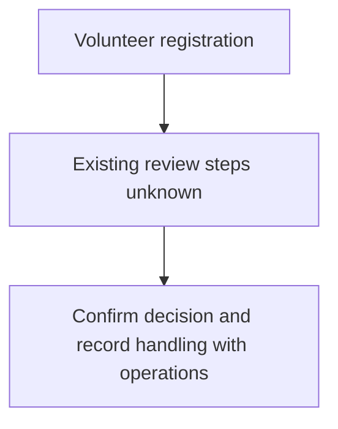
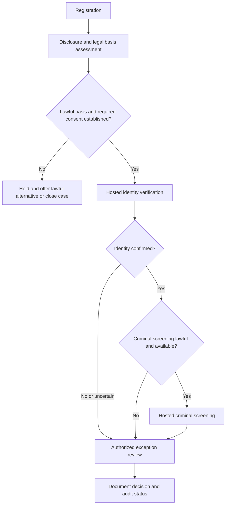

# Business Requirements Document — Volunteer Identity Verification

## 1. Document control

| Field | Value |
|---|---|
| Issue | #694 — Product analysis: Identity verification for volunteer onboarding |
| Author | Anvitha Sathenapally |
| Date | 2026-11-26 |
| Version | 0.3 |
| Status | Draft — stakeholder review; source validation incomplete |
| Reviewers | Product, volunteer operations, engineering, privacy/legal, finance; names TBD |

## 2. Executive summary

Saayam needs a trustworthy, affordable way to verify government-issued IDs of international volunteers and assess criminal history and pending cases where legally permissible. Visual inspection alone cannot establish document authenticity or criminal history. Initially, administrators should use an external provider's hosted workflow rather than build an integration.

Recommend evaluating Didit for identity verification and Checkr for country-specific criminal screening, with Veriff + Checkr as runner-up and Sterling as a potential lower-cost screening alternative. No provider or combination has demonstrated all mandatory requirements globally. Based on preliminary public-rate research, Didit + Checkr international screening starts at an illustrative $32.33 per applicant ($16,165 for 500), exceeding the proposed $10 combined target. International packages may substitute adverse media for criminal searches; this is not equivalent. Approval is requested for country-level legal and coverage assessment, budget confirmation and a controlled pilot, not procurement or production rollout.

## 3. Context and problem

The requested initial operating model is manual administration with outsourced verification. Actual current onboarding volumes, review times, fraud incidents and existing document-handling procedures have not been measured. Without reliable verification, impersonation, inconsistent decisions, privacy exposure and volunteer safety risks remain. Internal visual review cannot reliably authenticate documents or establish criminal-record status.

## 4. Objectives and success measures

All numerical targets below are proposed, not approved service levels.

| Objective | Target | Rationale |
|---|---|---|
| Identity turnaround | Automated result within 5 minutes | Reduce friction |
| Exception turnaround | Within 2 business days | Avoid unresolved applications |
| Background turnaround | Within 5 business days where supported | Predictable onboarding |
| Identity cost | At most $2 per applicant | Nonprofit affordability |
| Combined cost | At most $10 where feasible | Budget planning; current estimates exceed target |
| Geographic coverage | At least 95% of actual applicant population | Measure against country distribution, not advertised country counts |
| Completion | At least 90% of pilot participants | Usability |
| Consent and audit | 100% of applicable cases | Accountability |

## 5. Scope

In scope: business requirements, public vendor research, pricing, manual hosted workflows, future integration feasibility, privacy and legal constraints, pilot recommendation. Out of scope: implementation, production accounts, real IDs or personal data, sales outreach, credentials, procurement, promotion rules and automated eligibility decisions.

## 6. Stakeholders

| Stakeholder | Needs |
|---|---|
| Volunteers | Accessible, understandable, secure verification and dispute channels |
| Volunteer operations | Clear statuses, exceptions, manageable workload |
| Product leadership | Trust, coverage, measurable outcomes |
| Finance | Predictable cost and budget approval |
| Engineering | Hosted workflow and future API compatibility |
| Privacy/legal | Lawful purpose, consent, minimization, retention, transfers and redress |
| Security | Least privilege, auditability, secure vendor handling |

## 7. Current and target process

Current process is not independently documented; validate with operations. The proposed target starts with manual vendor administration. Saayam retains decision responsibility.

**Current state (discovery model, not a confirmed workflow):**

**Proposed target:**

Future architecture: web frontend requests a hosted session through API Gateway and Python Lambda; authenticated vendor callbacks update PostgreSQL with minimal status and reference metadata. Avoid raw IDs, biometric images and full reports in ordinary application storage. Verify signatures, handle retries idempotently and restrict reviewer access. No implementation is proposed in this issue.

## 8. Business requirements

M = Must; S = Should. Proposed additions are explicitly marked. Acceptance criteria are proposed pending approval.

| ID | Requirement | Priority | Origin | Rationale | Acceptance criterion |
|---|---|---|---|---|---|
| BR-01 | Authenticate government ID | M | Original | Prevent impersonation | Document authenticity outcome and reason available |
| BR-02 | Criminal history and pending cases where lawful | M | Original | Volunteer safety | Country-specific sources and scope documented; unavailable results explicitly flagged |
| BR-03 | Affordable verification | M | Original | Sustainability | Approved total cost including fees; compare proposed targets |
| BR-04 | International coverage | M | Original | Global onboarding | Country matrix covers at least 95% of actual applicant mix, proposed |
| BR-05 | Passport, license, national ID | M | Original | Inclusive onboarding | Supported document types confirmed per target country |
| BR-06 | Future API compatibility | M | Original | Existing stack | Hosted/API workflow mapped to Lambda, API Gateway, Python, PostgreSQL and web frontend |
| BR-07 | Live camera, selfie match and liveness | S | Original | Reduce impersonation | Documented live capture and matching; authorized test outcomes |
| BR-08 | Privacy and consent | M | Proposed | Lawful processing | Approved disclosures, legal basis and vendor agreement |
| BR-09 | Retention and deletion | M | Proposed | Minimize exposure | Approved retention schedule and deletion procedure |
| BR-10 | Manual exceptions | M | Proposed | Fair review | Failed, disputed and unavailable checks routed to authorized reviewer |
| BR-11 | Turnaround | S | Proposed | Timely onboarding | Measure against Section 4 targets |
| BR-12 | Audit and status | M | Proposed | Accountability | Every case has status, timestamp, reference and decision reason |
| BR-13 | Sandbox | M | Proposed | Safe testing | Synthetic test outcomes without real personal data |
| BR-14 | Accessibility and UX | S | Proposed | Inclusion | Pilot completion target and accessible alternative route |
| BR-15 | Watchlist screening | S | Proposed | Supplement risk assessment | Potential matches reviewed; never treated as criminal proof |

## 9. Market shortlist and method

Eight candidates selected for existing Stripe relationship, international identity capabilities, pricing visibility, or dedicated volunteer/criminal screening. Public documentation only; no vendor contact or account creation. Identity providers: Stripe Identity, Didit, ID.me, Sumsub, Veriff, Persona. Screening providers: Checkr and Sterling/First Advantage. Selection criteria: relevance to government ID or criminal screening, international applicability, public evidence, affordability and hosted or future API feasibility. Include Stripe, Didit and ID.me as requested; retain screening specialists because identity checks alone do not meet BR-02. Unknown pricing or eligibility is a research gap, not proof of unsuitability. This is not an exhaustive market survey. Source register in Section 18 contains preliminary research references requiring reopening before submission.

## 10. Vendor coverage and weighted evaluation

F = documented functional support in evaluated scope; P = conditional/partial; U = insufficient evidence. These are preliminary analyst classifications, not acceptance-test results. Sources: STR, DID, IDM, SUM, VER, PER, CHK, STE in Section 18.

| Requirement | Stripe | Didit | ID.me | Sumsub | Veriff | Persona | Checkr | Sterling |
|---|---|---|---|---|---|---|---|---|
| BR-01 | F | F | F | F | F | F | P | U |
| BR-02 | U | U | U | U | U | U | P | P |
| BR-03 | P | P | U | P | P | P | P | P |
| BR-04 | P | P | P | P | P | P | P | P |
| BR-05 | F | F | F | F | F | F | P | U |
| BR-06 | P | P | P | P | P | P | P | P |
| BR-07 | P | F | F | F | F | F | P | U |
| BR-08 | P | P | P | P | P | P | P | P |
| BR-09 | U | P | P | U | P | P | P | U |
| BR-10 | P | P | F | F | P | F | F | F |
| BR-11 | U | U | U | U | U | U | U | P |
| BR-12 | P | P | P | P | P | P | P | P |
| BR-13 | P | F | F | F | F | F | P | P |
| BR-14 | P | P | P | P | P | P | P | P |
| BR-15 | U | F | U | F | F | F | F | F |

Weights: identity 20%, criminal screening 20%, cost 20%, coverage 15%, integration 10%, privacy 10%, operations 5%. Trust and cost are core priorities; coverage supports global onboarding; integration, privacy and operations support sustainable delivery. Scores 0–5: 0 no evidence, 1 minimal, 2 limited, 3 conditional, 4 good, 5 strong documented capability. Total = sum(weight × score / 5). Mandatory gaps override ranking. Scores are judgment, not measured performance. Coverage measures expected breadth, not confirmed applicant eligibility; privacy scores reflect apparent controls, not legal compliance. Cost scores reflect indicative affordability and pricing visibility, not contractual quotes. Operations scores reflect apparent review and workflow support, not measured turnaround. All scores are provisional and require evidence review.

| Vendor | Identity | Criminal | Cost | Coverage | Integration | Privacy | Ops | Total /100 |
|---|---:|---:|---:|---:|---:|---:|---:|---:|
| Stripe | 4 | 0 | 4 | 3 | 5 | 3 | 3 | 60.0 |
| Didit | 5 | 0 | 5 | 4 | 4 | 3 | 3 | 69.0 |
| ID.me | 5 | 0 | 0 | 4 | 3 | 3 | 3 | 47.0 |
| Sumsub | 5 | 0 | 3 | 4 | 4 | 2 | 4 | 60.0 |
| Veriff | 5 | 0 | 4 | 4 | 4 | 3 | 4 | 66.0 |
| Persona | 5 | 0 | 2 | 4 | 4 | 4 | 4 | 60.0 |
| Checkr | 3 | 4 | 1 | 3 | 4 | 3 | 4 | 59.0 |
| Sterling | 0 | 4 | 0 | 2 | 2 | 2 | 4 | 34.0 |

| Vendor | Strength / scoring rationale | Limitation / notable finding |
|---|---|---|
| Stripe [STR-02, STR-03, STR-04, STR-05, STR-07] | Existing account, hosted identity and API | Volunteer use eligibility and independent liveness need confirmation; criminal checks unestablished |
| Didit [DID-02, DID-03, DID-04, DID-05] | Low preliminary unit price, document and biometric checks | Conflicting free-tier descriptions; criminal checks unestablished |
| ID.me [IDM-03, IDM-04, IDM-05, IDM-06, IDM-07, IDM-08] | Assisted and reusable identity | Pricing unknown; international workflows may impose extra steps |
| Sumsub [SUM-02, SUM-03, SUM-05, SUM-06, SUM-07, SUM-09] | Identity, AML and reviewer workflows | Monthly minimum; criminal watchlists not court searches |
| Veriff [VER-02, VER-03, VER-04, VER-05, VER-06] | Competitive identity pricing, human review on qualifying plans | Plan-specific review/deletion and retention concerns |
| Persona [PER-02, PER-03] | Configurable workflows and privacy controls | Annual commitment and service-unit billing uncertainty |
| Checkr [CHK-02, CHK-03, CHK-04, CHK-05, CHK-06, CHK-07] | Dedicated criminal screening and US biometric capability | International adverse media may substitute for criminal search; high cost |
| Sterling [STE-01, STE-02, STE-03, STE-04] | Volunteer-specific screening and reusable reports | International volunteer pricing and parent API compatibility unknown |

Combined options (same weights; analyst scores):

| Option | Identity | Criminal | Cost | Coverage | Integration | Privacy | Ops | Total |
|---|---:|---:|---:|---:|---:|---:|---:|---:|
| Didit + Checkr | 5 | 4 | 1 | 3 | 3 | 3 | 3 | 64.0 |
| Veriff + Checkr | 5 | 4 | 1 | 3 | 3 | 3 | 3 | 64.0 |
| Stripe + Checkr | 4 | 4 | 1 | 3 | 4 | 3 | 3 | 62.0 |
| Didit + Sterling | 5 | 4 | 0 | 2 | 2 | 2 | 3 | 53.0 |
| Checkr alone | 3 | 4 | 1 | 3 | 4 | 3 | 4 | 59.0 |

Veriff Essential is scored without assuming higher-tier human review. ID.me and Sterling receive zero cost-evidence points because comparable international rates are unavailable; this is an evidence penalty, not a finding of unaffordability. No combination passes all mandatory gates.

## 11. Pricing and cost analysis

USD, preliminary research estimates, not quotations. All vendor pricing figures are provisional and require independent verification against current official pricing pages. Monthly minimum model: max(minimum, volume × unit rate), where applicable. Exclude taxes, retries, optional checks, setup, court fees and internal labor.

| Vendor/plan | Unit rate | Minimum/commitment | Trial/free notes | 100 | 500 | 1,000 |
|---|---:|---|---|---:|---:|---:|
| Stripe Identity [STR-01] | $1.50 | Unconfirmed | First 50 free, eligibility pending | $150 | $750 | $1,500 |
| Didit identity [DID-01] | $0.33 | $0/month | $10 monthly credit for eligible work-email sign-ups; not deducted | $33 | $165 | $330 |
| Didit identity + watchlist [DID-01] | $0.53 | Same assumption | Not criminal screening | $53 | $265 | $530 |
| ID.me [IDM-01] | Unknown | Contact sales | Unknown | Unknown | Unknown | Unknown |
| Sumsub Basic [SUM-01] | $1.35 | $149/mo | Trial conditional | $149 | $675 | $1,350 |
| Sumsub Compliance [SUM-01] | $1.85 | $299/mo | Trial conditional | $299 | $925 | $1,850 |
| Veriff Essential [VER-01] | $0.80 | $49/mo | Trial conditional | $80 | $400 | $800 |
| Veriff Plus [VER-01] | $1.39 | $99/mo | Trial conditional | $139 | $695 | $1,390 |
| Veriff Premium [VER-01] | $1.89 | $209/mo | Trial conditional | $209 | $945 | $1,890 |
| Persona Essential [PER-01] | Unknown | $250/mo starting; 12 months | Service-based allowance; eligibility pending | $250+ | $250+ | $250+ |
| Checkr US Basic [CHK-01] | $29.99 | Unconfirmed | No recurring free tier established | $2,999 | $14,995 | $29,990 |
| Checkr US Essential [CHK-01] | $59.99 | Unconfirmed | Same | $5,999 | $29,995 | $59,990 |
| Checkr US Complete [CHK-01] | $94.99 | Unconfirmed | Same | $9,499 | $47,495 | $94,990 |
| Checkr International Basic [CHK-01] | $32+ | Country-dependent | Same | $3,200+ | $16,000+ | $32,000+ |
| Sterling volunteer illustration [STE-01] | $10 | Unknown | No free tier established | $1,000 | $5,000 | $10,000 |
| Sterling international [STE-01] | Unknown | Contact sales | Unknown | Unknown | Unknown | Unknown |

Sources: vendor pricing references in Section 18. Didit list price includes document, passive liveness, face matching and device/IP analysis; AML costs $0.20 separately [DID-01]. Veriff Plus and Premium add specialist review; Premium adds API session deletion. Veriff trial is 15 days/up to 50 live sessions; sandbox is available and retries are not billed as separate decisions [VER-01]. Sumsub Basic includes liveness and face matching; Compliance adds AML and address checks [SUM-01]. Stripe charges for completed document/selfie verification [STR-01]. Persona values are subscription floors, not full costs; the assumed 12-month commitment implies a $3,000 annual floor. Introductory offers and credits are excluded from estimates. Sterling illustration is not an international quote. Checkr International Basic starts at $32 and includes criminal OR adverse-media search plus global watchlist; pricing varies by country. Professional and Professional+ start at $102 and $124 respectively [CHK-01]. None establishes pending-case coverage globally.

| Combined scenario | 100 | 500 | 1,000 |
|---|---:|---:|---:|
| Didit + Checkr International [DID-01] | $3,233+ | $16,165+ | $32,330+ |
| Veriff Essential + Checkr International [VER-01] | $3,280+ | $16,400+ | $32,800+ |
| Stripe + Checkr International [STR-01] | $3,350+ | $16,750+ | $33,500+ |
| Didit + Sterling illustration [DID-01] | $1,033 | $5,165 | $10,330 |

Hidden costs: document retries, manual reviews, watchlist add-ons, monitoring, storage/deletion upgrades, SMS, court/repository fees, international surcharges, contract minimums, integration and dispute handling. Contact-sales items remain unresolved; no outreach authorized.

Manual comparison (illustrative): 15 minutes per applicant at $20/hour = $5 economic labor cost per applicant. Didit at $0.33 plus 10% exceptions requiring 10 minutes at $20/hour = approximately $0.663 per applicant. At 500 applicants: $2,500 and 125 hours manual versus $331.67 and 8.33 exception hours vendor-assisted. Estimated difference $2,168.33, excluding routine review, administration, criminal screening and setup. This is an exception-only scenario, not a measured initial manual hosted workflow; routine case handling must be timed separately. Volunteer time may not be cash expenditure; verification quality is not equivalent. Validate assumptions with operations.

## 12. Integration feasibility

| Vendor | Hosted / embedded / SDK | API / callbacks / sandbox | Effort and rationale |
|---|---|---|---|
| Stripe [STR-02, STR-03, STR-04, STR-05, STR-07] | Hosted, modal, mobile SDK | REST, webhooks, test mode | Low relative effort if existing account eligible |
| Didit [DID-02, DID-03, DID-04, DID-05] | Hosted/no-code, SDK | REST, webhooks, sandbox | Medium: new workflow and vendor |
| ID.me [IDM-03, IDM-04, IDM-05, IDM-06, IDM-07, IDM-08] | Hosted/pop-up, SDK unverified | REST/OIDC, callbacks, sandbox; full webhook scope unknown | Medium: token and policy configuration |
| Sumsub [SUM-02, SUM-03, SUM-05, SUM-06, SUM-07, SUM-09] | Hosted links, WebSDK, mobile SDK | REST, webhooks, sandbox | Medium: signed requests and workflow configuration |
| Veriff [VER-02, VER-03, VER-04, VER-05, VER-06] | Hosted, web/mobile SDK | REST, webhooks, test integration | Medium: session and decision mapping |
| Persona [PER-02, PER-03] | Hosted, iframe/modal, mobile SDK | REST, webhooks, sandbox; direct ID API tier-dependent | Medium: inquiry templates and plan constraints |
| Checkr [CHK-02, CHK-03, CHK-04, CHK-05, CHK-06, CHK-07] | Hosted candidate flow; US embedded options | REST, webhooks, staging access conditional | Medium hosted; high self-hosted compliance effort |
| Sterling [STE-01, STE-02, STE-03, STE-04] | Hosted volunteer portal; SDK unverified | Parent API/sandbox; volunteer callbacks unverified | High future integration uncertainty; manual phase simpler |

All REST-based integrations are conceptually compatible with Python Lambda/API Gateway and PostgreSQL status storage; no integration has been tested. Existing Stripe account is a potential advantage only for Stripe. Manual phase requires confirmation that authorized dashboard users can initiate hosted checks without engineering work. Sandbox simulations cannot prove real-world accuracy.

## 13. Privacy, compliance and consent

Require lawful purpose and jurisdiction-specific legal basis before collecting IDs or criminal information. Consent alone may not authorize criminal-record processing (including GDPR Article 10 restrictions). Review US FCRA applicability, disclosures, authorization, dispute and adverse-action obligations with counsel. Provide biometric notice and applicable consent, accessible alternatives, data subject rights and cross-border safeguards. Do not equate arrests, pending cases, adverse media or watchlist matches with guilt. Do not infer a clean record from missing coverage.

Vendor due diligence (questions to confirm, not established contractual terms): Stripe use-case restrictions and retention; Didit plan-specific retention/deletion; ID.me wallet and biometric retention; Sumsub DPA and residency; Veriff archival retention and secondary use; Persona configured deletion and service tiers; Checkr report retention and consumer rights; Sterling volunteer-product DPA and international transfers. All require contractual confirmation. Public-policy due diligence should explicitly confirm controller/processor roles, biometric deletion triggers, archival retention, secondary use, subprocessors, residency and applicant dispute rights. Do not assume deletion on account closure or a universal retention period. Candidate privacy references: IDM-09, IDM-10, VER-07, VER-08, VER-09, PER-03; other vendor-specific retention and transfer evidence remains outstanding. Store minimum necessary status metadata, enforce role-based access, encryption and audit logs; define deletion and incident response procedures before production.

## 14. Risks, assumptions, dependencies and constraints

| Risk | Likelihood | Impact | Mitigation |
|---|---|---|---|
| Criminal sources unavailable | High | High | Country-level legal/coverage matrix; hold and escalate |
| Budget exceeds target | High | High | Approve budget or formally revise scope; do not silently omit checks |
| False match or inaccurate report | Medium | High | Human review, dispute and correction |
| Sensitive data exposure | Medium | High | Hosted collection, minimization, access controls and deletion |
| Biometric exclusion or abandonment | Medium | High | Accessible assisted alternative |
| Vendor lock-in or pricing changes | Medium | Medium | Portable status model and alternative provider |
| Webhook failure | Medium | Medium | Future signature verification, retries and reconciliation |
| Vendor outage | Medium | High | Hold cases and define fallback procedures |
| Unauthorized reviewer access | Medium | High | Access reviews and least privilege |
| Unclear biometric retention | Medium | High | Approve deletion terms before procurement |
| Inconsistent international screening | High | High | Define country-specific sources and limitations |
| Missed deadline | High | High | Confirm extension with issue owner |

Assumptions: proposed volumes 100/500/1,000, USD, manual labor assumptions in Section 11, existing Stripe account. Dependencies: country mix, legal approval, finance budget, vendor eligibility, privacy agreement, authorized pilot. Constraints: no real personal data, accounts, credentials, sales contact or implementation under this issue. Original deadline November 22, 2026 has passed; extension unconfirmed.

## 15. Recommendation

Evaluate Didit + Checkr first as a provisional cost-based preference over Veriff + Checkr (equal weighted scores; $235 lower estimated cost at 500 applicants), conditional on lawful coverage and approved budget. Runner-up Veriff + Checkr if plan-specific operational benefits justify cost. Consider Stripe + Checkr if existing-account eligibility and reduced effort outweigh price; Didit + Sterling if equivalent country-level screening and pricing are confirmed; Checkr alone for eligible US workflows if consolidated pricing is acceptable. No production selection is justified yet. The $10 combined target is not demonstrated. Leadership must approve any scope or budget change.

## 16. Pilot and next steps

First validate sources, country distribution, legal authority, vendor eligibility, contract and budget. Obtain separate authorization before any account or real-data activity. Proposed initial pilot: 20–30 synthetic scenarios, including supported/unsupported documents, failure, abandonment, disputed match, unavailable criminal screening, consent and deletion. Measure simulated workflow completion, status correctness and exception routing; require 100% correct audit and consent handling. Simulate criminal screening outcomes locally or through authorized test fixtures; do not order real criminal searches. Synthetic tests cannot measure actual fraud accuracy, criminal-source completeness or real turnaround. A later separately authorized real-world pilot should measure Section 4 targets and actual costs. Product, operations, privacy/legal and finance jointly decide go/no-go; mandatory gaps block rollout.

## 17. Open questions

- What are actual applicant volumes, country distribution, document types and current review times?
- What is the approved budget and who funds checks?
- Which jurisdictions permit volunteer criminal and pending-case screening, and which sources are available?
- What eligibility policy and dispute process apply to unavailable or contested records?
- Does Stripe permit this volunteer use case? Do other vendors accept Saayam's organization and countries?
- Which plans include hosted manual initiation, biometric checks, deletion and review tools?
- What are contractual retention, residency, subprocessors, transfer and secondary-use terms?
- What are actual per-applicant costs including retries and court fees?
- Who approves the pilot and revised issue deadline?

## 18. Sources and glossary

Research register: STR-01, DID-01, SUM-01, VER-01 and CHK-01 are candidate references for the preliminary pricing and plan features in Section 11; independent verification remains outstanding. Other references are carried-forward candidates (reported research date 2026-11-26); exact claims and access dates remain unconfirmed in this revision. Bracketed IDs alone do not establish verification. Unconfirmed vendor claims remain hypotheses; do not use them for procurement. No vendor accounts or live checks were used.

| ID | Official reference |
|---|---|
| STR-01 (verification pending) | https://stripe.com/identity |
| STR-02 | https://docs.stripe.com/identity |
| STR-03 | https://docs.stripe.com/identity/verification-checks?type=document |
| STR-04 | https://docs.stripe.com/identity/verification-checks?type=selfie |
| STR-05 | https://docs.stripe.com/identity/use-cases |
| STR-06 | https://docs.stripe.com/identity/verify-identity-documents |
| STR-07 | https://docs.stripe.com/identity/handle-verification-outcomes |
| DID-01 (verification pending) | https://didit.me/pricing/ |
| DID-02 | https://didit.me/supported-documents/ |
| DID-03 | https://didit.me/solutions/full-kyc-onboarding/ |
| DID-04 | https://docs.didit.me/core-technology/aml-screening/warnings-aml-screening |
| DID-05 | https://docs.didit.me/core-technology/reusable-kyc/overview |
| IDM-01 | https://www.id.me/business/identity-verification |
| IDM-02 | https://www.id.me/platform/identity-proofing |
| IDM-03 | https://docs.id.me/guides/learn-more/supported-legal-ids |
| IDM-04 | https://help.id.me/hc/en-us/articles/26952364097559-Verify-with-IDMe-using-a-non-U-S-passport |
| IDM-05 | https://docs.id.me/guides/oidc/overview |
| IDM-06 | https://docs.id.me/guides/open-id-connect/integration |
| IDM-07 | https://docs.id.me/apis/services-api/documents |
| IDM-08 | https://docs.id.me/integrations/deploy-and-monitor/launching-in-production |
| IDM-09 | https://www.id.me/legal/biometric |
| IDM-10 | https://www.id.me/legal/privacy |
| SUM-01 (verification pending) | https://sumsub.com/pricing/ |
| SUM-02 | https://docs.sumsub.com/docs/supported-documents-and-countries |
| SUM-03 | https://docs.sumsub.com/docs/conduct-id-verification |
| SUM-04 | https://docs.sumsub.com/docs/user-verification-check-results |
| SUM-05 | https://docs.sumsub.com/reference/about-sumsub-api |
| SUM-06 | https://docs.sumsub.com/docs/user-verification-webhooks |
| SUM-07 | https://docs.sumsub.com/docs/test-in-sandbox |
| SUM-08 | https://docs.sumsub.com/docs/self-service |
| SUM-09 | https://docs.sumsub.com/docs/verification-links |
| VER-01 (verification pending) | https://www.veriff.com/pricing |
| VER-02 | https://www.veriff.com/plans/self-serve |
| VER-03 | https://www.veriff.com/supported-countries |
| VER-04 | https://devdocs.veriff.com/docs |
| VER-05 | https://devdocs.veriff.com/docs/decision-webhook |
| VER-06 | https://devdocs.veriff.com/docs/how-to-create-an-integration |
| VER-07 | https://www.veriff.com/privacy-notice |
| VER-08 | https://www.veriff.com/data-retention/ver-vdr-2301 |
| VER-09 | https://www.veriff.com/data-processing-addendum/ver-dpa-2304 |
| PER-01 | https://withpersona.com/pricing (candidate URL; verify) |
| PER-02 | https://docs.withpersona.com/ (documentation entry point; exact pages pending) |
| PER-03 | https://withpersona.com/ (privacy/security and product references pending) |
| CHK-01 (verification pending) | https://checkr.com/pricing |
| CHK-02 | https://checkr.com/background-check/criminal-background-checks |
| CHK-03 | https://checkr.com/use-cases/volunteers |
| CHK-04 | https://checkr.com/background-check/identity-verification |
| CHK-05 | https://docs.checkr.com/apis/openapi |
| CHK-06 | https://docs.checkr.com/apis/webhooks |
| CHK-07 | https://docs.checkr.com/partners/requesting-background-checks |
| CHK-08 | https://docs-classic.checkr.com/ |
| STE-01 | https://www.sterlingvolunteers.com/about/faqs/ |
| STE-02 | https://app.sterlingvolunteers.com/en/signup/onboarding/ |
| STE-03 | https://www.sterlingcheck.com/services/api/ |
| STE-04 | https://www.sterlingvolunteers.com/volunteers/ |
| STE-05 | https://www.sterlingvolunteers.com/resources/galaxy-digital-faqs/ |

Additional legal references for review: [GDPR Articles 9 and 10](https://eur-lex.europa.eu/eli/reg/2016/679/) and [FTC background-check guidance](https://www.ftc.gov/business-guidance/resources/background-checks-what-employers-need-know). These are candidate legal references, not legal approval.

Glossary: BRD — Business Requirements Document; IDV — identity verification; liveness — evidence of a live person rather than a replay or presentation attack; AML — anti-money laundering; PEP — politically exposed person; FCRA — Fair Credit Reporting Act; GDPR — General Data Protection Regulation; DPA — data processing agreement; SDK — software development kit; API — application programming interface; webhook — event callback; sandbox — isolated test environment; adverse media — potentially relevant public reporting, not proof of criminal conduct.
