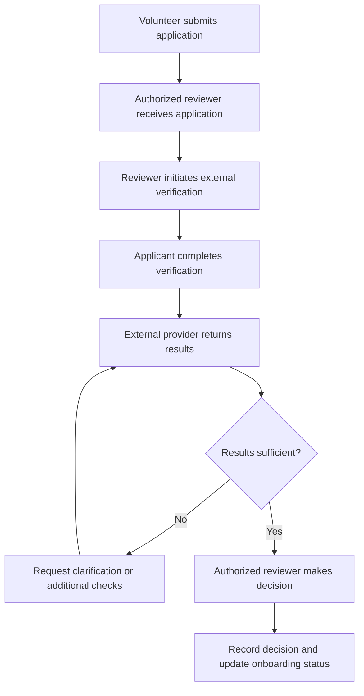
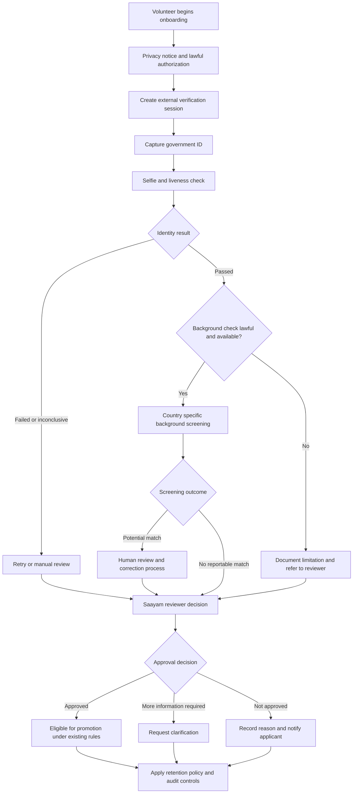
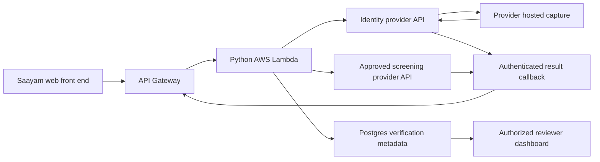

# Business Requirements Document: Volunteer Identity Verification

## 1. Document Control

| Field | Details |
|---|---|
| Organization | Saayam-for-All |
| Author | Tanisha Mukherjee |
| Date | November 22, 2026 |
| Version | 1.0 |
| Status | Draft |
| Related issue | #694 |
| Reviewers | Leadership, Engineering, Volunteer Operations, Privacy and Legal representatives (proposed) |

## 2. Executive Summary

Saayam requires a reliable, affordable and internationally accessible process for verifying volunteers before promotion. The proposed solution separates identity verification from criminal-background screening because these services address different risks.

### Recommended solution

- Primary identity provider: Didit.
- Background screening provider: Checkr, subject to country-specific availability, volunteer eligibility and legal approval.
- Runner-up: Stripe Identity combined with Checkr or an approved local screening provider.
- Initial operating model: External verification with manual review and approval by Saayam.
- Future operating model: API-driven verification with human review of exceptions.

Effective November 1, 2026, Didit provides $10 in monthly credit and charges $0.33 per full identity check on its pay-as-you-go plan [S1, S22].

Checkr International Basic starts at $32 per screening. Depending on the country, the package may provide criminal-record screening or adverse-media screening, together with watchlist checks [S10, S11].

### Estimated monthly provider costs

All figures are in USD.

| Monthly applicants | Didit identity only | Background screening for all, starting at $32 | Combined starting estimate |
|---:|---:|---:|---:|
| 100 | $23 | $3,200 | $3,223 |
| 500 | $155 | $16,000 | $16,155 |
| 1,000 | $320 | $32,000 | $32,320 |

These estimates exclude taxes, additional jurisdictional fees, retries, internal administration and negotiated pricing. They assume one complete identity workflow per applicant and availability of the $10 monthly credit.

The background-screening figures are illustrative starting-price scenarios, not contractual quotes or guarantees that criminal records are available in every country.

### Main risks

- Criminal-record access varies by jurisdiction.
- Biometric processing requires appropriate privacy safeguards.
- Automated identity checks can produce incorrect decisions.
- Background screening dominates total operating costs.
- Watchlist screening cannot establish the absence of a criminal record.

### Decision requested

Leadership should approve a limited synthetic-data pilot of Didit and Stripe Identity, authorize investigation of appropriate country-specific criminal-screening services, and establish a lawful screening policy before live volunteer verification.

No provider should be approved for production until legal, security, coverage and commercial requirements are satisfied.

## 3. Business Context and Problem Statement

Saayam connects volunteers with individuals and communities requiring assistance. Establishing confidence in volunteer identities supports the safety of beneficiaries and the credibility of the organization.

The issue specifies that the initial verification process will be operated manually and delegated to an external service provider. The current operational process, historical verification volumes and existing screening arrangements have not been independently confirmed.

Potential consequences of insufficient verification include:

- Fraudulent or impersonated volunteer accounts.
- Increased risk to vulnerable beneficiaries.
- Inconsistent decisions across reviewers.
- Additional investigation and administrative effort.
- Reputational damage and loss of community confidence.

Manual document inspection alone cannot reliably establish authenticity, identity ownership or criminal history.

## 4. Objectives and Success Criteria

The following targets are proposed for leadership approval. They are not vendor performance guarantees.

| Objective | Proposed target | Measurement and rationale |
|---|---|---|
| Identity turnaround | 95% within 5 minutes | Measure submission-to-result time to limit onboarding friction. |
| Background screening | 90% within 5 business days where supported | Track separately by jurisdiction because public-record availability varies. |
| Identity processing cost | At most $1.50 per successfully verified applicant at 500 monthly applicants | Provides a measurable affordability benchmark. |
| Country coverage | At least 95% of expected applicants | Calculate using actual country and document distribution rather than vendor country counts alone. |
| Document support | At least 95% of expected passport, national ID and driving-license submissions | Test representative supported document types. |
| Completion rate | At least 90% | Completed sessions divided by initiated sessions. |
| Decision quality | 100% of defined synthetic fraud scenarios routed to rejection or review | Validates workflow handling, not real-world fraud accuracy. |
| Privacy | Zero unauthorized access or disclosure | Review security incidents and access records. |
| Auditability | 100% of final decisions recorded | Ensure accountability and reproducibility. |

Actual production accuracy must be validated using an appropriately authorized and representative dataset.

## 5. Scope

### In scope

- Government-issued document authenticity checks.
- Verification of document ownership.
- Selfie capture, facial matching and liveness detection.
- Lawfully permitted criminal-background screening.
- Watchlist, sanctions and adverse-media screening evaluation.
- Vendor research and comparison.
- Cost projections.
- Conceptual integration architecture.
- Privacy, security and compliance requirements.
- Manual review and exception-handling requirements.

### Out of scope

- Building or deploying integrations.
- Modifying Saayam application code.
- Changing existing volunteer promotion rules.
- Purchasing vendor subscriptions.
- Contacting sales representatives without authorization.
- Uploading real identity documents or personal information to demos.
- Making legal determinations on behalf of Saayam.

## 6. Stakeholders and Users

| Stakeholder | Responsibilities and needs |
|---|---|
| Volunteer applicants | Accessible verification, clear instructions, privacy notices, reasonable turnaround and correction mechanisms. |
| Reviewers and administrators | Reliable results, exception queues, explanatory evidence and consistent review procedures. |
| Leadership | Affordable services, measurable risk reduction, clear recommendations and predictable operating costs. |
| Engineering | Documented APIs, secure callbacks, sandbox environments and manageable integration effort. |
| Privacy and legal representatives | Lawful processing, appropriate retention, international transfer controls and defensible screening policies. |
| Beneficiaries | Confidence that volunteer onboarding includes proportionate safeguards. |

## 7. Current Process and Target Process

### Current process

The detailed existing workflow requires confirmation from Volunteer Operations. Based on Issue #694, the intended initial phase involves manual administration and external verification.

An assumed workflow is:

Applicant submits information, a reviewer initiates external verification, the provider returns a result, and Saayam makes its approval decision.

### Current-state process flow (assumed)

This diagram represents an assumed manual workflow derived
from Issue #694. The actual existing operational process
must be confirmed with Volunteer Operations before adoption.

### Target process

The proposed process uses hosted identity capture to minimize the unnecessary handling of sensitive documents by Saayam.

### Process principles

- Provider results are evidence, not automatic promotion decisions.
- Identity and criminal-screening outcomes remain separate.
- An unavailable screening result must not be recorded as a clear criminal record.
- Applicants must have an appropriate correction or appeal route.
- A failed identity check must support authorized retry or alternative review.

## 8. Business Requirements

Priority definitions:

- Must: Mandatory for production approval.
- Should: Important, but exceptions may be approved.
- Could: Optional enhancement.

| ID | Requirement | Priority | Rationale | Acceptance criterion | Origin |
|---|---|---|---|---|---|
| BR-01 | Authenticate government-issued identity documents. | Must | Reduce fraudulent document submissions. | Provider returns an authenticity outcome and reasons for invalid or inconclusive documents. | Original |
| BR-02 | Provide lawful criminal-record screening directly or through an approved second provider. | Must | Address volunteer safety risks. | Country-specific searches and limitations are documented; criminal results are distinguished from watchlist results. | Original |
| BR-03 | Minimize verification cost. | Must | Maintain nonprofit affordability. | Pricing is documented for 100, 500 and 1,000 applicants, including fees and minimum commitments. | Original |
| BR-04 | Support countries and document types used by volunteers. | Must | Enable international participation. | At least 95% of expected applicant submissions are supported, subject to confirmed applicant distribution. | Original |
| BR-05 | Support programmatic integration. | Must | Fit the future Saayam platform. | Documented server-side API and result-retrieval mechanism are available for Python-based services. | Original |
| BR-06 | Support live camera capture, liveness detection and facial matching. | Should | Reduce impersonation risk. | Identity workflow supports face-to-document comparison and presentation-attack detection. | Original |
| BR-07 | Support secure processing and appropriate data retention. | Must | Protect sensitive personal information. | Approved data-processing terms, deletion process, access controls and retention schedule are documented. | Proposed |
| BR-08 | Support exception handling and human review. | Must | Avoid unfair or unexplained rejection. | Failed, inconclusive and disputed cases enter an authorized review workflow. | Proposed |
| BR-09 | Support sanctions and watchlist screening when justified. | Should | Identify additional relevant risks. | Results identify the screening type and potential-match status without misrepresenting criminal history. | Proposed |
| BR-10 | Provide auditable verification outcomes. | Must | Support accountability. | Each decision can be linked to a provider reference, timestamp, check type and reviewer decision. | Proposed |
| BR-11 | Provide a safe testing environment. | Should | Reduce integration risk. | Synthetic test cases can exercise success, failure and exception outcomes without real personal data. | Proposed |
| BR-12 | Support accessible applicant onboarding. | Should | Include applicants with varying devices and abilities. | Mobile and desktop flows are evaluated, with authorized alternatives for camera or accessibility failures. | Proposed |
| BR-13 | Provide reliable asynchronous result delivery. | Should | Support serverless integration. | Authenticated callbacks or a secure polling alternative can be tested with duplicate and delayed events. | Proposed |

BR-02 is evaluated at the combined-solution level. Identity-only providers are not expected to satisfy it independently.

## 9. Market Overview and Shortlist

Providers were selected through a desk-based review of public product pages, pricing information, help centers and developer documentation.

Selection considerations included:

- Mandatory providers identified by the issue.
- International identity-document support.
- Document authenticity and biometric capabilities.
- Public pricing and nonprofit affordability.
- Programmatic integration.
- Coverage of criminal or watchlist screening.

| Provider | Product category | Selection rationale |
|---|---|---|
| Stripe Identity | Identity verification | Existing Stripe relationship and published pricing. |
| Didit | Identity verification and optional risk screening | Low unit pricing and monthly usage credit. |
| ID.me | Digital identity verification | Mandatory provider with broad document support. |
| Sumsub | Identity verification and AML screening | Combined identity and watchlist capabilities. |
| Veriff | Identity verification and AML screening | Published plans and broad international document support. |
| Checkr | Background screening | Country-dependent criminal and watchlist screening. |

No vendor accounts were created, no sales representatives were contacted and no real personal information was submitted.

## 10. Vendor Capability and Requirements Matrix

Legend:

- Y: Relevant capability documented publicly.
- P: Partial, optional, conditional or requires further validation.
- N: Not established as a relevant offering in reviewed documentation.
- U: Insufficient evidence.
- Y does not constitute production acceptance or legal approval.

| Requirement | Stripe | Didit | ID.me | Sumsub | Veriff | Checkr |
|---|---|---|---|---|---|---|
| BR-01 Document authenticity | Y | Y | Y | Y | Y | P |
| BR-02 Criminal records | N | N | U | N | N | P |
| BR-03 Affordability | P | P | U | P | P | P |
| BR-04 International coverage | P | P | P | P | P | P |
| BR-05 Programmatic integration | Y | Y | P | Y | Y | Y |
| BR-06 Liveness and face match | Y | Y | P | Y | Y | N |
| BR-07 Privacy and retention | P | P | P | P | P | P |
| BR-08 Exception handling | P | P | P | P | P | P |
| BR-09 Watchlist screening | N | P | U | P | P | P |
| BR-10 Auditable outcomes | P | P | U | P | P | P |
| BR-11 Safe testing | Y | Y | P | Y | Y | Y |
| BR-12 Accessible onboarding | P | P | P | P | P | P |
| BR-13 Asynchronous results | Y | Y | U | Y | Y | Y |

### Matrix Assessment Notes

- BR-03: Published pricing does not establish affordability
  until the complete screening budget is approved.
- BR-04: Advertised geographic coverage does not establish
  coverage of Saayam's actual applicant population.
- BR-07: Public privacy policies do not establish contractual
  or regulatory approval.
- BR-08: Provider-level exception handling must be distinguished
  from Saayam's complete human-review and dispute process.
- BR-09: Watchlist availability depends on the selected
  screening package, jurisdiction and lawful purpose.
- BR-10: Provider references and verification statuses support
  auditability, but the complete audit workflow requires
  implementation and testing.
- BR-11: Documented testing environments do not establish
  unrestricted access or coverage of every test scenario.
- BR-13: Documented asynchronous delivery does not establish
  production reliability until integration testing is completed.

The matrix represents a preliminary capability assessment,
not completed vendor acceptance testing.

Mandatory requirements must be evaluated across the complete
proposed solution, including complementary screening providers
and Saayam's internal operational controls.

Unconfirmed capabilities must be reassessed during authorized
vendor due diligence and pilot testing.

Evidence references:

- Stripe: S3.
- Didit: S1, S2, S4.
- ID.me: S5, S6.
- Sumsub: S7, S8.
- Veriff: S9, S13.
- Checkr: S10, S11, S12.

### Critical capability comparison

| Provider | Document authenticity | Liveness / face match | Criminal records | Watchlists |
|---|---|---|---|---|
| Stripe | Yes | Yes | Not established | Separate service required |
| Didit | Yes | Yes | Not established | Optional AML module |
| ID.me | Yes | Conditional on verification flow | Unconfirmed | Unconfirmed |
| Sumsub | Yes | Yes | Not established | Compliance offering |
| Veriff | Yes | Yes | Not established | Optional paid add-on |
| Checkr | Conditional identity-document validation | Not established | Country-dependent | Available |

A watchlist match, sanctions match or adverse-media result is not equivalent to a criminal conviction or pending criminal case.

### Interpretation

Didit achieves the highest preliminary weighted score for
the identity-verification component.

Stripe and Veriff achieve equal weighted scores of 77.
Stripe is preferred as the conditional runner-up because
Saayam already has a Stripe account, which may reduce
administrative and integration overhead.

Existing Stripe account ownership does not automatically
establish Stripe Identity product eligibility.

Checkr is a complementary background-screening provider
rather than a direct substitute for identity verification.

## 11. Weighted Vendor Evaluation

### Evaluation Methodology

Each vendor is assessed against seven weighted criteria.
The maximum achievable weighted score is 100.

| Evaluation criterion | Maximum points |
|---|---:|
| Document authenticity | 20 |
| Cost and affordability | 20 |
| Geographic and document coverage | 15 |
| Liveness and facial matching | 10 |
| Technical integration | 15 |
| Criminal-background screening | 15 |
| Privacy and operational controls | 5 |
| **Total** | **100** |

The preliminary points assigned to each provider reflect
analyst judgments concerning documented capabilities,
estimated costs and known limitations.

### Weighted Scoring Matrix

| Criterion | Maximum | Stripe | Didit | ID.me | Sumsub | Veriff | Checkr |
|---|---:|---:|---:|---:|---:|---:|---:|
| Document authenticity | 20 | 20 | 20 | 16 | 20 | 20 | 8 |
| Cost and affordability | 20 | 16 | 20 | 4 | 12 | 16 | 4 |
| Geographic coverage | 15 | 12 | 15 | 12 | 12 | 15 | 9 |
| Liveness and facial matching | 10 | 10 | 10 | 6 | 10 | 10 | 0 |
| Technical integration | 15 | 15 | 15 | 6 | 12 | 12 | 12 |
| Criminal-background screening | 15 | 0 | 0 | 0 | 0 | 0 | 12 |
| Privacy and operational controls | 5 | 4 | 3 | 2 | 3 | 4 | 3 |
| **Total weighted score** | **100** | **77** | **83** | **46** | **69** | **77** | **48** |

### Scoring Principles

- Full points indicate the strongest preliminary assessment
  against the selected criterion.
- Partial points reflect limitations, uncertainty or
  comparatively weaker suitability.
- Zero points indicate that a relevant capability has not
  been established for the proposed use case.
- Unknown commercial or technical capabilities receive
  conservative preliminary scores.
- Individual provider scores are not equivalent to
  combined-solution qualification.
- Mandatory business requirements take precedence over
  numerical rankings.

Total weighted score equals the sum of the points assigned
across all seven criteria.

The scoring weights and individual scores are provisional
analyst judgments. They must be reassessed following
source validation, stakeholder feedback and authorized
pilot testing.

### 11.1 Scoring Assumptions and Limitations

| Criterion | Evaluation basis and limitation |
|---|---|
| Document authenticity | Publicly documented capabilities rather than independently measured fraud-detection accuracy. |
| Cost | Published entry-level pricing and modeled transaction volumes, excluding unconfirmed contractual discounts and additional fees. |
| Geographic coverage | Advertised geographic and document coverage rather than confirmed coverage of Saayam's applicant population. |
| Liveness and facial matching | Documented feature availability rather than independently tested biometric performance. |
| Integration | Public developer documentation and preliminary architectural compatibility rather than completed implementation. |
| Criminal screening | Documented screening availability, subject to jurisdiction, applicant eligibility and legal restrictions. |
| Privacy and operational controls | Preliminary assessment of published policies and operational features rather than completed contractual or security due diligence. |

The scores are qualitative analyst estimates.

They do not represent vendor accuracy percentages,
regulatory compliance certifications or statistically
validated performance measurements.

The geographic coverage scores must be reassessed after
Saayam confirms its volunteer country and document distribution.

### 11.2 Ranked Evaluation Results

| Rank | Provider | Weighted score | Proposed role |
|---:|---|---:|---|
| 1 | Didit | 83/100 | Preferred identity-verification candidate |
| 2 (tie) | Stripe Identity | 77/100 | Conditional runner-up |
| 2 (tie) | Veriff | 77/100 | Alternative identity-verification candidate |
| 4 | Sumsub | 69/100 | Alternative identity and compliance platform |
| 5 | Checkr | 48/100 | Complementary criminal-screening candidate |
| 6 | ID.me | 46/100 | Conditional alternative requiring further commercial validation |

Checkr's lower aggregate score reflects its different product
specialization. It must not be interpreted as evidence that
Checkr performs criminal screening less effectively than
identity-verification providers.

### 11.3 Mandatory Qualification Gates

| Gate ID | Mandatory qualification condition |
|---|---|
| G-01 | Government-issued document authenticity capability is established for the selected identity provider. |
| G-02 | A lawful criminal-screening method is established for each applicable country and volunteer role. |
| G-03 | Projected total costs receive budget approval. |
| G-04 | Required applicant countries and document types are supported or have approved alternatives. |
| G-05 | Required future integration capabilities are established. |
| G-06 | Privacy, retention, security and data-processing terms receive approval. |
| G-07 | Human review, dispute resolution and exception handling are established. |
| G-08 | Verification and screening decisions can be audited securely. |

A high weighted score cannot compensate for failure to
satisfy an applicable mandatory qualification gate.

Gate G-02 may be satisfied through a separately approved
background-screening provider or authorized country-specific
screening process.

### 11.4 Combined Solution Evaluation

| Solution | Principal advantage | Principal limitation | Preliminary decision |
|---|---|---|---|
| Didit + Checkr | Potentially low identity-verification cost with complementary criminal screening. | Criminal-screening cost and geographic restrictions require confirmation. | Preferred conditional solution |
| Stripe Identity + Checkr | Potential reuse of the existing Stripe relationship and documented integration capabilities. | Higher modeled identity-verification cost and country-dependent criminal screening. | Conditional runner-up |
| Veriff + Checkr | Competitive identity pricing and documented verification capabilities. | Additional provider onboarding and plan-specific limitations. | Alternative solution |
| Sumsub + Checkr | Identity verification and optional compliance-screening capabilities. | Monthly commitments and potential duplication of screening services. | Secondary alternative |
| ID.me + Checkr | Additional identity-proofing option. | Unconfirmed commercial terms and partner eligibility. | Hold pending clarification |
| Didit + authorized country-specific screening | Potential volunteer discounts and jurisdiction-specific screening suitability. | Higher operational complexity and inconsistent integration options. | Country-specific alternative |

No combined solution should be approved solely on the basis
of its estimated cost or the individual provider scores.

### 11.5 Reassessment During the Pilot

The weighted evaluation should be repeated after an
authorized pilot provides evidence concerning:

- Actual country and document coverage.
- Verification completion rates.
- Invalid-document detection outcomes.
- Liveness and facial matching outcomes.
- Manual exception rates.
- Applicant accessibility and usability.
- Actual cost per completed verification.
- Background-screening availability and turnaround time.
- Integration reliability.
- Privacy and security qualification results.

The proposed criteria and weights require stakeholder
approval before being used for a final procurement decision.

No individual provider or combined solution currently
receives unconditional production approval.

## 12. Individual Vendor Profiles

### 12.1 Stripe Identity

Documented findings [S3]:

- Supports identity documents issued in more than 100 countries.
- Includes document checking and selfie matching.
- Provides an option to enforce live capture.
- Published standard price is $1.50 per document-and-selfie verification.
- First 50 verifications are advertised as free.
- Provides personal-data redaction capabilities.

Analyst assessment:

Stripe offers an attractive operational alternative because Saayam already has a Stripe account. However, criminal screening remains a separate requirement, and account eligibility must be confirmed.

### 12.2 Didit

Documented findings [S1, S2, S4]:

- Advertises document support across more than 220 countries and territories.
- The pay-as-you-go plan provides $10 in monthly credit.
- The published full identity check list price is $0.33.
- Developer documentation describes APIs, workflows and signed webhooks.
- Additional AML features use separate pricing.

Analyst assessment:

Didit is the strongest affordability candidate. Monthly credit is shared across services. Additional completed checks and optional modules may increase expenditure. Contractual privacy controls, production support and country-specific document accuracy require validation.

### 12.3 ID.me

Documented findings [S5]:

- Advertises support for over 12,500 document types from more than 230 countries and territories.
- Accepted documents include passports, driving licenses and national identity cards.
- Alternative video-assisted verification may be available in certain cases.

Limitations:

- Applicable organizational pricing was not established.
- Partner integration conditions, international onboarding eligibility and webhook support require confirmation.
- Criminal-background capabilities were not established.

Analyst assessment:

Broad document acceptance is promising, but insufficient commercial and technical evidence prevents a firm recommendation.

### 12.4 Sumsub

Documented findings [S7, S8]:

- Basic plan includes document verification and biometric checks.
- Compliance plan incorporates AML screening.
- Provides a WebSDK and webhook-based result delivery.
- Offers sandbox functionality.

Analyst assessment:

Sumsub is a useful alternative when watchlist screening is justified. AML screening does not replace jurisdiction-specific criminal-record searches.

### 12.5 Veriff

Documented findings [S9, S13]:

- Advertises document support across 230 or more countries and territories.
- Provides identity verification, liveness and biometric matching.
- Plus and Premium plans include specialist review.
- Offers API access, hosted flows, SDKs, sandbox testing and webhook configuration.
- Watchlist and sanctions checks are separately priced.

Analyst assessment:

Veriff is a strong technically documented alternative. Monthly commitments and paid privacy or screening features may increase its total cost.

### 12.6 Checkr

Documented findings [S10, S11, S12]:

- Provides international screening packages with country-dependent availability.
- International Basic starts at $32 per check.
- The package may return criminal-record searches or adverse-media results, plus watchlist screening.
- International Professional+ includes identity-document validation.
- Provides a hosted applicant workflow, APIs and webhook-based status updates.

Analyst assessment:

Checkr is a reasonable complementary screening candidate, but nonprofit volunteer eligibility, jurisdiction-specific access, report contents and pricing must be confirmed before adoption.

### 12.7 Geographic and Document Coverage Comparison

| Provider | Reported geographic coverage | Document categories to validate | Outstanding limitations |
|---|---|---|---|
| Stripe Identity | More than 100 countries | Passports, national IDs, driving licenses | Country-specific document eligibility and account restrictions |
| Didit | More than 220 countries and territories | Passports, national IDs, driving licenses | Supported document versions and workflow-specific restrictions |
| ID.me | More than 230 countries and territories | Passports, national IDs, driving licenses | Partner eligibility and international applicant requirements |
| Sumsub | International coverage; exact count requires validation | Passports, national IDs, driving licenses, residence permits | Country-specific document requirements and service restrictions |
| Veriff | At least 230 countries and territories | Passports, national IDs, driving licenses, residence permits | Document-specific support and plan restrictions |
| Checkr | Country-dependent screening coverage | Identity documents required for applicable screening packages | Criminal-record access, applicant eligibility and package restrictions |

These geographic figures are preliminary vendor-coverage
claims retained from the research. Exact counts and supported
document categories require independent source validation.

#### Proposed Country-Level Validation

| Country or region | Representative documents to evaluate |
|---|---|
| United States | Passport, state ID, driving license |
| India | Passport, Aadhaar, driving license |
| United Kingdom | Passport, driving license |
| European Union / EEA | Passport, national identity card, residence permit |
| Canada | Passport, provincial identity card, driving license |
| Australia | Passport, driving license, applicable proof-of-age card |

These countries and documents are illustrative test candidates,
not confirmed Saayam applicant demographics or guaranteed
vendor capabilities.

Before provider selection, establish the supported combination
of issuing country, document type, document version and
verification method for each priority applicant population.

Identity-document availability must be evaluated independently
of criminal-background screening availability.

References: S1, S3, S4, S5, S7, S9, S11 and S13.

## 13. Cost Analysis

### Assumptions

- Currency: USD.
- Monthly volumes: 100, 500 and 1,000 applicants.
- One complete identity workflow per applicant.
- Steady-state pricing excludes temporary trial credits.
- No negotiated discounts or nonprofit rates assumed.
- Taxes and jurisdiction-specific fees excluded.
- Unknown vendor prices are not estimated as confirmed amounts.

### Public identity verification costs

| Provider / plan | Pricing model | Minimum or allowance | 100 | 500 | 1,000 |
|---|---|---|---:|---:|---:|
| Didit core identity | $0.33 per full check | $10 monthly credit | $23 | $155 | $320 |
| Stripe Identity | $1.50 per verification | First 50 free; not modeled as recurring | $150 | $750 | $1,500 |
| ID.me | Contact sales / confirm partner pricing | Unknown | Unknown | Unknown | Unknown |
| Sumsub Basic | $1.35 per verification | $149 monthly minimum | $149 | $675 | $1,350 |
| Sumsub Compliance | $1.85 per verification | $299 monthly minimum | $299 | $925 | $1,850 |
| Veriff Essential | $0.80 per verification | $49 monthly minimum | $80 | $400 | $800 |
| Veriff Plus | $1.39 per verification | $99 monthly minimum | $139 | $695 | $1,390 |

Pricing sources: S1, S3, S5, S7, S9, S22 and S23. S2 is retained as historical pricing evidence only.

The Sumsub and Veriff calculations use the greater of usage cost and the applicable monthly minimum.

### Criminal and watchlist screening costs

| Service | Pricing basis | 100 | 500 | 1,000 |
|---|---|---:|---:|---:|
| Checkr International Basic | From $32 per screening | $3,200 | $16,000 | $32,000 |
| Checkr International Professional+ | From $124 per screening | $12,400 | $62,000 | $124,000 |
| Didit AML example | $0.20 per check for illustrated AML module | $20 | $100 | $200 |
| Veriff watchlist add-on | Additional $0.64 per verification | $64 | $320 | $640 |

Sources: S1, S4, S9 and S10.

Didit's AML pricing varies by module. The $0.20 rate is an example documented for an AML workflow, not a universal AML price.

AML add-on amounts do not include identity verification costs and must not be substituted for criminal-screening costs.

### Combined solution scenarios

| Combination | 100 | 500 | 1,000 |
|---|---:|---:|---:|
| Didit and Checkr International Basic | $3,223 | $16,155 | $32,320 |
| Stripe and Checkr International Basic | $3,350 | $16,750 | $33,500 |
| Veriff Essential and Checkr International Basic | $3,280 | $16,400 | $32,800 |

These illustrative figures assume every applicant receives the starting-price international screening package. Actual country-specific costs may be materially higher. Checkr uses the name International Basic on its main pricing page and International Basic+ on certain partner pages. Package eligibility and applicable terms must be confirmed before procurement.

### Manual verification comparison

The following is an analyst-created planning assumption, not Saayam's measured labor cost.

Assumptions:

- Manual document review: 15 minutes per applicant.
- Loaded reviewer cost: $20 per hour.
- Manual identity review cost: $5 per applicant.
- External identity exception review: 10% of applicants.
- Exception review duration: 10 minutes.
- Exception review labor cost: $0.333333 per applicant, rounded only after calculating the monthly total.

| Monthly applicants | Manual identity review | Didit plus estimated exception labor | Stripe plus estimated exception labor |
|---:|---:|---:|---:|
| 100 | $500 | $56.33 | $183.33 |
| 500 | $2,500 | $321.67 | $916.67 |
| 1,000 | $5,000 | $653.33 | $1,833.33 |

Manual identity review is not equivalent to specialized authenticity or biometric verification. It also does not include authorized criminal-record retrieval.

### Preliminary Commercial Terms and Pricing Limitations

The following preliminary commercial details require validation against official
vendor pricing documentation before procurement.

| Provider | Additional commercial considerations |
|---|---|
| Didit | The pay-as-you-go plan provides $10 in monthly credit. Full identity checks cost $0.33 and optional watchlist screening costs $0.20. Additional modules and completed checks may incur charges. Enterprise data residency and custom service-level agreements require commercial confirmation. |
| Stripe | The first 50 verifications are free. Standard recurring pricing is $1.50 per completed document-and-selfie verification. Custom pricing is available for volumes exceeding 2,000 identities per month or unique business models. |
| Sumsub | Basic and Compliance plans have monthly minimum commitments. Custom plans require contacting sales. |
| Veriff | Charges for identity verification decisions rather than retries. Offers a 15-day Premium trial, including up to 50 live verifications and unlimited sandbox tests. Extended two-year retention costs an additional $0.30 per verification. Session deletion through the API is a Premium-plan feature. |
| Checkr | International pricing varies by country. Third-party court and database access fees may apply. International Basic may provide adverse-media screening instead of criminal-record screening in certain jurisdictions. |

### Additional Pricing Scenarios

All amounts are USD and exclude taxes, additional fees and
negotiated discounts.

| Service | 100 applicants | 500 applicants | 1,000 applicants |
|---|---:|---:|---:|
| Veriff Premium | $209 | $945 | $1,890 |
| Checkr US Basic ($29.99/report) | $2,999 | $14,995 | $29,990 |
| Checkr US Essential ($59.99/report) | $5,999 | $29,995 | $59,990 |
| Didit active liveness add-on | $15 | $75 | $150 |
| Veriff extended retention add-on | $30 | $150 | $300 |

The US Checkr packages are included for budget comparison only.
Their suitability for nonprofit volunteer screening and applicable
legal obligations must be confirmed before selection.

### Additional Pricing References

- Didit billing and credits:
  https://help.didit.me/billing-credits/how-pricing-and-credits-work
- Didit free-plan conditions:
  https://help.didit.me/getting-started/free-plan
- Didit module pricing:
  https://didit.me/pricing/
- Stripe Identity:
  https://stripe.com/identity
- Sumsub pricing:
  https://sumsub.com/pricing/
- Veriff pricing:
  https://www.veriff.com/pricing
- Checkr pricing:
  https://checkr.com/pricing

All references require final source validation.

### Additional cost considerations

- Country-specific criminal-record access fees.
- Additional identity sessions or retries.
- Minimum monthly commitments.
- Currency conversion and taxes.
- Paid AML and ongoing monitoring modules.
- Manual exception handling.
- Secure data storage and operational support.
- Integration development and maintenance.
- Contractual data residency and retention requirements.

Leadership should evaluate total cost per verified volunteer, not simply cost per initiated verification.

### 13.1 Didit Updated Subscription Plan Comparison

Didit announced a revised pricing structure effective
November 1, 2026.

The revised structure replaces the previous free-check
allowance with monthly usage credit.

| Pricing parameter | Free | Growth | Scale |
|---|---:|---:|---:|
| Monthly subscription fee | $0 | $99 | $299 |
| Included paid-plan credit | $0 | $115 | $350 |
| Additional eligible free credit | $10 | $10 | $10 |
| Unit price discount | 0% | 4% | 10% |
| Full identity check unit price | $0.33 | $0.3168 | $0.297 |

Enterprise pricing requires a customized commercial agreement.

#### Monthly Cost Comparison

| Monthly completed identity checks | Free | Growth | Scale | Lowest modeled cost |
|---:|---:|---:|---:|---|
| 100 | $23.00 | $99.00 | $299.00 | Free |
| 500 | $155.00 | $132.40 | $299.00 | Growth |
| 1,000 | $320.00 | $290.80 | $299.00 | Growth |

Calculation methodology:

Monthly cost = subscription fee + max(0, usage charges
minus eligible monthly credits).

Assumptions:

- One completed full identity check per applicant.
- The organization qualifies for the additional $10 monthly credit, which is separate from paid-plan credits. Didit specifies work-email eligibility [S22, S23].
- Credits are not consumed by other services.
- Monthly rather than annual subscription pricing.
- Taxes, additional modules and repeated checks are excluded.
- Completed checks may be billable even when unsuccessful.
- Monthly credits do not roll over.
- Prepaid top-up requirements may affect actual cash outflow.

#### Optimized Combined Screening Cost

| Monthly applicants | Suggested identity plan | Identity cost | Estimated Checkr International Basic | Combined estimated cost |
|---:|---|---:|---:|---:|
| 100 | Free | $23.00 | $3,200 | $3,223.00 |
| 500 | Growth | $132.40 | $16,000 | $16,132.40 |
| 1,000 | Growth | $290.80 | $32,000 | $32,290.80 |

The main cost analysis retains the pay-as-you-go plan as
a consistent comparison baseline. This supplementary table
illustrates potential savings through plan optimization.

The Checkr estimates remain subject to country-specific
availability, applicable screening types and additional fees.

#### Pricing Sensitivity: Monthly Credit Eligibility

The baseline financial model assumes that Saayam qualifies
for the $10 monthly credit. Eligibility and the ability to
combine this credit with paid-plan allowances require
independent commercial confirmation.

| Monthly applicants | Free plan with $10 credit | Free plan without $10 credit | Growth without additional $10 credit | Scale without additional $10 credit |
|---:|---:|---:|---:|---:|
| 100 | $23.00 | $33.00 | $99.00 | $299.00 |
| 500 | $155.00 | $165.00 | $142.40 | $299.00 |
| 1,000 | $320.00 | $330.00 | $300.80 | $299.00 |

These scenarios use the preliminary pricing assumptions
in Section 13.1 and are not independently confirmed
commercial quotations.

Without the additional monthly credit:

- The Free plan remains the lowest modeled cost at
  100 monthly applicants.
- Growth remains the lowest modeled cost at
  500 monthly applicants.
- Scale becomes the lowest modeled cost at
  1,000 monthly applicants.

Final plan selection must consider verified pricing,
credit eligibility, retention requirements, additional
modules and contractual conditions.

The preferred vendor recommendation must be reassessed
if actual commercial terms differ materially from
the financial model.

### 13.2 Pricing Source Discrepancy

Some publicly available Didit pricing and help pages still
describe the earlier 500-check allowance.

The dated pricing-change announcement and newer billing
documentation describe the replacement credit-based model.

For forward-looking budget estimates, this BRD uses the
announced November 1, 2026 pricing structure.

The older free-check allowance is not assumed to remain
available.

Actual account eligibility, current charges and commercial
terms must be confirmed before procurement.

Paid plans also advertise different data-retention periods.
These must be assessed against Saayam's privacy requirements
before selecting a plan solely on the basis of cost.

### 13.3 Additional Pricing References

- S22. Didit - November 2026 pricing-change announcement:
  https://didit.me/blog/new-pricing-november-2026/

- S23. Didit - Billing and plan documentation:
  https://help.didit.me/billing-credits/billing-and-plan-page

- S24. Didit - Official pricing page:
  https://didit.me/pricing/

Reviewed: November 22, 2026.

The dated announcement and newer billing documentation
take precedence over conflicting historical pricing
information for this preliminary financial model.

## 14. Integration and Technical Fit

### Proposed architecture

### Provider integration assessment

| Provider | Proposed applicant flow | Result delivery and testing | Effort |
|---|---|---|---|
| Stripe | Backend creates verification session and redirects applicant to vendor capture. | Verify session API, webhook and test-mode behavior during pilot. | Low: existing Stripe relationship may simplify onboarding. |
| Didit | Configure identity workflow and initiate session through API. | Signed webhooks, documented APIs and test workflow capabilities. | Low: documented modular workflow. |
| ID.me | Partner integration with provider-managed verification. | Confirm partner API, SDK, sandbox and asynchronous result mechanism. | High: commercial and technical dependencies remain unresolved. |
| Sumsub | Create applicant and expose vendor WebSDK. | Backend webhooks and sandbox result simulation. | Medium: applicant configuration and webhook mapping required. |
| Veriff | Create verification session, redirect to hosted page or use SDK. | Test integration and live decision webhooks. | Low: documented integration options. |
| Checkr | Backend requests invitation; applicant completes hosted screening flow. | Staging API and report-status webhooks. | Medium: additional consent and country-specific workflow. |

Sources: S3, S4, S6, S8, S9, S12 and S13.

Effort ratings are analyst estimates, not vendor commitments.

### Proposed platform controls

AWS API Gateway:

- Expose authenticated session-creation endpoints.
- Receive provider callbacks through dedicated endpoints.

Python AWS Lambda:

- Initiate vendor sessions.
- Validate webhook signatures where supported.
- Normalize provider outcomes.
- Handle delayed, duplicated and out-of-order events.
- Implement idempotency and controlled retries.

Postgres:

- Store internal applicant references and external verification identifiers.
- Record check type, jurisdiction, provider status and timestamps.
- Maintain reviewer decisions and audit metadata.
- Avoid retaining raw ID images and biometric templates unless explicitly necessary and authorized.

Web front end:

- Prefer hosted vendor capture for the initial phase.
- Display verification progress and appropriate remediation instructions.
- Confirm the existing framework and mobile application requirements before selecting an embedded SDK.

Security:

- Store credentials in an approved secrets-management service.
- Apply least-privilege access.
- Encrypt sensitive information.
- Avoid logging identity documents, credentials or biometric data.
- Reconcile missing callbacks using authenticated result retrieval.

No integration is being implemented as part of this BRD.

### 14.1 Developer Documentation Findings

The following findings are based on publicly available official
developer documentation reviewed on November 22, 2026.

| Provider | Documented integration capability | Important implementation constraint |
|---|---|---|
| Stripe Identity | VerificationSession API, hosted verification URL, matching-selfie configuration and session retrieval. | Sessions requiring additional input must support applicant resubmission. Existing Stripe account eligibility must be confirmed. |
| Sumsub | WebSDK, applicant identifiers, asynchronous webhooks and sandbox environment. | Applicant decisions can change after an initial result. Sandbox notifications may require explicit triggering. Production configuration must be established separately. |
| Veriff | Web flow, native SDKs, API, test integrations and authenticated webhooks. | Essential uses a dedicated Full Auto webhook rather than the standard decision webhook. Webhook handling must match the selected plan. |
| Checkr | REST API, hosted invitations, report retrieval, webhooks and staging environment. | International screening orders require the invitations API and a supported hosted workflow. Production access requires credentialing. |
| Didit | REST API, hosted verification links, web and mobile SDKs, signed webhooks, decision retrieval and sandbox testing. | Separate live and sandbox credentials are required. Webhook signatures must be verified according to the selected API version. |
| ID.me | OAuth 2.0, OpenID Connect, hosted authorization, user attribute retrieval and sandbox environments. | Identity verification sandbox access and production activation require partner approval. Pricing, organizational eligibility and asynchronous notification support remain unconfirmed. |

### 14.2 Proposed Serverless Integration Controls

The following controls are proposed for Saayam's future
implementation. They are architectural recommendations,
not claims about the existing platform.

1. Create verification sessions through authenticated backend
   services rather than exposing privileged credentials
   in the frontend.

2. Store provider credentials in AWS Secrets Manager and
   restrict access through least-privilege IAM policies.

3. Validate incoming webhook authenticity using the
   provider-specific signature verification procedure.

4. Preserve the original request body when required for
   cryptographic signature verification.

5. Use an asynchronous SQS queue to decouple webhook
   reception from downstream processing.

6. Implement idempotent processing using provider event
   identifiers or an equivalent deterministic event key.

7. Handle duplicate, delayed and out-of-order notifications
   without incorrectly approving an applicant.

8. Configure bounded retries and a dead-letter queue
   for unsuccessful event processing.

9. Keep identity verification and criminal screening
   statuses separate in PostgreSQL.

10. Require an authorized human reviewer to resolve
    disputed, inconclusive or potentially adverse findings.

11. Avoid storing raw identity documents, biometric images,
    full criminal reports or sensitive credentials in
    application logs.

12. Provide scheduled reconciliation for verification
    sessions that remain pending or have missing callbacks.

### 14.3 Proposed Acceptance Tests

| Test ID | Scenario | Expected outcome |
|---|---|---|
| IT-01 | Successful identity verification | Identity status is updated without automatically clearing criminal screening. |
| IT-02 | Invalid or inconclusive document | Applicant enters resubmission or authorized manual review. |
| IT-03 | Failed selfie or liveness check | Applicant is not automatically approved. |
| IT-04 | Duplicate webhook | Event is processed without duplicate decisions or records. |
| IT-05 | Invalid webhook signature | Request is rejected and a sanitized security event is recorded. |
| IT-06 | Out-of-order notification | Current decision is reconciled against authoritative provider state. |
| IT-07 | Provider timeout or temporary outage | Bounded retry or manual recovery is triggered. |
| IT-08 | Criminal screening unavailable in applicant country | Case is marked unavailable or incomplete, not clear. |
| IT-09 | Potential criminal or watchlist match | Case is routed to an authorized reviewer. |
| IT-10 | Applicant requests deletion | Approved retention and deletion workflow is followed. |
| IT-11 | Provider changes a previous decision | Applicant status is reassessed and an audit entry is created. |
| IT-12 | Missing webhook notification | Reconciliation detects the incomplete state. |
| IT-13 | International background screening order | Supported hosted invitation workflow is used. |
| IT-14 | Exhausted retry attempts | Event is routed to the dead-letter queue for investigation. |
| IT-15 | Unauthorized access to sensitive results | Access is denied and the attempted access is audited. |

All tests are proposed for a future authorized pilot.
No live verification, real personal data, account creation
or production API calls are required for this BRD.

### 14.4 Additional Official Developer References

Accessed: November 22, 2026.

- Stripe VerificationSession retrieval:
  https://docs.stripe.com/api/identity/verification_sessions/retrieve

- Sumsub WebSDK and verification results:
  https://developers.sumsub.com/web-sdk/index.html

- Veriff integration environments:
  https://devdocs.veriff.com/v1/docs/how-to-create-an-integration

- Veriff webhook security:
  https://devdocs.veriff.com/docs/webhooks-guide

- Veriff Essential integration:
  https://devdocs.veriff.com/docs/essential-plan-full-auto

- Checkr API quick start:
  https://docs.checkr.com/get-started/quick-start

- Checkr staging environment and credentials:
  https://docs.checkr.com/get-started/prerequisites

- Checkr hosted background screening workflows:
  https://docs.checkr.com/use-cases/background-checks

- Checkr report creation restrictions:
  https://docs.checkr.com/apis/openapi/reports/createreport

- Didit developer platform and integration capabilities:
  https://didit.me/developers/

- Didit API authentication and environment configuration:
  https://help.didit.me/integration/api-key-workflow-id-and-webhook-secret

- Didit webhook configuration and security:
  https://help.didit.me/integration/webhooks-basics

- ID.me OAuth 2.0 documentation:
  https://docs.id.me/guides/o-auth-2-0/overview

- ID.me OAuth integration:
  https://docs.id.me/guides/o-auth-2-0/integration

- ID.me OpenID Connect integration:
  https://docs.id.me/guides/open-id-connect/integration

- ID.me sandbox and production approval requirements:
  https://docs.id.me/integrations/deploy-and-monitor/launching-in-production

Accessed: November 22, 2026.

## 15. Compliance, Privacy and Legal Considerations

This section identifies issues requiring legal review. It does not provide legal authorization to conduct background checks.

### Core privacy requirements

- Provide a clear applicant privacy notice.
- Identify lawful processing grounds for each check.
- Obtain appropriate authorization where required.
- Minimize the personal information collected.
- Confirm controller and processor responsibilities.
- Establish data-processing agreements and international transfer safeguards.
- Document access, correction and deletion processes.
- Restrict access to criminal and biometric information.
- Avoid solely automated adverse decisions where prohibited.
- Provide meaningful human review and dispute handling.

### Country-specific screening considerations

| Jurisdiction | Consideration | Proposed action |
|---|---|---|
| European Union / EEA | GDPR Article 10 restricts criminal-offence data processing. Biometric identification may engage Article 9. | Obtain jurisdiction-specific legal approval before screening. |
| United Kingdom | Criminal-record checks are subject to eligibility and disclosure rules. Different DBS check levels have different conditions. | Confirm role eligibility and lawful processing grounds. |
| United States | Third-party background screening may trigger FCRA obligations and state or local rules, depending on purpose and applicability. | Confirm volunteer-screening applicability, disclosures, authorization and adverse-action procedures. |
| India | Police-clearance services have defined application purposes. Access to pending-case information cannot be assumed. | Confirm lawful local screening routes and applicable data-protection obligations. |
| Canada | Criminal-record and vulnerable-sector checks have distinct procedures and eligibility considerations. | Use the appropriate police or authorized screening route. |
| Australia | Nationally coordinated criminal-history checks operate through authorized arrangements, with disclosure rules. | Confirm the role, applicant consent and accredited provider availability. |
| Other jurisdictions | Access, disclosure, transfer and screening eligibility vary. | Do not enable criminal screening until a country-specific assessment is completed. |

Legal reference starting points: S14-S20.

The country table is preliminary. Saayam's actual volunteer-country list and a comprehensive legal availability matrix are outstanding.

### Criminal-screening limitations

No reviewed service establishes that an applicant has never committed a crime or has no pending legal cases anywhere.

Screening may be limited by:

- Geographic and jurisdictional coverage.
- Record availability and reporting restrictions.
- Identity-matching uncertainty.
- Spent or sealed record rules.
- Incomplete or delayed public data.
- Restrictions on accessing pending criminal cases.
- Differences between adverse media, sanctions and criminal records.

A potential match must be investigated appropriately rather than treated as proof of criminal conduct.

### Proposed retention approach

Subject to legal and operational approval:

- Retain only necessary decision metadata within Saayam.
- Avoid creating duplicate repositories of identity images.
- Request the shortest appropriate provider retention setting.
- Establish a documented deletion schedule.
- Preserve legally required records or authorized legal holds.
- Periodically review vendor deletion and access controls.

No final retention period is proposed as legally valid for every jurisdiction.

### 15.1 Preliminary Jurisdiction-Specific Restrictions

| Jurisdiction | Preliminary finding | Implication for Saayam |
|---|---|---|
| United States | The FCRA regulates employment-related consumer background reports, including authorization and adverse-action procedures. State and local restrictions may also apply. | Confirm applicability to volunteer screening, permissible purpose and required applicant procedures before ordering reports. |
| England and Wales | Basic DBS checks cost GBP 20. Qualifying volunteers may receive eligible Standard or Enhanced checks without a DBS fee, although administrative fees may apply. | Assess role-specific eligibility. Investigate DBS as a potentially less expensive alternative to commercial screening. |
| Scotland and Northern Ireland | Separate criminal-record disclosure systems operate in these jurisdictions. | Select the appropriate jurisdiction-specific screening authority. |
| European Union | GDPR Article 10 restricts processing of criminal conviction and offence data. Article 9 may apply to biometric identification. | Obtain jurisdiction-specific legal approval before processing criminal or biometric information. |
| Canada | Criminal-record disclosure depends on the requested check type. Vulnerable-sector screening uses national and relevant local police records. Results are released only to organizations located in Canada. | Confirm role eligibility, required checks and lawful collection procedures. |
| India | The suitability of police clearance certificates, authorized criminal searches and coverage of pending proceedings has not been independently established for Saayam's use case. | Obtain local legal and provider confirmation before deployment. |
| Australia | Volunteer screening eligibility, applicable state requirements and permitted criminal-history checks require additional jurisdiction-specific verification. | Confirm authorized screening arrangements before including Australia in the pilot. |

These jurisdictions are illustrative. Saayam's actual volunteer
country distribution must be confirmed before establishing
production screening coverage.

### 15.2 International Criminal Screening Limitations

Checkr's country-specific screening documentation, updated
November 3, 2026, identifies jurisdiction-dependent requirements
and restrictions.

Where criminal searches are prohibited, adverse-media screening
may be offered instead.

The following outcomes must not be treated as equivalent:

- Identity document successfully authenticated.
- Applicant facial identity successfully verified.
- No sanctions or watchlist match identified.
- No adverse-media match identified.
- No reportable criminal record identified.
- No pending criminal proceedings identified.

Each outcome represents a different screening purpose, data
source and level of assurance.

A provider's worldwide identity-document coverage does not
establish worldwide criminal-record coverage.

### 15.3 Proposed Screening Decision Framework

| Screening outcome | Proposed operational action |
|---|---|
| Identity verified and required criminal screening completed without reportable findings | Submit for authorized onboarding review. |
| Identity verification inconclusive | Request resubmission or alternative identity verification. |
| Criminal search unavailable | Record the coverage limitation and escalate for an approved alternative. |
| Adverse-media screening substituted for criminal search | Record the actual screening type; do not mark criminal screening complete. |
| Potential criminal-record match | Refer to authorized human review and verify identity matching. |
| Pending criminal proceedings reported | Apply approved role-specific policy and applicable legal restrictions. |
| Potential sanctions or watchlist match | Escalate for match resolution before making a decision. |
| Applicant disputes a finding | Suspend the affected decision and follow the approved dispute process. |
| Applicant declines authorization | Follow the approved alternative or incomplete-onboarding procedure. |

No applicant should be automatically rejected solely because
of an unresolved automated match.

Where required screening cannot lawfully be conducted, the
case must be recorded as unavailable or incomplete rather than
represented as a successful criminal clearance.

### 15.4 Proposed Risk-Based Screening Policy

The following categories are proposed for leadership and legal
review. They do not represent an approved Saayam policy.

| Volunteer risk category | Example activities | Proposed screening approach |
|---|---|---|
| Lower risk | Internal documentation and non-sensitive administrative activities | Identity verification and proportionate additional checks. |
| Moderate risk | Access to internal systems or beneficiary information | Identity verification and legally permitted, role-appropriate background screening. |
| Higher risk | Direct interaction with vulnerable individuals or access to sensitive resources | Identity verification, appropriate lawful criminal screening and additional safeguarding controls. |

Leadership must approve screening requirements for each role.
Any exception to mandatory criminal screening requires formal
policy and legal approval.

### 15.5 Official Legal and Screening References

Research compilation date: November 22, 2026.

- L1. US Federal Trade Commission - Background Checks:
  https://www.ftc.gov/business-guidance/resources/background-checks-what-employers-need-know

- L2. UK Government - DBS application process for volunteers:
  https://www.gov.uk/government/publications/dbs-check-application-process-for-volunteers/disclosure-application-process-for-volunteers

- L3. UK Government - Charity sector and overseas screening:
  https://www.gov.uk/government/publications/dbs-guidance-leaflets/working-with-adults-in-the-charity-sector-and-overseas-aid-organisations

- L4. UK Government - Criminal-record screening jurisdictions:
  https://www.gov.uk/government/publications/where-to-apply-for-criminal-record-checks-in-the-uk-and-overseas/where-to-apply-for-your-criminal-record-check

- L5. European Union - GDPR, including Articles 9 and 10:
  https://eur-lex.europa.eu/eli/reg/2016/679/oj/eng/

- L6. Royal Canadian Mounted Police - Vulnerable-sector checks:
  https://www.rcmp.ca/en/criminal-records/criminal-record-checks/vulnerable-sector-checks

- L7. Checkr - Country-specific international criminal searches:
  https://help.checkr.com/helpcenter/s/article/10910887661591-Country-specific-screening-information

### 15.6 Legal Approval Gate

This BRD is a product and technical evaluation, not a legal
opinion or certification of regulatory compliance.

Before production deployment, Saayam must obtain approval for:

1. Permissible screening purpose.
2. Country-specific screening eligibility.
3. Biometric and criminal-record processing authority.
4. Applicant notice and authorization requirements.
5. Cross-border data transfers.
6. Data retention and deletion policies.
7. Applicant dispute and appeal procedures.
8. Role-specific screening and decision-making criteria.
9. Provider agreements and data-processing terms.
10. Handling of unavailable or restricted criminal searches.

No real applicant information should be submitted during the
research phase.

### 15.7 Supplementary Research: India and Australia

#### India - Police Clearance Certificate (PCC)

The Ministry of External Affairs describes the Police Clearance
Certificate in connection with overseas employment, residential
status, long-term visas and immigration.

For Saayam:

- A standard passport-related PCC must not be assumed to be
  available for general nonprofit volunteer onboarding.
- Relevant state or district police verification alternatives
  should be evaluated.
- Coverage of pending criminal proceedings and nationwide
  criminal records remains unconfirmed.
- Applicant eligibility, processing time and applicable fees
  require further confirmation.
- Any applicant-provided certificate must undergo an approved
  authenticity verification process.
- Saayam must establish the lawful basis for obtaining, using
  and retaining criminal-record information.

Recommendation: Retain PCC and authorized local police
verification as conditional alternatives. Do not classify India
as fully covered until the applicable screening process is approved.

#### Australia - Nationally Coordinated Criminal History Check

The Australian Criminal Intelligence Commission (ACIC) provides
a reduced-cost screening category for qualifying volunteers.

Key findings:

- Eligible volunteer checks can be obtained through an approved
  ACIC-accredited organization or police agency.
- Applicants must provide evidence of identity and informed consent.
- Eligibility depends on the nature of the volunteer position.
- Information disclosed depends on the screening purpose and
  relevant state or territory legislation.
- Results represent criminal-history information available at
  the time of the check, subject to disclosure restrictions.
- A check obtained for one purpose should not be reused for
  an unrelated purpose.
- Separate Working with Children or vulnerable-person checks
  may be required for relevant volunteer activities.
- ACIC reports that approximately 70% of checks are returned
  within minutes, while approximately 30% require further
  police assessment.
- ACIC aims to process 95% of checks within 10 business days.

Recommendation: Evaluate an ACIC-approved volunteer screening
provider as a country-specific alternative to Checkr.

Actual provider fees, Saayam's organizational eligibility,
international applicant eligibility and technical integration
options remain subject to confirmation.

### 15.8 Country-Specific Screening Acceptance Criteria

| Test ID | Acceptance criterion |
|---|---|
| CS-01 | Each pilot country has an identified lawful screening method. |
| CS-02 | Each screening method has documented applicant and organizational eligibility requirements. |
| CS-03 | Fees and expected processing times are recorded separately for each country. |
| CS-04 | Criminal-record and pending-proceeding coverage limitations are documented. |
| CS-05 | Applicant authorization and information disclosure requirements are documented. |
| CS-06 | Unsupported countries have an approved exception or alternative screening process. |
| CS-07 | Volunteer-specific discounts are investigated where officially available. |
| CS-08 | Role-specific safeguarding checks are evaluated independently of general criminal screening. |

### 15.9 Additional Official Government References

Reviewed: November 22, 2026.

- L8. Ministry of External Affairs, India - Police Clearance Certificate:
  https://www.mea.gov.in/police-clearance-certificate.htm

- L9. ACIC - Volunteer checks:
  https://www.acic.gov.au/national-police-checking-service/find-out-more-information/volunteer-checks

- L10. ACIC - How the National Police Checking Service works:
  https://www.acic.gov.au/national-police-checking-service/find-out-more-information/how-service-works

- L11. ACIC - Criminal history check validity:
  https://www.acic.gov.au/national-police-checking-service/find-out-more-information/nationally-coordinated-criminal-history-check-validity

- L12. ACIC - Working with children checks:
  https://www.acic.gov.au/national-police-checking-service/find-out-more-information/working-children-checks

- L13. ACIC - Applicable legislation:
  https://www.acic.gov.au/national-police-checking-service/find-out-more-information/legislation

The government screening alternatives are supplementary options,
not confirmed replacements for the shortlisted commercial
providers. Their suitability must be evaluated during the
authorized pilot planning phase.

### 15.10 Vendor Privacy and Data Retention Assessment

The following assessment is based on public vendor policies
and documentation reviewed on November 22, 2026.

| Provider | Biometric and sensitive data handling | Retention and deletion | Outstanding confirmation |
|---|---|---|---|
| Didit | Publishes biometric processing, consent, encryption and access-control provisions. | Provides procedures for requesting deletion of biometric information. | Default retention for the selected workflow, backup deletion, hosting regions and contractual guarantees. |
| Stripe Identity | Processes sensitive identity-verification information and supports verification-session redaction. | Provides a redaction mechanism and associated event notification. | Default retention periods, redaction exceptions, biometric data handling and applicable contract terms. |
| ID.me | Publishes biometric consent and identity-proofing policies. | Biometric information may be retained during active wallet use and for up to one year after closure, with longer fraud-related or legally required exceptions. | Applicable partner-specific terms, applicant deletion options and suitability for nonprofit onboarding. |
| Sumsub | Processes biometric information under client instructions and may independently process data for disclosed lawful purposes. | Client-directed retention and deletion are subject to contractual, legal and independent processing obligations. | Selected plan's configurable retention, independent fraud-prevention processing and data residency. |
| Veriff | Publishes retention schedules covering documents, session media and facial embeddings. | A published schedule specifies 90 days of active storage and three years of archival storage, with service-specific variations. | Applicable plan and contract version, shorter retention options, deletion availability and associated costs. |
| Checkr | Processes sensitive applicant information and background screening reports. | Customer agreement requires reports to be retained only as necessary and securely disposed of when legally permitted. | Provider-side retention periods, deletion obligations, international data transfers and screening-specific legal requirements. |

Public policies do not replace the applicable customer agreement,
data-processing agreement or service-specific contractual terms.

Unknown information must not be interpreted as either confirmed
compliance or confirmed noncompliance.

### 15.11 Proposed Data Minimization Policy

Saayam should retain only information necessary to administer
the approved volunteer onboarding process.

| Data element | Proposed storage decision |
|---|---|
| Internal applicant identifier | Store |
| Provider verification reference | Store |
| Verification type | Store |
| Identity verification status | Store |
| Criminal screening status | Store with restricted access |
| Screening country | Store when necessary |
| Verification completion timestamp | Store |
| Authorized reviewer identifier | Store |
| Applicant authorization record | Store according to approved policy |
| Sanitized decision reason | Store when necessary |
| Raw passport or identity document | Avoid local storage |
| Government-issued identification number | Avoid unless legally required |
| Selfie or liveness recording | Avoid local storage |
| Biometric facial template | Do not store locally |
| Complete criminal background report | Avoid unless legally or operationally required |
| Provider API credentials | Store securely in AWS Secrets Manager |
| Raw provider webhook payload | Avoid persistent storage unless specifically justified and secured |

All retention decisions require approval from the designated
privacy and legal stakeholders.

Avoiding local storage does not eliminate Saayam's legal
responsibilities for information processed by external providers.

### 15.12 Vendor Privacy Due Diligence Checklist

The following items must be resolved before production approval:

- [ ] Identify controller and processor responsibilities.
- [ ] Review the applicable data-processing agreement.
- [ ] Confirm document and biometric data retention periods.
- [ ] Confirm background report retention periods.
- [ ] Establish applicant deletion and correction procedures.
- [ ] Confirm deletion from active storage, archives and backups.
- [ ] Identify data hosting and processing locations.
- [ ] Identify relevant subprocessors.
- [ ] Confirm international data transfer safeguards.
- [ ] Review encryption in transit and at rest.
- [ ] Verify role-based access controls and audit logging.
- [ ] Confirm security incident notification obligations.
- [ ] Evaluate independent security assurance documentation.
- [ ] Confirm restrictions on secondary use of applicant data.
- [ ] Evaluate data export and deletion upon contract termination.
- [ ] Confirm applicable biometric consent requirements.
- [ ] Establish legally compliant criminal-record access controls.
- [ ] Document exceptions for legal holds and fraud investigations.

### 15.13 Privacy Acceptance Criteria

| ID | Acceptance criterion |
|---|---|
| PR-01 | Applicable provider agreements are reviewed and approved before production processing. |
| PR-02 | Each collected data category has a documented purpose and retention period. |
| PR-03 | Raw identity documents and biometric templates are not persisted in Saayam systems without explicit approval. |
| PR-04 | Unauthorized users cannot access sensitive verification information. |
| PR-05 | An authorized deletion request can be tracked through completion or a documented lawful exception. |
| PR-06 | Application and infrastructure logs exclude sensitive identity and criminal-record information. |
| PR-07 | Cross-border data transfers have documented legal safeguards. |
| PR-08 | Provider termination includes an approved data return and deletion procedure. |
| PR-09 | The applicant-facing notice accurately explains verification and screening purposes. |
| PR-10 | Security incidents have a documented escalation and notification procedure. |

These are proposed acceptance criteria for a future implementation.
They have not been executed or certified.

### 15.14 Official Vendor Privacy References

Reviewed: November 22, 2026.

- P1. Didit - Biometric Data Retention and Destruction Policy:
  https://didit.me/terms/biometric-data-policy/

- P2. Stripe - API event documentation, including verification
  session redaction:
  https://docs.stripe.com/api/events/retrieve

- P3. ID.me - Biometric Information Privacy Policy:
  https://www.id.me/legal/biometric

- P4. ID.me - Privacy Policy:
  https://www.id.me/legal/privacy

- P5. Sumsub - Privacy Notice for Service Users:
  https://sumsub.com/privacy-notice-service/

- P6. Sumsub - Privacy User Acknowledgement and Consent:
  https://sumsub.com/privacy-user-acknowledgement-and-consent/

- P7. Sumsub - Data Controller Privacy Notice:
  https://sumsub.com/privacy-notice-data-controller/

- P8. Veriff - Published Data Retention Schedule:
  https://www.veriff.com/data-retention/ver-vdr-2301

- P9. Checkr - Customer Services Agreement:
  https://checkr.com/legal/customer-agreement

### 15.15 Privacy Decision Gate

No shortlisted provider is considered unconditionally approved
for production solely on the basis of public privacy documentation.

Didit remains the preliminary identity-verification recommendation,
subject to acceptable retention terms, data-processing agreements,
security controls and legally permitted processing.

Failure to satisfy mandatory privacy requirements must disqualify
a provider regardless of its pricing or weighted evaluation score.

## 16. Risks, Assumptions, Dependencies and Constraints

### Risk register

| ID | Risk | Likelihood | Impact | Mitigation |
|---|---|---|---|---|
| R01 | Criminal records unavailable in a country | High | High | Establish country-specific eligibility and alternative review routes. |
| R02 | False identity rejection | Medium | High | Enable retries, alternative checks and human review. |
| R03 | Fraudulent identity accepted | Medium | High | Combine document authenticity, biometrics and exception review. |
| R04 | Unauthorized biometric or criminal-data access | Medium | High | Minimize storage, restrict access and verify contractual controls. |
| R05 | Background-screening costs exceed budget | High | High | Obtain approved country-level costs and establish expenditure limits. |
| R06 | Provider outage or delayed results | Medium | Medium | Use pending states, retries and operational fallback. |
| R07 | Watchlist false positive | Medium | High | Require qualified human investigation. |
| R08 | Unsupported identity documents | Medium | Medium | Test actual document distribution and provide alternative routes. |
| R09 | Unlawful international transfer | Medium | High | Review transfer mechanisms, contracts and data residency. |
| R10 | Vendor pricing or free-tier changes | Medium | Medium | Revalidate pricing before procurement and periodically thereafter. |
| R11 | Duplicate or fraudulent webhooks | Medium | High | Validate authenticity and implement idempotent processing. |
| R12 | Unequal access for applicants without cameras | Medium | Medium | Define accessible alternatives and manual escalation. |
| R13 | Overreliance on automated decisions | Medium | High | Preserve Saayam's final decision authority. |

### Assumptions

- Monthly applicant volumes are scenario values, not measured demand.
- The existing Stripe account may simplify commercial onboarding.
- Volunteer country distribution is not yet available.
- Manual labor rates are illustrative.
- Published pricing applies only if Saayam meets service eligibility.

### Dependencies

- Leadership approval.
- Legal and privacy review.
- Confirmed volunteer country and document distribution.
- Vendor contractual terms and service eligibility.
- Engineering confirmation of front-end and mobile architecture.
- Approved reviewer and dispute-handling procedures.

### Constraints

- No production integration in this task.
- Public documentation and authorized synthetic tests only.
- No real personal data in provider demos.
- No vendor accounts or sales contact without maintainer approval.
- No credentials in documentation.
- Only the required Markdown document will be submitted.

## 17. Recommendation and Proposed Next Steps

### 17.1 Primary Recommendation

Select Didit as the preferred identity-verification pilot
candidate, subject to mandatory qualification requirements.

The preliminary recommendation is based on:

- Highest weighted evaluation score of 83/100.
- Competitive published identity-verification pricing.
- Document authentication and facial verification capabilities.
- Documented programmatic integration options.
- Potential suitability for manual and automated onboarding.
- Advertised international identity-document coverage.

Evaluate Checkr separately for eligible criminal-background
screening.

Where Checkr cannot lawfully or adequately provide the
required criminal-record search, evaluate an approved
country-specific screening alternative.

The recommended approach is a complementary two-provider
or jurisdiction-specific solution rather than reliance on
a single identity-verification platform.

### 17.2 Financial Justification

| Monthly applicants | Didit pay-as-you-go | Stripe Identity | Estimated identity cost savings |
|---:|---:|---:|---:|
| 100 | $23 | $150 | $127 |
| 500 | $155 | $750 | $595 |
| 1,000 | $320 | $1,500 | $1,180 |

These estimates assume eligibility for Didit's monthly
credit and exclude additional services, taxes and fees.

Subscription optimization may further reduce Didit's
estimated identity-verification expenditure.

Criminal screening remains the dominant projected expense.
Consequently, leadership should prioritize lawful,
role-appropriate screening and investigate eligible
nonprofit or volunteer-specific screening arrangements.

The financial estimates do not constitute binding
commercial quotations.

### 17.3 Runner-up and Alternative Solutions

The conditional runner-up is Stripe Identity combined
with Checkr or another approved background-screening service.

Stripe is a reasonable alternative because Saayam already
has a Stripe account and Stripe provides documented
identity-verification integration capabilities.

Existing account ownership does not guarantee access to
Stripe Identity or approval for the proposed use case.

Choose Stripe instead of Didit if the evaluation identifies:

- Materially better coverage of required identity documents.
- Better operational reliability.
- More acceptable contractual privacy conditions.
- Lower total integration or maintenance expenditure.
- More effective applicant exception handling.
- Failure by Didit to satisfy a mandatory qualification gate.

Veriff is an additional alternative, particularly if
specialist verification review is required.

Sumsub remains an alternative where broader compliance
capabilities justify additional expenditure.

ID.me should remain under consideration only after
commercial eligibility, pricing and integration access
are clarified.

### 17.4 Phase 1 - Manual Operational Workflow

The first production phase should use approved external
provider workflows without requiring full API integration.

Proposed process:

1. Applicant completes the initial volunteer application.
2. Authorized onboarding personnel identify applicable
   screening requirements.
3. Applicant receives the approved privacy notice and
   provides required authorization.
4. Authorized personnel initiate an external identity
   verification session.
5. Applicant completes the hosted verification process.
6. Authorized personnel review the verification outcome.
7. Required criminal screening is initiated separately
   through an approved provider or local screening authority.
8. Failed, disputed or inconclusive results are escalated
   for authorized human review.
9. The reviewer records the verification type, status,
   provider reference and decision timestamp.
10. Final onboarding approval follows the approved
    screening and safeguarding policy.

Raw identity documents, biometric templates and criminal
reports should not be copied into informal spreadsheets,
email conversations or unsecured storage.

The manual operating process requires leadership,
privacy and legal approval before handling real applicants.

### 17.5 Phase 2 - Automated Integration Roadmap

After successful Phase 1 qualification, evaluate integration
with Saayam's existing serverless architecture.

| Implementation stage | Proposed deliverable |
|---|---|
| Architecture design | Approved integration design and data-flow diagram. |
| API integration | Backend service for creating and retrieving verification sessions. |
| Applicant interface | Approved hosted verification or embedded applicant workflow. |
| Event processing | Authenticated webhook ingestion and asynchronous processing. |
| Data persistence | Minimal PostgreSQL verification and screening metadata. |
| Security controls | Secrets management, least-privilege access and sanitized logging. |
| Exception management | Authorized review and dispute-resolution workflow. |
| Reliability testing | Retry, duplicate-event, timeout and reconciliation tests. |
| Deployment | Controlled release with monitoring and rollback procedures. |

Phase 2 implementation is outside the scope of this BRD.

No production infrastructure changes, vendor account
creation or API implementation are authorized by this
research deliverable.

### 17.6 Proposed Pilot Timeline and Responsibilities

The following four-week plan is indicative and begins
only after maintainer and leadership authorization.

| Period | Activity | Proposed owner | Deliverable |
|---|---|---|---|
| Week 1 | Confirm countries, document distribution and role risks. | Volunteer Operations and Product | Approved applicant and screening requirements. |
| Week 1 | Review legal eligibility and privacy requirements. | Legal and Privacy stakeholders | Jurisdiction and privacy qualification checklist. |
| Week 2 | Confirm pricing, provider eligibility and permitted testing access. | Leadership and authorized Procurement representative | Commercial and eligibility assessment. |
| Week 2 | Prepare 30 to 50 synthetic test scenarios. | Engineering and QA | Approved synthetic test plan. |
| Week 3 | Execute permitted sandbox evaluations. | Engineering and QA | Technical test results and exception findings. |
| Week 3 | Review country-specific criminal-screening routes. | Volunteer Operations and Legal | Screening coverage and limitation matrix. |
| Week 4 | Compare technical, operational and financial results. | Product and Engineering | Updated evaluation scorecard. |
| Week 4 | Review findings and approve or reject progression. | Leadership | Documented go/no-go decision. |

All owners are proposed functional roles, not confirmed
individual assignments.

The timeline may be extended if legal, commercial or
provider-access approvals are delayed.

### 17.7 Proposed Pilot Success Criteria

| Metric | Proposed acceptance threshold |
|---|---|
| Synthetic test coverage | 100% of approved mandatory scenarios executed. |
| Expected workflow outcomes | At least 95% of synthetic scenarios produce the expected result. |
| Critical security controls | 100% of mandatory security tests pass. |
| Unauthorized applicant approval | Zero occurrences in approved test scenarios. |
| Duplicate-event handling | Zero duplicate final decisions during tested scenarios. |
| Exception routing | 100% of designated exception scenarios reach human review. |
| Country and document coverage | At least 95% of expected applicant submissions supported, subject to confirmed distribution. |
| Criminal-screening availability | Approved lawful route for every mandatory pilot screening requirement. |
| Identity expenditure | Modeled or authorized measured cost within the approved budget. |
| Privacy qualification | All mandatory privacy and legal gates approved before live processing. |
| Audit completeness | Every test decision has a traceable reference and timestamp. |
| Sensitive data exposure | Zero exposure of real applicant data during synthetic testing. |

Synthetic testing validates workflow behavior rather than
actual biometric accuracy or criminal-record completeness.

Production completion rates, real verification latency,
false-match rates and actual screening turnaround times
require a separately authorized live pilot.

### 17.8 Go/No-Go Decision Framework

| Decision | Required conditions |
|---|---|
| Go | Mandatory qualification gates approved, critical tests passed, lawful screening routes established, and budget accepted. |
| Conditional go | Only non-critical issues remain, with documented owners, mitigation measures and approved remediation deadlines. |
| No-go | Mandatory legal, privacy, security, coverage, screening or commercial requirements remain unresolved. |
| Reassess alternative | Preferred provider cannot satisfy mandatory requirements or demonstrates unacceptable cost or operational limitations. |

Conditional approval must not override unresolved
mandatory legal, privacy or security requirements.

The final production decision belongs to authorized
Saayam leadership and relevant approval stakeholders.

### 17.9 Fallback and Contingency Planning

| Trigger | Proposed fallback |
|---|---|
| Didit fails mandatory qualification | Evaluate Stripe Identity or Veriff. |
| Existing Stripe account is ineligible | Evaluate another qualified identity provider. |
| Checkr screening unavailable in a country | Evaluate an authorized country-specific screening process. |
| Screening package provides adverse media only | Record the limitation and seek an approved criminal-record screening alternative. |
| Applicant cannot complete automated face verification | Route to an approved accessible alternative or human-review process. |
| External provider temporarily unavailable | Pause affected decisions and invoke approved recovery procedures. |
| Screening costs exceed budget | Reassess commercial plans, lawful role-specific requirements and approved alternatives. |
| Provider privacy terms are unacceptable | Suspend procurement and evaluate an alternative provider. |

Fallback processes must not misrepresent incomplete
screening as successful verification.

### 17.10 Immediate Next Steps

- [ ] Obtain maintainer feedback on this BRD.
- [ ] Confirm leadership's screening objectives.
- [ ] Confirm applicant country and document distribution.
- [ ] Establish role-specific screening requirements.
- [ ] Identify applicable legal and privacy stakeholders.
- [ ] Confirm provider eligibility and commercial assumptions.
- [ ] Obtain approval for sandbox access if required.
- [ ] Prepare and review synthetic evaluation scenarios.
- [ ] Reassess vendor scores using pilot evidence.
- [ ] Obtain formal approval before any live deployment.

### 17.11 Decision Requested from Leadership

Leadership is requested to:

1. Approve or revise the proposed business requirements.
2. Approve Didit as the preferred identity-verification
   candidate for further evaluation.
3. Approve evaluation of Checkr and appropriate
   country-specific criminal-screening alternatives.
4. Retain Stripe Identity as the conditional runner-up.
5. Identify authorized owners for legal, commercial,
   operational and technical due diligence.
6. Approve an appropriate budget and controlled pilot scope.

This recommendation authorizes further evaluation only
if approved by leadership. It does not authorize
procurement, production deployment or processing of
real applicant information.

## 18. Open Questions, Sources and Glossary

### Open questions

1. Which countries account for most volunteer applicants?
2. Which government-issued documents are commonly submitted?
3. Are all volunteers screened, or does screening depend on role-specific risks?
4. What constitutes a legally permissible and relevant criminal-screening result?
5. How should sanctions, watchlist and adverse-media matches be handled?
6. What is the monthly verification budget?
7. What are the actual monthly applicant volumes?
8. What front-end framework and mobile applications are currently used?
9. Does the existing Stripe account support Identity for Saayam's entity and use case?
10. What retention and data-residency requirements apply?
11. Who owns manual reviews, appeals and final decisions?
12. What is the approved process when criminal screening is unavailable?
13. Are nonprofit discounts or special commercial arrangements available?
14. What existing verification procedures and baseline metrics can be measured?

### Appendix A: Sources

This BRD uses publicly available vendor documentation,
government guidance and official legislation.

Research compilation date: November 22, 2026.

Review status definitions:

- Confirmed: Source directly accessed and relevant content checked.
- Historical: Earlier information retained for comparison only.
- Pending verification: Reference identified but requiring final validation.

Published provider claims are not independently benchmarked
performance results.

| ID | Source | URL | Review status |
|---|---|---|---|
| S1 | Didit current pricing | https://didit.me/pricing/ | Pending independent source validation |
| S2 | Didit historical pricing and credits | https://help.didit.me/billing-credits/how-pricing-and-credits-work | Pending independent source validation |
| S3 | Stripe Identity | https://stripe.com/identity | Pending independent source validation |
| S4 | Didit developer information | https://didit.me/developers/ | Pending independent source validation |
| S5 | ID.me supported identity documents | https://help.id.me/hc/en-us/articles/4415460350871-Documents-you-need-to-verify-your-identity-with-IDMe | Pending independent source validation |
| S6 | ID.me developer documentation | https://docs.id.me/ | Pending independent source validation |
| S7 | Sumsub pricing | https://sumsub.com/pricing/ | Pending independent source validation |
| S8 | Sumsub WebSDK | https://developers.sumsub.com/web-sdk/index.html | Pending independent source validation |
| S9 | Veriff pricing | https://www.veriff.com/pricing | Pending independent source validation |
| S10 | Checkr pricing | https://checkr.com/pricing | Pending independent source validation |
| S11 | Checkr international screening | https://checkr.com/international-background-checks | Pending independent source validation |
| S12 | Checkr API quick start | https://docs.checkr.com/get-started/quick-start | Pending independent source validation |
| S13 | Veriff integration documentation | https://devdocs.veriff.com/docs/how-to-create-an-integration | Pending independent source validation |
| S14 | EU GDPR legislation | https://eur-lex.europa.eu/eli/reg/2016/679/ | Pending independent source validation |
| S15 | UK ICO criminal offence data guidance | https://ico.org.uk/for-organisations/uk-gdpr-guidance-and-resources/lawful-basis/criminal-offence-data/ | Pending independent source validation |
| S16 | UK DBS guidance | https://www.gov.uk/government/organisations/disclosure-and-barring-service | Pending independent source validation |
| S17 | US FTC background-check guidance | https://www.ftc.gov/business-guidance/resources/background-checks-what-employers-need-know | Pending independent source validation |
| S18 | India police clearance guidance | https://www.mea.gov.in/police-clearance-certificate.htm | Pending verification - Saayam-specific volunteer screening eligibility unresolved |
| S19 | RCMP criminal-record screening | https://www.rcmp.ca/en/criminal-records/criminal-record-checks/vulnerable-sector-checks | Pending independent source validation |
| S20 | ACIC volunteer screening | https://www.acic.gov.au/national-police-checking-service/find-out-more-information/volunteer-checks | Pending independent source validation |
| S21 | Checkr webhook documentation | https://docs.checkr.com/apis/webhooks | Pending independent source validation |
| S22 | Didit November 2026 pricing announcement | https://didit.me/blog/new-pricing-november-2026/ | Pending independent source validation |
| S23 | Didit billing and plan documentation | https://help.didit.me/billing-credits/billing-and-plan-page | Pending independent source validation |
| S24 | Didit current pricing reference | https://didit.me/pricing/ | Pending independent source validation |

#### Supplementary Reference Index

| Reference group | Location | Subject |
|---|---|---|
| S22-S24 | Section 13.3 | Updated Didit commercial terms |
| Developer references | Section 14.4 | API, SDK, sandbox and webhook documentation |
| L1-L7 | Section 15.5 | Jurisdiction-specific legal and screening guidance |
| L8-L13 | Section 15.9 | India and Australia screening guidance |
| P1-P9 | Section 15.14 | Vendor privacy and data-retention policies |

Supplementary references remain subject to the final
source-validation review.

#### Evidence Handling Rules

1. Prefer official vendor documentation for pricing and
   technical capabilities.
2. Prefer government and regulatory sources for legal
   and jurisdiction-specific screening requirements.
3. Preserve historical information when needed to explain
   changes in vendor pricing.
4. Do not treat advertised features as independently
   tested functionality.
5. Do not treat an accessible reference as proof of
   every claim associated with that reference.
6. Mark unavailable or unresolved evidence explicitly.
7. Reconfirm commercial terms and legal eligibility
   before procurement or production deployment.

Where vendor documentation conflicts, use the most
recent applicable official publication and disclose
the discrepancy.

Legal references inform preliminary research and do not
constitute authorization to process applicant information.

### Appendix B: Glossary

| Term | Definition |
|---|---|
| BRD | Business Requirements Document. |
| IDV | Identity verification. |
| KYC | Know Your Customer; identity-related verification processes. |
| Liveness | Detection intended to establish that a presented person is physically present rather than a replay or spoof. |
| Face match | Comparison of a person's facial image with an identity-document photograph. |
| AML | Anti-money laundering. |
| PEP | Politically exposed person. |
| Watchlist | A list of individuals or entities associated with specified compliance or security risks. |
| Adverse media | Potentially relevant negative information from media sources. |
| Criminal-background check | A legally authorized search for reportable criminal-record information. |
| API | Application programming interface. |
| SDK | Software development kit. |
| Webhook | An event-driven notification delivered to another system. |
| Sandbox | An isolated testing environment. |
| GDPR | General Data Protection Regulation. |
| FCRA | Fair Credit Reporting Act. |
| DPA | Data processing agreement. |
| PII | Personally identifiable information. |
| Idempotency | Processing an operation repeatedly without unintended duplicate effects. |

### Evidence Confidence and Validation Status

The vendor prices, coverage figures, technical capabilities,
privacy terms and jurisdiction-specific findings in this BRD
are preliminary research inputs requiring independent source
validation.

The financial calculations are internally consistent under
the stated assumptions, but their underlying commercial
inputs are not independently certified.

The reported November 2026 Didit pricing change, subscription
allowances and credit eligibility require particular attention
during source validation.

Vendor rankings and recommendations must be reassessed if
validated evidence differs materially from these assumptions.

### Document limitations

This BRD is a desk-research draft. No vendor integration, sandbox execution, real-document testing or contractual negotiation has been performed.

Published vendor claims have not been independently benchmarked. ID.me commercial and integration details, several jurisdiction-specific legal references and actual Saayam applicant demographics remain unresolved.

The recommendations and numerical scoring are analyst judgments subject to maintainer, leadership, engineering and legal review.
