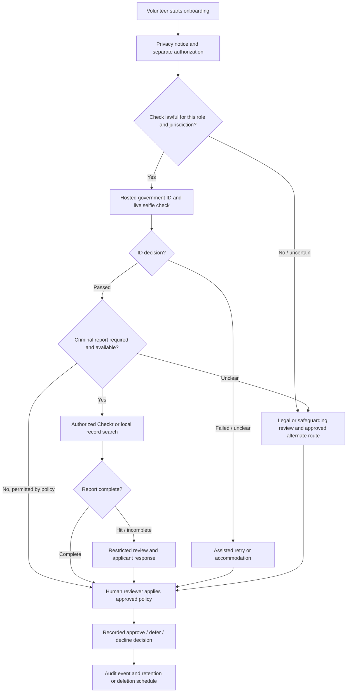

# Identity Verification for Volunteer Onboarding - BRD and Vendor Evaluation

## 1. Document control

| Field | Value |
|---|---|
| Title | Identity Verification for Volunteer Onboarding - Business Requirements and Vendor Evaluation |
| Author | Gyashaswi (product analysis, issue [#694](https://github.com/saayam-for-all/data/issues/694)) |
| Date / source review | November 25, 2026 |
| Version | 0.3 - pricing and technical validation |
| Status | **Draft - leadership/legal review required; no purchase approved** |
| Reviewers (proposed) | Product/volunteer operations lead, safeguarding/legal/privacy lead, engineering lead, finance/procurement lead |
| Repository target | `data-analytics/docs/identity-verification-brd.md` on branch `test` |

**Evidence key:** **Fact** = linked public vendor/government/repository documentation (sources checked **2026-11-25**, unless explicitly labeled otherwise). **Proposal / estimate** = Saayam target, scoring judgement, or cost scenario; not a vendor commitment. No provider accounts, vendor outreach, genuine IDs or personal data were used.

## 2. Executive summary (leadership decision)

**Decision requested.** Approve a **sandbox-only evaluation of Didit versus Veriff** for international government-ID verification and live selfie/liveness, and evaluate **Checkr separately** for criminal-history searches *only* in eligible countries and volunteer roles. Confirm the budget cap, legal/privacy owner, screening policy and whether Saayam can create test accounts. Do **not** authorize procurement, real-ID uploads, production integration or automated volunteer promotion yet. [R01][S07][L03]

**Problem.** Saayam must establish that prospective volunteers are who they claim to be *and*, where legally permissible, assess relevant criminal records and pending cases before promotion. **An authentic ID, liveness pass or sanctions/watchlist result does not prove that a person has no criminal history.** Court coverage and screening permissions differ by jurisdiction. [S07][S11][L03]

**Provisional recommendation:** **Didit** for the ID-document, passive-liveness and face-match bundle (**$0.33 per completed ID check**) and **Checkr** for selectively authorized criminal-record screening. Didit's optional sanctions/PEP/watchlist check adds **$0.20**, but is not a criminal-report replacement. Checkr US Basic starts at **$29.99** and has limited search depth; International entry screening starts at **$32**, with country-dependent coverage and extra court/government charges. Use a legally approved local alternative where the required records cannot be obtained through Checkr. [S01][S07][S11]

| Monthly completed applicants (illustrative) | Didit ID only, lowest **monthly** published tier* | Didit ID for all + Checkr US Basic for **10%** | Didit ID for all + Checkr US Basic for **100%** |
|---:|---:|---:|---:|
| 100 | **$23.00** | **$322.90+** | **$3,022.00+** |
| 500 | **$142.40** | **$1,641.90+** | **$15,137.40+** |
| 1,000 | **$299.00** | **$3,298.00+** | **$30,289.00+** |

*All USD; assumes eligible Didit monthly work-email credits and no other usage. The price-minimizing monthly tier is Free at 100, Growth at 500 and Scale at 1,000. Checkr estimates exclude pass-through fees, retries, taxes and staff time; 10% is an **illustrative assumption, not Saayam policy**. Adding Didit watchlists on every applicant changes the IDV portion to **$43.00 / $238.40 / $426.00**, respectively. See §11 and its equations. [S12][S14][S07]

**Runner-up:** **Veriff Essential + legally suitable background screening**, subject to country/document performance; Veriff's published Essential rate is **$0.80 per check** with a **$49 monthly minimum**. **Stripe Identity** is an integration-friendly alternative given Saayam's existing Stripe account, but it costs **$1.50 per check** after any trial allowance and supplies no criminal-report product. [S03][S04]

**Main risks:** inaccessible/incomplete criminal records, insufficient local document coverage, biased false matches, sensitive biometric and criminal-offence data, and unpredictable registry fees. Require a jurisdiction-by-role legal matrix, a human review/appeal process and a privacy/retention assessment before any live pilot. [L01][L03][S07]

## 3. Business context and problem statement

**Known from issue #694:** prospective volunteers upload government IDs from multiple countries; Saayam currently plans manual first-phase review delegated to an outside provider. The organization wants low cost, broad document support, API compatibility and preferably live camera capture. [R01]

**Today - process assumption pending validation:** an admin reviews submitted files manually, without a documented uniform authenticity, liveness or criminal-screening workflow. The issue does **not** establish that this process is already deployed. Verify the actual current approval process with operations. [R01]

**Cost of doing nothing (analysis):** inconsistent decisions, forged or stolen-document risk, inability to substantiate background checks, slow onboarding, exposure of sensitive documents to reviewers and preventable trust/safeguarding incidents. A passed ID check alone never establishes absence of criminal history. [S07][S11]

## 4. Objectives and measurable success criteria (proposed)

| Metric | Pilot target | Why / measurement |
|---|---|---|
| IDV turnaround | ≥90% provider decisions within 5 minutes after complete submission | Speed while allowing escalation; measure provider completion timestamps |
| End-to-end eligible approval | ≥90% within 5 business days *when criminal records are available* | Records vary widely by country; separately report unserviceable jurisdictions |
| Document coverage | ≥95% of **actual** volunteer-country/document combinations in pilot | Country counts alone are insufficient; validate sample mix |
| Completion | ≥85% of eligible applicants finish first-pass IDV or assisted retry | Monitor drop-off by device, country and document |
| Correct handling | 100% review for inconclusive IDV or screening hits | Avoid automatic criminal-history adjudication |
| Identity check cost | ≤$1.50 per completed IDV excluding background screening | Compare published products and retries |
| Background-check coverage | Record legal availability, check type and exceptions for 100% of pilot countries | No false claim of universal criminal history |
| Privacy control | 100% consent recorded, role-based access, auditable disposition | Essential for sensitive evidence |

Targets are **proposed acceptance thresholds**, not supplier SLAs. Break down metrics by country, ID type, mobile browser, disability/accessibility needs and provider.

## 5. Scope

**In:** government-document authenticity; live selfie/presence + face match where lawful; country/document eligibility; legally permissible criminal-record and optional watchlist screening; fraud/manual-review handling; consent and retention requirements; provider cost and architecture evaluation; sandbox-only pilot design.

**Out:** writing the application integration, changing Lambda/database schemas, final volunteer-promotion policy, obtaining criminal data without authority, real applicant processing in this research task, and vendor procurement/account creation. A criminal-record check is distinct from AML/PEP/watchlist screening. [S07][S11]

## 6. Stakeholders and users

| Group | Need |
|---|---|
| Applicant / volunteer | Clear reason for checks; localized/mobile-friendly document capture; consent; retry, accommodation and appeal path; privacy notice |
| Volunteer operations / reviewers | Case status, trustworthy document/screening evidence, queue and escalation, ability to mark manual decision with reason |
| Safeguarding / legal / privacy | Country/role screening eligibility; lawful basis; criminal-record rules; retention/deletion; complaint and false-match handling |
| Leadership / finance | Transparent all-in cost, coverage gaps, vendor risk, approval-rate and incident measures |
| Engineering / security | Hosted capture, server-issued sessions, signed webhooks, reliable status polling, minimal sensitive-data storage, audit/event mapping |

## 7. Current and target process

**Current:** Volunteer uploads a document → presumed administrative/manual review; the exact existing workflow and storage are **unconfirmed**. **Target:** check jurisdiction/legal eligibility, run provider-hosted IDV, perform the record screening required for that volunteer role, then make a **human** decision. [R01]

A vendor's **verified** signal never automatically promotes a volunteer; a watchlist or criminal-result hit is not by itself an automatic rejection. Future implementation may use Checkr's candidate invitations and `report.completed` events, with human oversight. [S08][S17]

## 8. Business requirements

Priorities: **Must** = required for go-live; **Should** = strong preference; **Could** = later optimization. **[Proposed]** denotes an analyst-added requirement beyond the five issue needs.

| ID | Priority | Requirement | Rationale | Acceptance criterion |
|---|---|---|---|---|
| BR-01 | Must | Authenticate government-issued ID | Prevent document forgery | Provider supplies pass/fail/review with document type and country |
| BR-02 | Must | Screen legally accessible criminal history / relevant pending cases independently of IDV | Safeguarding | For each enabled country/role, record legally permitted source, scope, results and limitations; no unsupported "clear everywhere" claim |
| BR-03 | Must | Minimize predictable total spend | Nonprofit affordability | Costs for 100/500/1,000/month, minimums, retries and background add-ons documented before approval |
| BR-04 | Must | Support volunteer countries and uploaded passport/driver-license/ID variants | Global access | Coverage confirmed by country **and** document type for ≥95% of observed mix (proposed target) |
| BR-05 | Must | Support future AWS Lambda/Python/API Gateway/Postgres/web integration | Platform fit | Provider has documented API, authenticated webhook or polling, hosted/SDK capture and sandbox |
| BR-06 | Should | Live selfie, liveness and match to ID portrait | Reduce impersonation | Test live-capture and mismatch outcomes with synthetic fixtures; manual alternative exists |
| BR-07 | Must **[Proposed]** | Give explicit notice, lawful consent/other legal basis and separate screening authorization | Privacy and record-screening law | Signed-off notices, records of consent/authorization and legal country matrix before production |
| BR-08 | Must **[Proposed]** | Human review of exceptions and safeguarding outcomes | Prevent unsafe or unfair automatic decisions | All hits, failures and unavailable searches move to reviewer queue; reason, reviewer and date recorded |
| BR-09 | Must **[Proposed]** | Minimize and delete sensitive data | Reduce breach/legal exposure | Written retention schedule, access roles, vendor DPA and **demonstrated deletion/export behavior at the selected plan tier** approved |
| BR-10 | Should **[Proposed]** | Provide accessible/localized capture and device handoff | Avoid excluding applicants | Tested browser/mobile capture and alternative route across pilot locales |
| BR-11 | Must **[Proposed]** | Authenticate callbacks and deduplicate results | Integrity | Vendor provides signature/auth scheme; no webhook alone can automatically promote a volunteer |
| BR-12 | Could **[Proposed]** | Track completion and cost by region/provider | Continuous improvement | Export report of costs, outcomes and exception rate without storing raw IDs |

The first six requirements express the issue's five business needs, with ID authenticity and criminal screening split because they are different services. [R01]

## 9. Market overview and selection method

**Method (research, 2026-11-25):** shortlist public, developer-documented products with a government-ID or background-screening capability; prefer public pricing, hosted capture, international document support and test environments. Evaluate seven: **Stripe Identity, Didit, ID.me, Veriff, Sumsub, Persona and Checkr**. This includes the three named in the issue. **Important:** Checkr is primarily the *criminal-screening complement*, not a replacement for ID+live-selfie services. [S01]–[S10]

**Coverage claims are provider-marketed reach, not evidence that every local document, criminal record or applicant will be supported.** Require a country/document-by-country pilot matrix before purchase. [S05][S06][S07]

## 10. Vendor evaluation

### A. Capability and coverage matrix (publicly documented; **not** live-tested)

Legend: **Yes** = documented, **Add-on** = optional/extra charge, **Partial** = related capability but not full criminal records, **No evidence** = cannot rely on it, **Specialist** = dedicated background-screening capability.

| Provider | Government ID authenticity | Selfie / liveness | AML / watchlists | Criminal-history / pending-case search | Document reach (vendor claim) | Public IDV price / commercial posture | Source |
|---|---|---|---|---|---|---|---|
| **Didit** | Yes | Yes | Add-on ($0.20 AML) | **No evidence of comprehensive criminal-record product** | Claims 220+ countries | $0.33 bundle; monthly credit conditions | [S01][S02] |
| **Veriff** | Yes | Yes | Add-on ($0.64 AML) | **No evidence** | 230+ countries/territories, 12,500+ specimens | Essential $0.80; $49 monthly minimum | [S04] |
| **Sumsub** | Yes | Yes | Included in Compliance plan | **No evidence** | 220+ countries, 14,000+ ID documents | Basic $1.35; $149 minimum | [S05][S06] |
| **Persona** | Yes | Yes | Available screening modules; confirm contract | **No evidence** | 200+ countries | **Contact sales**; startup eligibility restricted | [S09] |
| **Stripe Identity** | Yes | Yes (selfie match/live capture) | Not criminal screening | **No evidence** | Government IDs from 100+ countries | $1.50; first 50 free introductory offer | [S03] |
| **ID.me** | Yes | Yes in configured proofing flows; validate specific product | No evidence as criminal product | **No evidence** | ID documents from 230+ countries/territories; type varies | **Contact sales**; partner setup | [S10] |
| **Checkr** | ID verification available in selected packages/add-ons; **not evaluated as a selfie-IDV replacement** | No documented standard selfie bundle here | Yes, global watchlists | **Specialist** US criminal reports; international searches where legally available; pending-case visibility varies | Screening in 200+ countries/territories, by country/check | US Basic (limited criminal search) from $29.99; international Basic from $32 | [S07][S08] |

**Crucial distinction:** A sanctions, politically exposed person (PEP), adverse-media or law-enforcement watchlist hit is *not* proof of a criminal conviction; no hit does *not* clear criminal history or pending charges. For example, Didit's own AML guidance distinguishes AML list results from criminal records. [S11]

### B. Coverage against **all** requirements

**Read first:** **Y** = marketed product capability; **P** = partial / conditional / requires Saayam process or contract; **N** = not a qualifying product capability; **?** = not confirmed from public sources. The matrix is an analyst assessment, **not certification, live testing or a promise that country-specific records exist**. BR-02 requires a separately authorized criminal-record source: AML/watchlist alone is **N** for that criterion. BR-07–12 are partly Saayam controls, not features any vendor can satisfy alone.

| Requirement | Didit | Veriff | Sumsub | Persona | Stripe | ID.me | Checkr |
|---|:---:|:---:|:---:|:---:|:---:|:---:|:---:|
| **BR-01** ID document check | Y | Y | Y | Y | Y | Y | P |
| **BR-02** criminal records / pending cases | N | N | N | N | N | N | **P** |
| **BR-03** predictable low total cost | Y | P | P | ? | P | ? | P |
| **BR-04** actual-country/document coverage | P | P | P | P | P | P | P |
| **BR-05** AWS/Python/API + hosted flow | Y | Y | Y | Y | Y | P | Y |
| **BR-06** live selfie and face match | Y | Y | Y | Y | Y | P | P |
| **BR-07** legal consent/authorization | P | P | P | P | P | P | P |
| **BR-08** human review of exceptions | P | P | P | P | P | P | P |
| **BR-09** data minimization/deletion | P | P | P | P | P | P | P |
| **BR-10** accessibility/localization | P | P | P | P | P | P | P |
| **BR-11** authenticated result handling | P | P | P | P | P | P | P |
| **BR-12** cost/outcome reporting | P | P | P | P | P | P | P |

**Hard gates before selection:** independently confirm BR-01, BR-02 (where required), BR-04 and privacy/legal eligibility for the real countries/roles. A low weighted score or cheap AML feature never waives these gates. Checkr's BR-02 is partial because the published entry package and international records do not guarantee all local courts or pending cases. [R01][S07][L03]

### C. Weighted decision score (analyst judgement, not vendor certification)

Weights reflect two hard trust needs plus global volunteer access: **ID authenticity 20%, selfie/liveness 10%, legally useful criminal/record capability 20%, actual country/document reach 15%, recurring price 15%, integration 10%, privacy controls 5%, assisted/manual handling 5%** (total **100%**). Scale **0–5**, where 0=no evidence, 3=adequate/conditional, 5=strong published fit. Unsupported capabilities receive conservative scores; scores are provisional until pilot/vendor terms. Weighted points = Σ(weight × score ÷ 5).

| Vendor | ID 20 | Live 10 | Criminal 20 | Reach 15 | Price 15 | API 10 | Privacy 5 | Review 5 | **Total / 100** |
|---|---:|---:|---:|---:|---:|---:|---:|---:|---:|
| Didit | 5 | 5 | 1 | 5 | 5 | 5 | 3 | 3 | **80** |
| Veriff | 5 | 5 | 1 | 5 | 4 | 5 | 4 | 4 | **79** |
| Sumsub | 5 | 5 | 1 | 5 | 3 | 5 | 4 | 4 | **76** |
| Persona | 5 | 5 | 1 | 5 | 2 | 5 | 4 | 4 | **73** |
| Stripe Identity | 5 | 4 | 0 | 3 | 3 | 5 | 5 | 4 | **65** |
| ID.me | 5 | 4 | 0 | 5 | 1 | 3 | 4 | 5 | **61** |
| Checkr | 1 | 0 | 5 | 4 | 1 | 5 | 4 | 4 | **57** |

**Interpretation:** This ranking is a *directional shortlist score*, not a compliance pass. The seven vendors serve different functions, so Checkr is a **screening specialist**, not a failed IDV vendor. A high total score never overrides the hard gate for BR-02 or legal/privacy eligibility. IDV ranking does **not** mean Didit alone satisfies BR-02. Checkr's lower aggregate score reflects its different function; adding a background-check provider is mandatory wherever the role-specific legal policy requires a criminal search. Existing Stripe access does not automatically establish eligibility for Stripe Identity; confirm with Stripe. “Privacy” scores reflect publicly visible controls rather than an audited Saayam DPA. [S01]–[S10]

### D. Brief vendor profiles

- **Didit - leading IDV cost choice.** Document/liveness/face-match/device bundle, hosted workflow, API/webhooks/sandbox; very low published unit price. Surprise: as of **November 1, 2026**, Didit introduced a **$10 work-email monthly credit** instead of the older 500-free-check allowance; some older help/product pages still describe the old model, so use its dated announcement for pricing. [S12] Verify the provider's definition of a billable completed check and charges for retries during contracting. AML is not criminal records. **Limit:** confirm data-processing terms, regional documents and assisted-review routes. [S01][S02][S11]
- **Veriff - runner-up IDV.** Hosted page, robust reach, sandbox, APIs/webhooks; Essential $0.80 with $49 minimum. **Limit:** Essential does not include the human-review capabilities of Plus ($1.39; $99 minimum), and optional AML costs extra. [S04]
- **Sumsub - broad feature set.** 220+ country/document coverage, WebSDK/links and webhooks, Basic with IDV+liveness. **Limit:** Basic ($1.35; $149 minimum) **does not include AML screening**; Compliance ($1.85; $299 minimum) includes AML but **not a universal criminal background report**. [S05][S06]
- **Persona - flexible workflow.** Hosted, embedded and mobile SDK flows, 200+ country ID coverage, API/webhooks, sandbox. **Limit:** standard per-check enterprise pricing not published; startup-program credit is not guaranteed to a nonprofit. [S09]
- **Stripe Identity - easiest existing-account candidate.** Prebuilt capture, API, 100+ country IDs, selfie verification, strong documented data controls. **Limit:** at $1.50/verification, costs more than Didit/Veriff at volume; no criminal history screening. [S03]
- **ID.me - high-assurance option.** Supports many countries' legal IDs and OAuth/partner APIs, with assisted/video pathways in selected flows. **Limit:** contract, use-case fit, partner testing arrangements and price require **contact sales**; available document *types* vary by country. [S10]
- **Checkr - criminal-screening complement.** US Basic includes national criminal database, sex-offender and global watchlist searches, **but no routine unlimited county/state/federal court coverage**; international Basic includes international criminal/**or adverse media** and global watchlists. **Limit:** country-specific scope, pass-through fees, and US Basic's limitations mean “no reportable hit” is not “no criminal record anywhere.” [S07][S08]

## 11. Cost analysis (USD/month, analyst calculation)

**Assumptions:** 100 / 500 / 1,000 completed identity checks per month; exactly one billable IDV bundle per applicant and, where noted, one paid criminal report for the stated share. No annual prepayment discounts, one-time trials, taxes, retries, support labor, court/registry pass-through fees or other product usage. Didit's Free credit requires an eligible work email; no incremental credit is assumed on top of the published **Growth $115** or **Scale $350** plan credit. The plan-minimizing calculations below use current **monthly** billing, not an enterprise quote. Published rates and legal availability must be reconfirmed before purchase. [S12][S14][S07]

| Vendor / scope | Model / important limits | **100** | **500** | **1,000** | Criminal report included? |
|---|---|---:|---:|---:|---|
| **Didit ID + selfie + liveness** | **$0.33/check**, select cheapest monthly Free / Growth / Scale | **$23.00** (Free) | **$142.40** (Growth) | **$299.00** (Scale) | No |
| Didit ID + AML/watchlist | $0.33 + $0.20/check; cheapest published monthly plan | **$43.00** (Free) | **$238.40** (Growth) | **$426.00** (Scale) | **No** - sanctions/PEP only |
| Stripe Identity, steady state | $1.50/check, 50 introductory checks free initially | $150 | $750 | $1,500 | No |
| Veriff Essential | $0.80/check, $49/month minimum; AI-only | $80 | $400 | $800 | No |
| Veriff Essential + AML | $0.80 + $0.64/check, plus plan minimum | $144 | $720 | $1,440 | No |
| Veriff Plus (assisted vendor review) | $1.39/check, $99 minimum | $139 | $695 | $1,390 | No |
| Sumsub Basic | $1.35/check; $149 minimum; **AML not included** | $149 | $675 | $1,350 | No |
| Sumsub Compliance | $1.85/check; $299 minimum; includes AML | $299 | $925 | $1,850 | No court report |
| Persona | **Contact sales** | Quote needed | Quote needed | Quote needed | No verified universal report |
| ID.me | **Contact sales** | Quote needed | Quote needed | Quote needed | No verified universal report |
| Checkr US Basic **alone** | $29.99+/report; **limited** US criminal coverage | $2,999.00+ | $14,995.00+ | $29,990.00+ | Partial US coverage |
| Checkr International entry **alone** | $32+/report; international criminal **or adverse-media**, by country | $3,200.00+ | $16,000.00+ | $32,000.00+ | Depends on country |
| **Didit ID + Checkr US Basic for 10%** | US Basic on 10% high-trust roles (illustrative only) | **$322.90+** | **$1,641.90+** | **$3,298.00+** | Only 10% screened |
| Didit ID + Checkr US Basic for 100% | IDV and US Basic on each applicant | **$3,022.00+** | **$15,137.40+** | **$30,289.00+** | Limited US scope |
| Didit ID + Checkr International entry for 100% | Country-dependent; base rate only | **$3,223.00+** | **$16,142.40+** | **$32,299.00+** | Varies; may be adverse media |

**How Didit plan costs were calculated (important):** Given monthly quantity `n` and list unit cost `u`, model cash expense as **plan fee + max(0, n × u × discount multiplier − included plan credit)**. Free = `max(0, n × u − 10)` (if eligible), Growth = `99 + max(0, n × u × 0.96 − 115)`, and Scale = `299 + max(0, n × u × 0.90 − 350)`. For example, with `n = 1,000` and `u = $0.33`, **Scale costs $299.00** (the discounted $297 usage is fully covered by its $350 credit), less than Growth's $300.80. With 500 ID checks, **Growth costs $142.40**, not $155; with 1,000 ID + AML checks, **Scale costs $426.00**, not $477. Plans are **alternatives**, not stackable: do not subtract an extra $10 Free credit from paid plans. This is our calculation, based on official rate/credit rules, not a vendor quote. [S12][S14]

**Screening scope warning:** Checkr US Basic ($29.99+) includes a national criminal database search, sex-offender register and global watchlist; it is **not** a comprehensive all-courts search. Essential ($59.99+) adds county searches and Complete ($94.99+) adds state/federal searches. International entry screens may involve *adverse media instead of court records*, so coverage cannot be assumed to meet Saayam's pending-case requirement. Contract and country-level availability must be checked first. [S07][S13]

**Hidden costs / sensitivity:** local court and registry charges, higher Checkr screening packages, rechecks/retries, paid completed-but-declined IDV steps, translations, optional NFC, AML monitoring, consent/adverse-action handling, international applicant assistance, taxes and foreign-exchange costs. A role mix of 10% is an unapproved example; 100% formal screening is about 10× the **background-report portion** of the 10% model, not 10× the whole budget. Do not claim a universal percentage surcharge on court fees. Didit bills completed **declined** feature checks as well. [S14][S07][S04]

**Manual visual review comparator - analyst scenario, not an observed baseline:** 20 minutes × $25/hour loaded staff time = **$8.33/applicant**; about **$833 / $4,167 / $8,333 per month** at 100 / 500 / 1,000 applicants. That is not equivalent to automated forgery detection, liveness or criminal-report coverage; Saayam must supply its real manual handling time, rework and labor costs. No background-check savings should be claimed without comparable scope.

## 12. Integration and technical fit (future design; no integration built)

**Confirmed technical context:** The data repository documents AWS Lambda, Python and PostgreSQL (Aurora). The `saayam-for-all/webapp` `test` branch declares React 18, Vite and AWS Amplify. Issue #694 identifies API Gateway and an existing Stripe account as planning inputs. A separate native iOS/Android app **has not been confirmed**; evaluate mobile-browser capture first and ask the web/mobile owners before selecting native SDKs. [R01][R02][R03]

**Proposed asynchronous flow:** React starts onboarding → API Gateway/Python Lambda creates a provider-hosted IDV session → store a random applicant correlation ID and **pending** status in PostgreSQL → applicant completes hosted capture → vendor callback authenticates the server-side result (poll when needed) → determine role/country eligibility for a **separate** background report → Checkr or authorized local provider delivers the report → reviewer records approval/defer/decline → retention/deletion schedule starts. Never treat the browser redirect alone as a verified result.

| Provider | Capture / API and Python | Callback validation and test environment | Estimated future effort / qualification | Evidence |
|---|---|---|---|---|
| **Didit** | Hosted redirect or JS Web SDK; REST API and official Python **`didit-sdk`** (`Didit.sessions.create`, `retrieve_decision`) | **`X-Signature-V2`**, HMAC-SHA256 full-payload signature; SDK `didit.webhooks.verify`; free sandbox with synthetic scenarios | **Low** - strong Lambda/Python fit; confirm workflow eligibility, applicant coverage and retention | [S15][S16] |
| **Stripe Identity** | Hosted flow or Stripe.js, official **`stripe`** Python SDK and Identity verification sessions | **`Stripe-Signature`** via `stripe.Webhook.construct_event`; Stripe test mode | **Low** - existing Stripe account helps, but Identity approval and a separate record-screening integration remain | [S03][S20] |
| **Veriff** | Hosted page or JS SDK, REST API (Python `requests`/`httpx` wrapper) | **`X-HMAC-SIGNATURE`** and `X-AUTH-CLIENT`; 15-day test/trial | **Low–medium** - straightforward hosted flow; vendor manual review available on Plus, not Essential | [S04][S18] |
| **Sumsub** | Hosted/WebSDK, REST API with App Token request signing | **`X-Payload-Digest`** with `X-Payload-Digest-Alg`; configured sandbox/test webhook | **Medium** - verification-level configuration, signature algorithms and multi-stage statuses | [S05][S06][S19] |
| **Persona** | Hosted/embedded inquiry flow, REST APIs and developer tools | Signed webhooks, sandbox for approved plan | **Medium** - inquiry-template setup and package entitlement confirmation | [S09] |
| **ID.me** | Hosted OAuth2/OIDC identity flow; services API | Partner-specific callbacks/authorization, test access by arrangement | **Medium–high** - procurement, use-case approval and configured flow add complexity | [S10] |
| **Checkr** | Hosted candidate invitation; REST API for candidates, invitations and reports | **`X-Checkr-Signature`** HMAC-SHA256 HTTPS webhooks or **AWS SNS** notifications; staging/test API | **Medium** - SNS fits AWS, but credentials, scope, authorization and adverse-action process are separate | [S07][S08][S17] |

**Proposed engineering security gates:** Verify signatures using the vendor-specified canonicalization/bytes (not one generic HMAC parser); require timestamp/replay checks where supported; apply idempotency by event ID and fetch the authoritative status before changing state. Checkr **does not guarantee webhook ordering**. For SNS, grant only scoped Publish permission; do not embed credentials in public source or the BRD. Store only minimal metadata (`volunteer_id`, provider, opaque session ID, jurisdiction, states, timestamps, reviewer and retention deadline), redact logs, and separate sandbox from production. **Vendor default retention may exceed the proposed 30–90-day window** (Didit currently lists up to one year on Free and longer on paid tiers); obtain contract/deletion capabilities before any real-data pilot. [S14][S16][S17]

## 13. Compliance, privacy and legal considerations

- **Biometric matching:** in EU/UK contexts, biometric data used to identify a person may be **special-category data**; lawful basis/Article 9 condition, transparency, risk assessment and consent suitability must be assessed. Explicit consent is *not automatically sufficient* when it cannot be freely refused. Provide an appropriate alternate process. [L01][L02]
- **Criminal records:** GDPR Article 10 and local laws can restrict processing criminal-offence data even when a volunteer consents. Do not buy or retain records until a country-and-role legality assessment is approved. [L02][L03]
- **US:** FCRA and similar state requirements **may** apply to third-party screening depending on the purpose and applicant relationship; do not assume every volunteer report is automatically covered or exempt. Counsel must confirm permissible purpose, disclosure/authorization, disputes, adverse-action rules and role-specific screening limits. [L04]
- **UK:** Eligible volunteer Standard/Enhanced DBS checks may be free; Basic DBS has a fee. Enhanced/Standard checks require legally eligible roles. A UK DBS check cannot comprehensively search other countries' records, including for a person who lived abroad. Do not mark international applicants “clear” solely on this basis. [L05][L06][L07]
- **Other countries:** criminal-certificate availability, consent, spent records, pending-case access, language, local service operators and transfer rules are **country-specific unknowns**. Leadership must first list the countries/roles; legal and vendor documentation must map each one before any real checks.
- **Controls (proposed):** separate identity and screening notices; purpose limitation, data minimization, DPA/vendor subprocessor and hosting review; encryption in transit/at rest; MFA and least-privilege access; no public URLs with personal data; data-subject deletion/access and breach-response plan; retention interval approved by counsel (do not invent a universal legal duration); human appeal and nondiscrimination procedures. [L01][L02][L03]

**Safeguarding rule:** a missing record is not a confirmed clean history, and a watchlist or pending-charge hit is not itself a conviction or automatic grounds to reject someone. An authorized reviewer must apply a written, lawful, role-relevant policy. [S07][L03][L04]

## 14. Risks, assumptions, dependencies and constraints

| Risk | Likelihood | Impact | Mitigation / owner (proposed) |
|---|---|---|---|
| Criminal checks unavailable or incomplete by country | High | High | Legal country/role matrix; approved alternate route; safeguarding owner |
| 2026 pricing/promotions change or country extras appear | High | Medium | Recheck vendor price sheet before procurement; pilot billing caps; finance |
| False rejection, bias or mismatch from face/ID tools | Medium | High | Assisted retry, manual review, appeal and segmented monitoring; ops |
| Data transfer / biometric or criminal record noncompliance | Medium | High | DPA, DPIA where needed, counsel approval and minimization; privacy lead |
| Breach via uploaded ID, storage or webhooks | Medium | High | Hosted upload, authenticated callbacks, least privilege, redaction and deletion; security |
| Vendor default retention exceeds Saayam policy | Medium | High | Validate deletion API, retention configuration and DPA before contracting; privacy/procurement |
| Unsupported ID type/device or poor connectivity | High | Medium | Country/document matrix, accessible fallback and device handoff; product |
| Provider outage / undelivered webhook | Medium | Medium | Polling recovery, duplicate protection, pending status; engineering |
| Wrongful inference from “no match” or unresolved court case | Medium | High | Explicit scope text, reviewer training, no auto-adjudication; safeguarding |

**Assumptions / dependencies:** actual monthly applicant volume, high-risk roles, target countries and ID types, existing review process, legal basis, authorized screening provider, fundraising/budget, and mobile-app status **not supplied**. The verified *web* technology is React/Vite; a native mobile app remains unconfirmed. [R01][R02][R03]

**Constraints:** documentation-only issue; public sources and vendor sandboxes only; no real IDs/PII, credentials, account creation, vendor sales contact, application integration or deployment without maintainer permission. [R01]

## 15. Recommendation and alternatives

**Approve a limited evaluation, not an unqualified provider contract:**

1. **Primary IDV: Didit** - lowest publicly listed bundle among evaluated options; hosted verification and developer tooling; test its coverage, false declines, data agreement and actual billing. **Criminal history not provided by this purchase.** [S01][S02]
2. **Separate screening: Checkr only where lawful and suitably scoped** - baseline for US and supported international cases. Ask a legally authorized route for countries/roles not supported by Checkr and obtain confirmation of pending-case search depth. Do not substitute AML for the record requirement. [S07][S08][L03]
3. **Human approval required** after both applicable results; exceptions routed to safeguarding review. Confirm what happens where legal screening cannot occur before allowing promotion.

**Runner-up: Veriff Essential + jurisdiction-appropriate background provider.** Choose Veriff if ID document performance, assisted options or security/retention terms outperform Didit enough to justify the higher cost. Consider **Stripe Identity** if Saayam's existing Stripe integration and data controls outweigh global coverage and price; **Sumsub** if regulated AML workflow is actually required; **ID.me/Persona** only after commercial fit and price are established. [S03][S04][S05][S09][S10]

## 16. Proposed next steps and pilot gates

| Step | Owner (proposed) | Deliverable / gate |
|---|---|---|
| 1. Confirm roles and jurisdictions | Leadership + operations | Country/ID-type matrix, volunteer role categories, screening policy and estimated volumes |
| 2. Legal/privacy sign-off | Counsel/privacy/safeguarding | Legal basis, criminal screening authorization by jurisdiction, consent/notice and retention approach |
| 3. Sandbox-only evaluation | Product + engineering | Compare Didit and Veriff with provider-supplied mock/test fixtures; optionally Stripe Identity test mode; **no live IDs** |
| 4. Compare background paths | Safeguarding + procurement | Checkr package/country eligibility plus allowed country-specific alternatives; **ask maintainer before contacting sales** |
| 5. Report pilot metrics | Product + finance | Successful document combinations, errors, completion/turnaround, modeled unit costs, accessibility exceptions |
| 6. Leadership decision | Leadership | Approve supplier/commercial terms and future engineering story, or defer/choose runner-up |

**Proposed sandbox test set:** at least 30 *synthetic* journeys spanning countries, documents, poor capture, expired/unsupported ID, selfie mismatch and webhook retry; mock country gaps and duplicate events. The 30-case target tests flow behavior, **not** statistical verification accuracy. A separate live-user pilot would require approval, consent and legal/privacy controls.

## 17. Open questions for leadership

1. Which **countries of residence and ID-issuing countries** account for 80–90% of volunteer applications? Which passport/driver-license/national-ID variants do people actually upload?
2. Which roles work with children, vulnerable people, payments or sensitive data, and what criminal screening is legally required for each role?
3. Does **every** volunteer need a criminal report? If a jurisdiction prohibits checks, can an alternate approved safeguarding route allow onboarding or must promotion stop?
4. Are “pending cases” required where public/authorized records allow access, and what is the policy for arrests without conviction, old cases, false matches and appeals?
5. What are monthly volumes, budget ceiling, expected staff review labor cost and acceptable time to volunteer approval?
6. Who is Saayam's legal/data-controller owner and who signs vendor DPA, biometric notice, retention policy and screening authorization?
7. Does Saayam maintain a **separate native mobile app**, or is mobile-browser capture sufficient? Confirm with frontend/mobile owners.
8. Is the current process really manual, and where are existing uploaded IDs stored and deleted?
9. Is Saayam eligible for Didit's work-email credit/nonprofit terms? Are fees in local currencies relevant?
10. Will the existing Stripe account be enabled for Identity in all intended operating jurisdictions? No assumption that payments access equals Identity approval.

## 18. Appendix - evidence sources and glossary

**Source-review date: 2026-11-25 for every row.** Prices/features may change; source claims do not prove contractual entitlement or local legal eligibility. Public documentation and repository pages only.

| ID | Source (publisher) | Link | Checked |
|---|---|---|---|
| R01 | Issue #694 requirements (Saayam) | https://github.com/saayam-for-all/data/issues/694 | 2026-11-25 |
| R02 | Data repository contributing guide - Python/Lambda/Aurora (Saayam) | https://github.com/saayam-for-all/data/blob/test/data-engineering/CONTRIBUTING.md | 2026-11-25 |
| R03 | Webapp `package.json` - React/Vite (Saayam) | https://github.com/saayam-for-all/webapp/blob/test/package.json | 2026-11-25 |
| S01 | Current published full ID + optional AML list prices (Didit) | https://didit.me/solutions/ | 2026-11-25 |
| S02 | Current published ID + AML + free-credit model (Didit) | https://didit.me/products/aml-screening/ | 2026-11-25 |
| S03 | Identity product, coverage, privacy (Stripe) / USD pricing (Stripe) | https://stripe.com/identity ; https://stripe.com/pricing | 2026-11-25 |
| S04 | Self-Serve plans, fees, features, document coverage, sandbox (Veriff) | https://www.veriff.com/pricing | 2026-11-25 |
| S05 | Basic/Compliance pricing, monthly minimums and trial (Sumsub) | https://sumsub.com/pricing/ | 2026-11-25 |
| S06 | Global ID coverage (Sumsub Docs) / webhooks (Sumsub Docs) | https://docs.sumsub.com/docs/identity-verification ; https://docs.sumsub.com/docs/user-verification-webhooks | 2026-11-25 |
| S07 | US and international packages, screening coverage, pass-through fees (Checkr) | https://checkr.com/pricing | 2026-11-25 |
| S08 | Candidate invitations, API, staging and webhooks (Checkr Docs) | https://docs.checkr.com/apis/getting-started | 2026-11-25 |
| S09 | Pricing tiers and startup plan (Persona) / country coverage and workflows (Persona Docs) | https://withpersona.com/pricing ; https://help.withpersona.com/articles/5vXD7S7pQCq8Q9Z4RztxLw/ ; https://docs.withpersona.com/2026-09-29/inquiries | 2026-11-25 |
| S10 | International legal IDs and country-specific types (ID.me Docs) / Services API and sandbox (ID.me Docs) / enterprise (ID.me) | https://docs.id.me/guides/learn-more/supported-legal-ids ; https://docs.id.me/apis/services-api/overview ; https://docs.id.me/integrations/deploy-and-monitor/launching-in-production ; https://www.id.me/enterprise | 2026-11-25 |
| S11 | AML screen scope (Didit) | https://didit.me/products/aml-screening/ | 2026-11-25 |
| S12 | **Nov 1, 2026 pricing revision:** replacing 500-free-check allowance, $10/month credit, Growth/Scale credits and discounts (Didit official announcement) | https://didit.me/blog/new-pricing-november-2026/ | 2026-11-25 |
| S13 | International screening fees and country-specific checks (Checkr) | https://help.checkr.com/s/article/International-non-US-background-check-prices-and-fees | 2026-11-25 |
| S14 | Published monthly plan credit/discount rules and billable completed checks (Didit) | https://help.didit.me/billing-credits/how-pricing-and-credits-work ; https://help.didit.me/billing-credits/what-counts-as-billable | 2026-11-25 |
| S15 | Official Didit Python `didit-sdk`, webhook verification helper | https://docs.didit.me/integration/server-sdks/python | 2026-11-25 |
| S16 | Didit signed webhook formats, V2/timestamp and test scenarios | https://docs.didit.me/integration/webhooks | 2026-11-25 |
| S17 | Checkr signed webhooks, ordering and AWS SNS | https://docs.checkr.com/apis/webhooks | 2026-11-25 |
| S18 | Veriff webhook HMAC authentication and raw-payload rules | https://devdocs.veriff.com/docs/webhooks-guide | 2026-11-25 |
| S19 | Sumsub webhook `X-Payload-Digest` and algorithm header | https://docs.sumsub.com/docs/webhook-manager | 2026-11-25 |
| S20 | Stripe Identity outcome webhooks and signature verification | https://docs.stripe.com/identity/handle-verification-outcomes ; https://docs.stripe.com/webhooks/signature | 2026-11-25 |
| L07 | UK volunteer DBS eligibility and overseas-record limitations (UK government) | https://www.gov.uk/guidance/dbs-check-requests-guidance-for-employers | 2026-11-25 |
| L01 | Biometric data lawful processing (UK ICO) | https://ico.org.uk/for-organisations/uk-gdpr-guidance-and-resources/lawful-basis/biometric-data-guidance-biometric-recognition/how-do-we-process-biometric-data-lawfully | 2026-11-25 |
| L02 | Data protection basics, special/criminal-offence data (European Data Protection Board) | https://www.edpb.europa.eu/sme/learn-the-basics/data-protection-basics_en | 2026-11-25 |
| L03 | Article 10 criminal data rules (UK ICO) | https://ico.org.uk/for-organisations/uk-gdpr-guidance-and-resources/lawful-basis/criminal-offence-data/what-are-the-rules-on-criminal-offence-data/ | 2026-11-25 |
| L04 | Third-party background screening and FCRA (US FTC) | https://www.ftc.gov/business-guidance/resources/background-checks-what-employers-need-know | 2026-11-25 |
| L05 | DBS volunteer checks and price (UK government) | https://www.gov.uk/government/publications/dbs-check-application-process-for-volunteers/disclosure-application-process-for-volunteers | 2026-11-25 |
| L06 | DBS overseas record limits and charity sector (UK government) | https://www.gov.uk/government/publications/dbs-guidance-leaflets/working-with-children-in-the-charity-sector-and-overseas-aid-organisations | 2026-11-25 |

**Glossary:** **IDV** = identity verification; **KYC** = know your customer; **AML** = anti-money-laundering screening (e.g., sanctions, PEP, adverse media), *not* a full criminal-record check; **PEP** = politically exposed person; **liveness** = test whether the face capture comes from a present, real person; **DPA** = data-processing agreement; **DPIA** = data-protection impact assessment; **SDK** = software development kit; **webhook** = server-to-server event notification; **FCRA** = US Fair Credit Reporting Act; **DBS** = UK Disclosure and Barring Service; **pass-through fee** = third-party database/court cost charged on top of screening provider's base price.

<!-- Inline evidence references, with review dates and additional URLs in the table above. -->
[R01]: https://github.com/saayam-for-all/data/issues/694
[R02]: https://github.com/saayam-for-all/data/blob/test/data-engineering/CONTRIBUTING.md
[R03]: https://github.com/saayam-for-all/webapp/blob/test/package.json
[S01]: https://didit.me/solutions/
[S02]: https://didit.me/products/aml-screening/
[S03]: https://stripe.com/pricing
[S04]: https://www.veriff.com/pricing
[S05]: https://sumsub.com/pricing/
[S06]: https://docs.sumsub.com/docs/identity-verification
[S07]: https://checkr.com/pricing
[S08]: https://docs.checkr.com/apis/getting-started
[S09]: https://withpersona.com/pricing
[S10]: https://docs.id.me/guides/learn-more/supported-legal-ids
[S11]: https://didit.me/products/aml-screening/
[S12]: https://didit.me/blog/new-pricing-november-2026/
[S13]: https://help.checkr.com/s/article/International-non-US-background-check-prices-and-fees
[S14]: https://help.didit.me/billing-credits/how-pricing-and-credits-work
[S15]: https://docs.didit.me/integration/server-sdks/python
[S16]: https://docs.didit.me/integration/webhooks
[S17]: https://docs.checkr.com/apis/webhooks
[S18]: https://devdocs.veriff.com/docs/webhooks-guide
[S19]: https://docs.sumsub.com/docs/webhook-manager
[S20]: https://docs.stripe.com/identity/handle-verification-outcomes
[L07]: https://www.gov.uk/guidance/dbs-check-requests-guidance-for-employers
[L01]: https://ico.org.uk/for-organisations/uk-gdpr-guidance-and-resources/lawful-basis/biometric-data-guidance-biometric-recognition/how-do-we-process-biometric-data-lawfully
[L02]: https://www.edpb.europa.eu/sme/learn-the-basics/data-protection-basics_en
[L03]: https://ico.org.uk/for-organisations/uk-gdpr-guidance-and-resources/lawful-basis/criminal-offence-data/what-are-the-rules-on-criminal-offence-data/
[L04]: https://www.ftc.gov/business-guidance/resources/background-checks-what-employers-need-know
[L05]: https://www.gov.uk/government/publications/dbs-check-application-process-for-volunteers/disclosure-application-process-for-volunteers
[L06]: https://www.gov.uk/government/publications/dbs-guidance-leaflets/working-with-children-in-the-charity-sector-and-overseas-aid-organisations
