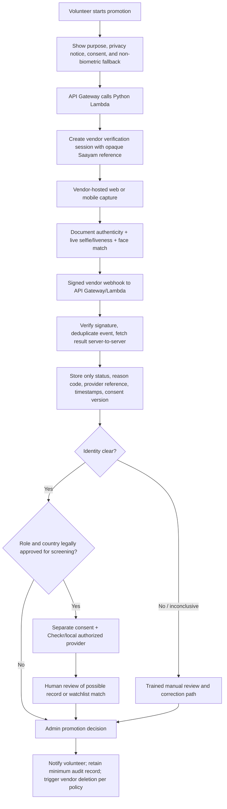

# Identity Verification for Volunteer Onboarding

## 1. Document control

| Field | Value |
|---|---|
| Document | Business requirements and vendor evaluation |
| Author | Unmesh Achar |
| Date | 2026-11-22 |
| Version | 0.1 |
| Status | Draft for leadership review |
| Reviewers | Saayam leadership, engineering lead, privacy/security reviewer, and legal counsel |
| Source issue | [saayam-for-all/data #694](https://github.com/saayam-for-all/data/issues/694) |

Facts in this document are linked to public sources and were checked on 2026-11-22 unless stated otherwise. Conclusions labelled **Assessment** or **Recommendation** are the author's judgment. Prices exclude taxes, foreign-exchange charges, implementation labor, and any negotiated nonprofit discount.

## 2. Executive summary

Saayam needs to establish that a volunteer is the person shown on a genuine government ID before promotion. It also wants to identify relevant criminal-history or pending-case risks. These are different capabilities: identity-verification vendors authenticate documents and compare a live face, while background-screening providers query jurisdiction-dependent records. AML watchlists, sanctions, politically exposed persons (PEP), and adverse-media searches are not substitutes for criminal-record checks.

**Recommendation (judgment):** pilot **Didit** for primary identity verification plus AML/watchlist screening, subject to security, privacy, and legal review. Its public documentation reports coverage of 220+ countries/territories and 14,000+ ID types; it offers document verification, passive liveness, face match, hosted/API/SDK integration, webhooks, and a sandbox ([Didit overview](https://help.didit.me/getting-started/what-is-didit), [coverage](https://help.didit.me/documents-coverage/supported-documents-and-countries)). Its public list price is unusually favorable for Saayam's expected volumes: the first 500 monthly checks are free separately for core modules, a completed core KYC flow is $0.33 after the allowance, and AML screening is $0.20 per screening ([free plan](https://help.didit.me/getting-started/free-plan), [billable actions](https://help.didit.me/billing-credits/what-counts-as-billable)). Under the assumptions in Section 12, estimated monthly cost is **$20 at 100**, **$100 at 500**, and **$365 at 1,000** volunteers. Configure the shortest justified retention period; Didit's published policy says retention is customer-configurable but may otherwise default to indefinite outside specified regions ([privacy policy](https://didit.me/terms/privacy-policy/)).

The **runner-up is Veriff**. It has similarly broad published coverage and transparent self-service pricing, and its PEP/sanctions/watchlist add-on is documented, but the estimated combined cost is $144, $720, and $1,440 at the same volumes ([pricing](https://www.veriff.com/pricing), [coverage](https://www.veriff.com/supported-countries)). **Stripe Identity** remains the low-integration-risk alternative because Saayam already has a Stripe account, but its public price is $1.50 per completed document-and-selfie verification, it reports 100+ supported countries, and its Identity documentation does not advertise criminal-record or AML/watchlist screening ([Stripe Identity](https://stripe.com/identity)).

For criminal records, add **Checkr or a country-specific equivalent only after counsel approves each country, purpose, consent flow, and decision policy**. Checkr advertises international checks in 200+ countries, but available data and legal permission vary by country ([international screening](https://checkr.com/legal/international), [international FAQ](https://help.checkr.com/s/article/26097812887319-FAQs-about-international-non-US-background-checks)). Its published U.S. Basic package is $29.99 per report before pass-through fees, making it far more expensive than identity verification ([package comparison](https://checkr.com/resources/articles/backgroundchecks-com-vs-checkr)). Do not automatically reject a volunteer from an AML match, arrest, pending case, or adverse-media result; route potential matches to trained review and provide a correction/appeal path.

**Decision needed:** approve a 50-person, sandbox-first Didit pilot and legal/privacy diligence; approve Veriff as the fallback; and decide whether Saayam has a documented, role-specific need for criminal-record screening that justifies a separate, jurisdiction-gated project.

## 3. Business context and problem statement

Saayam is a nonprofit platform that connects people who need help with volunteers ([project README](../../README.md)). The issue states that promotion to volunteer currently requires identity assurance and that an initial manual process is planned before work is delegated to an external provider ([issue #694](https://github.com/saayam-for-all/data/issues/694)). The desired control must support volunteers from many countries and different government-issued documents.

**Working assumption:** no production-grade, automated identity-verification workflow exists today. A reviewer would inspect uploaded material manually, with inconsistent access to document expertise and official record sources.

**Cost of doing nothing (judgment):** fake or stolen identities can enter the volunteer pool; manual reviews may be inconsistent, slow, difficult to audit, and privacy-invasive; raw ID images may be retained unnecessarily; country coverage will depend on reviewer familiarity; and an unstructured criminal-record decision could create discrimination, due-process, and data-protection risk.

## 4. Objectives and success criteria

The targets below are proposed pilot targets, not vendor claims. Leadership should reset them after measuring the first 50 consented test participants.

| Objective | Proposed success measure | Why this target |
|---|---|---|
| Establish identity | At least 95% of supported, good-quality pilot submissions receive a conclusive identity result without manual document inspection | Allows a small exception queue while testing real device/document variability |
| Fast experience | Median participant completion under 5 minutes; 90% of automated results reach Saayam within 2 minutes after capture | Keeps onboarding usable while allowing network and vendor processing time |
| Broad practical coverage | 100% of the top countries and document types representing at least 95% of Saayam's prior-year volunteer demand are supported before launch | Demand-weighted coverage is more meaningful than a vendor's country count |
| Control cost | Primary identity plus AML/watchlist average at or below $0.60 per completed volunteer at 1,000/month, excluding criminal records | Provides headroom above the $0.365 Didit planning estimate |
| Protect privacy | Saayam stores no raw ID/selfie; 100% of sessions have recorded notice/consent version and retention outcome | Minimizes exposure of sensitive data |
| Operate fairly | 100% of non-clear, watchlist, and background results receive human review; 100% of adverse decisions have a reason and correction path | Prevents opaque automated promotion decisions |
| Integrate reliably | 99% of vendor callbacks processed once within 5 minutes in pilot; duplicates produce no duplicate state change | Makes webhook behavior measurable and safe |
| Limit abandonment | Fewer than 15% of started sessions abandon for reasons other than explicit withdrawal | Surfaces usability, device, language, and accessibility problems |

## 5. Scope

### In scope

- Business requirements for government-ID authenticity, live selfie/liveness, face match, AML/watchlist screening, and separately gated criminal-background screening.
- Evaluation of six identity vendors and one optional background-screening layer.
- Public list-price modeling at 100, 500, and 1,000 completed volunteers per month.
- Target process, integration pattern, privacy/legal controls, pilot measures, and leadership decisions.

### Out of scope

- Building or deploying the integration, changing the volunteer data model, or defining production infrastructure.
- Final rules for volunteer promotion, role-based screening depth, or automatic disqualification criteria.
- Vendor account creation, sales contact, contract negotiation, production credentialing, or processing real IDs in a demo.
- Legal advice, a final DPIA, penetration testing, or a full vendor security assessment.
- Guaranteeing access to criminal records or pending cases in every country.

## 6. Stakeholders and users

| Stakeholder/user | Need from the solution |
|---|---|
| Volunteer applicant | Clear purpose and consent, accessible/mobile capture, supported documents/language, status visibility, data rights, and a correction path |
| Reviewer/admin | A small exception queue, reason codes, evidence provenance, audit history, and no unnecessary access to raw biometric/ID data |
| Saayam leadership | A defensible risk/cost decision, country coverage, measurable outcomes, and an exit path if the pilot fails |
| Engineering | Hosted or SDK flow, stable API, signed webhooks, sandbox, idempotency, minimal stored fields, monitoring, and deletion support |
| Privacy/security reviewer | Data map, subprocessor/hosting facts, retention/deletion controls, security evidence, incident terms, and least-privilege access |
| Legal counsel | Country-by-country lawful basis, consent language, biometric and criminal-data restrictions, notice/adverse-action process, and contract/DPA terms |
| Support/appeals team | A documented escalation, correction, and re-verification process with response SLAs |

## 7. Current process

The issue describes the first phase as manual and says the work will later be delegated to an external company ([issue #694](https://github.com/saayam-for-all/data/issues/694)). The presumed current path is: applicant uploads a document; a Saayam reviewer visually inspects it; the reviewer records a result; leadership or an admin makes the promotion decision. This description must be confirmed because the repository does not document an operating verification workflow.

Manual visual inspection alone cannot consistently validate security features, face presence, or worldwide criminal records. It also encourages Saayam to receive and retain raw documents, which should be avoided where a vendor-hosted capture can return a minimal result.

## 8. Target process

The existing repository documents a React web client and mobile app calling AWS API Gateway and Python Lambda with Postgres behind the service ([knowledge transfer](../../data-engineering/KNOWLEDGE_TRANSFER.md)). Volunteers generally do not have AWS access, so integration development should use mocks and the vendor sandbox until a team lead deploys it ([contributing guide](../../data-engineering/CONTRIBUTING.md)).

The vendor, not Saayam, should collect ID images and selfies wherever practical. A vendor result is one input to a human-governed promotion decision, not the decision itself.

## 9. Business requirements

| ID | Priority | Requirement | Rationale | Acceptance criterion |
|---|---|---|---|---|
| BR-01 | Must | Authenticate supported government IDs and detect common tampering/forgery signals. | Core trust need. | In a sandbox/vendor test set, the provider returns pass, fail, or review with reason codes for every supported sample; Saayam does not rely on visual inspection for clear results. |
| BR-02 | Must | Match the document portrait to a live camera capture with liveness/presence detection. | Reduces stolen-document and static-image attacks. | Hosted/SDK flow captures a live selfie or video, runs liveness and face match, and returns separate outcomes or explainable reason codes. |
| BR-03 | Must | Support Saayam's demand-weighted countries and document types. | Volunteers are international. | Before launch, the provider supports the countries/documents covering at least 95% of the prior-year applicant mix and publishes or contractually confirms the list. |
| BR-04 | Must | Keep identity, AML/watchlist, and criminal-record results distinct. | They answer different questions and have different legal limits. | The data model and reviewer UI use separate statuses; no AML hit is labelled a criminal record, and no country is shown as criminal-checked without an authorized source. |
| BR-05 | Must | Integrate programmatically with React/mobile, API Gateway, Python Lambda, and Postgres. | Fits the documented Saayam stack. | A sandbox proof creates a session server-side, completes a hosted/mobile flow, validates a signed webhook, fetches the result, and stores only the approved minimal fields. |
| BR-06 | Must | Meet the approved cost ceiling and expose all billable events. | Saayam is cost-sensitive. | Finance can reproduce monthly cost from completed checks, module charges, minimums, retries, monitoring, storage, and pass-through fees; pilot alerts at 80% and 100% of budget. |
| BR-07 | Must | **Proposed:** minimize, secure, and delete identity/biometric data. | IDs and facial templates are high-impact data. | DPA, data-flow map, encryption, access controls, subprocessor/region list, breach terms, retention schedule, deletion API/process, and evidence of deletion pass privacy/security review. |
| BR-08 | Must | **Proposed:** obtain informed, versioned consent/notice and provide a lawful non-biometric exception path where required. | Consent and lawful basis vary by country and context. | Every session records notice version, timestamp, purpose, provider, retention, and withdrawal route; legal approves text and fallback before production. |
| BR-09 | Must | **Proposed:** require human review and correction before adverse action. | Vendor matches can be wrong or incomplete. | No non-clear result automatically rejects a person; reviewers see reason/provenance, document a decision, and offer correction/re-verification. |
| BR-10 | Must | **Proposed:** provide a sandbox without real personal data. | Safe testing is an explicit task rule. | Engineering can complete all expected states using synthetic/vendor samples with no production billing or real identity. |
| BR-11 | Should | Support accessible, multilingual, mobile-first capture and recoverable sessions. | Reduces exclusion and abandonment. | Pilot measures completion by device/language; WCAG/accessibility evidence is reviewed; interrupted users can resume safely. |
| BR-12 | Should | **Proposed:** produce auditable, observable, idempotent events. | Supports operations and dispute handling. | Signed events carry stable IDs/timestamps; duplicate or reordered webhooks do not corrupt state; dashboards expose failures and latency. |
| BR-13 | Should | **Proposed:** support configurable country/role rules. | Screening availability and necessity differ. | Admin-approved policy enables only the minimum checks for a country and volunteer role, with effective dates and audit history. |
| BR-14 | Could | **Proposed:** support NFC/e-passport reading and reusable verification. | Can improve assurance or reduce repeat friction. | Capability can be enabled without making unsupported devices ineligible; benefit and incremental cost are measured before adoption. |

## 10. Market overview and shortlist

The shortlist was built from providers with public product, coverage, integration, and pricing documentation where available. The issue-required vendors—Stripe Identity, Didit, and ID.me—are included. Veriff, Persona, and Sumsub add well-documented global identity/AML alternatives. Checkr is evaluated separately because it is a background-screening service rather than a like-for-like identity-verification replacement.

### Capability coverage matrix (facts)

Legend: **Yes** = explicitly documented; **Add-on** = separately priced/module; **No public evidence** = not found in the reviewed product documentation; **Varies** = country/package dependent.

| Provider | Document authenticity | Live selfie/liveness + face match | AML/watchlist/PEP | Criminal records/pending cases | Published reach | Sources |
|---|---:|---:|---:|---:|---|---|
| Didit | Yes | Yes | Add-on | No public evidence | 220+ countries/territories; 14,000+ ID types | [overview](https://help.didit.me/getting-started/what-is-didit), [coverage](https://help.didit.me/documents-coverage/supported-documents-and-countries), [AML](https://help.didit.me/aml-screening/how-aml-screening-works) |
| Veriff | Yes | Yes | Add-on | No public evidence | 230+ countries/territories; 12,500+ documents | [pricing](https://www.veriff.com/pricing), [coverage](https://www.veriff.com/supported-countries), [liveness](https://devdocs.veriff.com/docs/presence-verification), [watchlist API](https://devdocs.veriff.com/v1-api/apidocs/v1sessionsidwatchlist-screening-1) |
| Persona | Yes | Yes | Yes; plan/module dependent | No public evidence | Government-ID checks in 200+ countries/territories | [verification types](https://docs.withpersona.com/verification-types), [country coverage](https://help.withpersona.com/articles/5vXD7S7pQCq8Q9Z4RztxLw/), [product capabilities](https://help.withpersona.com/articles/2zTxJpHEHx8vc0WSf9H5DA/) |
| Sumsub | Yes | Yes | Included in Compliance plan | No public evidence | 220+ countries/territories; 14,000+ ID types | [identity verification](https://docs.sumsub.com/docs/identity-verification), [pricing](https://sumsub.com/pricing/) |
| Stripe Identity | Yes | Yes | No public evidence in Identity | No public evidence | 100+ countries | [product and pricing](https://stripe.com/identity), [Verification Sessions API](https://docs.stripe.com/api/identity/verification_sessions/retrieve) |
| ID.me | Yes | Yes | No public evidence in reviewed business IDV docs | No public evidence | 230 countries/territories in supported-ID documentation | [business IDV](https://www.id.me/business/identity-verification), [supported legal IDs](https://docs.id.me/guides/learn-more/supported-legal-ids), [mobile SDK](https://docs.id.me/guides/mobile-sdk/overview) |
| Checkr (separate layer) | Identity inputs vary by package/country; not primary live IDV | No public evidence as the core service | Global watchlist included in published U.S. Basic package | Yes; varies by country and package, and pending-case availability is not guaranteed | International checks advertised in 200+ countries | [U.S. packages](https://checkr.com/resources/articles/backgroundchecks-com-vs-checkr), [international checks](https://checkr.com/legal/international), [country/legal limits](https://help.checkr.com/s/article/26097812887319-FAQs-about-international-non-US-background-checks) |

**Assessment:** none of the reviewed primary identity vendors publicly promises both global document/liveness verification and global criminal/pending-case coverage. A layered design is required if leadership confirms a lawful need for criminal screening.

## 11. Weighted vendor evaluation

Weights reflect Saayam's stated trust, coverage, low-cost, and integration priorities. Identity assurance receives 25% because a low-cost result is useless if it cannot establish document/face authenticity. Coverage and cost each receive 20% because Saayam is international and nonprofit. Integration receives 15%. Privacy/compliance controls and non-criminal screening breadth receive 10% each. Scores are 1 (weak/unknown) to 5 (strong), based only on reviewed public evidence; an unknown price is penalized rather than assumed favorable.

| Provider | Identity assurance 25% | Coverage 20% | Cost 20% | Integration 15% | Privacy/compliance controls 10% | AML/watchlist breadth 10% | Weighted /100 |
|---|---:|---:|---:|---:|---:|---:|---:|
| Didit | 4 | 5 | 5 | 4 | 3 | 4 | **86** |
| Veriff | 5 | 5 | 3 | 4 | 4 | 4 | **85** |
| Persona | 5 | 5 | 2 | 4 | 5 | 4 | **83** |
| Sumsub | 5 | 5 | 2 | 4 | 4 | 4 | **81** |
| Stripe Identity | 5 | 4 | 3 | 5 | 4 | 1 | **78** |
| ID.me | 5 | 4 | 1 | 3 | 3 | 1 | **62** |

**Assessment:** the one-point difference between Didit and Veriff is not proof of superior accuracy. Didit wins this model because of published price; Veriff is effectively tied on capability and has clearer self-service packaging. A pilot, security review, and negotiated terms can change the scores.

### Provider profiles

#### Didit

- **Facts:** hosted links/QR, API/SDK, webhooks or polling, sandbox, core identity modules, and AML screening are documented ([overview](https://help.didit.me/getting-started/what-is-didit), [AML](https://help.didit.me/aml-screening/how-aml-screening-works)). Core modules have separate monthly free allowances and transparent overages ([free plan](https://help.didit.me/getting-started/free-plan)).
- **Assessment:** best public-price/coverage fit and strongest pilot candidate. The surprising risk is retention: configure it explicitly rather than accepting the published default ([privacy policy](https://didit.me/terms/privacy-policy/)). Security and corporate/vendor stability require diligence before production.

#### Veriff

- **Facts:** self-service tiers include document/biometric verification, liveness, hosted flow, API, webhooks, and sandbox; PEP/sanctions/watchlist is a published add-on ([pricing](https://www.veriff.com/pricing)).
- **Assessment:** clearest runner-up and a strong choice if leadership values mature packaging and transparent screening add-ons more than the price difference.

#### Persona

- **Facts:** supports hosted, embedded, iOS, Android, and React Native flows; API results and webhooks are documented ([inquiries](https://docs.withpersona.com/2026-09-29/inquiries), [API introduction](https://docs.withpersona.com/api-introduction)). Essential starts at $250/month with an annual commitment and usage rules expressed in services ([pricing](https://withpersona.com/pricing), [billing details](https://help.withpersona.com/articles/6oZbzp7jb7AWGClF5vpY3K/)).
- **Assessment:** flexible and privacy-capable, but plan/module complexity and a 12-month minimum reduce its fit for an initial low-volume nonprofit pilot.

#### Sumsub

- **Facts:** identity verification includes document, face/liveness, SDK/API, sandbox, and global coverage; its Compliance tier adds AML and ongoing monitoring ([identity verification](https://docs.sumsub.com/docs/identity-verification), [pricing](https://sumsub.com/pricing/)). Webhooks are documented ([webhooks](https://docs.sumsub.com/docs/user-verification-webhooks)).
- **Assessment:** broad all-in-one compliance product, but monthly minimums and higher list cost are difficult to justify before Saayam proves volume and need.

#### Stripe Identity

- **Facts:** hosted/mobile document and selfie verification supports 100+ countries and 53 languages; public price is $1.50 per completed document-and-selfie verification and the first 50 are free ([Stripe Identity](https://stripe.com/identity)). Verification Sessions and identity events/webhooks are documented ([sessions API](https://docs.stripe.com/api/identity/verification_sessions/retrieve), [events API](https://docs.stripe.com/api/events/retrieve)).
- **Assessment:** lowest integration/account-friction option because Saayam already has Stripe. It is a practical fallback when engineering simplicity outweighs country reach and screening breadth.

#### ID.me

- **Facts:** business identity verification includes physical-ID and selfie/liveness capabilities; OAuth/OIDC hosted integration, API services, mobile SDKs, and a sandbox-to-production process are documented ([business IDV](https://www.id.me/business/identity-verification), [OAuth](https://docs.id.me/guides/o-auth-2-0/integration), [services API](https://docs.id.me/apis/services-api/overview), [production launch](https://docs.id.me/integrations/deploy-and-monitor/launching-in-production)). Business pricing was not public in the reviewed pages.
- **Assessment:** credible identity assurance and strong U.S. government positioning, but unknown price, consultant-led production enablement, and no public criminal/AML feature in the reviewed IDV docs make it a weaker first pilot.

#### Checkr (separate background layer)

- **Facts:** U.S. packages combine identity inputs, national/county/federal criminal sources, sex-offender and global-watchlist checks depending on tier; pass-through fees can apply ([package comparison](https://checkr.com/resources/articles/backgroundchecks-com-vs-checkr)). API, staging, and webhooks are documented, with production credentialing required ([API getting started](https://docs.checkr.com/apis/getting-started)). International availability and permissible checks vary by country ([international FAQ](https://help.checkr.com/s/article/26097812887319-FAQs-about-international-non-US-background-checks)).
- **Assessment:** use only as a separate, legally gated service for roles where a documented risk assessment justifies it. It is not a substitute for live document/face verification.

## 12. Cost analysis

### Identity plus AML/watchlist planning estimate

All values are monthly U.S. dollars at completed-verification volumes and use public list prices. They are calculations, not quotes.

| Provider/scenario | Public pricing assumption | 100 | 500 | 1,000 | Important exclusions/hidden costs |
|---|---|---:|---:|---:|---|
| Didit core KYC + AML | First 500/month free for each core module; full core KYC $0.33 beyond allowance; AML $0.20 from first use ([free plan](https://help.didit.me/getting-started/free-plan), [billing](https://help.didit.me/billing-credits/what-counts-as-billable)) | **$20** | **$100** | **$365** | Active liveness, NFC, database checks, monitoring, repeated completed modules, taxes, and negotiated terms may add cost |
| Veriff Essential + PEP/sanctions | $0.80 identity + $0.64 screening per completed verification; $49 minimum ([pricing](https://www.veriff.com/pricing)) | **$144** | **$720** | **$1,440** | Ongoing monitoring $0.09; longer retention $0.30; taxes and retries outside published assumptions |
| Stripe document + selfie | $1.50 per completed verification; steady-state estimate excludes the one-time/introductory first 50 free ([pricing](https://stripe.com/identity)) | **$150** | **$750** | **$1,500** | Identity only; separate AML/background provider and its integration are additional |
| Sumsub Compliance | $1.85 per verification with $299 monthly minimum ([pricing](https://sumsub.com/pricing/)) | **$299** | **$925** | **$1,850** | Extra modules, country-specific databases, taxes, and contract terms |
| Persona Essential identity-only planning case | $250/month annual minimum includes 500 services; $1.50/additional service; assume government ID + selfie consume two services/applicant ([pricing](https://withpersona.com/pricing), [billing details](https://help.withpersona.com/articles/6oZbzp7jb7AWGClF5vpY3K/)) | **$250** | **$1,000** | **$2,500** | Assumption must be confirmed; watchlist/report modules and higher plans may be **contact sales**; 12-month commitment |
| ID.me | **Contact sales**; no public business price found in reviewed sources | **Contact sales** | **Contact sales** | **Contact sales** | Implementation/production enablement and contract minimums unknown |

Didit arithmetic: at 1,000, the first 500 core flows are free, the next 500 × $0.33 = $165, and 1,000 AML screens × $0.20 = $200, totaling $365. Veriff arithmetic is volume × ($0.80 + $0.64). Persona is deliberately conservative and must be validated with the vendor without creating an account or contacting sales until a maintainer approves.

### Optional criminal-background layer

Checkr's September 2026 comparison publishes a $29.99 U.S. Basic package including SSN trace, sex-offender registry, global watchlist, and national criminal search; county, federal, state, international, and pass-through charges vary ([package comparison](https://checkr.com/resources/articles/backgroundchecks-com-vs-checkr)). At that list price, the base estimate is **$2,999 at 100**, **$14,995 at 500**, and **$29,990 at 1,000**. This must not be treated as a worldwide quote or proof that pending cases are returned.

### Manual comparison

For planning only, assume 30 minutes of reviewer time at a fully loaded $30/hour, or **$15 per applicant**: $1,500 at 100, $7,500 at 500, and $15,000 at 1,000. This internal assumption excludes training, secure storage, management, legal review, court/database fees, rework, and the fact that a general reviewer cannot reliably authenticate every country's security features. The comparison supports automating identity verification; it does not show that unrestricted background screening is cost-effective or lawful.

## 13. Integration and technical fit

Saayam's documented stack is React web plus mobile, API Gateway, Python Lambda, and Postgres ([knowledge transfer](../../data-engineering/KNOWLEDGE_TRANSFER.md)). The preferred pattern for every vendor is server-created, single-use hosted sessions; signed callbacks to API Gateway/Lambda; server-side result retrieval; and minimal Postgres state. Never put secret keys in React/mobile or store raw ID/selfie files in Saayam.

| Provider | Flow and result path | Sandbox/test | Fit/effort assessment |
|---|---|---|---|
| Didit | Hosted link/QR or SDK; API creates session; webhook or polling returns result ([overview](https://help.didit.me/getting-started/what-is-didit)) | Documented sandbox; sandbox actions unbilled ([billing](https://help.didit.me/billing-credits/what-counts-as-billable)) | **Low–Medium:** direct API/webhook fit; validate Python examples, signature handling, retry semantics, and deletion API |
| Veriff | Hosted page or web/native SDK; session API; decision webhook ([pricing](https://www.veriff.com/pricing), [liveness docs](https://devdocs.veriff.com/docs/presence-verification)) | Sandbox and 50-session/15-day trial documented in pricing | **Low–Medium:** clear hosted/API pattern; add separate watchlist result handling |
| Persona | Hosted, embedded, iOS/Android/React Native; API; inquiry webhooks ([inquiries](https://docs.withpersona.com/2026-09-29/inquiries)) | Sandbox and 60-day/50-service trial documented ([billing details](https://help.withpersona.com/articles/6oZbzp7jb7AWGClF5vpY3K/)) | **Medium:** strong fit but templates, workflows, services, and report modules increase configuration/testing |
| Sumsub | Web/mobile SDK or API; applicant/level model; review-result webhooks ([identity verification](https://docs.sumsub.com/docs/identity-verification), [webhooks](https://docs.sumsub.com/docs/user-verification-webhooks)) | Sandbox and 14-day/50-check trial documented in pricing | **Medium:** broad platform; more policy/module configuration than the pilot needs |
| Stripe Identity | Stripe-hosted modal/redirect; Lambda creates VerificationSession; identity events/webhooks; retrieve result server-side ([sessions API](https://docs.stripe.com/api/identity/verification_sessions/retrieve), [events](https://docs.stripe.com/api/events/retrieve)) | Test mode documented through Stripe's Identity integration resources | **Low:** existing Stripe account and familiar event model; add a second provider for screening |
| ID.me | Hosted OAuth/OIDC, services API, or mobile SDK; production activation follows review ([OAuth](https://docs.id.me/guides/o-auth-2-0/integration), [mobile SDK](https://docs.id.me/guides/mobile-sdk/overview), [launch](https://docs.id.me/integrations/deploy-and-monitor/launching-in-production)) | Sandbox documented | **High:** production enablement/consultant coordination and price/contract uncertainty |
| Checkr | Separate invitation/candidate workflow after identity; API/staging; result/status webhooks ([API getting started](https://docs.checkr.com/apis/getting-started)) | Staging documented; production requires credentialing | **High:** legal notices, authorization, country/role gating, adjudication, adverse-action workflow, and pass-through fees |

Common controls: authenticate callbacks, allow-list event types, preserve the raw event ID only as necessary, process idempotently, fetch authoritative state server-side, encrypt minimal records, restrict reviewer access, log policy version, and run deletion/reconciliation jobs.

## 14. Compliance, privacy, and legal considerations

This section identifies review topics and is not legal advice.

- **Biometrics and lawful basis:** facial recognition used to uniquely identify a person is special-category biometric data under UK GDPR guidance; a lawful basis plus an Article 9 condition is needed ([ICO biometric guidance](https://ico.org.uk/for-organisations/uk-gdpr-guidance-and-resources/lawful-basis/biometric-data-guidance-biometric-recognition/biometric-recognition/)). High-risk or special-category processing may require a DPIA ([ICO special-category rules](https://ico.org.uk/for-organisations/uk-gdpr-guidance-and-resources/lawful-basis/special-category-data/what-are-the-rules-on-special-category-data/)). Legal must assess GDPR/UK GDPR, state biometric laws, and local equivalents for each launch country.
- **Consent and choice:** show purpose, data fields, vendor, sharing, retention, automated/human use, withdrawal/deletion route, and consequences before capture. Where consent is the basis, it must be freely given and a meaningful non-biometric exception may be necessary; ICO guidance notes that biometric processing must be necessary and proportionate when another basis is used ([lawful biometric processing](https://ico.org.uk/for-organisations/uk-gdpr-guidance-and-resources/lawful-basis/biometric-data-guidance-biometric-recognition/how-do-we-process-biometric-data-lawfully/)).
- **Criminal-offence data:** UK GDPR Article 10 processing requires a lawful basis and additional authorization/safeguards; comprehensive registers are tightly controlled ([ICO criminal-offence data rules](https://ico.org.uk/for-organisations/uk-gdpr-guidance-and-resources/lawful-basis/criminal-offence-data/what-are-the-rules-on-criminal-offence-data/)). Country availability is not permission to use the data.
- **U.S. background reports:** if a third-party report is used in a covered employment decision, FTC guidance requires standalone notice, written permission, certification, and pre-/post-adverse-action steps under FCRA ([FTC employer guidance](https://www.ftc.gov/business-guidance/resources/background-checks-what-employers-need-know)). Counsel must determine application to volunteers and state/local laws rather than assuming volunteer status is exempt.
- **Fairness:** EEOC guidance warns that blanket exclusion of everyone with a criminal record is generally not job-related and consistent with business necessity under Title VII absent a legal mandate ([EEOC Q&A](https://www.eeoc.gov/laws/guidance/questions-and-answers-about-eeocs-enforcement-guidance-consideration-arrest-and)). Saayam should assess role relevance, nature/gravity, time elapsed, evidence of rehabilitation, and corrections with counsel.
- **Pending cases and adverse media:** they are not convictions. Never equate a name match, allegation, arrest, pending case, sanctions similarity, or adverse-media result with guilt. Require identity resolution, source/country context, trained review, and appeal.
- **Storage and retention:** prefer vendor-hosted capture and store only status, provider reference, reason category, timestamps, consent/policy version, reviewer decision, and deletion state. Contract for the shortest defensible vendor retention, verified deletion, approved regions/subprocessors, and incident notice. Stripe publishes approximate retention of one year for biometric data and seven years for non-biometric verification data, subject to controls and legal needs ([Stripe FAQ](https://support.stripe.com/questions/stripe-identity-faq?locale=en-GB)); Didit documents configurable retention but a potentially indefinite default outside specified regions ([Didit privacy policy](https://didit.me/terms/privacy-policy/)). These differences require counsel review.
- **Cross-border transfers and data rights:** document controller/processor roles, hosting regions, subprocessors, transfer mechanism, access/correction/deletion response, and how Saayam propagates a request to every provider.
- **Security:** require current independent assurance reports/certifications, encryption, key management, RBAC, audit logs, tenant isolation, vulnerability/incident processes, and contract remedies. Marketing claims alone are insufficient.

## 15. Risks, assumptions, dependencies, and constraints

| Type | Item | Likelihood | Impact | Mitigation/owner |
|---|---|---:|---:|---|
| Risk | Vendor accepts a fake/stolen document or spoofed face | Medium | High | Layer document+liveness+face signals; risk-based manual review; synthetic/adversarial pilot tests; Security owner |
| Risk | Valid volunteer fails because of device, document, skin tone, disability, or language | Medium | High | Measure completion/outcomes by lawful cohorts; accessible fallback; human review; UX/Privacy owners |
| Risk | Watchlist/name false positive is treated as criminal proof | Medium | High | Separate statuses; match-resolution training; no automatic rejection; appeal; Legal/Operations owners |
| Risk | Criminal check is unavailable, prohibited, stale, or incomplete in a country | High | High | Country matrix approved by counsel; disclose limits; do not show “clear” when no authorized search occurred |
| Risk | Excessive retention or cross-border transfer exposes IDs/biometrics | Medium | High | Hosted capture, minimal Saayam storage, DPA/DPIA, explicit retention, deletion test, regional review |
| Risk | Public price changes or module/retry charges exceed budget | Medium | Medium | Pilot budget cap, billing-event reconciliation, alerts, quote before production, exit clause |
| Risk | Vendor outage/webhook duplication blocks onboarding or corrupts state | Medium | Medium | Idempotency, retries/backoff, polling reconciliation, queue/manual fallback, status page/SLA review |
| Risk | Provider lock-in | Medium | Medium | Vendor-neutral statuses, adapter boundary, opaque internal reference, export/deletion clauses |
| Risk | Raw PII or secrets leak through logs/client code | Low–Medium | High | Secret manager, server-side calls, log redaction, least privilege, code/security review |
| Assumption | 100/500/1,000 are completed monthly verifications, not attempts | — | Medium | Confirm funnel and vendor billing unit before budget approval |
| Assumption | Top country/document demand is available or can be measured | — | High | Produce a privacy-safe aggregate before final selection |
| Dependency | Legal, privacy, and security reviewers are available | — | High | Name owners and block production until written sign-off |
| Dependency | Maintainer performs AWS deployment/credential setup | — | Medium | Use mocks/sandbox locally; follow repository contribution model |
| Constraint | Public sources and sandbox only; no real identity data, Saayam account creation, or sales contact | — | High | Use synthetic/vendor samples; get maintainer approval before commercial contact |

## 16. Recommendation

**Recommendation (judgment):** select Didit for a time-boxed pilot of document authenticity, passive liveness, face match, and AML/watchlist screening. Configure hosted capture, EU or otherwise legally approved processing region, a maximum 30-day vendor retention for pilot artifacts unless counsel documents a shorter/longer necessity, signed/idempotent webhooks, and minimal Saayam records. Selection for production is conditional on DPA/DPIA approval, security evidence, documented deletion testing, acceptable accuracy/accessibility results, and confirmation of the public pricing assumptions.

Use Checkr or another accredited local background provider only as a second, country- and role-gated phase. Leadership must first define which volunteer roles create enough risk to justify the check. Legal must approve the lawful purpose, source, notice/consent, adjudication, appeal, and retention for every country. Do not promise a global “no criminal history or pending cases” result.

**Runner-up:** Veriff. Choose Veriff instead if Didit fails security/privacy diligence, pilot completion or accuracy targets, webhook/deletion testing, or commercial stability review. Choose Stripe Identity instead when fastest delivery and the existing Stripe relationship are more important than broader coverage, lower list price, and in-product AML screening.

## 17. Proposed pilot and next steps

1. Leadership approves the layered principle: identity assurance first; criminal screening only where separately justified and lawful.
2. Product produces an aggregate table of applicant country, document type, device, and language demand; do not export applicant PII.
3. Legal/privacy completes a DPIA/data map, defines the lawful basis and non-biometric fallback, and drafts notice/consent/correction text.
4. Security reviews Didit's DPA, subprocessors/regions, independent assurance, retention/deletion, incident terms, authentication, and business continuity. A maintainer may then request a nonprofit quote; no account or sales contact occurs before approval.
5. Engineering runs a sandbox proof with only vendor-provided or synthetic artifacts: create session, hosted capture, pass/fail/review, signed duplicate webhook, polling reconciliation, deletion, outage/retry, and cost-event tracking.
6. After approvals, pilot with up to 50 consenting participants representing common countries/devices/documents; provide a manual/non-biometric path and no automatic adverse decision.
7. Measure completion, median time, conclusive rate, manual-review rate, callback latency/duplication, abandonment reason, support tickets, effective cost, deletion completion, and correction/appeal count.
8. Conduct a go/no-go review. Go only if Section 4 targets and legal/security conditions are met; otherwise test Veriff. Evaluate background screening as its own decision after role/country analysis.

## 18. Open questions for leadership

1. Which volunteer roles, actions, or access levels create a documented need for identity, AML, or criminal screening?
2. What are the last 12 months' applicant counts by country, document type, device, and language?
3. Is a selfie/liveness check mandatory, and what equivalent path is offered to people unable or unwilling to use biometrics?
4. Who is the controller/decision owner, who reviews exceptions, and what is the review/appeal SLA?
5. What does “pending cases” mean, which countries permit access/use, and is considering allegations consistent with Saayam's mission and counsel's advice?
6. What maximum per-approved-volunteer budget and monthly minimum can leadership accept?
7. What retention is actually necessary for vendor artifacts and Saayam's audit record?
8. Which processing regions and cross-border transfer mechanisms are acceptable?
9. Does the existing Stripe account have Identity enabled, suitable legal entity details, and an approved billing owner?
10. Who may contact vendors, accept terms, access dashboards, and authorize production credentials?

## 19. Appendix

### A. Source register

All sources below were checked on **2026-11-22**.

#### Saayam sources

- [Issue #694: Product analysis—identity verification](https://github.com/saayam-for-all/data/issues/694)
- [Repository README](../../README.md)
- [Data engineering knowledge transfer](../../data-engineering/KNOWLEDGE_TRANSFER.md)
- [Contribution guide](../../data-engineering/CONTRIBUTING.md)

#### Didit

- [What is Didit?](https://help.didit.me/getting-started/what-is-didit)
- [Free-plan allowance and overages](https://help.didit.me/getting-started/free-plan)
- [What counts as billable](https://help.didit.me/billing-credits/what-counts-as-billable)
- [AML screening](https://help.didit.me/aml-screening/how-aml-screening-works)
- [Supported documents and countries](https://help.didit.me/documents-coverage/supported-documents-and-countries)
- [Document coverage by country](https://help.didit.me/documents-coverage/document-coverage-by-country)
- [Data protection approach](https://help.didit.me/data-privacy/how-didit-protects-data)
- [Certifications and compliance claims](https://help.didit.me/data-privacy/certifications-and-compliance)
- [Privacy policy](https://didit.me/terms/privacy-policy/)

#### Veriff

- [Pricing and plans](https://www.veriff.com/pricing)
- [Supported countries and documents](https://www.veriff.com/supported-countries)
- [Presence/liveness verification](https://devdocs.veriff.com/docs/presence-verification)
- [Watchlist-screening API](https://devdocs.veriff.com/v1-api/apidocs/v1sessionsidwatchlist-screening-1)

#### Persona

- [Pricing](https://withpersona.com/pricing)
- [Essential-plan billing details](https://help.withpersona.com/articles/6oZbzp7jb7AWGClF5vpY3K/)
- [Government-ID country coverage](https://help.withpersona.com/articles/5vXD7S7pQCq8Q9Z4RztxLw/)
- [Verification types](https://docs.withpersona.com/verification-types)
- [Identity and screening capabilities](https://help.withpersona.com/articles/2zTxJpHEHx8vc0WSf9H5DA/)
- [Selfie verification](https://help.withpersona.com/articles/1l0WTbR5UsfiggNDPWbnUp/)
- [Inquiries and integration methods](https://docs.withpersona.com/2026-09-29/inquiries)
- [API introduction](https://docs.withpersona.com/api-introduction)
- [Hosted flow](https://docs.withpersona.com/hosted-flow)
- [Privacy policy](https://withpersona.com/legal/privacy-policy)

#### Sumsub

- [Pricing](https://sumsub.com/pricing/)
- [Identity verification](https://docs.sumsub.com/docs/identity-verification)
- [How identity verification works](https://docs.sumsub.com/docs/how-id-verification-works)
- [User-verification webhooks](https://docs.sumsub.com/docs/user-verification-webhooks)

#### Stripe

- [Stripe Identity product, coverage, and pricing](https://stripe.com/identity)
- [Identity FAQ and retention](https://support.stripe.com/questions/stripe-identity-faq?locale=en-GB)
- [Verification Sessions API](https://docs.stripe.com/api/identity/verification_sessions/retrieve)
- [Events API](https://docs.stripe.com/api/events/retrieve)

#### ID.me

- [Business identity verification](https://www.id.me/business/identity-verification)
- [Accepted IDs by country](https://help.id.me/hc/en-us/articles/44484601223447-Accepted-IDs-by-country-and-ID-type)
- [Supported legal IDs](https://docs.id.me/guides/learn-more/supported-legal-ids)
- [Services API overview](https://docs.id.me/apis/services-api/overview)
- [Mobile SDK overview](https://docs.id.me/guides/mobile-sdk/overview)
- [OAuth integration](https://docs.id.me/guides/o-auth-2-0/integration)
- [Production launch process](https://docs.id.me/integrations/deploy-and-monitor/launching-in-production)
- [Biometric data policy](https://www.id.me/legal/biometric)

#### Checkr and legal/regulatory

- [Checkr package comparison and U.S. list prices](https://checkr.com/resources/articles/backgroundchecks-com-vs-checkr)
- [Checkr international screening](https://checkr.com/legal/international)
- [Checkr international FAQ](https://help.checkr.com/s/article/26097812887319-FAQs-about-international-non-US-background-checks)
- [Checkr API getting started](https://docs.checkr.com/apis/getting-started)
- [FTC background-check guidance](https://www.ftc.gov/business-guidance/resources/background-checks-what-employers-need-know)
- [EEOC criminal-record guidance Q&A](https://www.eeoc.gov/laws/guidance/questions-and-answers-about-eeocs-enforcement-guidance-consideration-arrest-and)
- [ICO biometric-recognition guidance](https://ico.org.uk/for-organisations/uk-gdpr-guidance-and-resources/lawful-basis/biometric-data-guidance-biometric-recognition/biometric-recognition/)
- [ICO lawful biometric-processing guidance](https://ico.org.uk/for-organisations/uk-gdpr-guidance-and-resources/lawful-basis/biometric-data-guidance-biometric-recognition/how-do-we-process-biometric-data-lawfully/)
- [ICO special-category-data rules](https://ico.org.uk/for-organisations/uk-gdpr-guidance-and-resources/lawful-basis/special-category-data/what-are-the-rules-on-special-category-data/)
- [ICO criminal-offence-data rules](https://ico.org.uk/for-organisations/uk-gdpr-guidance-and-resources/lawful-basis/criminal-offence-data/what-are-the-rules-on-criminal-offence-data/)

### B. Glossary

| Term | Meaning in this document |
|---|---|
| Adverse action | A negative eligibility decision based partly or wholly on a background report; legal notice/correction duties may apply |
| AML | Anti-money-laundering screening, commonly including sanctions, PEP, and watchlists; not a criminal-record check |
| DPA | Data processing agreement between controller/customer and processor/vendor |
| DPIA | Data protection impact assessment for high-risk personal-data processing |
| Document authenticity | Automated/manual checks that an identity document is genuine and not materially altered |
| FCRA | U.S. Fair Credit Reporting Act, which regulates covered consumer reports and their use |
| Face match | Comparison of a live/selfie face to the portrait on an identity document |
| Liveness/presence | Signals intended to show that capture involves a present person rather than a photo, replay, mask, or injection |
| PEP | Politically exposed person; a risk-screening category, not proof of wrongdoing |
| Pass-through fee | Third-party court, registry, or government fee billed in addition to the provider's package price |
| Pending case | An unresolved allegation or proceeding; not a conviction and not uniformly available or lawful to use |
| Webhook | Provider-initiated HTTP event notifying Saayam of a state change; it must be authenticated and processed idempotently |
