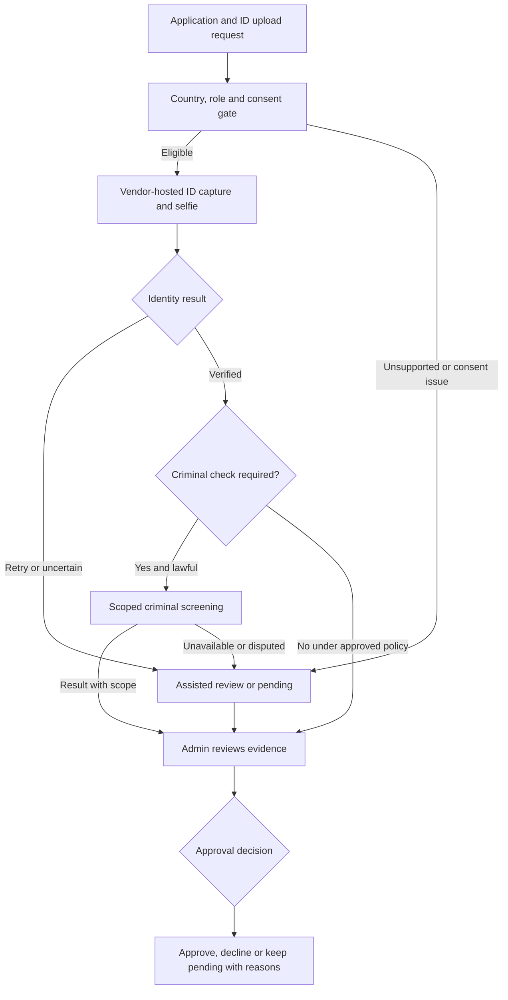

# Volunteer onboarding: identity verification BRD and vendor evaluation

## 1. Document control

| Field | Value |
| --- | --- |
| Author | Omsali; revised from the earlier research draft by Purnendu Kale (`ipurnendu26`, [commit](https://github.com/saayam-for-all/data/commit/d16ee75bc3da7c210ad8b820eadefbfd8d5b9fbc)) |
| Date / version / status | 2026-11-24 / 0.2 / **Draft — for leadership review** |
| Issue / delivery | [#694][S01]; document only; PR base `test`; requested deadline 2026-11-22 |
| Proposed reviewers (not yet approved) | Issue maintainer; Data Analytics lead; volunteer operations/safeguarding owner; engineering lead; privacy/legal counsel; budget owner |
| Evidence baseline | Vendor pricing and product pages refreshed **2026-11-24**; other dated sources retain their individual check dates in section 18. No vendor accounts created, sales contacted, sandbox sessions executed, or personal documents submitted |

**Reading convention:** linked statements are documented facts or vendor claims, not independently tested performance. **Proposal**, **estimate** and **judgment** identify analyst recommendations. **Unknown** means not established by the reviewed evidence. Sources and check dates are in section 18. No purchasing or production approval is implied.

## 2. Executive summary

**Problem.** Saayam needs to establish an applicant's identity before promotion to volunteer, across countries and government ID types. Phase 1 is manually operated using an external provider; this task selects a solution, not an integration. Saayam already has a Stripe account. These are issue-provided facts; current volumes, countries and review procedures remain unconfirmed. [S01]

**Recommendation — conditional pilot:** use **Didit for document authenticity, passive liveness and face matching**, paired with **Checkr for legally permitted, country-specific criminal checks**. Do not treat Didit's AML/watchlist product, or Checkr's adverse-media substitute, as a criminal-record clearance. Checkr documents that some countries receive adverse-media checks instead of criminal-record searches. No evaluated solution demonstrates worldwide completeness for criminal history or pending cases. [S09] [S10] [S24] **Runner-up:** Stripe Identity plus the same country-specific screening route; its existing-account fit reduces setup uncertainty, although Identity still requires activation. [S01] [S03]

**Estimated monthly budget, USD:** at **500 applicants**, Didit identity checks are **$155** with the eligible $10 monthly credit or **$165** without it; proposed provider-assisted review labor is **$625**. This gives a **$780–$790 identity-and-review estimate**, before criminal screening. Checkr does not currently publish an international per-check rate on the reviewed pricing page, so the global screening total is **$780–$790 + 500 × the quoted country-specific rate + pass-through fees**. As a clearly separate **U.S.-only public-price benchmark**, Checkr Basic at $29.99/report would add $14,995, producing $15,775–$15,785 before court/database fees if the package is eligible and appropriate. Do not apply that domestic price to international checks. [S09] [S10] [S23] [S55] Section 11 gives 100/500/1,000 scenarios and manual comparison.

**Why this choice (judgment).** Didit's low published usage cost and hosted workflow make it a sensible cost-first pilot; the weighted assessment is 83/100 versus Stripe's 80/100. This narrow difference is not measured accuracy. Didit's current feature-level billing lists separate charges for completed checks, so the selected workflow must be costed from its exact modules; revalidate terms before approval. [S09] [S10]

**Main risks:** inaccessible or incomplete criminal records; false identity or name matches; biometric privacy and retention; unsupported local documents; and screening expense dominating identity fees. A missing check must remain **unavailable/pending**, never “clear.”

**Decision requested:** approve the conditional vendor direction and a synthetic-data pilot; name the accountable reviewer and legal owner; choose launch countries, roles and whether criminal screening is mandatory for every applicant; and set a budget ceiling. **Do not launch** until lawful country routes, consent, retention, provider eligibility and pilot gates are approved. If every applicant must have a criminal check, unsupported cases stay pending; leadership must approve a lawful alternative before any exception.

## 3. Business context and problem statement

Saayam describes a nonprofit web/mobile platform connecting people seeking help with volunteers and organizations. [S02] Impersonation and unsuitable access could expose beneficiaries and volunteers to harm, increase incident response work, and damage trust (**risk judgment**, not measured incidents).

The issue states that identity checks will initially be handled manually and delegated externally. It does not establish an existing vendor, reviewer SOP, turnaround, failure rate or approved legal policy. [S01] **Working assumption:** an admin receives an application and uploaded ID and makes a promotion decision. Validate this with operations; do not infer production behavior from mock data. The cost of doing nothing is an unmitigated trust gap and growing reviewer workload; incident frequency and monetary loss are **unknown**, so no invented ROI is used.

The trust need has three distinct outputs: (1) document/face assurance, (2) scoped criminal-record results, and (3) watchlist signals. A genuine ID proves neither suitability nor absence of crime. An arrest, allegation, PEP match or shared name is not itself a conviction or an automatic rejection reason (**proposed decision safeguard**).

## 4. Objectives and success criteria

All targets below are **proposed**, to be baselined during the pilot rather than represented as vendor guarantees.

| Measure | Proposed target / definition | Reason |
| --- | --- | --- |
| Identity turnaround | 95% of completed, supported captures receive a result within 10 minutes; report reviewer time separately | Practical onboarding experience without hiding exceptions |
| Human queue | 95% triaged within 1 business day; criminal ETA displayed separately by country | Record searches must not inherit an identity SLA |
| Cost per identity-verified volunteer | At 500/month, ≤$2 including identity fees and routine/exception labor; denominator is successful identity verifications | Recommended model is $780 / successful identities; at 90% success, $1.73; criminal fees reported separately |
| Country/document coverage | Supported country × document combinations cover ≥95% of forecast applications and 100% of the approved launch list | Headline country counts are not applicant coverage |
| Completion / accessibility | ≥90% of eligible applicants who start finish; all blocked users receive an assisted path | Measure device/country/document breakdowns; do not force biometrics without a lawful alternative |
| Safety and accuracy | 0 unexpected accepts in the synthetic negative test set; every uncertain case gets human review | Regression gate, **not** a population false-accept estimate |
| Screening traceability | 100% of required checks record source jurisdiction, search scope/date, status and reviewer; 0 unavailable checks marked clear | Avoid false global assurances |
| Privacy / event handling | 100% consent evidence and deletion checks; future integration rejects invalid/replayed events and records duplicates once | Testable governance and technical gates |

## 5. Scope

**In:** authenticity of passport/driver's license/national ID where supported; face matching and preferred live capture; separate lawful criminal/pending-case and watchlist evaluation; manual provider workflow; exception handling, cost model, privacy requirements and future API fit.

**Out:** building or deploying integrations; changing volunteer promotion/eligibility rules; choosing criminal disqualification criteria; purchasing services; background checks unrelated to the role (credit, education, employment); continuous surveillance. Leadership retains suitability policy and approval authority. Minors require a separate approved process and are excluded from the proposed initial pilot.

## 6. Stakeholders and users

| Stakeholder | Need / responsibility (proposed) |
| --- | --- |
| Volunteer applicant | Clear purpose, language/accessibility support, supported IDs, progress, privacy rights and correction/appeal path |
| Reviewer / admin | Role-limited queue, evidence and reason codes, retry/assisted path, separate identity and screening statuses |
| Volunteer operations / safeguarding | Country/role check policy, escalation, training and accountable final decision |
| Leadership / budget owner | Explicit residual risks, comparable costs, pilot results and spending authority |
| Engineering / security | Hosted-first design, Python-compatible APIs, authenticated events, test isolation and minimal Postgres records |
| Privacy/legal owner | Lawful basis, consent, country restrictions, contracts/transfers and retention sign-off |

## 7. Current process and target process

**Current state:** the issue establishes a manual first phase, government-ID uploads and a volunteer promotion decision. The actual intake channel, ID storage/access controls and review steps are **unknown**. [S01] Confirm before a live pilot; do not forward existing uploads to a vendor without purpose/consent review.

**Proposed target:** admin checks the country/role policy, gives notices, initiates the vendor-hosted flow, and reviews the independent identity and screening results. The volunteer uploads/captures directly with the vendor where possible. Dashboard review is phase 1; automated session creation and result ingestion are later engineering work.

**Proposed record:** applicant reference, consent/policy version, provider/session/report references, country/document type, separate identity/criminal/watchlist states, search scope/date, reviewer decision/reason, timestamps and deletion status. No raw ID numbers, images or biometric templates in routine analytics/logs. “Not required,” “not run,” “unavailable,” “pending,” “no reportable result in searched scope,” and “requires review” must stay distinct. Approval requires all policy-required checks or an explicitly authorized lawful alternative; the diagram does not define eligibility rules.

## 8. Business requirements

BR-01–BR-05 and BR-07 originate in the issue; all others are **proposed additions**. Acceptance criteria apply to the **whole solution**, including Saayam operations, not just a vendor product. Musts are gates; a weighted score cannot waive them.

| ID | Priority | Requirement and rationale | Acceptance criterion |
| --- | --- | --- | --- |
| BR-01 | Must | Assess document authenticity; reduce forged/stolen-ID use | Supported ID fixtures return documented decisions/reasons; uncertain/failed checks cannot auto-approve |
| BR-02 | Must | Obtain lawful criminal/pending-case evidence separately from identity; preserve the trust objective without promising universal records | Every launch country/role has approved sources, lookback, pending-case scope and legal route; required-but-unavailable searches block clearance; AML/adverse media never substituted silently |
| BR-03 | Must | Cover actual countries and uploaded ID types | Approved country × document inventory meets section 4 coverage target; unsupported cases have an assisted path |
| BR-04 | Must | Minimize total cost within an approved ceiling | 100/500/1,000 model includes minimums, retries, screening and labor; budget owner approves country-adjusted ceiling before launch |
| BR-05 | Should | Prefer live capture, liveness and document-to-selfie match to deter impersonation | Pilot exercises camera capture, mismatch/spoof scenarios and assisted alternative; document any country/device exceptions |
| BR-06 | Must | **Proposed:** support phase-1 manual operation without Saayam code | Admin can initiate hosted flow, inspect outcome, reconcile applicant and record decision; no IDs emailed to reviewers/vendors |
| BR-07 | Must | Support API fit with Lambda/API Gateway, Python, Postgres and web/mobile; preserve a path from manual operation to automation | Public integration path exists; later sandbox proves session initiation, authenticated authoritative result and applicant correlation; existing Stripe account benefit assessed |
| BR-08 | Must | **Proposed:** separate identity evidence from suitability; prevent false matches | Human reviewer resolves potential hits with multiple identifiers and documented appeal; no automatic rejection on a name/PEP match |
| BR-09 | Must | **Proposed:** provide lawful purpose, notices and consent | Legal owner approves country-specific basis, biometric and background disclosures; store version/time; provide a correction/withdrawal route |
| BR-10 | Must | **Proposed:** minimize and delete sensitive data | Approved per-data-class retention schedule; synthetic deletion proves removal/inaccessibility, including face-template choices; legal holds documented |
| BR-11 | Must | **Proposed:** restrict access and govern processors/transfers | Security/legal review approves DPA, locations, subprocessors, transfer basis, least-privilege access, incident process and relevant assurance evidence |
| BR-12 | Must | **Proposed:** prevent fabricated or duplicate results | Future integration rejects bad signatures/state/tokens, replay and wrong-environment results; duplicate delivery creates one recorded outcome; phase 1 verifies outcomes in provider console |
| BR-13 | Must | **Proposed:** allow safe testing | Only synthetic/vendor test data; test/live separated; no production approval from simulated results |
| BR-14 | Should | **Proposed:** provide accessible remediation and localization | Pilot covers launch languages, low bandwidth, camera denial and an assisted route with measured completion |
| BR-15 | Must | **Proposed:** provide auditable decisions and operational recovery | Admin can reconstruct who decided what, on which evidence/policy/date; outage and disputed/unavailable checks remain pending |
| BR-16 | Should | **Proposed:** meet turnaround and reporting targets | Section 4 metrics reported with denominators, country/device breakdowns and separate identity/criminal timelines |

## 9. Market overview and shortlist

**Method:** start with the three mandated vendors (Stripe Identity, Didit, ID.me), then add Veriff and Sumsub because public sources describe document/face verification and developer integration. Add Checkr as a **screening specialist**, not a substitute for the five-way identity comparison. Reviewed primary pricing, coverage, integration and regulator/government sources; excluded unsourced aggregator pricing and vendor comparisons about competitors. This is a focused shortlist, not an exhaustive market survey.

**Selection gates:** manual hosted operation now; documented API path later; relevant country/document support; transparent cost or a clearly marked quote dependency; and a reviewable privacy arrangement. Account eligibility, exact launch coverage and legal terms remain gates for **every** provider. Document/territory counts below are vendor claims, not measured pass rates.

| Provider | Document authenticity | Live face / matching | Criminal / pending cases | Watchlist capability | Coverage evidence and qualification |
| --- | --- | --- | --- | --- | --- |
| Stripe Identity | Document check | Selfie matching; live capture configurable | Not documented in reviewed Identity check catalog; separate provider needed | Not documented in that catalog | Country/type list; passports widely supported, local ID types vary; business-location eligibility is separate. [S04] [S05] [S06] |
| Didit | ID verification | Passive/active liveness and face match | No comprehensive criminal/pending-case product established by reviewed sources | Paid AML module | Claims 220+ countries and 14,000+ document types; validate specific versions. [S09] [S10] [S11] |
| ID.me | ID verification | Video selfie and assisted/video routes | Not established by reviewed identity documentation | Not established; do not assume identity attribute verification is AML | Country/type list says 200+ territories; other help copy says 230+/12,500+ docs. Treat the product-specific list, not the largest headline, as the gate. [S15] [S16] [S17] |
| Veriff | ID verification | Liveness in self-serve plans | Not established by reviewed IDV/AML scope | Paid PEP/sanctions add-on | Claims 230+ countries/territories and 12,500+ documents with type table. [S19] [S20] |
| Sumsub | ID verification | Liveness and face match | Not established by reviewed KYC scope | Compliance plan adds AML | Claims 220+ countries/territories; use document-level list. [S21] [S22] |
| Checkr (screening complement) | Identity verification is listed in U.S. Essential/Complete packages; international document-authenticity coverage is not established | Liveness for an international background-check flow is not established | International coverage is advertised, but each country’s criminal-record vs. adverse-media scope and pending-case coverage needs confirmation | U.S. Basic lists a global watchlist; do not assume international package parity | Broad international service coverage does **not** establish criminal-record availability in every country. [S23] [S24] [S25] |

## 10. Vendor evaluation

### Requirement coverage matrix

**D:** documented capability/path, still subject to pilot; **P:** partial, plan-dependent or requires Saayam/another service; **U:** unverified; **N:** not established in reviewed product scope. No cell means contract approval or acceptance-test completion. Columns inherit the source sets in section 9 and the integration sources in section 12; additional control sources: Stripe redaction [S08], Didit deletion [S14], and ID.me biometrics [S18].

| Requirement | Stripe | Didit | ID.me | Veriff | Sumsub | Checkr |
| --- | --- | --- | --- | --- | --- | --- |
| BR-01 authenticity | D | D | D | D | D | P: separate product |
| BR-02 criminal/pending | N | N | U | N | N | P: country/scope |
| BR-03 actual ID coverage | P | P | P | P | P | P |
| BR-04 approved total cost | P: public | P: public | U: quote | P: public | P: public | P: starting rates |
| BR-05 liveness/match | D | D | D | D | D | U |
| BR-06 manual hosted flow | D | D | D | D | P: configured flow | D |
| BR-07 future stack fit | D | D | D | D | D | D |
| BR-08 human suitability/appeal | P | P | P | P | P | P |
| BR-09 lawful basis/consent | P | P | P | P | P | P |
| BR-10 retention/deletion | D: redaction | D: template caveat | P | P: tier | U: terms review | U: terms review |
| BR-11 contract/security/transfer | U | U | U | U | U | U |
| BR-12 authoritative secure result | D: signed event | D: signed event | D: OAuth/OIDC | D: HMAC event | P: webhook validation | P: webhook validation |
| BR-13 safe test path | D | D | P: access gated | P: plan entitlement | D | P: credentialed staging |
| BR-14 accessible remediation | P | P | P: video route | P | P | P |
| BR-15 audit/recovery | P | P | P | P | P | P |
| BR-16 measured SLA/reporting | U | U | U | U | U | U |

### Weighted scores — analyst judgment, not tested performance

Rate 1–5: **1** weak/unknown fit, **3** plausible with gaps, **5** strongest evidenced fit for this context. Missing evidence is penalized, not proof a feature is absent. Formula: **score out of 100 = sum(weight in percentage points × rating / 5)**. Criminal coverage (BR-02), privacy sign-off and actual country fit remain **separate mandatory gates**, because no identity vendor alone satisfies them.

| Criterion | Weight | Requirements / reason |
| --- | --- | --- |
| Identity assurance (A) | 25% | BR-01, BR-05; trust is the primary purpose; equal 4s reflect documented methods, not accuracy superiority |
| Total identity cost (C) | 20% | BR-04; nonprofit budget, using 500/month public baseline, with quote uncertainty penalized |
| Document coverage (G) | 15% | BR-03; breadth matters, but real applicant mix is unknown |
| Implementation fit (I) | 20% | BR-06, BR-07, BR-12, BR-13; manual-first and existing Stripe relationship |
| Privacy/control evidence (P) | 10% | BR-09–BR-11; public control evidence only, contracts not approved |
| Operations/remediation (O) | 10% | BR-08, BR-14–BR-16; assisted handling and plan constraints |

| Provider / evaluated tier | A | C | G | I | P | O | Total / 100 |
| --- | --- | --- | --- | --- | --- | --- | --- |
| Didit Free/list rates | 4 | 5 | 5 | 4 | 3 | 3 | **83** |
| Stripe Identity | 4 | 3 | 4 | 5 | 4 | 4 | **80** |
| Sumsub Basic | 4 | 3 | 5 | 4 | 3 | 4 | **77** |
| Veriff Premium | 4 | 2 | 5 | 4 | 4 | 4 | **75** |
| ID.me / quote required | 4 | 1 | 3 | 3 | 2 | 4 | **57** |
| Checkr screening complement* | 1 | 1 | 2 | 3 | 2 | 4 | **39** |

*Checkr's score uses the same **identity-solution** rubric solely for comparability; it is not ranked as an alternative to the five ID vendors and says nothing about its criminal-search quality. Its separate selection depends on lawful country sources, pending-case scope, price and dispute handling, all unresolved procurement gates. [S23]–[S26]

**Rationale and surprises (judgment supported by cited facts):**

- **Didit:** low cost and broad claimed coverage favor a pilot. Public deletion controls exist, but retained face templates require a deliberate setting and queued webhooks can survive session deletion. Free-plan staffing/support and unapproved contracts lower P/O confidence. [S09] [S14]
- **Stripe:** existing account and documented hosted/Python/event path improve I; redaction documentation improves P evidence. Identity is not automatically activated by having Payments. Lower-cost vendors can justify switching at scale. [S01] [S03] [S07] [S08]
- **Sumsub:** documented React WebSDK and isolated sandbox support the stack; Basic excludes the Compliance plan's AML scope. More configuration and unreviewed terms limit the rating. [S21] [S22] [S27] [S28]
- **Veriff:** Premium is evaluated because its advertised session deletion API fits the proposed controls. Essential is cheaper but is not an equivalent control bundle; sandbox/plan entitlement also needs confirmation. [S19] [S29]
- **ID.me:** reusable wallet and video assistance may help some applicants, but commercial price, exact partner flow and non-US eligibility need confirmation. Country headline differences and separate identity-sandbox access prevent assuming a simple universal rollout. [S15]–[S18] [S30] [S31]
- **Checkr:** the key surprise is “criminal **or adverse media**” in its international package. That distinction must survive into Saayam's decision record. [S23] [S24]

**Sensitivity (proposal):** move 10 percentage points from cost to implementation fit: Didit becomes 81, Stripe 84, Sumsub 79, Veriff 79, ID.me 61. Thus leadership prioritizing the existing relationship over cost should select Stripe, after the same gates. Scores should be rerun using the confirmed country mix and pilot evidence.

## 11. Cost analysis

**Estimate basis:** USD public list prices; relevant pricing sources rechecked 2026-11-24. N = applicants/check sessions, one completed identity bundle each, no negotiated/nonprofit discount, taxes, FX, extras or repeated billable sessions. Do not confuse **per session/check** with **per successfully approved volunteer**. Identity and criminal searches are priced separately.

| Service / model | Monthly formula | N=100 | N=500 | N=1,000 |
| --- | --- | --- | --- | --- |
| Didit ID + passive liveness + match + device/IP; Free plan, eligible $10 recurring credit [S09] [S10] | max(0, 0.33N − 10) | $23 | $155 | $320 |
| Didit same bundle + one AML screen each; credit shared across modules [S09] [S10] | max(0, 0.53N − 10) | $43 | $255 | $520 |
| Stripe document + selfie, recurring baseline [S06] | 1.50N | $150 | $750 | $1,500 |
| Veriff Essential; $49 minimum [S19] | max(49, 0.80N) | $80 | $400 | $800 |
| Veriff Premium; $209 minimum; evaluated tier [S19] | max(209, 1.89N) | $209 | $945 | $1,890 |
| Sumsub Basic; $149 minimum [S21] | max(149, 1.35N) | $149 | $675 | $1,350 |
| Sumsub Compliance; $299 minimum, AML included [S21] | max(299, 1.85N) | $299 | $925 | $1,850 |
| ID.me: **contact sales; no public commercial rate established** [S15] [S30] | F + pN, subject to negotiated minimums | Quote | Quote | Quote |
| Checkr U.S. Basic (domestic-only public benchmark; not an international rate) [S23] | $29.99N, before pass-through fees | $2,999 | $14,995 | $29,990 |
| Checkr international screening: **contact sales**; no public per-check price established [S23] [S25] [S55] | N × quoted country rate + pass-through fees | Quote + fees | Quote + fees | Quote + fees |

**Pricing qualifications:**

- Didit's live page now gives $10 monthly credit for eligible work-email organizations, not the older indexed “500 free” allowance; it flags a 2026-11-01 change. Budget without credit if ineligible: **$33/$165/$330**. Growth is $99/month with $115 credit and 4% lower usage rates; Scale $299 with $350 credit and 10% lower rates. Those plans may improve total cost but do not alter this conservative Free/list-rate comparison. Declined sessions may contain billable completed modules. [S09] [S10]
- Stripe advertises the **first 50 verifications free**, not 50 every month. If still available to Saayam, first-period totals would be **$75/$675/$1,425**; the baseline deliberately excludes that one-time benefit. Completion includes a verified or unverified report, so failure need not be free. [S06] [S32]
- Veriff advertises a 15-day/50-session trial. AML adds $0.64/check, so Premium + AML costs **$273/$1,265/$2,530** at these volumes; extras sit above the minimum. Essential is a price floor, subject to control/plan acceptance. [S19] [S33]
- Sumsub charges the plan bundle even if some included features are unused. Extra messaging, data fields, proof-of-address and monitoring can add costs; confirm the detailed rate card and ongoing-screening units rather than assuming unlimited monitoring. [S21]
- F and p for ID.me, as well as any API entitlement, onboarding fees, minimums and assisted-review charges, are **unknown**, not zero. The $29.99 Checkr Basic rate is a U.S. public price and is not evidence of international pricing or suitability. International country rates, extra jurisdictions, court/database pass-through costs, rescreening and whether pending cases are covered require written confirmation; no sales request was sent. [S23] [S25] [S26] [S30] [S55]

### Manual comparison and combined recommendation

**Proposed labor assumptions:** $25/hour fully loaded opportunity cost; current/manual ID review **15 min/applicant** = **$6.25N**. Provider-assisted operation: **2 min routine review each**, plus **10% needing 10 extra min** = **$1.25N**. Neither figure is measured; the pilot must replace both. Manual ID review cannot be assumed equivalent to forensic document/liveness checks or a criminal-record search.

| Monthly planning scenario (calculated, not quoted) | 100 | 500 | 1,000 |
| --- | --- | --- | --- |
| Manual ID review labor only | $625 | $3,125 | $6,250 |
| Didit identity + proposed internal labor | $148 | $780 | $1,570 |
| Didit + Checkr U.S. Basic for 100% + internal labor (U.S.-only reference) | $3,147 | $15,775 | $31,560 |
| Didit + Checkr international screening for 100% + internal labor | $148 + 100 × quote + fees | $780 + 500 × quote + fees | $1,570 + 1,000 × quote + fees |
| Manual ID review + Checkr U.S. Basic for 100% (U.S.-only reference) | $3,624 | $18,120 | $36,240 |

The Checkr U.S. figures are a domestic list-price reference only, exclude pass-through fees, and may not be legally available or appropriate for volunteer screening. For international checks, use actual country prices `c_j` and shares `q_j`: screening cost is `N × sum(q_j × c_j)`, plus extra residence/jurisdiction searches, pass-through fees and any minimums. The total international screening estimate remains **contact sales / quote required**; do not use the former $32/check assumption, which the current public page does not substantiate. If criminal screening is unavailable, adverse media does not close BR-02. The all-in scenarios omit an optional Didit AML screen because the Checkr U.S. package includes a watchlist search; avoid duplicate screening without a defined purpose. [S23] [S25] [S55]

**Hidden-cost reserve (proposal):** at 500/month, a 10% increase in paid identity bundles adds $16.50; an extra five minutes of reviewer time on every required criminal report adds **$1,041.67** labor at the assumed $25/hour. If an additional-jurisdiction search costs `q`, running it for 20% of applicants adds `100 × q` at 500 applicants, plus any pass-through fees. These sensitivities show why residence history and adjudication matter more than headline ID prices. Include taxes, translations, accessibility support, training, disputes, legal review and privacy/security due diligence in the approved budget; their costs are unknown. No hosting cost is added to phase 1; future AWS/API engineering and infrastructure require a separate estimate.

## 12. Integration and technical fit

**Verified context:** the issue specifies Lambda behind API Gateway, Python, Postgres and an existing Stripe account. [S01] Repository guidance identifies Aurora PostgreSQL and team-owned deployment; cross-team architecture separates the volunteer service. [S34] [S35] The `test` manifests confirm **React 18/Vite web** and **React Native/Expo mobile**. [S36] [S37] This confirms source technologies and a mobile codebase, **not** deployed versions, mobile release availability or ownership of the final promotion endpoint.

**Proposed shared future design:** authenticated client asks Lambda for a session; vendor hosts sensitive capture; authoritative result reaches a separate Gateway/Lambda endpoint; persist minimal states in Postgres; admin makes the final decision. Validate signed raw payloads (preserving bytes through API Gateway), correlate session/applicant/environment, prevent replay/duplicate writes and reconcile missed events by API. Browser redirects alone never prove success. OAuth vendors require server-side token/assertion validation rather than pretending all vendors have the same webhook model. This is design guidance, **no implementation in this PR**.

Effort labels below are **relative analyst estimates for a later production integration**, including capture, outcomes and recovery, excluding procurement/legal waiting time and criminal-policy design. Phase 1 uses approved consoles/hosted links, not these APIs.

| Provider | Capture and result path | API/SDK and test evidence | Stack / Stripe fit; effort judgment |
| --- | --- | --- | --- |
| Stripe | Lambda creates VerificationSession; hosted redirect or web modal; selfie/live capture configured; signed `verified` / `requires_input` events to backend | Server libraries including Python; web/mobile integration options; test-mode outcomes are simulated, not real document checks. [S03] [S07] [S38] | Existing account reduces account work, but separate Identity application needed; store references/status in Postgres. **Low:** well-documented hosted/Python/event path; criminal integration remains separate |
| Didit | Admin-hosted flow now; later server creates session/workflow and returns capture URL; signed webhook plus decision lookup | Hosted flow, SDK/API offering; separate sandbox with mocked outcomes; signatures documented. [S11] [S12] [S13] [S39] | Python can call REST; React/Expo hosted-browser path avoids assuming native-module compatibility. No Stripe account reuse. **Medium:** new provider controls, event handling and mobile return-path validation |
| ID.me | ID.me-hosted verification/wallet; OAuth/OIDC authorization code returned to backend, exchanged for token and approved attributes | API/SDK documentation; default credential sandbox differs from identity sandbox, which requires arranged access. No decision-webhook dependency established for this selected flow. [S15] [S30] [S31] | Python handles server exchange/validation, React/Expo use browser redirect. No Stripe reuse. **Medium:** partner configuration, scope and identity-sandbox/production approval dependencies |
| Veriff | Create session URL; hosted page or web/native SDK; decision webhook carries authoritative result | SDK guide, HMAC checks and test integration; test decisions must be forced. Old plan documentation says Essential lacks sandbox integration while current trial offers sandbox: confirm paid-tier entitlement. [S19] [S29] [S40] [S41] | REST works from Python; web/mobile SDK exists but Expo native build support untested. No Stripe reuse. **Medium:** SDK/event wiring plus Premium/control entitlement validation |
| Sumsub | Backend creates applicant/SDK access token; hosted WebSDK/React embed captures ID/selfie; webhook triggers backend reconciliation | React package, web/mobile guidance, API and event docs; sandbox has no real approval logic. [S22] [S27] [S28] [S42] | REST from Python and React embedding fit; mobile camera/WebView settings require testing. No Stripe reuse. **Medium:** applicant levels, token signing, webhook verification and recovery |
| Checkr | Admin invitation/hosted applicant flow now; future backend initiates candidate/invitation/report and ingests report events; reviewer resolves results | REST, hosted collection, webhooks; credentialing and authenticated production account required before staging access; staging uses mock data. [S25] [S26] [S43] | Python REST + minimal Postgres report reference; separate from any Stripe account. **High:** country-specific report lifecycle, legal disclosures, identity correlation and disputes |

**Manual-first acceptance (proposal):** use provider-native hosted links created by an authorized admin; reconcile by internal reference; review only in approved consoles; enter minimal result metadata in Saayam's approved record system. Do not email raw IDs or assume already-uploaded images can be reused without fresh capture. Reviewers must verify provider results directly, not accept applicant screenshots. Future integration needs separate volunteer-service/API ownership sign-off. [S35]

## 13. Compliance, privacy and legal considerations

The following are **jurisdiction examples and proposed controls**, not a completed legal-country approval list. Applicant nationality, residence history, volunteer activity location, organization location and role all affect the route. No launch countries have yet been approved. Consent does not by itself authorize every criminal-record search.

| Jurisdiction | Sourced limit / implication | Proposed launch gate |
| --- | --- | --- |
| United States | FTC employment guidance requires disclosure/authorization and pre/post-adverse-action steps when applicable to consumer reports. [S44] | Counsel/provider confirm permissible purpose and applicability to Saayam's volunteer roles plus state/local restrictions; establish notice/dispute process and whether pending/non-conviction information can lawfully be used |
| Illinois, US | BIPA covers face-geometry identifiers; requires specified notices and written release for covered collection and a public retention/destruction policy, with purpose completion or three years after last interaction, whichever earlier. [S45] [S46] | Assess biometric processing by Saayam and vendors; approve notice/release and destruction schedule before any covered capture |
| EU/EEA | GDPR Article 6 basis plus Article 9 condition for identifying biometrics; Article 10 separately restricts criminal data to official authority or authorization in Union/member-state law; transfers and retention also need review. [S47] | Country-specific criminal authority and appropriate safeguards, processor/controller roles, DPA/transfer mechanism and DPIA assessment; a generic consent checkbox is insufficient evidence |
| United Kingdom | UK criminal data needs an Article 6 basis plus official authority or a DPA 2018 Schedule 1 condition. ICO notes guidance is under review after legislative changes. [S48] DBS eligibility/jurisdiction is role-dependent and does not generally cover overseas history. [S49] [S50] | Confirm the lawful processing condition and correct DBS/Disclosure Scotland/AccessNI/overseas route; do not request an ineligible enhanced/barred-list check |
| France | B3 is requested by the person or lawful representative; official guidance says an employer may inspect it but not retain it. [S51] | Counsel confirm role-related necessity and volunteer applicability; support a lawful applicant-mediated inspection route and retain only permitted outcome metadata |
| Germany | Official procedure requires personal application; enhanced certificates require qualifying justification; ordinary delivery is to the applicant, with a separate public-authority route. [S52] | Do not assume vendor direct access; confirm certificate type, permissible inspection, limitations and handling with counsel |
| India | MEA describes Passport PCC for residence, employment, long-term visa or immigration; foreign nationals use district police/FRRO routes. This is not evidence that all domestic volunteering qualifies. [S53] | Confirm a suitable local police/court route and pending-case coverage; do not promise a universal national API or treat a passport as criminal clearance |
| Canada | RCMP vulnerable-sector checks require a qualifying trust/authority role and results are only made available to organizations in Canada. [S54] | Confirm eligible organization/role/local police route; a US nonprofit cannot assume access; assess a lawful ordinary criminal check if appropriate |
| Other countries | No complete legal/coverage analysis established | Keep required screening pending until legal owner records an approved route; adverse media cannot replace criminal records without an explicit policy change |

**Proposed data policy:** before live use, approve collection purpose and retention for each data class, access role, vendor DPA, storage/processing regions, subprocessors, deletion/backup scope and incident notification obligations. Start with no raw-ID storage in Saayam; request vendor media deletion within **30 days of final resolution** where lawful, and a **12-month minimal decision audit record**, both provisional and subordinate to shorter legal limits, required holds and dispute periods. Do not adopt financial-services retention periods merely because the product is called KYC.

Didit documents session deletion, separate face-template settings, surviving audit/list data and queued events; verify the full erasure path and model-training opt-out before launch. [S14] Stripe's redaction is asynchronous and may take up to four days; monitor completion. [S08] Other providers' exact retention, backups and deletion entitlements remain **unapproved**. Vendor compliance badges are not Saayam compliance. Offer a legally appropriate assisted/non-biometric path and human correction/appeal; never publish raw criminal reports in analytics or this repository.

## 14. Risks, assumptions, dependencies and constraints

Likelihood/impact are **qualitative analyst judgments** before pilot evidence.

| Risk | Likelihood | Impact | Mitigation / proposed owner |
| --- | --- | --- | --- |
| Criminal history/pending cases unavailable or incomplete | High | High | Record country/source/lookback and limitations; keep required checks pending; approve local alternative — legal/safeguarding |
| Shared-name/watchlist or criminal false match | Medium | High | Corroborating identifiers, human adjudication, dispute route; no automatic rejection — operations |
| Forged IDs, replayed capture or deepfakes accepted | Medium | High | Live capture/liveness where lawful, synthetic negative tests and assisted review; pilot cannot certify population accuracy — security |
| Biometric over-retention, training use or unauthorized access | Medium | High | Minimal fields, retention settings, opt-out, DPA and deletion evidence — privacy/security |
| Country/document or accessibility gap excludes legitimate applicants | High | High | Weighted actual inventory, assisted route, device/language testing — product/operations |
| Price/free-tier or plan entitlement changes | High | Medium | Recheck rate card before approval, monitor spend and do not rely on historical allowances — budget owner |
| Screening pass-through fees or review work exceed budget | High | High | Country-adjusted quotes, volume/extra-jurisdiction cap and measured labor — budget/safeguarding |
| Spoofed, duplicate, delayed or wrong-environment outcomes | Medium | High | Console verification in phase 1; future signature/state validation, idempotency and reconciliation — engineering |
| Vendor outage or unsupported country | Medium | Medium | Pending state, manual queue/communications; fallback only after equivalent controls approval — operations |
| Automatic promotion bypasses unresolved screening | Medium | High | Separate states; gate approval on all required evidence — volunteer-service owner |

**Assumptions:** 100/500/1,000 monthly volumes are planning cases, not forecasts; manual timing/wage and 10% exception rate are placeholders; credit eligibility is conditional; no live deployment or vendor account was inspected.

**Dependencies:** real country/document/residence inventory; safeguarding/role policy; legal and budget owners; permitted vendor use for a nonprofit; DPAs and package quotes; authorized account admins; engineering coordination with web/mobile/API/volunteer teams. **Constraints:** public documents and synthetic sandbox data only; no accounts in Saayam's name, sales outreach, real IDs, credentials or integration code in this deliverable. [S01]

## 15. Recommendation

**Judgment:** select **Didit + Checkr (where suitable) for a conditional, manually operated pilot**, with applicant-mediated/local authorized routes for countries where the quoted Checkr package does not supply lawful criminal evidence. Didit leads the cost-weighted identity assessment and its hosted flow fits phase 1. Checkr is a candidate criminal-screening complement, **not yet an approved global solution**. Do not buy a package labelled “criminal or adverse media” without identifying which service each country receives. [S09] [S11] [S23] [S24]

**Runner-up:** **Stripe Identity + the same screening arrangement**. Choose it if minimizing provider setup is more important than identity usage fees, Didit's privacy/price/control gates fail, or Stripe's pilot achieves materially better completion in the actual countries. Existing Stripe access does not establish Identity activation or eligibility. [S01] [S03]

Choose Veriff Premium or Sumsub only if pilot evidence shows enough extra coverage/remediation value to justify the premium. Reconsider ID.me if its quoted economics and exact international partner flow are competitive or wallet reuse materially reduces applicant effort. These are decision conditions, not factual performance rankings.

**No unconditional award:** if universal criminal screening is non-negotiable and any launch cohort lacks a lawful, adequate route, defer that cohort's clearance. Leadership must resolve the requirement or country scope; an ID-only success cannot satisfy it.

## 16. Proposed next steps

| Step / owner | Deliverable and decision gate |
| --- | --- |
| 1. Leadership/operations, before vendor work | Confirm volumes, countries/ID types, applicant ages, residence lookback, volunteer risk tiers, universal versus role-based screening and budget |
| 2. Legal/security and authorized admins | Approve lawful country routes, nonprofit eligibility, DPA/retention/access controls, exact rates and permitted test access; maintainer approval before accounts or sales contact |
| 3. Analyst/reviewers, public-doc walkthrough | Dry-run the manual SOP using synthetic records: approval, mismatch, unreadable/expired/unsupported ID, no camera, consent refusal, possible hit, dispute and unavailable criminal data |
| 4. Engineering, separately authorized sandbox pilot | Target 30 synthetic scenarios across representative country/document/device combinations; simulate outcomes/events, deletion and recovery. Compare Didit and Stripe; do not upload real personal data or claim simulated acceptance proves authenticity accuracy |
| 5. Operations/budget owner | Measure reviewer minutes, completion, case status accuracy and modeled billable events; reconcile 100/500/1,000 estimates and vendor billing rules |
| 6. Leadership | Go/no-go after all musts have evidence; select vendor, lawful countries and spending cap; create separate implementation work only after approval |

The issue's requested **2026-11-22 deadline** is for this analysis, not a promised integration launch. [S01] This document is dated 2026-11-24. Live accuracy, real document acceptance and actual conversion remain unvalidated by a synthetic-only pilot. Any later live pilot needs separate authorization and privacy/legal preparation, outside this issue.

## 17. Open questions

1. Which countries, document versions, ages and residence histories represent actual applicants? What are monthly volume and peak forecasts?
2. Does “no criminal history or pending cases” mean every applicant, or particular roles? Which records, lookback and dispositions are relevant and legally usable? Who owns policy and exceptions?
3. Who currently receives/stores uploaded IDs, and how are consent, access, deletion and admin approval handled?
4. Who is the final suitability decision-maker, safeguarding owner, legal reviewer and budget approver?
5. Which entity/country owns the Stripe account, is Identity activated, and is its first-50 allowance unused? Who may initiate vendor procurement?
6. Are mobile verification and assisted/non-biometric alternatives required at launch? Which deployed web/mobile versions and languages need support?
7. Will the volunteer service or another API own approval state and evidence references? How will the later integration authenticate results and recover failures?
8. What retention windows, processing locations, model-training choices, security evidence and incident terms are acceptable?
9. For each launch country, will Checkr supply criminal records or only adverse media, which pending cases/jurisdictions are included, what fees apply, and what lawful local alternative exists?
10. If there is no adequate lawful criminal route, should that cohort stay pending or should leadership change its role/country policy? An analyst/vendor must not decide this implicitly.

## 18. Appendix: sources and glossary

Prices/features are snapshots; recheck before procurement. The Didit pricing/billing pages, Veriff and Sumsub pricing/product pages, and Checkr pricing/international/pass-through pages were checked **2026-11-24**. The Stripe unit price was checked 2026-11-17; its public page was rechecked 2026-11-24 for the first-50-verifications promotion, but did not expose a unit rate in the retrieved page text. Other sources were checked on the date shown. Repository manifests establish source dependencies, not live deployments. No provider sandbox was executed. Source ranges in the text refer to the individual links listed here.

| ID | Primary source / purpose | Checked |
| --- | --- | --- |
| S01 | [Issue #694: requirements and delivery][S01] | 2026-11-17 |
| S02 | [Saayam data README at reviewed base][S02] | 2026-11-17 |
| S03 | [Stripe hosted verification and activation][S03] | 2026-11-17 |
| S04 | [Stripe document checks and country/type limits][S04] | 2026-11-17 |
| S05 | [Stripe selfie checks][S05] | 2026-11-17 |
| S06 | [Stripe US product/pricing][S06] | 2026-11-17 |
| S07 | [Stripe asynchronous outcomes and signature validation][S07] | 2026-11-17 |
| S08 | [Stripe redaction API and completion timing][S08] | 2026-11-17 |
| S09 | [Didit current pricing and plan credits][S09] | 2026-11-24 |
| S10 | [Didit billable module rules and per-feature rates][S10] | 2026-11-24 |
| S11 | [Didit ID verification and document catalog][S11] | 2026-11-17 |
| S12 | [Didit sandbox limits and simulated outcomes][S12] | 2026-11-17 |
| S13 | [Didit webhook setup and signature guidance][S13] | 2026-11-17 |
| S14 | [Didit deletion, face templates, retention and training controls][S14] | 2026-11-17 |
| S15 | [ID.me developer integration options][S15] | 2026-11-17 |
| S16 | [ID.me country/document matrix][S16] | 2026-11-17 |
| S17 | [ID.me supported documents and assisted-route caveats][S17] | 2026-11-17 |
| S18 | [ID.me biometric consent and purposes][S18] | 2026-11-17 |
| S19 | [Veriff pricing, control tiers, liveness and trial][S19] | 2026-11-24 |
| S20 | [Veriff supported countries/documents][S20] | 2026-11-17 |
| S21 | [Sumsub plans, minimums and extra charges][S21] | 2026-11-24 |
| S22 | [Sumsub user verification scope][S22] | 2026-11-24 |
| S23 | [Checkr public U.S. package pricing; no international per-check rate listed][S23] | 2026-11-24 |
| S24 | [Checkr API: international criminal/adverse-media distinction][S24] | 2026-11-17 |
| S25 | [Checkr international background-check overview][S25] | 2026-11-24 |
| S26 | [Checkr credentialing and staging prerequisites][S26] | 2026-11-17 |
| S27 | [Sumsub React/WebSDK setup and mobile caveats][S27] | 2026-11-17 |
| S28 | [Sumsub isolated sandbox][S28] | 2026-11-17 |
| S29 | [Veriff test/live integration and HMAC test cases][S29] | 2026-11-17 |
| S30 | [ID.me business verification / commercial inquiry][S30] | 2026-11-17 |
| S31 | [ID.me sandbox distinctions and production approval][S31] | 2026-11-17 |
| S32 | [Stripe billable completion rules][S32] | 2026-11-17 |
| S33 | [Veriff extra charges above minimum][S33] | 2026-11-17 |
| S34 | [Saayam Python/Lambda/Aurora contribution context][S34] | 2026-11-17 |
| S35 | [Saayam cross-team architecture and service ownership][S35] | 2026-11-17 |
| S36 | [Webapp test manifest: React/Vite][S36] | 2026-11-17 |
| S37 | [Mobileapp test manifest: React Native/Expo][S37] | 2026-11-17 |
| S38 | [Stripe session creation and test-mode semantics][S38] | 2026-11-17 |
| S39 | [Didit server session/workflow/environment setup][S39] | 2026-11-17 |
| S40 | [Veriff SDK session URL guide][S40] | 2026-11-17 |
| S41 | [Veriff older self-serve sandbox entitlement table][S41] | 2026-11-17 |
| S42 | [Sumsub result webhooks][S42] | 2026-11-17 |
| S43 | [Checkr hosted application flow][S43] | 2026-11-17 |
| S44 | [FTC: consumer reports, permissions and adverse action][S44] | 2026-11-17 |
| S45 | [Illinois BIPA section 10: identifiers][S45] | 2026-11-17 |
| S46 | [Illinois BIPA section 15: notice/retention/release][S46] | 2026-11-17 |
| S47 | [EU GDPR, including Articles 5/6/9/10/28/35 and Chapter V][S47] | 2026-11-17 |
| S48 | [ICO: lawful handling of UK criminal-offence data][S48] | 2026-11-17 |
| S49 | [DBS employer/volunteer/overseas guidance][S49] | 2026-11-17 |
| S50 | [UK jurisdiction and eligibility for criminal checks][S50] | 2026-11-17 |
| S51 | [France official B3 request and retention restrictions][S51] | 2026-11-17 |
| S52 | [German Federal Office of Justice: applicant/enhanced certificate procedure][S52] | 2026-11-17 |
| S53 | [India MEA: Police Clearance Certificate purposes/routes][S53] | 2026-11-17 |
| S54 | [RCMP: vulnerable-sector eligibility and recipient restriction][S54] | 2026-11-17 |
| S55 | [Checkr court/database pass-through fee policy][S55] | 2026-11-24 |

| Term | Meaning in this document |
| --- | --- |
| IDV / KYC | Identity verification / know your customer; neither label implies criminal clearance |
| Liveness / PAD | Evidence of a present person / presentation-attack detection; not a guarantee against all spoofing |
| Face match | Comparison of captured face with document portrait |
| AML / PEP | Anti-money-laundering screening / politically exposed person; PEP status is not a criminal conviction |
| Adverse media | Information from news/other sources; not equivalent to official court/criminal records |
| Criminal check | Search with specified jurisdictions, sources, dates and reportable scope |
| DPA / DPIA | Data processing agreement / data protection impact assessment |
| Webhook / idempotency | Provider-to-server event / processing repeat delivery without duplicate effects |
| Sandbox | Simulated test environment; cannot establish real verification accuracy |
| Pass-through / minimum | Third-party fees added to price / minimum contractual spend regardless of usage |

[S01]: https://github.com/saayam-for-all/data/issues/694
[S02]: https://github.com/saayam-for-all/data/blob/c3b66eadc20b765c09dedb40d35d3566efdd652f/README.md
[S03]: https://docs.stripe.com/identity/verify-identity-documents?platform=web&type=redirect
[S04]: https://docs.stripe.com/identity/verification-checks?type=document
[S05]: https://docs.stripe.com/identity/verification-checks?type=selfie
[S06]: https://stripe.com/us/identity
[S07]: https://docs.stripe.com/identity/handle-verification-outcomes
[S08]: https://docs.stripe.com/api/identity/verification_sessions/redact
[S09]: https://didit.me/pricing/
[S10]: https://help.didit.me/billing-credits/what-counts-as-billable
[S11]: https://didit.me/products/id-verification/
[S12]: https://help.didit.me/getting-started/sandbox-and-testing
[S13]: https://help.didit.me/integration/webhooks-basics
[S14]: https://help.didit.me/data-privacy/delete-verification-data
[S15]: https://docs.id.me/
[S16]: https://help.id.me/hc/en-us/articles/44484601223447-Accepted-IDs-by-country-and-ID-type
[S17]: https://help.id.me/hc/en-us/articles/4415460350871-Documents-you-need-to-verify-your-identity-with-IDMe
[S18]: https://www.id.me/legal/biometric
[S19]: https://www.veriff.com/pricing
[S20]: https://www.veriff.com/supported-countries
[S21]: https://sumsub.com/pricing/
[S22]: https://docs.sumsub.com/docs/user-verification
[S23]: https://checkr.com/pricing
[S24]: https://docs.checkr.com/apis/openapi
[S25]: https://checkr.com/international-background-checks
[S26]: https://docs.checkr.com/apis/getting-started
[S27]: https://docs.sumsub.com/docs/get-started-with-web-sdk
[S28]: https://docs.sumsub.com/docs/test-in-sandbox
[S29]: https://devdocs.veriff.com/docs/how-to-create-an-integration
[S30]: https://www.id.me/business/progressive-identity-verification
[S31]: https://docs.id.me/integrations/deploy-and-monitor/launching-in-production
[S32]: https://support.stripe.com/questions/billing-for-stripe-identity?locale=en-GB
[S33]: https://support.veriff.com/s/article/Veriff-Plans-Description
[S34]: https://github.com/saayam-for-all/data/blob/c3b66eadc20b765c09dedb40d35d3566efdd652f/data-engineering/CONTRIBUTING.md
[S35]: https://github.com/saayam-for-all/data/blob/c3b66eadc20b765c09dedb40d35d3566efdd652f/data-engineering/KNOWLEDGE_TRANSFER.md
[S36]: https://github.com/saayam-for-all/webapp/blob/8d927903d5f1e70c22121b9cf73a3b16a708f53e/package.json
[S37]: https://github.com/saayam-for-all/mobileapp/blob/e5de37c17f0edf8235153fbcee6cb681fd471086/package.json
[S38]: https://docs.stripe.com/api/identity/verification_sessions/create
[S39]: https://help.didit.me/integration/api-key-workflow-id-and-webhook-secret
[S40]: https://devdocs.veriff.com/docs/sdk-guide
[S41]: https://veriff.my.site.com/cs/s/article/Self-Serve-plans-descriptions
[S42]: https://docs.sumsub.com/docs/webhooks
[S43]: https://docs.checkr.com/partners/reference
[S44]: https://www.ftc.gov/business-guidance/resources/using-consumer-reports-what-employers-need-know
[S45]: https://www.ilga.gov/legislation/ilcs/fulltext?DocName=074000140K10
[S46]: https://my.ilga.gov/legislation/ilcs/fulltext?DocName=074000140K15
[S47]: https://eur-lex.europa.eu/eli/reg/2016/679/
[S48]: https://ico.org.uk/for-organisations/uk-gdpr-guidance-and-resources/lawful-basis/criminal-offence-data/what-are-the-rules-on-criminal-offence-data/
[S49]: https://www.gov.uk/guidance/dbs-check-requests-guidance-for-employers
[S50]: https://www.gov.uk/government/publications/where-to-apply-for-criminal-record-checks-in-the-uk-and-overseas/where-to-apply-for-your-criminal-record-check
[S51]: https://www.service-public.gouv.fr/particuliers/vosdroits/F14710
[S52]: https://www.bundesjustizamt.de/SharedDocs/Downloads/DE/ZentraleRegister/Bundeszentralregister/Merkblatt_Antrag_en.pdf?__blob=publicationFile&v=3
[S53]: https://www.mea.gov.in/police-clearance-certificate.htm
[S54]: https://rcmp.ca/en/criminal-records/criminal-record-checks/vulnerable-sector-checks
[S55]: https://checkr.com/pricing/passthrough-fees-overview
