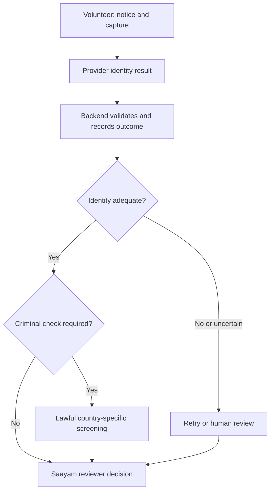

# Volunteer identity verification: business requirements and vendor evaluation

## 1. Document control

| Field | Value |
| --- | --- |
| Issue / deliverable | [#694](https://github.com/saayam-for-all/data/issues/694); `data-analytics/docs/identity-verification-brd.md` |
| Prepared for | Saayam For All leadership and engineering |
| Author | Rohit S. Bhosale; AI-assisted research and drafting |
| Version / status | 0.1 / Draft for review; not procurement or legal approval |
| Prepared | November 22, 2026, America/Chicago; source retrieval November 23 UTC |
| Requested reviewers | Sana Desai, Sahil Mane, product lead, and a privacy/legal reviewer; participation not yet confirmed |
| Submission | Document-only PR against `test`; maintainer merges |

**Evidence convention:** [S01]–[S29] resolve to dated public sources in section 18. Vendor statements are published claims, not independently tested results. All requirements, targets, scores, estimates, workflows, and recommendations below are **analyst proposals**, unless attributed to the issue. No vendor accounts, API calls, real ID uploads, sales contacts, or live integrations were used. The assignment email named RohittXD, but the current issue assignees differ; maintainer confirmation is outstanding. The issue's November 22 deadline is recorded, not represented as an on-time delivery.

## 2. Executive summary

**Problem:** Saayam needs identity evidence before promoting a person to volunteer. Document authenticity, matching a live person to that document, and criminal-record searches are separate capabilities. None of the five identity providers evaluated here establishes that a person has no criminal history or pending cases worldwide. Watchlist screening is not a substitute for court/police-record searches. [S01–S10, S16–S17]

**Recommendation (conditional):** Pilot **Didit** for document authentication, passive liveness and face matching, optionally adding its AML/watchlist module if leadership identifies a lawful need. For roles requiring actual criminal screening, evaluate **Didit + Checkr**, country by country, with equivalent legally permitted local certificate routes where necessary. Do not substitute adverse-media-only results for criminal-record coverage. Checkr's international package explicitly allows criminal **or adverse-media** searches. [S03–S05, S16–S17]

**Indicative recurring budget at 500 checks/month:** Didit full KYC list usage **$165**, or **$155** after an eligible $10 monthly credit; adding one $0.20 AML screen/person gives **$255** after that same credit. Screening all 500 with Checkr International Basic adds **at least $16,000**, giving **at least $16,255** combined. Country prices, fees, legal review, retries, engineering and admin labor are extra; this is not a quote. [S03, S05, S16] See section 11 for 100/500/1,000 volumes.

**Runner-up:** **Stripe Identity**, because Saayam already has a Stripe account according to the issue, and Stripe provides document/selfie verification and session APIs. Account presence does not confirm Identity activation or suitability. Its recurring list budget is **$750/500 completed checks**, excluding separate screening. [S01–S02]

**Main risks:** false confidence in a clean background; unconfirmed country/document mix; biometric/privacy restrictions; false matches and appeals; changing prices and retention terms. No provider is approved for production by this report.

**Decision needed:** authorize a documentation-to-sandbox pilot, name an owner, approve launch countries and screening policy, and choose a provisional ceiling of **$2 per identity check** (excluding actual criminal screening). If criminal screening is mandatory for every volunteer, approve its separate budget and legal/coverage gate before promotion. Do not waive that gate merely because identity verification passed.

## 3. Business context and problem statement

The issue says identity must be checked before volunteer promotion, the first phase is manual, volunteers are international, and uploaded documents may include passports or driver's licenses. It specifies Lambda/API Gateway, Python, Postgres and an existing Stripe account. **Not supplied:** actual current manual steps, reviewers, handling/storage of uploads, volume, error rate, country distribution, frontend framework, or mobile-app status. These must not be inferred from generic practice.

Without a defined process, Saayam risks inconsistent evidence review, avoidable staff effort and unresolved impersonation concerns (**risk assessment**, not a measured incident history). Outsourcing does not transfer Saayam's responsibility to choose lawful checks or make an accountable approval decision. The present requirement to confirm “no known criminal history or pending cases” needs refinement into specific sources, jurisdictions, dates and permitted uses. [S18–S21]

## 4. Objectives and success criteria

All targets are **proposed pilot targets**, not achieved results or vendor guarantees.

| Objective | Proposed measure / target | Reason |
| --- | --- | --- |
| Coverage | Supported document route for at least 95% of the actual incoming country/document mix; documented alternative for the rest | Broad country counts alone do not establish usable coverage |
| Timeliness | 90% of completed identity sessions reach a usable result in 5 minutes; exceptions reviewed within 2 business days | Separate automated capture from human queues |
| Affordability | Identity vendor spend / completed verifications at most $2; report spend / approved volunteer separately | Declines and repeated checks affect effective cost |
| Safety | 100% of curated synthetic spoof/invalid-result scenarios route to review or retry, not approval | Tests integration behavior, not real-world biometric accuracy |
| Accountability | Every decision has session ID, check types, timestamp and reviewer/policy version | Traceability without retaining unnecessary ID copies |
| Privacy | 100% of pilot participants receive notices; retention/deletion test evidence required before live use | Privacy is a launch gate |
| Screening completeness | Every required country/role has verified lawful coverage or remains pending | No silent downgrade to watchlists/adverse media |

## 5. Scope

**In:** business requirements; document authenticity, live-person/face match, criminal/watchlist distinctions; five-provider evaluation; a supplemental criminal-screening option; costs; proposed target workflow and pilot; privacy/legal dependencies.

**Out:** writing or deploying integration code; changing volunteer promotion rules; conducting checks on real people; making suitability decisions; creating Saayam vendor accounts; contacting sales; claiming a global criminal-clearance guarantee. Legal review and production procurement are future approval gates, not completed work.

## 6. Stakeholders and users

| Stakeholder | Need / proposed responsibility |
| --- | --- |
| Prospective volunteer | Understand checks, consent where appropriate, accessible capture, correction/appeal route |
| Reviewer / admin | Clear separate identity and screening outcomes; trained manual escalation; least-privilege evidence access |
| Leadership / product | Risk tolerance, country/role eligibility policy, budget, final vendor decision |
| Engineering | Confirmed frontend/mobile architecture, authenticated result delivery, testable state model |
| Privacy/legal owner | Lawful basis, biometric/criminal-check permissions, contracts, retention and cross-border review |

## 7. Current process and proposed target process

**Current:** only the intended manual first phase is known from the issue. Its operational sequence, storage, escalation and turnaround remain unverified. Do not describe a functioning approval pipeline without confirmation.

**Target (proposal):** volunteer opens an authenticated verification request; receives notices and required consent; uploads/captures directly with the provider; provider returns a backend-validated identity outcome. A policy gate separately determines whether lawful criminal screening is required. Saayam's reviewer makes the promotion decision under a policy defined outside this task.

Unresolved checks remain pending; browser redirects never constitute authoritative approval. Direct capture is preferred over copying historic uploads; whether existing uploads can be reused is an open vendor/security question. In the manual first phase, an authorized reviewer can initiate hosted checks and record outcomes; later API automation must preserve the same gates. These are design proposals, not existing behavior.

## 8. Business requirements

BR-01–05 derive from the issue's five needs; all additional requirements are explicitly proposed. Must requirements are launch gates; a weighted score cannot override them.

| ID | Priority / origin | Requirement and rationale | Acceptance criterion |
| --- | --- | --- | --- |
| BR-01 | Must / issue: trust | Check document authenticity and separate criminal/pending-case evidence; avoid conflating them | Each result names check, jurisdiction, source scope and date; unavailable criminal coverage is pending, never clear |
| BR-02 | Must / issue: cost | Predictable, approved all-in spend | Finance signs volume scenarios, minimums, billable declines/retries and separate screening budget |
| BR-03 | Must / issue: coverage | Support actual volunteer countries and document types | Approved country/document inventory is matched to provider-supported types; exceptions have a lawful route |
| BR-04 | Must / issue: integration | Programmatic fit with specified stack | Reviewed design covers authenticated session creation, backend result handling and Postgres status; sandbox proves it before live launch |
| BR-05 | Should / issue: preferred | Live capture with face match | Selected workflow demonstrates document/selfie match and liveness, or a reviewed non-biometric alternative |
| BR-06 | Must / proposed | Privacy, retention, deletion and lawful transfers | Legal signs DPA, subprocessors, locations and retention schedule; deletion verified in test/contract |
| BR-07 | Must / proposed | Prevent fabricated, duplicate or stale result application | Sandbox rejects invalid signatures; duplicate/reordered events are idempotent; retries cannot auto-promote |
| BR-08 | Must / proposed | Human escalation and appeal | Reviewer can hold, correct/escalate and document reasoning; ambiguous screening hits cannot automatically reject |
| BR-09 | Should / proposed | Accessible international experience | Pilot covers selected languages, mobile/desktop and low-connectivity/retry scenarios; assisted route documented |
| BR-10 | Must / proposed | Auditable least-privilege access | Role tests prevent unauthorized evidence access; every decision has traceable metadata without secrets/ID images in logs |
| BR-11 | Must / proposed | Safe testing | Synthetic fixtures exercise approved, denied, pending and outage states; no real ID in demos |
| BR-12 | Should / proposed | Reliability and support | Pilot measures result latency, outage recovery and escalation; contract/SLA gaps explicitly accepted |
| BR-13 | Could / proposed | Reuse existing Stripe relationship | Confirm Identity eligibility/activation and billing; compare support overhead rather than assuming a discount |
| BR-14 | Must / proposed | Country/role-specific screening legality | Counsel approves checks and adjudication per launch jurisdiction; forbidden/unavailable checks have an approved policy response |

## 9. Market overview and shortlist

Method: read public first-party product, pricing and developer documentation; include the three mandated vendors (**Stripe Identity, Didit, ID.me**) and two broad-coverage alternatives with published pricing (**Veriff, Sumsub**). Review Checkr separately for the missing criminal-record capability. Search snippets were discovery aids; current provider pages are preferred to old comparisons. Didit's November 1 pricing change makes older “500 free checks” claims unsuitable for this budget. [S03–S04]

This is a desk-research shortlist, not an exhaustive tender or empirical fraud benchmark. Provider country totals describe advertised reach, not confirmed support for Saayam's still-unknown documents or lawful criminal checks. [S01, S03, S06, S11, S17]

## 10. Vendor evaluation

### 10.1 Capabilities and requirement coverage

**D:** documented capability; **P:** partial, plan-dependent or requires a separate service; **U:** unverified in reviewed sources; **G:** Saayam legal/policy gate, not satisfied by vendor marketing; **—:** not relevant to this provider. No symbol means accepted for production. Sources apply to the whole vendor column.

| Requirement | Stripe [S01–02] | Didit [S03–05, S22–23] | ID.me [S08–10] | Veriff [S06–07, S24] | Sumsub [S11–14, S25] |
| --- | --- | --- | --- | --- | --- |
| BR-01: document authenticity | D | D | D | D | D |
| BR-01: criminal/pending-case history | U; separate service | U; AML not equivalent | U; separate service | U; AML not equivalent | U; AML not equivalent |
| BR-01: sanctions/PEP/watchlists | U in Identity scope | D; AML add-on | U | D; add-on | D; Compliance plan |
| BR-02: published unit pricing | D | D | U; contact sales | D; monthly minimum | D; monthly minimum |
| BR-03: actual country/document mix | P | P | P; international pathway varies | P | P |
| BR-04: API fit | D | D | D; OAuth/OIDC | D | D |
| BR-05: liveness/face match | D; configure live capture/selfie | D; selected modules | D | D | D |
| BR-06: retention/legal readiness | P + G | U + G | U + G | P + G | U + G |
| BR-07: trusted result delivery | P; implementation needed | P; signed webhook | P; backend token/attributes | P; signed webhook | P; signed webhook |
| BR-08: appeal/escalation | P; Saayam owns policy | P; Saayam owns policy | P; video assistance | P; plan-dependent human review | P; Saayam owns policy |
| BR-09: accessibility/localization | U; pilot needed | U; pilot needed | P; assisted international route | U; pilot needed | P; mobile handoff; language caveats |
| BR-10: audit/access controls | U; Saayam validation | U; Saayam validation | U; Saayam validation | U; Saayam validation | P; audit trail documented |
| BR-11: test environment | D [S29] | D | P; IDV sandbox access approval | D; decisions simulated | D; not live approval logic |
| BR-12: support/SLA sufficiency | U | P; plan-dependent | U | U | U |
| BR-13: existing Stripe relationship | D in issue, activation unverified | — | — | — | — |
| BR-14: criminal-check legality | G | G | G | G | G |

Supplement: **Checkr** documents international criminal **or adverse-media** searches and global watchlists; certain packages add identity document validation. That does not establish equivalent liveness or comprehensive pending-case coverage. Country-specific confirmation is mandatory. [S16–S17] No evaluated single provider is proven to satisfy all of BR-01 and BR-14 worldwide.

### 10.2 Proposed weighted scores

Scale 1–5: 1 = weak/unverified fit, 3 = plausible with substantial gaps, 5 = strongest documented fit in this shortlist. These are comparative analyst judgments, not accuracy or compliance certifications. Missing evidence lowers scores; procurement/privacy gates still apply.

Weights: trust 25% and cost 25% reflect the nonprofit's main needs; coverage 20% reflects international intake; technical fit 15% reflects the stated stack; governance evidence 15% prevents cost alone deciding. Trust scores concern identity assurance, **not global criminal clearance**. Weights total 100%.

| Vendor | Trust 25% | Cost 25% | Coverage 20% | Technical 15% | Governance 15% | Weighted / 5 |
| --- | ---: | ---: | ---: | ---: | ---: | ---: |
| Didit | 4 | 5 | 5 | 4 | 3 | 4.30 |
| Veriff | 4 | 4 | 5 | 4 | 3 | 4.05 |
| Sumsub | 4 | 3 | 5 | 4 | 4 | 3.95 |
| Stripe Identity | 4 | 3 | 3 | 5 | 4 | 3.70 |
| ID.me | 4 | 1 | 2 | 3 | 3 | 2.55 |

Formula: sum(score × weight) / 100. Didit leads on public price and advertised reach, but loses governance points pending retention/contract validation. Veriff benefits from price/coverage; human review needs a higher plan. Sumsub's documented audit and screening workflow help governance but minimums raise cost. Stripe's existing relationship and session/redaction API improve fit despite narrower advertised document reach. ID.me pricing and Saayam-specific international configuration remain unverified. [S01–S14, S22–S25]

**Sensitivity:** moving 15 percentage points from cost to technical fit makes Didit 4.15 and Stripe 4.00. Stripe becomes a stronger practical runner-up if its existing-account reuse materially reduces setup; it is not the numeric second-place vendor. A failed privacy or country gate disqualifies the score winner.

### 10.3 Short profiles

| Vendor | Strength | Limit / noteworthy finding |
| --- | --- | --- |
| Stripe | Document/selfie product; over 100 issuing countries; session redaction API [S01–02] | Identity verification is not a criminal check; existing Stripe account is not proof Identity is activated |
| Didit | Low public module pricing; full KYC bundle; 220+ advertised countries [S03] | Free allowance changed to $10 monthly credit; declined sessions can still contain billable checks; confirm retention before adoption [S03–04] |
| ID.me | Document/presence checks and assisted video route [S08] | Business rate not published in reviewed pages; foreign-passport route requires additional address evidence/video and may depend on partner configuration [S09–10] |
| Veriff | 230+ countries/territories; Essential liveness and hosted page [S06] | Essential automated vs higher-plan human review; API deletion listed on Premium, so low-cost tier needs retention scrutiny [S06] |
| Sumsub | Document/liveness bundle; AML option; international and audit tooling [S11–14] | Monthly minimum; language/script caveats can require translations or extra cost [S11–12] |

## 11. Cost analysis

USD estimates, not quotes. Assume N completed billable sessions, one selected workflow per person, monthly billing, no negotiated nonprofit discounts, taxes/FX excluded. Total billable checks may exceed approved volunteers. Rates and minimums are sourced; multiplication is our estimate. Plan minimum is a floor, **not added again** to usage. Trial credits are excluded unless explicitly shown.

| Workflow | Formula / pricing basis | 100/month | 500/month | 1,000/month |
| --- | --- | ---: | ---: | ---: |
| Stripe document + selfie | 1.50 × N [S01] | $150 | $750 | $1,500 |
| Didit full KYC, gross | 0.33 × N [S03] | $33 | $165 | $330 |
| Didit full KYC, eligible credit | max(0, 0.33 × N − 10) [S03–04] | $23 | $155 | $320 |
| Didit full KYC + one AML check | max(0, 0.53 × N − 10); same shared credit, not twice [S03, S05] | $43 | $255 | $520 |
| Veriff Essential | max(49, 0.80 × N) [S06] | $80 | $400 | $800 |
| Veriff Essential + AML | max(49, 0.80 × N) + 0.64 × N; confirm add-on terms [S06] | $144 | $720 | $1,440 |
| Sumsub Basic | max(149, 1.35 × N) [S11] | $149 | $675 | $1,350 |
| Sumsub Compliance, includes AML | max(299, 1.85 × N) [S11] | $299 | $925 | $1,850 |
| ID.me | Contact sales: unit, minimum and contract unavailable [S08] | Quote needed | Quote needed | Quote needed |
| Checkr International Basic only | At least 32 × N; criminal **or adverse media**, country-dependent [S16] | ≥$3,200 | ≥$16,000 | ≥$32,000 |
| Didit KYC + AML + Checkr for all | Above Didit + 32 × N; floor, not equivalent coverage everywhere | ≥$3,243 | ≥$16,255 | ≥$32,520 |

**Billing qualifications:** Stripe advertises the first 50 checks free; this is not a recurring monthly assumption. Didit Free currently offers $10 credit for eligible work-email organizations; show gross amounts if ineligible. Optional Growth ($99/month with $115 credit; 4% discount) and Scale ($299/month with $350 credit; 10% discount) may alter high-volume totals; these scenarios deliberately use Free/pay-as-you-go rather than assume credit/discount stacking. Veriff offers a 15-day trial, 50 live checks and sandbox tests; this task did not use them. Sumsub minimums remain payable at low usage. Checkr US Basic starts $29.99 but is described as limited criminal search; International Basic's $32 starting price cannot be assumed to cover all courts or pending cases. [S01, S03–04, S06, S11, S16]

**Hidden costs to confirm:** billable failures/retries and repeated AML screens; manual fallback; translated/certified documents; court/database pass-through fees (Checkr expressly lists these); plan upgrades for deletion/support/residency; retention/storage; engineering, security/legal review and disputes. Recheck terms before committing. [S03, S06, S12, S16]

**Paid-plan sensitivity (conditional calculation):** applying Growth's 4% discount before deducting its $115 included credit gives `99 + max(0, 0.53 × N × 0.96 − 115)` for KYC + AML, or $99/$238.40/$492.80. Scale gives `299 + max(0, 0.53 × N × 0.90 − 350)`, or $299/$299/$426. Do not assume an additional $10 stacks on paid plans. Thus 500/month may favor Growth and 1,000/month Scale; validate credit application, top-up rules and actual module usage before purchase. These are modelled alternatives, not confirmed invoices. [S03–S04]

**Manual comparison (assumption, not measured):** 10 minutes × $20/hour = $3.33 per identity review, or approximately $333/$1,667/$3,333 at these volumes. Volunteer time is an opportunity-cost valuation, not wages paid. Manual visual review does not reproduce vendor fraud detection or criminal searches. For a 20% exception rate requiring the same review, add about $67/$333/$667 to outsourced identity costs; validate this rate in the pilot. Neither manual nor automated identity comparison includes criminal-screening labor or fees.

## 12. Integration and technical fit

**Proposed common pattern, not implemented:** Python Lambda creates an authenticated session through API Gateway; provider captures documents directly; verified webhook or backend token exchange updates minimal Postgres metadata. Retain provider/session reference, check scope, timestamps, consent record, outcome and review status rather than raw biometric/media copies by default. Use secrets management, HTTPS, signature/token validation, replay protection, idempotency and recovery queues. Final promotion remains Saayam's decision. These controls are BR proposals, not confirmed provider guarantees.

Effort labels are rough comparative engineering estimates after access/policy approval: Low = hosted path/familiar API; Medium = new asynchronous workflow/SDK; High = multiple systems or approval-heavy onboarding. They exclude procurement, legal review and actual calendar commitments.

| Provider | Upload/capture → result path; API/SDK | Test environment / caveat | Fit / proposed effort |
| --- | --- | --- | --- |
| Stripe | Hosted URL or frontend capture using VerificationSession; REST callable from Python; fetch session/report, use backend events [S01–02, S26] | Test-key sessions do not perform real verification checks [S29] | **Low**: existing account may simplify setup; confirm Identity entitlement; no separate screening supplied |
| Didit | Hosted link or Web/mobile SDK; session API; signed status webhook or decision retrieval [S05, S22] | Sandbox supports simulated outcomes; no real IDs needed [S23] | **Medium**: new workflow and signature verification; no special benefit from Stripe account |
| ID.me | Hosted proofing/consent; OAuth authorization code → backend token → attributes; REST and sample-code options [S09, S27] | General credential sandbox differs from identity-proofing sandbox; latter needs approval [S09] | **Medium**: Python backend exchange feasible; do not assume generic verification webhooks or existing Stripe linkage |
| Veriff | Hosted capture/page or integration SDK; create session; plan-specific result webhooks [S06–07] | Test integration is unbilled and requires simulated decisions [S24] | **Medium**: Essential Full Auto webhook differs from hybrid decision webhook; configure correct plan schema |
| Sumsub | Hosted verification links or WebSDK 2.0/mobile SDK; REST; applicant status via HTTP webhooks [S12–14, S25] | Sandbox uses templates and no live approval logic [S13] | **Medium**: applicant tokens, workflow and webhook mapping; Stripe account offers no assumed shortcut |
| Checkr supplement | Candidate invitation/hosted consent, API ordering, report webhook then retrieve report [S15] | Test credentials documented; no live checks performed [S15] | **High combined**: separate screening state, consent and country/package coverage; no Python SDK assumed |

Frontend framework/mobile existence are still unknown. Start with a framework-neutral hosted redirect design, then validate UX and SDK packaging. Existing uploaded files are not assumed transferable to these APIs. Sandbox success demonstrates plumbing, not biometric accuracy or country coverage.

## 13. Compliance, privacy and legal considerations

**Decision support, not legal advice:** privacy counsel must approve applicability and launch-country policy. Consent alone is not assumed to authorize every biometric or criminal-record use. A PEP, sanctions or adverse-media hit is not automatically evidence of guilt. [S12, S18–S20]

| Jurisdiction / issue | Official evidence and limit | Proposed launch condition |
| --- | --- | --- |
| United States | FTC employer guidance covers consumer reports, disclosures/permission, adverse-action procedures and state/local laws; it does not resolve every volunteer arrangement [S18] | Counsel determines FCRA/permissible-purpose and state biometric/privacy applicability to Saayam; approve notices, authorization, dispute and adverse-action process |
| EU/EEA | GDPR Articles 5/6 address principles/lawfulness; Article 9 adds biometric restrictions; Article 10 restricts criminal-offence data; Chapter V covers transfers [S19] | Document legal basis, applicable Article 9/10 conditions and national restrictions; DPA, transfer mechanism and DPIA assessment before collection |
| UK | ICO describes additional criminal-data conditions; DBS eligibility depends on role and does not cover overseas criminal records [S20–21] | Confirm UK-law condition, correct DBS/certificate route and residence history; do not order an ineligible higher-level check |
| India | Official DPDP Rules notification provides phased commencement; not every rule starts at publication [S28] | Local counsel checks operative duties and lawful criminal-source access; no assumed general-purpose Aadhaar or police database access |
| Other / unconfirmed countries | Launch list and exact local access rules are unknown; Checkr's global reach is not proof of criminal coverage per country [S17] | Country remains blocked for required screening until provider coverage, lawful purpose, consent and local access restrictions are reviewed |

**Proposed retention controls:** approve a purpose-based schedule before pilot: target deletion of raw ID/selfie data within 30 days after final review, unless a lawful documented requirement or hold applies; decision metadata duration to be separately approved. This is not a statement that every plan supports 30-day deletion. Stripe documents redaction taking up to seven days; Veriff lists API deletion on Premium, not Essential. Confirm Didit/ID.me/Sumsub deletion deadlines, backup treatment, model-training use, hosting regions and subprocessors contractually. [S02, S06] No claim of GDPR compliance follows merely from a provider's certification badge.

Provide an accessible alternative if biometrics cannot lawfully or practically be used. Store neither full IDs nor background reports in GitHub, chat or logs. Restrict reviewers, audit access, handle data-subject requests, and have incident notification/deletion responsibilities in the contract. These are proposed controls awaiting approval.

## 14. Risks, assumptions, dependencies and constraints

Likelihood/impact are qualitative analyst judgments, not measured probabilities.

| Risk | Likelihood | Impact | Mitigation / owner |
| --- | --- | --- | --- |
| Identity/watchlist pass mistaken for criminal clearance | High | High | Separate result labels and gates; product/legal approve scope |
| Actual countries/documents unsupported | Medium | High | Product supplies intake mix; engineering verifies supported types before pilot |
| Illegal/disproportionate biometric or background use | Medium | High | Counsel approval per country/role; no live data until signed off |
| False match, false rejection or inaccessible flow | Medium | High | Human review/appeal; assisted alternative; measure completion by pilot cohort |
| Rates, credit rules or retention differ from webpage | High | Medium | Finance validates current contract and gross budget; avoid old free-tier claims |
| Spoofed/duplicate events or provider outage | Medium | High | Authenticated backend decisions, deduplication, retry and pending state; engineering |
| Excess retention or secondary model-training use | Medium | High | Contractual retention/use restrictions, least privilege and deletion test; privacy |
| Criminal source unavailable, adverse media substituted | Medium | High | Country/package coverage gate; explicitly unresolved, not clear; legal/product |
| Deadline/assignment mismatch and duplicated team work | High | Medium | Maintainer confirms contribution scope; document-only draft PR; no self-assignment |

Assumptions: published USD list rates; no negotiated discounts; one session/person for baseline; volumes are scenarios, not actual Saayam usage. Dependencies: lead confirmation, country/document inventory, budget owner, legal reviewer, frontend/mobile confirmation and later authorized sandbox access. Constraints: no accounts in Saayam's name or sales outreach without approval; no real IDs in demos; no credentials; only this Markdown file in the PR. [Issue #694]

## 15. Recommendation and alternatives

**Propose Didit + a legally approved country-specific criminal-screening route (Checkr where confirmed).** Pilot Didit identity first; AML is optional and never counts as complete criminal coverage. Do not authorize volunteer promotion where required criminal evidence remains unresolved. This combination is a proposed evaluation path, not an assertion of full end-to-end global compliance. [S03–S05, S16–S21]

**Runner-up: Stripe Identity + the same separate screening route.** Choose Stripe when existing-account activation, support and retention validation outweigh the higher unit rate and its supported documents cover the actual intake. **Veriff** is numeric second and an alternative if its Essential plan's privacy/retention limits are acceptable. Choose **Sumsub Compliance** if integrated AML workflows and review tooling justify its minimum spend. Consider **ID.me** if reusable identity/assisted proofing is strategically important and a scoped quote and international flow are acceptable. These are analyst judgments based on sections 10–12, not vendor endorsements.

No unconditional production award is defensible until the Must gates are satisfied. If leadership insists on universal proof of no criminal history/pending cases, return for requirement revision: this report found no evidence that any shortlisted product guarantees that outcome worldwide.

## 16. Proposed next steps

1. Maintainer confirms ownership, reviewers and revised delivery expectations; leadership resolves questions in section 17.
2. Privacy/legal owner approves a country/role screening matrix, notices, retention and permitted pilot activity; finance rechecks rates/plan gates.
3. With separately authorized sandbox access, engineering tests synthetic approved/declined/pending, duplicate/out-of-order events, signature failure, outages and deletion. **Not executed in this research task.**
4. After a separate real-data authorization, run a small voluntary pilot, proposed **30–50 participants** across the actual priority countries/devices; do not use real IDs in demos/sandboxes.
5. Measure completion/abandonment, supported document rate, time-to-result, manual exceptions, costs per attempt/approval and disputes. Small samples do not establish fraud accuracy.
6. Leadership decides expand, change vendor, or stop against section 4 targets and legal gates. Engineering opens a separately scoped integration issue; only maintainers approve deployment.

## 17. Open questions for leadership

- Is RohittXD still expected to submit this contribution, and what revised deadline applies?
- Which countries, residence histories, ID types, ages and languages are in the initial cohort?
- What are actual monthly intake, current manual handling time and operational pain points?
- Does every role need criminal checks, or only legally defined risk-sensitive roles? What does “pending case” mean for policy purposes?
- Is watchlist/AML screening needed independently of criminal screening? Who adjudicates name matches and appeals?
- Who signs privacy/legal review, data-processing terms, transfers and retention? Can a non-biometric route be offered?
- What budget separates identity, criminal checks, review labor and one-time engineering?
- Which frontend framework/mobile apps exist, and are existing uploads available/appropriate to reuse?
- Is Stripe Identity enabled for Saayam's account, and are there any approved existing verification contracts?
- Who owns manual initiation, exceptions, final approval, ongoing support and provider exit/deletion?

## 18. Appendix: sources and glossary

**All sources checked November 23, 2026 UTC (November 22 America/Chicago).** Access dates are retrieval dates, not publication dates. Product/pricing claims remain vendor assertions; no independent performance audit was performed. Legal sources identify issues for counsel, not blanket permission for Saayam. Every numbered source below links directly to the page used; the issue itself is linked in section 1.

| ID | Public source / use |
| --- | --- |
| S01 | [Stripe Identity product/pricing](https://stripe.com/identity): document/selfie, reach, $1.50, introductory checks |
| S02 | [Stripe Verification Sessions](https://docs.stripe.com/identity/verification-sessions): backend status and redaction |
| S03 | [Didit pricing](https://didit.me/pricing/): bundle/module rates, credit eligibility, billing, country reach, plan terms |
| S04 | [Didit November pricing change](https://didit.me/blog/new-pricing-november-2026/): effective November 1; replacement of old free-check allowance |
| S05 | [Didit AML screening](https://didit.me/products/aml-screening/): screening scope, price, hosted/SDK and results options |
| S06 | [Veriff pricing](https://www.veriff.com/pricing): coverage, plans/minimums, liveness, AML extra and deletion tier |
| S07 | [Veriff webhooks guide](https://devdocs.veriff.com/docs/webhooks-guide): plan/product-specific result webhooks |
| S08 | [ID.me identity proofing](https://www.id.me/platform/identity-proofing): document/liveness and assisted routes; quote-based business discussion |
| S09 | [ID.me launch/sandbox guide](https://docs.id.me/integrations/deploy-and-monitor/launching-in-production): OAuth result flow and distinct sandbox access |
| S10 | [ID.me foreign-passport verification](https://help.id.me/hc/en-us/articles/26952364097559-Verify-with-IDMe-using-a-non-U-S-passport): international evidence/video route and limitations |
| S11 | [Sumsub pricing](https://sumsub.com/pricing/): Basic and Compliance scope, unit rates and minimums |
| S12 | [Sumsub FAQ](https://docs.sumsub.com/page/faq): document/country reach, language limits, screening, links/API and audit trail |
| S13 | [Sumsub sandbox](https://docs.sumsub.com/docs/test-in-sandbox): templates, test behavior and production separation |
| S14 | [Sumsub webhooks](https://docs.sumsub.com/docs/webhooks): applicant notifications and delivery/retry |
| S15 | [Checkr API overview](https://docs.checkr.com/workforce) and [API keys/testing](https://docs.checkr.com/get-started/prerequisites): invitation/report flow and test credentials |
| S16 | [Checkr pricing](https://checkr.com/pricing): US/international starting prices, criminal-or-adverse-media distinction and pass-through fees |
| S17 | [Checkr international checks](https://checkr.com/international-background-checks): advertised international reach and variable scope/cost |
| S18 | [FTC/EEOC background-check guidance](https://www.ftc.gov/business-guidance/resources/background-checks-what-employers-need-know): US employment-report permissions and adverse action |
| S19 | [GDPR official text](https://eur-lex.europa.eu/eli/reg/2016/679/): Articles 5, 6, 9, 10, 28, 35 and Chapter V |
| S20 | [ICO criminal-offence data rules](https://ico.org.uk/for-organisations/uk-gdpr-guidance-and-resources/lawful-basis/criminal-offence-data/what-are-the-rules-on-criminal-offence-data/): UK additional conditions; guidance under review |
| S21 | [UK DBS employer/volunteer guidance](https://www.gov.uk/guidance/dbs-check-requests-guidance-for-employers): role eligibility, no overseas-record access |
| S22 | [Didit webhook guidance](https://help.didit.me/integration/webhooks-basics): signed results and environment configuration |
| S23 | [Didit sandbox/testing](https://help.didit.me/getting-started/sandbox-and-testing): simulated outcomes; sandbox still stores captured media |
| S24 | [Veriff integration/testing](https://devdocs.veriff.com/docs/how-to-create-an-integration): unbilled test sessions, manually triggered decisions and signature tests |
| S25 | [Sumsub WebSDK](https://docs.sumsub.com/docs/about-web-sdk): embedded widget and mobile handoff |
| S26 | [Stripe integration variants](https://docs.stripe.com/identity/verify-identity-documents): hosted redirect and modal/platform options |
| S27 | [ID.me developer overview](https://docs.id.me/home): REST APIs, sample-code and integration options |
| S28 | [India DPDP Rules official notification](https://www.meity.gov.in/static/uploads/2025/11/53450e6e5dc0bfa85ebd78686cadad39.pdf): phased commencement |
| S29 | [Stripe create VerificationSession](https://docs.stripe.com/api/identity/verification_sessions/create): test-key behavior and hosted session URL |

**Glossary:** BRD = business requirements document; KYC = know your customer/identity checks; liveness = checking that a live person is present rather than a replay or image; face match = comparing a captured face to document evidence; AML = anti-money-laundering screening; PEP = politically exposed person, not a criminal conviction; DPA = data-processing agreement (or UK Data Protection Act where stated); DPIA = data-protection impact assessment; FCRA = US Fair Credit Reporting Act; webhook = provider-to-backend event notification; OAuth/OIDC = authorization/identity protocols; sandbox = test environment, not evidence that a real person passed a check; pending = incomplete evidence, not approval.
