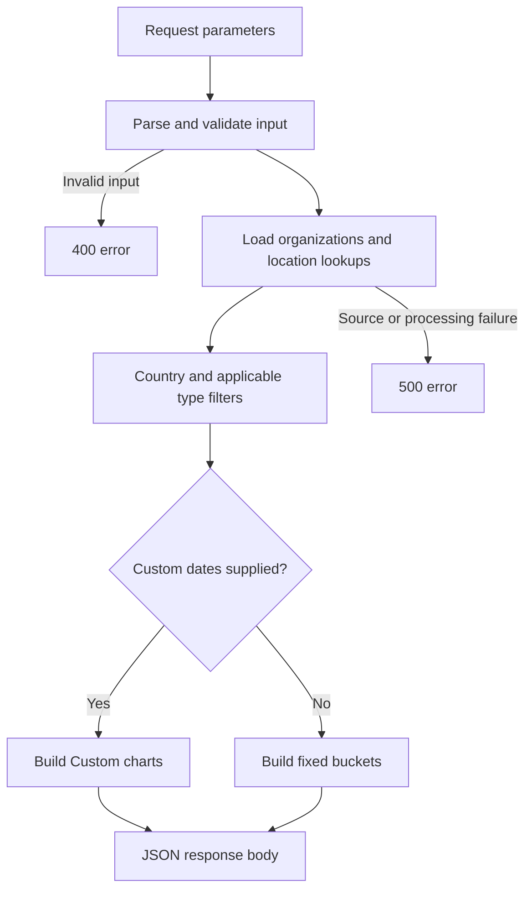
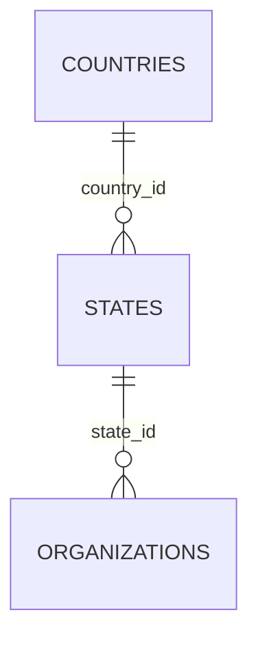

# Organization Tab Documentation

This document explains the Organization area of **Super Admin Dashboard → Analytics → Application Analytics**: its purpose, intended user journey, chart data contracts, calculations, implementation history, and outstanding integration work. It addresses [documentation issue #604][i604].

**Review date:** 27 October 2026. **Code baseline:** `test` at [`b9a25d62a957b14f526f0f4e463e73ef7e2ffacf`][baseline]. Statements about current behavior refer to that commit, not to an assumed production deployment. Task and PR states below were checked on the review date.

## 1. Implementation status and scope

The Organization requirements have evolved from a single dashboard API into three standalone chart handlers. The checked-in implementation and the latest requested changes differ:

| Area | Verified in the reviewed code | Requested work still pending at this baseline |
| --- | --- | --- |
| Growth & Location | `growth_trend_analytics.py`; one shared Custom date pair; country filter; country-to-state location breakdown; default returns four fixed buckets | [#539][i539] has a merged implementation, [PR #541][p541], although the issue remains open |
| Size & Contribution | `size_and_contribution.py`; independent size/contribution date pairs; optional CSV mode; default returns four fixed buckets **plus empty `Custom`** | [#569][i569]: default response, mock-source default, timestamp handling, unknown-country validation. [#583][i583]: one shared date pair and CSV-only packaging |
| Rating & Type | `rating_type_analytics.py`; independent rating/type date pairs; optional CSV mode; default returns four fixed buckets **plus empty `Custom`** | [#506][i506]: remove empty `Custom` from the default response |
| Four summary cards | Required by [#228][i228]; the three standalone handlers do **not** return `summary` | The source of the four cards and their wiring to the three handlers need confirmation |
| Frontend | The inspected webapp `test` component lists Requests, KPI, Beneficiaries, and Volunteers only; its analytics service has no Organization function | Organization navigation, chart components, endpoint wiring, and deployed UI behavior are unverified |

Sources: [Growth handler][growth], [Size handler][size], [Rating handler][rating], [frontend navigation][frontend], and [frontend analytics service][frontend-service]. The frontend snapshot is independently pinned to webapp `test` commit `b13d81ab0ce0b3315af3c01219b377aa4844a452`; it does not establish which code the hosted app runs.

The documentation PR targets `test` because that branch contains the current chart handlers and is the base specified by the subsequent Organization update tasks. At review time the data repository's `main` (`443fc079091fce43058030ef1ac8bc1ef6cf9951`) and `dev` (`fb300562d71d86c97f63c4353d5e8b63400968ee`) do not contain these three files. This document records those differences rather than treating an open PR or issue comment as proof of deployment.

The Request Details → Organizations recommendation list, `saayam-org-aggregator`, and its distance work are a different feature. They do not supply the six analytics charts described here.

## 2. Purpose and features

The Organization area helps an administrator understand how the organization directory is growing, where organizations are located, their sizes, their collaborator/contributor flags, their ratings, and the balance of for-profit and non-profit organizations. The date-based charts use **organization creation time**, not help-request completion, donation amounts, volunteer hours, or a recorded date when collaborator status changed.

[#228][i228] specifies four common cards and three inner views:

| View | Charts and purpose | Data returned by the standalone implementation |
| --- | --- | --- |
| Growth & Location | Growth line chart; organization counts by location | `growth_trend.total_organizations`, `growth_trend.collaborators`, `organizations_by_location` |
| Size & Contribution | Organizations grouped by size; independent collaborator and contributor counts/shares | `organizations_by_size`, `collaborator_vs_contributor` |
| Rating & Type | Counts at each star rating; stacked organization mix trend by type | `rating_distribution`, `organization_mix_trend.non_profit`, `organization_mix_trend.for_profit` |

The common cards requested in #228 are Total Organizations, Total Collaborators, Total Contributors, and Average Organization Rating. The original specification suggested `POST /analytics/organizations` with a flat response containing all charts and `summary`. That suggested endpoint is **not registered** by the current standalone handlers; do not use it as a verified deployed URL.

## 3. User flow

The following is the **intended flow from the requirements**, supported by the backend contracts. The frontend integration is not present in the inspected snapshot, so button placement, initial selected range, loading indicators, chart interactions, and reset implementation still need UI-owner confirmation.

1. An authorized Super Admin opens **Analytics → Application Analytics → Organization**.
2. The administrator reads the four summary cards, when their data source is integrated, and selects Growth & Location, Size & Contribution, or Rating & Type.
3. For fixed ranges, a handler returns multiple buckets in one response. The UI can select `7D`, `30D`, `1Y`, or `All` from those results without another request **if it retains that response locally**. This is a contract capability, not verified frontend caching behavior.
4. The administrator selects a country where supported. A new filtered request is needed. In Growth & Location, both charts are filtered, and the location labels change from country codes to state names.
5. For a Custom range, the UI sends the handler-specific parameters in section 4. Growth uses one pair for both charts. Size and Rating currently accept separate pairs. A valid Custom request returns only `Custom`; a chart whose pair was not supplied remains empty in the latter two APIs.
6. An empty array means no matching chart data, rather than a zero-filled series. A `400` means invalid input; a `500` means a data-loading or processing failure. A UI should preserve that distinction. The current frontend treatment is unverified.
7. Reset is requested by #228. Clearing the filters and requesting `{}` restores each handler's default bucket response. Which fixed range the UI displays after reset is unspecified.

### Backend processing flow



This is a logical flow. Validation order varies: Growth loads its CSVs before validating country/dates, while Size and Rating validate date parameters before loading data. Therefore a missing source file can mask a Growth input error. API Gateway route configuration and frontend calls are outside these files.

## 4. Filters and response contracts

### Current contract comparison

All names below are case-sensitive JSON field names. The fixed response key is **`All`**, not `ALL`; the country/type no-filter input convention is `ALL`.

| Contract detail | Growth & Location | Size & Contribution | Rating & Type |
| --- | --- | --- | --- |
| No Custom dates | `7D`, `30D`, `1Y`, `All` | Same four keys plus empty `Custom` | Same four keys plus empty `Custom` |
| Custom parameters | `start_date`, `end_date`, shared by both charts | `size_start_date`, `size_end_date`; `contribution_start_date`, `contribution_end_date` | `rating_start_date`, `rating_end_date`; `type_start_date`, `type_end_date` |
| Valid Custom response | `Custom` only, both charts evaluated | `Custom` only; each chart evaluated only if its pair was supplied | `Custom` only; each chart evaluated only if its pair was supplied |
| Country | Code or name, case-insensitive; spaces match underscores | Code or name, case-insensitive; spaces/underscores normalized | Code or name, case-insensitive; spaces match underscores |
| No country restriction | Missing, blank/whitespace, null, or `ALL` | Missing, `""`, null, or `ALL`; whitespace-only is not normalized to ALL | Missing, blank/whitespace, null, or `ALL` |
| Unknown country | `400 {"error":"Unknown country"}` | `200` with empty charts in CSV mode | `200` with empty charts in CSV mode |
| Organization type | Not supported | `non_profit`, `for_profit`, `ALL`; hyphens/spaces/case normalized | Not supported; the second chart already splits by type |
| `time_filter`, `region`, `group_by` | Not consumed | Not consumed | Not consumed |

Sources: [Growth parsing and handler][growth-handler], [Size parsing and handler][size-handler], [Rating parsing and handler][rating-handler]. Unsupported fields are generally ignored; they are not reliably rejected. In particular, sending `start_date`/`end_date` to the current Size or Rating handler does **not** select Custom mode.

### Dates and validation

Requests should use `YYYY-MM-DD`. Custom start and end dates are inclusive: Growth and Size compare against midnight of the following day as an exclusive upper bound; Rating compares through the final microsecond of the end date. Equal start/end dates are valid.

- Growth treats both blank/null dates as absent; a half pair, invalid date, or reversed pair returns `400` with `Invalid date format or start_date after end_date`. Non-text country returns `country must be a string`. Country validation runs first after source loading.
- Size treats falsey date values as absent, validates real calendar dates with a zero-padded date pattern, and rejects half/reversed pairs with field-specific messages. Invalid organization type or malformed JSON returns `400`. Its `body.get(...) or "ALL"` filter parsing also treats `0`/`false` as no filter; #569 proposes stricter handling.
- Rating requires a partner for a non-null date, rejects invalid/reversed pairs, and validates both pairs before returning any chart. Empty strings are invalid dates here, unlike Growth. Non-text country and malformed/non-object JSON return `400`.

Growth and Rating use `datetime.strptime` without a zero-padding regex; some non-zero-padded strings may parse even though the contract requests `YYYY-MM-DD`. Do not rely on that permissiveness as an integration contract.

### Fixed-window boundaries in the actual code

| Bucket | Growth | Size | Rating |
| --- | --- | --- | --- |
| `7D` | From local-runtime today minus 6 days at midnight; no upper bound | From UTC today minus 6 days to tomorrow midnight, exclusive | From local-runtime today minus 6 days through current runtime time |
| `30D` | From today minus 29 days at midnight; no upper bound | From UTC today minus 29 days to tomorrow midnight, exclusive | From today minus 29 days through current runtime time |
| `1Y` | First day of the month 11 months before current month; no upper bound | Same 12-calendar-month start, ending tomorrow midnight, exclusive | One calendar year before today plus one day through current runtime time; leap-day fallback handled |
| `All` | All rows retained after valid-date cleaning and country filtering | All rows retained after valid-date cleaning and country/type filtering | All retained rows up to current runtime time |

Sources: [Growth windows][growth-windows], [Size windows][size-windows], [Rating windows][rating-windows]. `1Y` is therefore **not identical across all three handlers**. Growth can include future-dated rows in fixed windows and `All`. Runtime-local clocks versus UTC normalization are another reconciliation risk.

### Planned contract changes

| Task | Required change | Status evidence |
| --- | --- | --- |
| [#506][i506] | Rating default returns four fixed keys without empty `Custom`; independent Custom date pairs remain | Reviewed linked PRs are open; current code still adds `Custom` |
| [#539][i539] | Growth uses one date pair and country filter; countries by default, states when selected; no top-four limit | [PR #541][p541] merged into `test` and matches the inspected code |
| [#569][i569] | Size defaults to adjacent mock CSVs, uses Postgres only for explicit `USE_MOCK_DATA=false`, normalizes mixed timestamps, errors on unknown country, removes default empty `Custom` | Reviewed linked PRs are open; current file retains older behavior |
| [#583][i583] | Size uses one shared date pair, no empty default `Custom`, adjacent `mock_data` only; removes database code, switches, and demo block | [PR #596][p596] and [PR #600][p600] are open; not applied at baseline |

#583 names `size_contribution_analytics.py`, but the checked-in file and both reviewed implementations are `size_and_contribution.py`. #583 also describes Rating as sharing one date pair; that is **not true of the inspected Rating code**, and #506 does not request that change. These discrepancies need maintainer confirmation before claiming a common dashboard contract.

## 5. Data sources and schema

The reviewed sample source is [`data-analytics/mock-data-generation/`][mock-dir]. The handlers need three CSVs, with this relationship:



| Table | Fields used | Meaning |
| --- | --- | --- |
| `organizations` | `org_id`, `created_at`, `state_id` | Organization row identity, creation timestamp, geographic lookup |
| `organizations` | `is_collaborator`, `is_contributor` | Independent status flags, not opposite values of one field |
| `organizations` | `org_size`, `org_type`, `org_rating` | Size label, profit category, literal integer star rating |
| `states` | `state_id`, `country_id`, `state_name` | Link each organization to country; readable state label |
| `countries` | `country_id`, `country_code`, `country_name` | Country filtering and displayed country code |

The new sample uses `small`/`medium`/`large`, `non_profit`/`for_profit`, and country names such as `UNITED_STATES`. Organization timestamps are `created_at`; `last_updated_at` is not used for chart window selection. The handlers count rows rather than explicitly deduplicating organization IDs. Unique organization IDs and unique lookup keys must be maintained upstream to avoid inflated counts or joins.

### Source selection and packaging

| Handler | Current source behavior |
| --- | --- |
| Growth | Always reads adjacent `mock_data/organizations.csv`, `states.csv`, `countries.csv`; no DB path and no environment-variable directory override |
| Size | Handler defaults to Postgres; `USE_MOCK_DATA=true` selects pandas CSV loading. `MOCK_DATA_DIR` overrides adjacent `mock_data`; mock lookup filenames also accept singular aliases. The standalone demo block sets mock mode when run as a script |
| Rating | Handler defaults to Postgres; `USE_MOCK_DATA=true` selects pandas CSV loading. `MOCK_DATA_DIR` overrides adjacent `mock_data`; expects plural lookup filenames. The standalone demo block sets mock mode when run as a script |

No adjacent `mock_data` directory is tracked at this baseline. Growth needs the three CSVs copied into that location, or its module constant redirected in a local verification harness. A Lambda bundle must contain the handler and that folder. Size/Rating can be pointed at the tracked sample directory locally; their DB paths require configured credentials. No database or AWS deployment was used for this documentation review.

The retained Size DB path reads `virginia_dev_saayam_rdbms.organizations` by default but joins singular `state`/`country`; Rating also joins singular `state`/`country`, unqualified by schema. #301 records a migration to plural names. These DB paths have not been validated against a live database. Optional `psycopg2` imports permit CSV-only local use without that package; pandas is required. The repository requirements pin pandas 2.2.2.

### Sample snapshot and freshness

Independent inspection of the pinned CSVs found **400 organizations with 400 unique IDs, 400 states, and 18 countries**. Organization creation timestamps span **2 June 2025 to 31 August 2026**. Thus on the review date, empty `7D`/`30D` charts are expected with this fixture. They do not prove that the service is broken.

[The generator][generator] seeds Python randomness with 42, uses `ROW_COUNT = 400`, and creates organization timestamps within a fixed 2025–2026 interval. Running it overwrites generated files. Its [README][mock-readme] still describes three countries, while the checked-in data has 18; use the actual files for this snapshot. Older files under `data-analytics/sql/` and the spreadsheet attached to #84 represent different historical schemas and should not be mixed into these joins without checking their headers.

## 6. Metrics and calculations

Let **F** be the valid-date organization rows after applicable country/type filters, and **W** the rows in the selected creation-time window. All counts below assume one row per organization.

### Summary cards requested by #228

| Card | Intended calculation over the selected population | Implementation caveat |
| --- | --- | --- |
| Total Organizations | Number of organization rows | Not returned as `summary` by the three chart handlers |
| Total Collaborators | Count rows where `is_collaborator` is true | Independent flag in the newer chart APIs |
| Total Contributors | Count rows where `is_contributor` is true | Do not substitute the non-collaborator count |
| Average Organization Rating | Sum of non-null valid ratings divided by the number of rated organizations | Final validation, rounding, empty value, and serving endpoint need confirmation; do not treat an unrated organization as zero stars |

The older [FastAPI implementation][legacy] has protected GET overview/performance endpoints rather than the proposed single POST endpoint. Its overview summary derives contributors as `is_collaborator IS NOT TRUE`, and its average uses assumed column `rating`; its date filter uses assumed `registered_at`. This differs from the newer `is_contributor`, `org_rating`, and `created_at` contracts. Its tests validate that older scaffold, not all six newer chart contracts.

### Growth & Location

- **`total_organizations`**: group F by day or month, count rows, take a running sum, then emit only periods with organizations in W. The baseline includes organizations created before the visible window; it does not restart at zero. Country filtering changes both the baseline and visible data.
- **`collaborators`**: for each emitted period, count rows in W whose `is_collaborator` flag is true. This is **per-period**, not cumulative. If organizations were created but none were collaborators, that period appears with collaborator count 0.
- **Location**: count rows in W after joining the geographic lookups. With no country filter, group by country code. With a country selected, group by state name. Return all non-empty groups sorted by count descending and label ascending. Missing lookup labels become `Unknown`; there is no `Other`, percentage, or top-four cap in the current code.

`7D`/`30D`/`Custom` trends label periods `YYYY-MM-DD`; `1Y`/`All` use `YYYY-MM`. Periods with no organization creation are omitted. Source: [Growth calculations][growth-calcs].

### Size & Contribution

- **Size**: `count(rows in W with each observed org_size)`. Emit raw observed labels; no zero-filled missing size categories. Current display ordering is small, medium, large, then other observed labels. Null sizes are omitted from the size groups but still belong to the contribution denominator.
- **Collaborator**: `C = count(is_collaborator is true in W)`.
- **Contributor**: `T = count(is_contributor is true in W)`; a missing contributor column yields 0 in mock mode, and the SQL path checks column availability.
- **Each percentage**: Python `round(100 × flag_count / len(W), 1)`. Empty W returns `[]`; otherwise two rows are returned, labeled `Collaborator` and `Contributor`.

An organization may have both flags or neither. For example, with 10 organizations, 6 collaborators and 7 contributors mean 60.0% and 70.0%; a combined 130% is valid. These values do not measure donation revenue or the number of contributions. Source: [Size calculations][size-calcs].

### Rating & Type

- **Rating distribution**: restrict to W; coerce `org_rating` to numeric; retain only integer values 1–5; group/count by that value, ascending. Missing, nonnumeric, fractional, and out-of-range ratings are omitted. Do not round a 4.5 rating into a star bucket. Missing stars are not zero-filled.
- **Organization mix trend**: split F by normalized `non_profit`/`for_profit`; count creations per period and take a running sum **including pre-window history**, bounded by the window end. Each type independently emits only periods where it has in-window creations. The two arrays can therefore have different period labels and lengths.

If a frontend aligns type series for stacked bars, an omitted period is not evidence that a cumulative total fell to zero. It needs a defined carry-forward/display policy; that policy is not implemented here. Source: [Rating and type calculations][rating-calcs].

Both growth and mix totals represent historical **creation counts using current row attributes**, not historical snapshots of rating, type, size, or status. A current flag/type edit can change historical groupings. Deletions and previous state changes are not reconstructed.

## 7. Examples verified against the pinned sample

The examples below are parsed JSON bodies. The Lambda return object wraps each with `statusCode`, headers, and a JSON-encoded string `body`. Through a correctly configured API Gateway proxy, the HTTP response body is the JSON payload, not the wrapper.

### Growth shared date and country filters

Request:

```json
{"start_date":"2026-01-01","end_date":"2026-03-31","country":"USA"}
```

Verified response:

```json
{
  "Custom": {
    "growth_trend": {
      "total_organizations": [
        {"period":"2026-01-25","count":26},
        {"period":"2026-01-29","count":27},
        {"period":"2026-03-04","count":28},
        {"period":"2026-03-10","count":29},
        {"period":"2026-03-12","count":30},
        {"period":"2026-03-14","count":31}
      ],
      "collaborators": [
        {"period":"2026-01-25","count":0},
        {"period":"2026-01-29","count":0},
        {"period":"2026-03-04","count":1},
        {"period":"2026-03-10","count":1},
        {"period":"2026-03-12","count":1},
        {"period":"2026-03-14","count":0}
      ]
    },
    "organizations_by_location": [
      {"state":"Kentucky","count":1},
      {"state":"Minnesota","count":1},
      {"state":"New Hampshire","count":1},
      {"state":"North Carolina","count":1},
      {"state":"Utah","count":1},
      {"state":"West Virginia","count":1}
    ]
  }
}
```

There are six in-window organizations, while the last cumulative total is 31 because earlier USA organizations remain in the baseline.

### Size and Rating requests at the current baseline

To populate **both** Size charts for the same Custom window, currently send:

```json
{
  "country":"USA",
  "size_start_date":"2026-01-01","size_end_date":"2026-03-31",
  "contribution_start_date":"2026-01-01","contribution_end_date":"2026-03-31"
}
```

To populate **both** Rating charts, currently send:

```json
{
  "country":"USA",
  "rating_start_date":"2026-01-01","rating_end_date":"2026-03-31",
  "type_start_date":"2026-01-01","type_end_date":"2026-03-31"
}
```

Both requests return `Custom` only. Do not replace these pairs with `start_date`/`end_date` until the appropriate contract change is merged and integrated.

For `{}` in mock mode, the `All` buckets reconcile to the following independent CSV controls:

| Control | Verified value |
| --- | --- |
| Growth last cumulative total / location-count sum | 400 / 400 |
| Size counts | small 122; medium 168; large 110; sum 400 |
| Collaborators / contributors | 125 / 224 |
| Collaborator / contributor percentages | 31.2% / 56.0%, from Python one-decimal rounding |
| Star counts 1, 2, 3, 4, 5 | 9, 13, 46, 119, 136; total rated 323 |
| Unrated rows | 77 |
| Last type totals | non_profit 270; for_profit 130 |
| Countries represented / USA organizations | 18 / 51 |

These are fixture controls, not production KPIs. Numbers shown in older tasks, guides, or PR outputs may use other datasets or execution dates.

## 8. Development history and individual task review

Before writing this document, the task bodies and all returned comments were reviewed individually. Directly linked implementation PRs, their discussions/diffs, relevant merged history, and the attachments listed below were inspected. Cross-reference timelines also contain many alternative volunteer submissions; the explicit PR lists below identify the reviewed implementation evidence and must not be read as proof that every alternative was merged or deployed.

### #81 — Super Admin analytics parent task

[#81](https://github.com/saayam-for-all/data/issues/81) is closed. Its brief body establishes the three analytics categories; its completion comment does not link an implementation PR or attachment. It supplies navigation context, not a verifiable Organization API contract.

### #82 — Application Analytics design

[#82][i82] is closed. It initially requests organization counts by for-profit/non-profit category over time. The comments link the [Super Admin analytics design wiki][wiki] and report completion. The wiki was inspected and contains the early organization-count requirement, not the later three-view contract. No Organization-specific PR is linked in those comments.

### #84 — Initial sample data and visualization design

[#84][i84] is closed. It proposes CSV → backend JSON → frontend charts for MVP, followed by a later DB replacement. Comments say JSON objects were created and shared with the UI team; no PR is linked.

Both attachments were inspected: [table/column workbook][attachment84schema] and [visualization document][attachment84visuals]. The historical workbook has `state_code` and `created_at` for organizations, and lacks several newer dashboard fields. The visualization document proposes an organization profit/non-profit donut and country/category bar chart. Those early visuals do not establish the final six-chart layout or current schema.

### #89 — Plotly/application dashboard implementation

[#89](https://github.com/saayam-for-all/data/issues/89) is closed and has no description. Comments record mock CSV-to-JSON handoff and completion. No code, attachment, or PR in the comments establishes a deployed Organization tab; the title alone is not evidence that the present UI uses Plotly.

### #228 — Consolidated Organization API and cards

[#228][i228] remains open. Its current body defines the four cards, three views, common filters, source tables, suggested single POST endpoint, and local PostgreSQL/mock tests without AWS deployment. Both comment-linked PRs were reviewed: [#234][p234] (CSV implementation, open) and [#300][p300] (PostgreSQL implementation, open). In #300, review comments challenge cumulative type totals under that older contract and invalid-JSON fallback; author replies identify fixes. Those comments concern the earlier API, not the later #380 cumulative-type requirement.

Merged [PR #272][p272] added the retained FastAPI overview/performance scaffold, shared time filters, local seed SQL, and mocked DB tests. Its description explicitly flags `rating` and `registered_at` as assumptions. It does not implement the final single-response contract. #228 links `sql/states.csv`; the earlier sample used singular `state.csv`, illustrating the schema/version drift.

### #301 — Shared mock dataset

[#301][i301] is closed and specifies the ten synthetic tables and their foreign keys. Comment-linked [PR #314][p314] is merged; [PR #331][p331] remains open. #331's review discusses schema, enum, coordinate, and validation mismatches and author-reported corrections. [PR #346][p346], also referenced from #228's timeline, is open. None of those open branches supersedes the checked-in sample for this document.

Merged [PR #504][p504] updated SQL-folder CSVs; [PR #536][p536] updated mock-data-generation files. Their sparse descriptions require inspecting the files themselves. The current 18-country fixture comes from the reviewed `test` snapshot, not the old one-country assumption in #336.

### #336 — Standalone Growth & Location

[#336][i336] remains open. It originally defines independent Custom ranges, all-time organization totals, per-period collaborator counts, sparse periods, and top-four countries. Comments link merged [PR #347][p347] and [Task 336 solution guide][attachment336]. Both were inspected. #347's review explicitly requests response-shape changes; an author reply records four default keys and Custom-only behavior.

The guide describes the older independent-range/top-four contract and suggests a route, but it is not evidence of a deployed endpoint. Merged [#424][p424] removes embedded tests/output from #347's function. [#425][p425] adds another Growth function. [#356][p356] is merged, includes a review discussion of a 1Y off-by-one correction, and is subsequently reverted by merged [#489][p489]. Merged [#538][p538] establishes the current `growth_trend_analytics.py`; merged #541 then updates it. Do not combine calculations from reverted files with the current handler.

### #376 — Standalone Size & Contribution

[#376][i376] remains open. It specifies independent flags, separate Custom ranges, percentages against window total, raw size categories, CSV/pandas testing, and optional psycopg2. The comment-linked [PR #379][p379] is open; its attached [test output][attachment379] reports 21 passing tests on that proposal. This historical result was read, not rerun as validation of the current file. The comment `PR #376` is not a valid PR link: 376 is this issue.

Merged [#419][p419] adds another implementation under `data-engineering/src/organization_size_contribution_analytics/`, with tests. Merged [#471][p471] is reverted by [#490][p490]. Merged [#568][p568] adds the present `data-analytics/lambda_functions/size_and_contribution.py`. The retained #419 implementation has a different default source and 1Y definition and is not assumed to be the handler selected by the dashboard.

### #380 — Standalone Rating & Type

[#380][i380] remains open. It requires literal integer ratings, sparse categorical results, all-time cumulative type series, a country filter, and independent date pairs. Its comment attaches [Task 380 solution guide][attachment380], which was inspected; its five-key default is the older behavior that #506 asks to change. Merged [PR #503][p503] adds the present `rating_type_analytics.py` with that five-key default. No deployed route or frontend component is established by the guide.

### #506 — Rating default response correction

[#506][i506] remains open. Its comments report fixes but do not establish a merge. Its linked PRs [#514][p514], [#520][p520], [#521][p521], [#529][p529], [#535][p535], [#550][p550], [#555][p555], [#614][p614], and [#616][p616] were inspected and are open. Their central change removes default `Custom`; several also update the docstring. #555 targets `main` and has a broader branch diff despite describing a one-file change. The pinned `test` code still contains the default `Custom` block.

### #539 — Shared Growth range and country selection

[#539][i539] remains open and has no comments/attachments. All six PRs linked in its reviewed timeline were inspected: [#541][p541] is merged; [#542][p542], [#557][p557], [#561][p561], [#570][p570], and [#591][p591] remain open. #541's diff adds country resolution, removes independent location dates, changes locations to countries/states without a cap, and shares one range. Its review is positive. That merged code is the current source of truth; later alternatives are not silently included.

### #569 — Size response, source, timestamps, and country fixes

[#569][i569] remains open. A comment reports a fix. The six linked PRs [#572][p572], [#575][p575], [#595][p595], [#597][p597], [#607][p607], and [#608][p608] were inspected and remain open. They propose four default keys, mock-by-default, UTC timestamp normalization, and country lookup validation while retaining separate ranges. #575's review flags that adjacent `mock_data` is absent in a checkout; bundle assembly must supply it. No fix is assumed merged from a comment or a passing-test claim alone.

### #583 — Shared Size range and CSV-only source

[#583][i583] remains open and has no comments/attachments. Both linked PRs [#596][p596] and [#600][p600] were inspected and are open. They edit `size_and_contribution.py`, explicitly noting the filename mismatch in the issue, replace the four date fields with one pair, and remove DB/source switches and demo code. This is a later requested contract than #569, not current behavior at the reviewed baseline.

### Related work excluded from this chart implementation

[#72](https://github.com/saayam-for-all/data/issues/72), an earlier voluntary-organization trend task, was reviewed with its [notebook](https://github.com/user-attachments/files/22468818/TrendAnalysisForVoluntaryOrg.ipynb), [counts attachment](https://github.com/user-attachments/files/22468819/volunteer_counts_by_org.xls), and [dummy CSV](https://github.com/user-attachments/files/22468820/volunteers_dummy.csv). It groups volunteers by organization and draws bar/pie charts, not the present organization-creation analytics. Its comment says Red Cross has the highest count, but the supplied counts file has five equal counts of 10; that narrative is not used as a finding here.

[#302](https://github.com/saayam-for-all/data/issues/302) and [#433](https://github.com/saayam-for-all/data/issues/433) concern Request Details organization recommendations/aggregator schema and distance, respectively. They are excluded from the six-chart implementation history.

## 9. Verification and local inspection

This documentation change does not alter handlers, fixtures, deployment, or database behavior. Local inspection used Python 3.12.14 and pandas 2.2.3 from the available runtime; the repository pins pandas 2.2.2. The fixture controls and current response shapes were checked by importing the pinned modules and comparing outputs with independently grouped CSV counts. No new claim of production correctness follows from those checks.

To inspect a handler locally, install the repository's pandas version in a development environment, then run this from the repository root. It does not require DB credentials or AWS access:

```python
import importlib.util
import json
import os
from pathlib import Path

root = Path.cwd()
csv_dir = root / "data-analytics/mock-data-generation"
handlers_dir = root / "data-analytics/lambda_functions"
os.environ["USE_MOCK_DATA"] = "true"
os.environ["MOCK_DATA_DIR"] = str(csv_dir)

for filename in (
    "growth_trend_analytics.py",
    "size_and_contribution.py",
    "rating_type_analytics.py",
):
    spec = importlib.util.spec_from_file_location(filename[:-3], handlers_dir / filename)
    module = importlib.util.module_from_spec(spec)
    spec.loader.exec_module(module)
    if filename == "growth_trend_analytics.py":
        # Local harness override; the packaged function uses adjacent mock_data.
        module.DATA_DIR = str(csv_dir)
    response = module.lambda_handler({}, None)
    print(filename, response["statusCode"], list(json.loads(response["body"])))
```

Observed default keys are four for Growth and five for Size/Rating, as documented in section 4. A separate local verification run passed 50 checks covering fixture keys/joins/totals, USA filtering, unknown-country differences, shared-date fields ignored by Size/Rating, valid handler-specific Custom pairs, and exact agreement with the Growth Custom response in section 7. Markdown checks found no unresolved reference links; all four JSON examples parsed, the Python snippet compiled and ran, and pinned local code paths/line anchors resolved. The existing pytest suite was not run: `pytest` is absent from the available runtime. Prior PR test counts above are explicitly historical, author-reported results and are not substituted for current verification.

## 10. Known limitations and information needing confirmation

| Gap | Evidence and impact | Confirmation or follow-up needed |
| --- | --- | --- |
| Frontend and deployment | Inspected webapp `test` has no Organization navigation/service; no route configuration binds these three handlers in this repository | UI/service owners should link the active Organization component, endpoint URLs/methods, API Gateway mappings, and deployed revision |
| Summary cards | #228 requests four cards; standalone responses contain charts only; retained FastAPI scaffold has incompatible assumptions | Confirm serving endpoint, population/filters, contributor semantics, average-rating rounding and unrated behavior |
| Date/filter contract drift | #539 merged; #506/#569/#583 remain proposals; #583 assumes a Rating shared-range contract not found in code | Confirm the intended final common contract and refresh this document after merges |
| File and schema drift | #583 names another filename; legacy uses `rating`/`registered_at`; DB joins use singular lookup tables | Confirm canonical handler and latest database DDL before enabling DB mode |
| Packaging | Adjacent `mock_data` is not tracked; Growth always needs it; Size/Rating default to DB unless configured | Document the maintainer-owned package build, CSV refresh process, and pandas dependency/layer |
| Window consistency | Growth/Size calendar-month `1Y` differs from Rating; Growth has no fixed-window upper bound | Agree a common clock, timezone, future-date policy, and exact range boundaries |
| Timestamp robustness | Size mock parsing lacks UTC normalization; Growth parsing does not request mixed-format inference | Complete #569 or later agreed fixes and verify mixed/offset timestamps against the supported pandas version |
| Data freshness | Fixtures end in August 2026; mock README country count is stale | Define refresh cadence; label mock/demo metrics and avoid presenting them as live activity |
| Historical interpretation | Counts use creation timestamps with current flags/type; no status-change history | Confirm business definitions of collaborator, contributor, size, rating origin, and historical reporting needs |
| Sparse chart alignment | Type series omit different periods; zero-filled plotting can misstate running totals | Define frontend axis alignment and carry-forward policy; preserve true empty states |
| Data quality | Row counts assume unique org IDs and lookup keys; null sizes/ratings are excluded from their distributions | Validate keys/joins upstream; surface excluded-row counts if required |
| Access control | Standalone handlers do not enforce authentication/roles internally; legacy FastAPI does | Confirm API Gateway/Cognito or other external authorization for the Super Admin route; CORS headers alone do not supply it |
| Deployment evidence | [Current workflow][workflow] automatically handles selected `data-engineering/src/saayam-org-*` changes on merges to `main`, not these analytics files | Identify the actual analytics deployment process and owner; no AWS deployment was performed for #604 |

This document deliberately leaves these points open rather than inventing a frontend, production endpoint, database schema, or deployment state.

[baseline]: https://github.com/saayam-for-all/data/tree/b9a25d62a957b14f526f0f4e463e73ef7e2ffacf
[growth]: https://github.com/saayam-for-all/data/blob/b9a25d62a957b14f526f0f4e463e73ef7e2ffacf/data-analytics/lambda_functions/growth_trend_analytics.py
[growth-handler]: https://github.com/saayam-for-all/data/blob/b9a25d62a957b14f526f0f4e463e73ef7e2ffacf/data-analytics/lambda_functions/growth_trend_analytics.py#L234
[growth-windows]: https://github.com/saayam-for-all/data/blob/b9a25d62a957b14f526f0f4e463e73ef7e2ffacf/data-analytics/lambda_functions/growth_trend_analytics.py#L102
[growth-calcs]: https://github.com/saayam-for-all/data/blob/b9a25d62a957b14f526f0f4e463e73ef7e2ffacf/data-analytics/lambda_functions/growth_trend_analytics.py#L141
[size]: https://github.com/saayam-for-all/data/blob/b9a25d62a957b14f526f0f4e463e73ef7e2ffacf/data-analytics/lambda_functions/size_and_contribution.py
[size-handler]: https://github.com/saayam-for-all/data/blob/b9a25d62a957b14f526f0f4e463e73ef7e2ffacf/data-analytics/lambda_functions/size_and_contribution.py#L341
[size-windows]: https://github.com/saayam-for-all/data/blob/b9a25d62a957b14f526f0f4e463e73ef7e2ffacf/data-analytics/lambda_functions/size_and_contribution.py#L128
[size-calcs]: https://github.com/saayam-for-all/data/blob/b9a25d62a957b14f526f0f4e463e73ef7e2ffacf/data-analytics/lambda_functions/size_and_contribution.py#L150
[rating]: https://github.com/saayam-for-all/data/blob/b9a25d62a957b14f526f0f4e463e73ef7e2ffacf/data-analytics/lambda_functions/rating_type_analytics.py
[rating-handler]: https://github.com/saayam-for-all/data/blob/b9a25d62a957b14f526f0f4e463e73ef7e2ffacf/data-analytics/lambda_functions/rating_type_analytics.py#L337
[rating-windows]: https://github.com/saayam-for-all/data/blob/b9a25d62a957b14f526f0f4e463e73ef7e2ffacf/data-analytics/lambda_functions/rating_type_analytics.py#L184
[rating-calcs]: https://github.com/saayam-for-all/data/blob/b9a25d62a957b14f526f0f4e463e73ef7e2ffacf/data-analytics/lambda_functions/rating_type_analytics.py#L209
[legacy]: https://github.com/saayam-for-all/data/blob/b9a25d62a957b14f526f0f4e463e73ef7e2ffacf/data-engineering/src/main.py#L299
[mock-dir]: https://github.com/saayam-for-all/data/tree/b9a25d62a957b14f526f0f4e463e73ef7e2ffacf/data-analytics/mock-data-generation
[generator]: https://github.com/saayam-for-all/data/blob/b9a25d62a957b14f526f0f4e463e73ef7e2ffacf/data-analytics/mock-data-generation/generate_mock_data.py
[mock-readme]: https://github.com/saayam-for-all/data/blob/b9a25d62a957b14f526f0f4e463e73ef7e2ffacf/data-analytics/mock-data-generation/readme.md
[frontend]: https://github.com/saayam-for-all/webapp/blob/b13d81ab0ce0b3315af3c01219b377aa4844a452/src/pages/Dashboard/components/Analytics/ApplicationAnalytics.jsx
[frontend-service]: https://github.com/saayam-for-all/webapp/blob/b13d81ab0ce0b3315af3c01219b377aa4844a452/src/services/analyticsServices.js
[workflow]: https://github.com/saayam-for-all/data/blob/b9a25d62a957b14f526f0f4e463e73ef7e2ffacf/.github/workflows/deploy-lambda.yml
[wiki]: https://github.com/saayam-for-all/ml/wiki/Super-Admin-Dashboard-Analytics-tab-Design
[attachment84schema]: https://github.com/user-attachments/files/24040548/Table.column.names_data-1764970855601.xlsx
[attachment84visuals]: https://github.com/user-attachments/files/24040571/Types.of.Visualizations.for.Application.Analytics.Dashboard.docx
[attachment336]: https://github.com/user-attachments/files/32817149/Task.336_Sol.md
[attachment380]: https://github.com/user-attachments/files/33403091/Task.380.Sol.md
[attachment379]: https://github.com/user-attachments/files/32580603/test_output.txt
[i604]: https://github.com/saayam-for-all/data/issues/604
[i82]: https://github.com/saayam-for-all/data/issues/82
[i84]: https://github.com/saayam-for-all/data/issues/84
[i228]: https://github.com/saayam-for-all/data/issues/228
[i301]: https://github.com/saayam-for-all/data/issues/301
[i336]: https://github.com/saayam-for-all/data/issues/336
[i376]: https://github.com/saayam-for-all/data/issues/376
[i380]: https://github.com/saayam-for-all/data/issues/380
[i506]: https://github.com/saayam-for-all/data/issues/506
[i539]: https://github.com/saayam-for-all/data/issues/539
[i569]: https://github.com/saayam-for-all/data/issues/569
[i583]: https://github.com/saayam-for-all/data/issues/583
[p234]: https://github.com/saayam-for-all/data/pull/234
[p272]: https://github.com/saayam-for-all/data/pull/272
[p300]: https://github.com/saayam-for-all/data/pull/300
[p314]: https://github.com/saayam-for-all/data/pull/314
[p331]: https://github.com/saayam-for-all/data/pull/331
[p346]: https://github.com/saayam-for-all/data/pull/346
[p347]: https://github.com/saayam-for-all/data/pull/347
[p356]: https://github.com/saayam-for-all/data/pull/356
[p379]: https://github.com/saayam-for-all/data/pull/379
[p419]: https://github.com/saayam-for-all/data/pull/419
[p424]: https://github.com/saayam-for-all/data/pull/424
[p425]: https://github.com/saayam-for-all/data/pull/425
[p471]: https://github.com/saayam-for-all/data/pull/471
[p489]: https://github.com/saayam-for-all/data/pull/489
[p490]: https://github.com/saayam-for-all/data/pull/490
[p503]: https://github.com/saayam-for-all/data/pull/503
[p504]: https://github.com/saayam-for-all/data/pull/504
[p514]: https://github.com/saayam-for-all/data/pull/514
[p520]: https://github.com/saayam-for-all/data/pull/520
[p521]: https://github.com/saayam-for-all/data/pull/521
[p529]: https://github.com/saayam-for-all/data/pull/529
[p535]: https://github.com/saayam-for-all/data/pull/535
[p536]: https://github.com/saayam-for-all/data/pull/536
[p538]: https://github.com/saayam-for-all/data/pull/538
[p541]: https://github.com/saayam-for-all/data/pull/541
[p542]: https://github.com/saayam-for-all/data/pull/542
[p550]: https://github.com/saayam-for-all/data/pull/550
[p555]: https://github.com/saayam-for-all/data/pull/555
[p557]: https://github.com/saayam-for-all/data/pull/557
[p561]: https://github.com/saayam-for-all/data/pull/561
[p568]: https://github.com/saayam-for-all/data/pull/568
[p570]: https://github.com/saayam-for-all/data/pull/570
[p572]: https://github.com/saayam-for-all/data/pull/572
[p575]: https://github.com/saayam-for-all/data/pull/575
[p591]: https://github.com/saayam-for-all/data/pull/591
[p595]: https://github.com/saayam-for-all/data/pull/595
[p596]: https://github.com/saayam-for-all/data/pull/596
[p597]: https://github.com/saayam-for-all/data/pull/597
[p600]: https://github.com/saayam-for-all/data/pull/600
[p607]: https://github.com/saayam-for-all/data/pull/607
[p608]: https://github.com/saayam-for-all/data/pull/608
[p614]: https://github.com/saayam-for-all/data/pull/614
[p616]: https://github.com/saayam-for-all/data/pull/616
