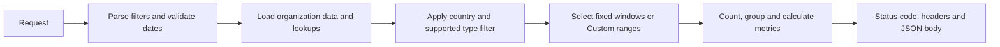

# Organization Tab Documentation

**Related task:** [Issue #604][i604]  
**Reviewed:** 2 November 2026  
**Backend baseline:** [`test` at `f64938fef70d2a629f00d8edf9d39b4cd2dcfc97`][baseline]

## 1. Purpose and scope

The Organization tab belongs to **Super Admin Dashboard → Application Analytics**. It is intended to help administrators understand organization growth, geographic coverage, size, collaboration/contribution, ratings, and profit type.

Parent [#81][i81] establishes Super Admin analytics. [#82][i82] introduces Application Analytics and organization counts over selected periods and profit categories. [#228][i228] expands that requirement into four summary cards and three views, each containing two charts.

This document describes the three Organization Lambda handlers present on the reviewed `test` branch. It separates **implemented behavior**, **requested changes**, and **unverified integration**. A merged backend PR does not by itself establish what is deployed.

### Feature inventory

| View | Charts | Current source |
| --- | --- | --- |
| Growth & Location | Organization growth; organization counts by location | [growth_trend_analytics.py][growth] |
| Size & Contribution | Organizations by size; collaborators versus contributors | [size_and_contribution.py][size] |
| Rating & Type | Star-rating distribution; for-profit/non-profit trend | [rating_type_analytics.py][rating] |

The four cards requested in #228 are Total Organizations, Total Collaborators, Total Contributors, and Average Organization Rating. The three handlers above do **not** return a `summary` object. Their serving endpoint, filter scope, rating rounding, and integration require confirmation.

The organization recommendation/distance feature in Request Details is outside this document's scope.

## 2. Intended user flow and integration status

1. A Super Admin opens Application Analytics and selects Organization.
2. The administrator selects Growth & Location, Size & Contribution, or Rating & Type.
3. For a fixed period, the UI selects `7D`, `30D`, `1Y`, or `All` from a multi-bucket response.
4. The administrator changes country, and organization type where supported. The backend filters the chart population.
5. For a Custom period, the UI submits the date fields supported by the selected handler. The response contains only `Custom`.
6. Empty arrays indicate no matching chart data. Input errors and source failures must be handled separately from an empty chart.
7. Reset should clear the relevant filters and restore a default request. The initial displayed period and reset interaction are not specified by the handlers.

This is the **intended flow**, not a verified walkthrough of the hosted application. The reviewed webapp `test` [ApplicationAnalytics component][frontend] contains Requests, KPI, Beneficiaries, and Volunteers, but no Organization tab. The inspected [analytics service][frontend-service] also has no Organization request function. These observations do not establish whether another branch or deployed version includes the UI.

Fixed buckets allow the frontend to switch periods using one response if it retains that response. Frontend caching, chart interactions, loading indicators, and actual endpoint calls remain unverified.

## 3. Data sources and implementation

### Tables and relationships

The sample datasets are under [data-analytics/mock-data-generation][mock].

| Table | Fields used by the chart handlers |
| --- | --- |
| `organizations` | `org_id`, `created_at`, `state_id`, `is_collaborator`, `is_contributor`, `org_size`, `org_type`, `org_rating` |
| `states` | `state_id`, `country_id`, `state_name` |
| `countries` | `country_id`, `country_code`, `country_name` |

Geography is resolved through `organizations.state_id → states.state_id`, then `states.country_id → countries.country_id`. Organization creation time, `created_at`, drives date filtering. The charts do not measure donation amounts, help-request completion, or the date a collaborator flag changed.

### Runtime source selection

| Handler | Current source behavior |
| --- | --- |
| Growth | Always reads `organizations.csv`, `states.csv`, and `countries.csv` from an adjacent `mock_data/` folder. |
| Size | Defaults to PostgreSQL. `USE_MOCK_DATA=true` selects CSVs; `MOCK_DATA_DIR` can override adjacent `mock_data/`. Geographic CSVs are loaded when country filtering is requested; singular lookup filenames are also accepted. |
| Rating | Defaults to PostgreSQL. `USE_MOCK_DATA=true` selects the three CSVs; `MOCK_DATA_DIR` overrides adjacent `mock_data/`. |

All three use pandas for CSV processing. Size and Rating import psycopg2 optionally for database mode. Their standalone demonstration blocks select mock mode, but importing the handler does not execute those blocks.

The reviewed tree has no adjacent `lambda_functions/mock_data/` directory. A local run or deployment bundle must supply it for Growth; Size and Rating can point to the tracked sample directory using their environment settings.

### Processing flow



This describes logical stages, not an identical execution order. Growth loads files before country/date validation; Size and Rating validate their date pairs before loading their data. All three return a Lambda response envelope containing `statusCode`, `headers`, and a JSON-encoded string in `body`.

The files do not register API Gateway routes. Suggested HTTP paths in issues or guides must not be presented as verified deployed endpoints.

## 4. Filters and response contracts

### Current behavior at the reviewed commit

| Behavior | Growth & Location | Size & Contribution | Rating & Type |
| --- | --- | --- | --- |
| Default response keys | `7D`, `30D`, `1Y`, `All` | Same four plus empty `Custom` | Same four plus empty `Custom` |
| Custom fields | `start_date`, `end_date` | `size_start_date`, `size_end_date`; `contribution_start_date`, `contribution_end_date` | `rating_start_date`, `rating_end_date`; `type_start_date`, `type_end_date` |
| Custom scope | One pair controls both charts | Each pair controls its own chart | Each pair controls its own chart |
| Country filter | Both charts | Both charts | Both charts |
| Organization-type filter | Not consumed | `non_profit`, `for_profit`, or `ALL` | Not consumed |
| Unknown country | `400` | Empty chart results in CSV mode | Empty chart results in CSV mode |
| Both date fields blank | No Custom selection | No Custom selection | Empty strings are invalid dates |

Country codes and names are matched case-insensitively, with space/underscore normalization. Missing or null country means no restriction. Growth and Rating also accept whitespace-only strings as no filter; Size's current whitespace-only handling differs. Size normalizes spaces and hyphens in organization-type values.

Valid Custom requests return **only** `Custom`. In Size and Rating, a chart whose pair is absent remains empty. When both pairs are supplied, both are evaluated independently.

Use `YYYY-MM-DD` date strings and send both members of a pair. Start must not follow end. Custom end dates include the entire end day. The handlers generally return `400` for invalid supported input and `500` for loading/processing failures.

`time_filter`, `region`, and `group_by` from the older consolidated proposal are not consumed by these handlers. Unsupported fields may be ignored. In particular, sending `start_date` and `end_date` to current Size or Rating code does not activate Custom mode.

### Fixed windows

| Bucket | Growth | Size | Rating |
| --- | --- | --- | --- |
| `7D` | Today minus 6 days, from midnight | UTC today minus 6 days through tomorrow midnight, exclusive | Today minus 6 days through current runtime time |
| `30D` | Today minus 29 days, from midnight | UTC today minus 29 days through tomorrow midnight, exclusive | Today minus 29 days through current runtime time |
| `1Y` | First day of current month minus 11 months | Same calendar-month start through tomorrow midnight, exclusive | One calendar year before today plus one day, through current runtime time |
| `All` | All retained rows | All retained rows | Retained rows through current runtime time |

Growth has no upper bound for its fixed windows. Growth and Rating use runtime-local clocks; Size uses the UTC date. These differences can affect boundary or future-dated rows and should not be described as one uniform time-window implementation.

Growth and Rating time series use daily labels for `7D`, `30D`, and `Custom`; monthly labels for `1Y` and `All`. Size and rating distributions are categorical counts rather than time series.

## 5. Metrics and calculations

Let **F** be the retained organization rows after supported non-date filters, and **W** the rows within the selected creation-time window. Counts assume the dataset has one row per organization.

### Growth & Location

- **Total organizations:** group F by period, count rows, and calculate a running total. Return periods with organization creation activity in W. Organizations created before the visible window contribute to the running total.
- **Collaborators:** count organizations in W with `is_collaborator=true` for each displayed period. This is a per-period count, not a running total.
- **Location:** count W by country code without a country filter; count by state name when a country is selected. Results are sorted by count descending, then label ascending. All populated groups are included; there is no top-four cap, percentage, or “Other” category.
- Periods without organization creation are omitted. A displayed period with no new collaborators has collaborator count zero.

Source: [Growth calculations][growth].

### Size & Contribution

- **Organizations by size:** count W for each non-null observed `org_size`. Expected categories are `small`, `medium`, and `large`; the code also emits other observed labels. Missing categories are not filled with zero.
- **Collaborators:** count W where `is_collaborator=true`.
- **Contributors:** independently count W where `is_contributor=true`.
- **Percentage:** `round(100 × flag_count / number_of_rows_in_W, 1)`.
- An organization may have both flags or neither. The two counts need not sum to the population, and percentages need not sum to 100%.
- Missing `is_contributor` is treated as false. An empty population returns an empty contribution array.

Example: among 10 organizations, 6 collaborators and 7 contributors produce 60.0% and 70.0%; this is valid when flags overlap.

Source: [Size calculations][size].

### Rating & Type

- **Rating distribution:** within W, keep numeric integer ratings from 1 through 5 and count each value. Null, fractional, and out-of-range ratings are excluded. Results are sorted by rating; absent ratings are omitted.
- **Organization mix trend:** separately calculate all-time cumulative organization counts for `non_profit` and `for_profit`, after country filtering and up to the range end. Emit only periods where that type has creation activity within the window.
- The two type series may contain different period labels. A missing period does not mean the cumulative count became zero.
- Counts reflect current stored type and rating combined with organization creation time; the source does not provide a history of type/rating changes.

Source: [Rating calculations][rating].

### Summary cards

#228 requests total organizations, independent collaborator/contributor totals, and average organization rating. A normal average would divide the sum of valid ratings by the number of rated organizations, but its final population, handling, and rounding must be confirmed with the card implementation. These are requirements, not verified outputs of the three handlers.

## 6. Example requests

These are valid request-body examples for the reviewed code, not claims about a deployed URL or live dataset.

**Growth: one range and country for both charts**

```json
{
  "country": "USA",
  "start_date": "2026-01-01",
  "end_date": "2026-03-31"
}
```

The decoded response body contains only `Custom`, with `growth_trend` and `organizations_by_location`. Location entries use `state` labels.

**Size: the same dates must currently be sent to both pairs**

```json
{
  "country": "USA",
  "organization_type": "non_profit",
  "size_start_date": "2026-01-01",
  "size_end_date": "2026-03-31",
  "contribution_start_date": "2026-01-01",
  "contribution_end_date": "2026-03-31"
}
```

The decoded body contains only `Custom`, with `organizations_by_size` and `collaborator_vs_contributor`.

**Rating: populate the rating chart only**

```json
{
  "country": "USA",
  "rating_start_date": "2026-01-01",
  "rating_end_date": "2026-03-31"
}
```

The decoded body contains only `Custom`. Rating counts depend on the selected rows; `organization_mix_trend` contains empty `non_profit` and `for_profit` arrays because no type date pair was supplied.

**Illustrative empty Growth Custom response body**

```json
{
  "Custom": {
    "growth_trend": {
      "total_organizations": [],
      "collaborators": []
    },
    "organizations_by_location": []
  }
}
```

This last example illustrates the shape when no organizations match; it is not the measured result of the USA example above.

## 7. Individual task review and development history

The following records separate reviews of the task bodies and comments, along with relevant PR and attachment evidence. Selected PRs were inspected for implementation history; this is not a claim that every alternative submission was exhaustively reviewed.

| Task | Findings from task/comments | PR, attachment, and current-code evidence |
| --- | --- | --- |
| [#81][i81] | Establishes Super Admin analytics. Its comment reports completion without implementation details or a PR link. | Broad parent context; does not prove Organization deployment. |
| [#82][i82] | Defines Application Analytics categories and organization counts by time/profit type. Comments link a [design wiki][wiki] and report completion. | Wiki content could not be retrieved during this review; it remains a follow-up source, not evidence for specific UI behavior. |
| [#228][i228] | Specifies four cards, six charts, shared filters, and a suggested consolidated endpoint. Comments link #234 and #300. | [#234][p234] and [#300][p300] are open proposals. #300's review discusses per-period type counts and malformed-JSON handling, with author-reported fixes. Later #380 explicitly requires cumulative type counts; do not combine the two contracts. |
| [#336][i336] | Original standalone Growth specification: separate Custom ranges and top-four countries. Comments link #347 and a solution guide. | [#347][p347] is merged into test; comments request and describe four default buckets/Custom-only behavior. The [guide][a336] describes the older five-key, separate-range contract and example routes. Current behavior follows #539 instead. |
| [#376][i376] | Specifies independent collaborator/contributor flags, window-scoped percentages, separate Custom pairs, and country/type filters. | Comment-linked [#379][p379] is open. Its [test attachment][a379] reports 21 passing tests for that proposal, not validation of the current handler. The comment “PR #376” points to the issue number, not a separate PR. Merged [#568][p568] supplies the current Size file. |
| [#380][i380] | Specifies integer star counts, cumulative type trends, country filtering, and independent Custom pairs. | The [attached guide][a380] was reviewed as historical implementation guidance. Merged [#503][p503] supplies the current Rating file. Guide routes and sample outputs are not deployment evidence. |
| [#506][i506] | Requests removing Rating's default empty Custom key; comments report fixes. It does not request a shared date pair. | [#514][p514] is an open implementation example. The reviewed Rating code still adds empty Custom, so the requested behavior is not applied at this baseline. |
| [#539][i539] | Requests one Growth range, country filtering, country/state location behavior, and no empty Custom. No issue comments. | [#541][p541] is merged and approved; the current Growth file implements this update. |
| [#569][i569] | Requests Size default-source/response changes, mixed-timezone handling, and unknown-country errors while retaining separate pairs. A comment reports a fix. | [#634][p634] is an open proposal. The current Size file retains database-by-default, empty Custom, and older country behavior. |
| [#583][i583] | Requests one Size range, CSV-only adjacent mock_data, and removal of default empty Custom. No issue comments at review. | [#596][p596], [#600][p600], and [#637][p637] are open. The issue names size_contribution_analytics.py, but the current file and proposals use size_and_contribution.py. Its assumption that Rating already shares one range does not match current Rating code. |
| [#604][i604] | Requires this separate document, individual task reviews, supporting links, and explicit gaps. | This document covers the inspected implementation and preserves unresolved integration questions below. |

The guides are secondary evidence: their suggested routes, original five-key Growth response, and simplified date windows differ from the current code. The Rating guide also includes a standard-library CSV implementation despite the issue requiring pandas. The repository handlers take precedence for descriptions of implemented behavior.

## 8. Known limitations and open questions

| Gap | Why it matters | Follow-up |
| --- | --- | --- |
| Frontend integration | Organization is absent from the inspected webapp test navigation/service. | Obtain the active component, endpoint configuration, and deployed revision from the UI owner. |
| Summary cards | The three handlers do not return the four requested cards. | Confirm serving API, calculations, filters, and unrated behavior. |
| Unequal date contracts | Growth is shared-range; Size and Rating remain independent-range. | Update this document after the relevant changes merge. Do not describe #583 as current behavior. |
| Different window boundaries | The handlers differ in 1Y definition, timezone, and upper bounds. | Agree intended common semantics with maintainers. |
| Mock-data packaging | Growth needs adjacent CSVs, absent from the tracked handler directory. | Confirm the package assembly and fixture refresh process. |
| Database schema | Size joins schema-qualified singular state/country; Rating joins unqualified singular state/country. CSV paths use plural names. | Validate database paths against current schema before claiming production support. |
| Timestamp handling | Size uses ISO8601 parsing without UTC normalization; mixed timezone inputs can be problematic. | Track #569 and validate with the supported pandas version. |
| Unknown-country behavior | Size/Rating currently return empty data rather than the Growth error. | Document the distinction until validation is aligned. |
| Data quality | Counts use rows, not explicit organization-ID deduplication. Null sizes/invalid ratings are excluded from those charts. | Validate unique IDs, lookup keys, and excluded records upstream. |
| Historical meaning | Current flags/type/rating are grouped using creation dates. | Confirm that this matches the business meaning of historical charts. |
| Sparse cumulative series | Missing type-series periods are not zero values. | Agree chart alignment/carry-forward behavior with frontend owners. |
| Authorization and deployment | No deployed route or Super Admin authorization configuration was verified in these handlers. | Confirm API Gateway/authentication configuration and deployment ownership. |
| Parent design wiki | Linked from #82 but not retrievable in this review. | Review the wiki before claiming its design matches the implemented UI. |

## 9. Review and maintenance checklist

- [x] Parent issues #81 and #82 reviewed, including comments.
- [x] Core Organization build/update tasks reviewed individually.
- [x] Current code distinguished from historical specifications and open PRs.
- [x] Purpose, features, intended flow, filters, data sources, metrics, and implementation documented.
- [x] Supporting issue, PR, attachment, and code references included.
- [x] Missing or unclear information listed explicitly.
- [ ] Maintainer/UI owner confirms deployment, summary cards, and design-wiki details.
- [ ] Commit this document under data-analytics/docs/organization-tab.md and link it in the PR for #604.

Validation for this documentation is source inspection and document/link checking. No live database, AWS deployment, or hosted UI was exercised, and historical PR test counts are not presented as tests run for this document. Recheck the test branch and pending PRs before publication.

[baseline]: https://github.com/saayam-for-all/data/tree/f64938fef70d2a629f00d8edf9d39b4cd2dcfc97
[growth]: https://github.com/saayam-for-all/data/blob/f64938fef70d2a629f00d8edf9d39b4cd2dcfc97/data-analytics/lambda_functions/growth_trend_analytics.py
[size]: https://github.com/saayam-for-all/data/blob/f64938fef70d2a629f00d8edf9d39b4cd2dcfc97/data-analytics/lambda_functions/size_and_contribution.py
[rating]: https://github.com/saayam-for-all/data/blob/f64938fef70d2a629f00d8edf9d39b4cd2dcfc97/data-analytics/lambda_functions/rating_type_analytics.py
[mock]: https://github.com/saayam-for-all/data/tree/f64938fef70d2a629f00d8edf9d39b4cd2dcfc97/data-analytics/mock-data-generation
[frontend]: https://github.com/saayam-for-all/webapp/blob/358e3fa2be3dfe0e313b7133a7d168943fe073e3/src/pages/Dashboard/components/Analytics/ApplicationAnalytics.jsx
[frontend-service]: https://github.com/saayam-for-all/webapp/blob/358e3fa2be3dfe0e313b7133a7d168943fe073e3/src/services/analyticsServices.js
[wiki]: https://github.com/saayam-for-all/ml/wiki/Super-Admin-Dashboard-Analytics-tab-Design
[a336]: https://github.com/user-attachments/files/32817149/Task.336_Sol.md
[a380]: https://github.com/user-attachments/files/33403091/Task.380.Sol.md
[a379]: https://github.com/user-attachments/files/32580603/test_output.txt
[i81]: https://github.com/saayam-for-all/data/issues/81
[i82]: https://github.com/saayam-for-all/data/issues/82
[i228]: https://github.com/saayam-for-all/data/issues/228
[i336]: https://github.com/saayam-for-all/data/issues/336
[i376]: https://github.com/saayam-for-all/data/issues/376
[i380]: https://github.com/saayam-for-all/data/issues/380
[i506]: https://github.com/saayam-for-all/data/issues/506
[i539]: https://github.com/saayam-for-all/data/issues/539
[i569]: https://github.com/saayam-for-all/data/issues/569
[i583]: https://github.com/saayam-for-all/data/issues/583
[i604]: https://github.com/saayam-for-all/data/issues/604
[p234]: https://github.com/saayam-for-all/data/pull/234
[p300]: https://github.com/saayam-for-all/data/pull/300
[p347]: https://github.com/saayam-for-all/data/pull/347
[p379]: https://github.com/saayam-for-all/data/pull/379
[p503]: https://github.com/saayam-for-all/data/pull/503
[p514]: https://github.com/saayam-for-all/data/pull/514
[p541]: https://github.com/saayam-for-all/data/pull/541
[p568]: https://github.com/saayam-for-all/data/pull/568
[p596]: https://github.com/saayam-for-all/data/pull/596
[p600]: https://github.com/saayam-for-all/data/pull/600
[p634]: https://github.com/saayam-for-all/data/pull/634
[p637]: https://github.com/saayam-for-all/data/pull/637

