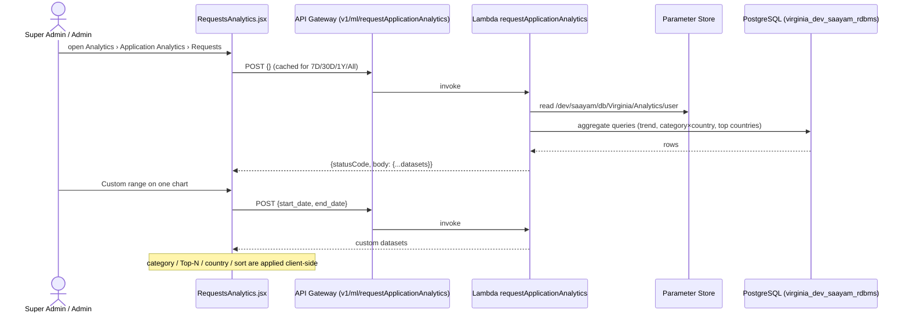

# Request Tab Documentation — Super Admin Dashboard › Analytics › Application Analytics

> **Issue:** [saayam-for-all/data#602](https://github.com/saayam-for-all/data/issues/602)
> **Scope:** the **Requests** tab of Application Analytics: how it works today, how it was built, and what is still missing.
> **Sources:**
> - every task, PR and code file linked in [§13](#13-references)
> - the data repo `test` branch at [`f64938f`](https://github.com/saayam-for-all/data/tree/f64938fef70d2a629f00d8edf9d39b4cd2dcfc97)
> - the webapp `test` branch at [`83f689d`](https://github.com/saayam-for-all/webapp/tree/83f689de72b65a683ab2aa2837a6c684768104c9)
>
> Reviewed on 2026-11-03. This is a documentation-only change; no code, data or infrastructure was modified.
>
> **How to read this document:** statements are taken from code, issues or PRs unless they are marked **(inferred)**. Open questions are collected in [§11](#11-missing-or-unclear-information), referenced as R1, R2, … in the text.

## Contents

1. [Purpose](#1-purpose)
2. [Features](#2-features)
3. [User flow](#3-user-flow)
4. [Filters](#4-filters)
5. [Data sources](#5-data-sources)
6. [Metrics and calculations](#6-metrics-and-calculations)
7. [Implementation approach](#7-implementation-approach)
8. [Development history: task-by-task review](#8-development-history-task-by-task-review)
9. [Original design vs what was built](#9-original-design-vs-what-was-built)
10. [Known limitations](#10-known-limitations)
11. [Missing or unclear information](#11-missing-or-unclear-information)
12. [Issues reviewed and excluded](#12-issues-reviewed-and-excluded)
13. [References](#13-references)

---

## 1. Purpose

The Requests tab gives Super Admins (and Admins) a view of **how many help requests Saayam receives over time** and **what kinds of help are requested, from which countries**. It answers two questions from the original design ([data#82](https://github.com/saayam-for-all/data/issues/82), [wiki](https://github.com/saayam-for-all/data/wiki/Super-Admin-Dashboard-Analytics-tab-Design)):

1. *Total help requests* in the last 7 days, month, year, or a custom date range.
2. *Help requests by category and region.*

It is the default tab of **Application Analytics**, next to the KPI, Beneficiaries and Volunteers tabs. Those tabs are documented separately under #599, #603 and #605.

## 2. Features

The tab shows two charts side by side ([`RequestsAnalytics.jsx` L356–L657](https://github.com/saayam-for-all/webapp/blob/83f689de72b65a683ab2aa2837a6c684768104c9/src/pages/Dashboard/components/Analytics/RequestsAnalytics.jsx#L356-L657)).

| # | Chart | Type (Recharts) | What it shows | Own controls |
|---|---|---|---|---|
| 1 | **Request Volume Trend** | Line chart (`date` × `count`) | Number of requests per day, or per month for 1Y/All | 7D · 30D · 1Y · All · Custom (start/end date) |
| 2 | **Requests by Category & Region** ("Geographic distribution of requests across categories") | Horizontal stacked bar chart: one bar per category, one coloured segment per country | Request counts per category, split by country | Category multi-select, Top 5/7/8, 7D · 30D · 1Y · All · Custom, country selector, sort (Total/Name) |

Chart 2 also shows a **"Top 5" badge row**: the five countries with the most requests in the selected range, with rank and total ([L591–L608](https://github.com/saayam-for-all/webapp/blob/83f689de72b65a683ab2aa2837a6c684768104c9/src/pages/Dashboard/components/Analytics/RequestsAnalytics.jsx#L591-L608)).

Chart behaviour:

- **Independent time ranges.** Each chart has its own time range, so changing one does not reload or reset the other ([L98–L157](https://github.com/saayam-for-all/webapp/blob/83f689de72b65a683ab2aa2837a6c684768104c9/src/pages/Dashboard/components/Analytics/RequestsAnalytics.jsx#L98-L157)). This was added after a request in [webapp#1589](https://github.com/saayam-for-all/webapp/issues/1589) on 2026-07-01.
- **Status messages.** Each chart shows a loading, validation, error or "No data available for the selected period" message in place of the chart ([L54–L57](https://github.com/saayam-for-all/webapp/blob/83f689de72b65a683ab2aa2837a6c684768104c9/src/pages/Dashboard/components/Analytics/RequestsAnalytics.jsx#L54-L57)).
- **Partial failures.** When the API reports a partial failure with `has_errors`, the chart shows the API's `error_message` instead of a misleading "no data".
- **Country names and colours.** Country codes are converted to names with `isoAlpha3ToName` ([L20–L26](https://github.com/saayam-for-all/webapp/blob/83f689de72b65a683ab2aa2837a6c684768104c9/src/pages/Dashboard/components/Analytics/RequestsAnalytics.jsx#L20-L26)). India, United States, Canada, Australia and United Kingdom have fixed colours; any other country gets a hashed fallback colour ([L28–L52](https://github.com/saayam-for-all/webapp/blob/83f689de72b65a683ab2aa2837a6c684768104c9/src/pages/Dashboard/components/Analytics/RequestsAnalytics.jsx#L28-L52)).

## 3. User flow

1. Log in as a **Super Admin** or **Admin**. Both dashboards mount the same component: [`SuperAdminDashboard.jsx`](https://github.com/saayam-for-all/webapp/blob/83f689de72b65a683ab2aa2837a6c684768104c9/src/pages/Dashboard/views/SuperAdminDashboard.jsx) and [`AdminDashboard.jsx`](https://github.com/saayam-for-all/webapp/blob/83f689de72b65a683ab2aa2837a6c684768104c9/src/pages/Dashboard/views/AdminDashboard.jsx).
2. Open the **Analytics** tab, then the **Application Analytics** sub-tab. The other sub-tabs are Infrastructure and Google Analytics.
3. **Requests** is selected by default ([`ApplicationAnalytics.jsx` L8–L15](https://github.com/saayam-for-all/webapp/blob/83f689de72b65a683ab2aa2837a6c684768104c9/src/pages/Dashboard/components/Analytics/ApplicationAnalytics.jsx#L8-L15)).
4. On load, both charts start on **All**. The page sends **one** `POST` with an empty body `{}` and caches the response; both charts share it.
5. Switching between 7D / 30D / 1Y / All re-reads the cached response. **No new API call is made.**
6. Choosing **Custom** on a chart shows two date pickers. Nothing is sent until both dates are set and start ≤ end; until then the chart shows "Select a start and end date" or "Start date must be on or before end date". The chart then sends `{start_date, end_date}` for that chart only.
7. On chart 2, the user can narrow by category, change the Top-N limit, pick a single country, or sort. All of this is computed **in the browser** on the data already loaded (see §4).



## 4. Filters

| Filter | Applies to | Values | Where it is applied | Notes |
|---|---|---|---|---|
| Time range | Each chart separately | 7D, 30D, 1Y, All, Custom | **Server** for the presets (one response holds every window) and for Custom (separate call) | **All is not all-time**: it re-uses the 1-year datasets ([L64](https://github.com/saayam-for-all/webapp/blob/83f689de72b65a683ab2aa2837a6c684768104c9/src/pages/Dashboard/components/Analytics/RequestsAnalytics.jsx#L64), [L72](https://github.com/saayam-for-all/webapp/blob/83f689de72b65a683ab2aa2837a6c684768104c9/src/pages/Dashboard/components/Analytics/RequestsAnalytics.jsx#L72)). See R3. |
| Custom start/end date | The chart it is set on | `YYYY-MM-DD` from `<input type="date">` | Server | The frontend no longer sends `group_by`; a code comment says "The API chooses daily or monthly grouping from the date range" ([L124](https://github.com/saayam-for-all/webapp/blob/83f689de72b65a683ab2aa2837a6c684768104c9/src/pages/Dashboard/components/Analytics/RequestsAnalytics.jsx#L124)). See R2. |
| Category | Chart 2 | Multi-select with checkboxes, at most N | Client | With nothing selected, the top N categories by total are shown ([L272–L289](https://github.com/saayam-for-all/webapp/blob/83f689de72b65a683ab2aa2837a6c684768104c9/src/pages/Dashboard/components/Analytics/RequestsAnalytics.jsx#L272-L289)). |
| Top-N limit | Chart 2 | Top 5 (default), Top 7, Top 8 | Client | Also caps how many categories can be selected. |
| Country | Chart 2 | All Countries, or one country from the loaded data | Client | The list is built from the countries in the current response ([L321–L324](https://github.com/saayam-for-all/webapp/blob/83f689de72b65a683ab2aa2837a6c684768104c9/src/pages/Dashboard/components/Analytics/RequestsAnalytics.jsx#L321-L324)). |
| Sort | Chart 2 | Total (default), Name | Client | [L299–L304](https://github.com/saayam-for-all/webapp/blob/83f689de72b65a683ab2aa2837a6c684768104c9/src/pages/Dashboard/components/Analytics/RequestsAnalytics.jsx#L299-L304) |

The backend also accepts `category`, `country` and `sort_by` filters, as specified in [data#146](https://github.com/saayam-for-all/data/issues/146) and implemented in every Lambda version (§7.3). **The frontend never sends them.** See R5.

## 5. Data sources

**Database:** PostgreSQL, schema `virginia_dev_saayam_rdbms`. The Lambda gets its credentials from AWS Systems Manager Parameter Store, `/dev/saayam/db/Virginia/Analytics/user` in us-east-1 ([`requestApplicationAnalytics.py` L23–L54](https://github.com/saayam-for-all/data/blob/7cda7bc6c8e4ec932fbcb2335ad9a142c6eef240/data-analytics/lambda_functions/requestApplicationAnalytics.py#L23-L54)). It is the same parameter the KPI Lambda uses.

| Table | Used for | Key columns |
|---|---|---|
| `request` | Main source: one row per help request | `submission_date` (time axis), `req_cat_id` (category), `req_user_id` (requester) |
| `users` | Links a request to the requester's country | `user_id`, `country_id` |
| `country` | Country code shown on the chart | `country_id`, `country_code` (ISO alpha-3) |
| `help_categories` | Category name shown on the chart | `cat_id`, `cat_name` |

**Joins** used in the deployed lineage ([L132–L141](https://github.com/saayam-for-all/data/blob/7cda7bc6c8e4ec932fbcb2335ad9a142c6eef240/data-analytics/lambda_functions/requestApplicationAnalytics.py#L132-L141)):

```sql
FROM request r
INNER JOIN users u            ON r.req_user_id = u.user_id
INNER JOIN country c          ON u.country_id  = c.country_id
INNER JOIN help_categories cat ON r.req_cat_id = cat.cat_id
```

Two consequences of these joins:

- **"Region" means the requester's country** (`users.country_id`). It is not the location of the request (`req_loc`).
- **Requests are dropped** when the requester, country or category is missing, because the joins are INNER JOINs.

**Mock data.** These CSVs in [`data-analytics/sql/`](https://github.com/saayam-for-all/data/tree/f64938fef70d2a629f00d8edf9d39b4cd2dcfc97/data-analytics/sql) were built for local testing; they are not used by the deployed Lambda:

- `requests.csv`: 25 rows, `submission_date` from 2025-08-09 to 2026-08-14
- `users.csv`, `country.csv`, `help_category.csv`, `request_statuses.csv`

Their join keys do not line up with each other or with the Lambda; see §10. The early mock JSON given to the UI team in [data#84](https://github.com/saayam-for-all/data/issues/84) and [data#89](https://github.com/saayam-for-all/data/issues/89) was never committed; see R8.

**The team's own workflow doc** (`Request_Analytics_Workflow.docx`, sana-desai, 2026-09-02) lists the same pipeline: Dashboard/API Gateway → Lambda → Parameter Store credentials → PostgreSQL `virginia_dev_saayam_rdbms` → SQL analytics (Trend | Country | Category) → JSON. It lives only on the unmerged branch `sana-desai-patch-2`, in [commit `d03da12`](https://github.com/saayam-for-all/data/commit/d03da126f8fc341cc0c318537cd5c118269632f2). It names the tables `requests` / `countries`, while the code uses `request` / `country`. See R9.

## 6. Metrics and calculations

All counting happens in SQL with `COUNT(*)` and `DATE_TRUNC`. The formulas below are from the most recent code in git, [`requestApplicationAnalytics.py`](https://github.com/saayam-for-all/data/blob/7cda7bc6c8e4ec932fbcb2335ad9a142c6eef240/data-analytics/lambda_functions/requestApplicationAnalytics.py). The live Lambda has moved beyond this file (R1), so treat these as the documented baseline.

### 6.1 Request Volume Trend

```sql
SELECT DATE_TRUNC(:unit, submission_date) AS date, COUNT(*) AS count
FROM request
WHERE submission_date > CURRENT_TIMESTAMP - INTERVAL :window   -- presets
   -- or: submission_date BETWEEN :start_date AND :end_date        -- custom
  AND submission_date IS NOT NULL
GROUP BY DATE_TRUNC(:unit, submission_date)
ORDER BY date
```
([L77–L124](https://github.com/saayam-for-all/data/blob/7cda7bc6c8e4ec932fbcb2335ad9a142c6eef240/data-analytics/lambda_functions/requestApplicationAnalytics.py#L77-L124))

| UI range | Response key | Window | Grouping (`:unit`) |
|---|---|---|---|
| 7D | `request_volume_7_days` | now − 7 days → now (rolling, from the current timestamp) | day |
| 30D | `request_volume_1_month` | now − 30 days → now | day |
| 1Y | `request_volume_1_year` | now − 1 year → now | month |
| All | `request_volume_1_year` (same as 1Y) | now − 1 year → now | month |
| Custom | `request_volume_custom_range` | `start_date` → `end_date` | committed code: `group_by` from the request; live API: chosen automatically (R2) |

Each point is `{"date": "<ISO timestamp>", "count": n}`. The UI keeps only the date part ([L79–L84](https://github.com/saayam-for-all/webapp/blob/83f689de72b65a683ab2aa2837a6c684768104c9/src/pages/Dashboard/components/Analytics/RequestsAnalytics.jsx#L79-L84)). **Periods with no requests are omitted**, not returned as zero, so the line joins the non-empty days directly.

### 6.2 Requests by Category & Region

```sql
SELECT cat.cat_name, c.country_code, COUNT(*) AS count
FROM request r JOIN users u ... JOIN country c ... JOIN help_categories cat ...
WHERE c.country_code IS NOT NULL AND cat.cat_name IS NOT NULL
  AND r.submission_date > CURRENT_TIMESTAMP - INTERVAL '<window>'
  [AND cat.cat_name = :category] [AND UPPER(c.country_code) = :country]
GROUP BY cat.cat_name, c.country_code
ORDER BY count DESC          -- or cat_name / country_code via sort_by
```
([L129–L170](https://github.com/saayam-for-all/data/blob/7cda7bc6c8e4ec932fbcb2335ad9a142c6eef240/data-analytics/lambda_functions/requestApplicationAnalytics.py#L129-L170))

- **Output:** one row per (category, country): `{"category", "country", "count"}`.
- **Windows:** the same as §6.1. The keys are `requests_by_category_region 7 days` / `1 month` / `1 year`, with spaces in the key names.
- **Custom range:** `requests_by_category_region_custom_range`. This key is not in any committed code (R1).

**What the browser then does** ([L225–L319](https://github.com/saayam-for-all/webapp/blob/83f689de72b65a683ab2aa2837a6c684768104c9/src/pages/Dashboard/components/Analytics/RequestsAnalytics.jsx#L225-L319)):

1. **Top 5 countries:** sum `count` per country across all categories, then take the five largest.
2. Apply the category selection, or the top N categories by total when nothing is selected.
3. Apply the country filter.
4. Pivot to one bar per category with one stack per country, then compute the bar `total` and sort.
5. **Only the top-5 countries are drawn as stack segments.** Counts for other countries still count towards the bar `total` used for Top-N and sorting, but are not visible. See §10.

### 6.3 Top countries (API only)

The Lambda also returns `top_countries 7 days` / `30 days` / `1 year`: `{"rank", "country", "count"}`, the five countries with the most requests ([L175–L199](https://github.com/saayam-for-all/data/blob/7cda7bc6c8e4ec932fbcb2335ad9a142c6eef240/data-analytics/lambda_functions/requestApplicationAnalytics.py#L175-L199)). **The frontend does not read these keys**; it recomputes the top 5 itself from the category/region data (§6.2), so the two can disagree.

## 7. Implementation approach

### 7.1 Architecture

```
Webapp (React, Recharts)                         AWS
RequestsAnalytics.jsx ──POST──▶ API Gateway ──▶ Lambda "requestApplicationAnalytics" ──▶ Parameter Store (DB creds)
  analyticsServices.js            v1/ml/requestApplicationAnalytics      │
  (Cognito ID token)                                                     └──▶ PostgreSQL virginia_dev_saayam_rdbms
```

- **Frontend call:** `getRequestsApplicationAnalytics(payload)` does `api.post(endpoints.REQUEST_APPLICATION_ANALYTICS, payload)` and returns `response.data` ([`analyticsServices.js` L12–L18](https://github.com/saayam-for-all/webapp/blob/83f689de72b65a683ab2aa2837a6c684768104c9/src/services/analyticsServices.js#L12-L18)). The endpoint is `"v1/ml/requestApplicationAnalytics"` ([`endpoints.json` L45](https://github.com/saayam-for-all/webapp/blob/83f689de72b65a683ab2aa2837a6c684768104c9/src/services/endpoints.json#L45)).
- **Response shape:** the UI accepts the datasets either wrapped in `body` or at the top level (`response?.body || response`, [L141](https://github.com/saayam-for-all/webapp/blob/83f689de72b65a683ab2aa2837a6c684768104c9/src/pages/Dashboard/components/Analytics/RequestsAnalytics.jsx#L141)).
- **Lambda name:** `requestApplicationAnalytics`, from dokababa's deployment comment on [data#167](https://github.com/saayam-for-all/data/pull/167), dated 2026-05-12.
- **Not recorded in either repo:** the AWS account, the API Gateway integration type, and how the Lambda is deployed (R6).

### 7.2 API contract as the frontend uses it

**Request**

```jsonc
// presets (7D / 30D / 1Y / All), sent once and cached
{}
// custom range, one call per chart
{ "start_date": "2026-01-13", "end_date": "2026-05-18" }
```

**Response.** The frontend reads exactly these keys ([L59–L96](https://github.com/saayam-for-all/webapp/blob/83f689de72b65a683ab2aa2837a6c684768104c9/src/pages/Dashboard/components/Analytics/RequestsAnalytics.jsx#L59-L96)):

```jsonc
{
  "statusCode": 200,
  "body": {
    "request_volume_7_days":   [{ "date": "2026-10-28T00:00:00", "count": 3 }],
    "request_volume_1_month":  [ ... ],
    "request_volume_1_year":   [{ "date": "2026-09-01T00:00:00", "count": 41 }],
    "request_volume_custom_range": [ ... ],                    // custom calls only
    "requests_by_category_region 7 days":  [{ "category": "FOOD", "country": "IND", "count": 5 }],
    "requests_by_category_region 1 month": [ ... ],
    "requests_by_category_region 1 year":  [ ... ],
    "requests_by_category_region_custom_range": [ ... ],      // custom calls only
    "top_countries 7 days": [{ "rank": 1, "country": "IND", "count": 9 }],  // returned, not used by the UI
    "has_errors": false,                                       // optional
    "error_message": null                                      // optional
  }
}
```
*The values are illustrative. The key names are exact.*

**Errors (committed code)**

| Case | Response |
|---|---|
| DB connection failure, or any other exception | `500`, body `{"error": "Failed to connect to database"}` ([L242–L248](https://github.com/saayam-for-all/data/blob/7cda7bc6c8e4ec932fbcb2335ad9a142c6eef240/data-analytics/lambda_functions/requestApplicationAnalytics.py#L242-L248)) |
| One metric query fails | That dataset returns `[]` and the rest still succeed |

There is no 400 validation in committed code. For example, `start_date` without `group_by` raises a `KeyError` that comes back as the same misleading 500 ([L208–L212](https://github.com/saayam-for-all/data/blob/7cda7bc6c8e4ec932fbcb2335ad9a142c6eef240/data-analytics/lambda_functions/requestApplicationAnalytics.py#L208-L212)). See R2.

### 7.3 Backend implementations found

**None of these is on `main`, `dev` or `test`.**

| # | Version | Where | Response keys | Filters / range | Status |
|---|---|---|---|---|---|
| 1 | sana-desai, 2026-04-23 | `data-analytics/lambda_functions/request_application_analytics.py`, renamed to `application_analytics_request.py.py` ([`75715b2`](https://github.com/saayam-for-all/data/commit/75715b266e1c2f7b82cce3868f6ee015be04b079)) | `"7 days requests"`, `"1 month requests"`, `"1 year requests"`, `"Country requests"` | Env-var DB creds; grouping in pandas | Overwritten with volunteer-analytics code 31 minutes later ([`42b959d`](https://github.com/saayam-for-all/data/commit/42b959dc429cbb1f7cef4560d3ab63c2fc8be8dc)), deleted 2026-05-08 ([`cfc2ec9`](https://github.com/saayam-for-all/data/commit/cfc2ec98b9b32ba9b5c8a945cd38a835f5dfee7c)) |
| 2 | dokababa, [PR #167](https://github.com/saayam-for-all/data/pull/167) for #146 | `data-analytics/lambda_functions/application_analytics_request.py` (+ `mock_local_db.py`, unit tests) | The five keys from #146: `request_volume_7_days`, `request_volume_1_month`, `request_volume_1_year`, `top_countries`, `requests_by_category_region` | `category`, `country`, `sort_by`; presets only; SQL `DATE_TRUNC` | **Open, not merged** (base `main`). Author reports deploying it as `requestApplicationAnalytics` |
| 3 | Vighnesh Sridhar, 2026-06-25 | [`requestApplicationAnalytics.py`](https://github.com/saayam-for-all/data/blob/7cda7bc6c8e4ec932fbcb2335ad9a142c6eef240/data-analytics/lambda_functions/requestApplicationAnalytics.py), carried inside the unrelated [PR #189](https://github.com/saayam-for-all/data/pull/189) | Per-window keys with spaces (`requests_by_category_region 7 days`, `top_countries 30 days`, …) + `request_volume_custom_range` | Adds a custom range (`start_date`, `end_date`, `group_by`); `body` is a dict | **Open, not merged** (base `main`). The closest match to what the UI reads, and a direct evolution of #2 with the same functions and docstrings |
| 4 | AnushaPoojary1998, 2026-07-07 | [`saayam/SuperAdmin/application_analytics_request.py`](https://github.com/saayam-for-all/data/blob/8b630f50b17784c7b7c979725fb70b4f6d4e618d/saayam/SuperAdmin/application_analytics_request.py) on branch `anushapoojary/application-analytics-request` | The five keys from #146 | Filters by `country_name` (not code); LEFT JOINs with `'Unknown'`; category/region and top countries **not time-filtered** | No PR |
| 5 | **Deployed Lambda (live)** | Not in git **(inferred)** | Everything in #3 + `requests_by_category_region_custom_range`, `has_errors`, `error_message` | Custom range without `group_by`; grouping chosen by the API | Confirmed only indirectly: the webapp was changed to match it, and live retests passed on [webapp#1589](https://github.com/saayam-for-all/webapp/issues/1589) on 2026-10-01 |

The KPI Lambda, [`kpi_api_analytics.py`](https://github.com/saayam-for-all/data/blob/f64938fef70d2a629f00d8edf9d39b4cd2dcfc97/data-analytics/lambda_functions/kpi_api_analytics.py), also counts requests, but it powers the **KPI** tab (#599), not this one.

### 7.4 Frontend files

| File (webapp `test`) | Role |
|---|---|
| [`src/pages/Dashboard/components/Analytics/RequestsAnalytics.jsx`](https://github.com/saayam-for-all/webapp/blob/83f689de72b65a683ab2aa2837a6c684768104c9/src/pages/Dashboard/components/Analytics/RequestsAnalytics.jsx) | The tab: data hooks, key mapping, client-side filtering, both charts |
| [`src/pages/Dashboard/components/Analytics/RequestsAnalytics.test.jsx`](https://github.com/saayam-for-all/webapp/blob/83f689de72b65a683ab2aa2837a6c684768104c9/src/pages/Dashboard/components/Analytics/RequestsAnalytics.test.jsx) | 19 tests: caching, custom ranges, filters, partial-error handling, response with or without a `body` wrapper |
| [`src/pages/Dashboard/components/Analytics/ApplicationAnalytics.jsx`](https://github.com/saayam-for-all/webapp/blob/83f689de72b65a683ab2aa2837a6c684768104c9/src/pages/Dashboard/components/Analytics/ApplicationAnalytics.jsx) | Requests / KPI / Beneficiaries / Volunteers sub-tabs |
| [`src/services/analyticsServices.js`](https://github.com/saayam-for-all/webapp/blob/83f689de72b65a683ab2aa2837a6c684768104c9/src/services/analyticsServices.js) · [`src/services/endpoints.json`](https://github.com/saayam-for-all/webapp/blob/83f689de72b65a683ab2aa2837a6c684768104c9/src/services/endpoints.json) | API call and route |
| [`src/pages/Dashboard/views/SuperAdminDashboard.jsx`](https://github.com/saayam-for-all/webapp/blob/83f689de72b65a683ab2aa2837a6c684768104c9/src/pages/Dashboard/views/SuperAdminDashboard.jsx) · [`AdminDashboard.jsx`](https://github.com/saayam-for-all/webapp/blob/83f689de72b65a683ab2aa2837a6c684768104c9/src/pages/Dashboard/views/AdminDashboard.jsx) | Where the Analytics › Application Analytics tab is mounted |

## 8. Development history: task-by-task review

The tab was built in four phases: design, mock UI, live API, and live integration fixes. Each task was reviewed individually: body, comments, attachments and linked PRs.

### Phase 1: Design and mock data (Nov 2025 – Mar 2026, data repo)

| Task | Dates | What it asked for | Comments and attachments | PRs | Outcome |
|---|---|---|---|---|---|
| [data#82](https://github.com/saayam-for-all/data/issues/82) Design of Application Analytics tab | Opened 2025-11-20, closed 2026-03-24 (prachi080588) | Six analytics categories, two visuals each. **Requests:** total help requests for 7 days / month / year / custom, and requests by category and region | 2025-11-26: asks for the design to be written up on the wiki. 2026-03-24: "Complemented the implementation…" | None | The design lives on the [wiki page](https://github.com/saayam-for-all/data/wiki/Super-Admin-Dashboard-Analytics-tab-Design). No chart types or data sources specified |
| [data#84](https://github.com/saayam-for-all/data/issues/84) Creation of test data | Opened 2025-12-08, closed 2026-03-24 | Build schema-based CSVs, convert them to JSON, and serve that to the UI so it can work independently; later swap in SQL "without UI changes" | Attachments: [Table.column.names_data .xlsx](https://github.com/user-attachments/files/24040548/Table.column.names_data-1764970855601.xlsx) and ["Types of Visualizations for Application Analytics Dashboard" .docx](https://github.com/user-attachments/files/24040571/Types.of.Visualizations.for.Application.Analytics.Dashboard.docx). 2026-03-24: "created the JSON objects and sent it to UI team" | None | The mock JSON was handed over outside GitHub (R8) |
| [data#89](https://github.com/saayam-for-all/data/issues/89) Implementation in Python using plotly | Opened 2025-12-16, closed 2026-03-24 | No description | 2026-01-06: mock CSVs converted to JSON and shared with the front end | None | No plotly code was committed. The shipped UI uses Recharts |

### Phase 2: Mock-data UI (Jan – Feb 2026, webapp)

Built under the RBAC dashboards issue [webapp#1057](https://github.com/saayam-for-all/webapp/issues/1057) (closed 2026-06-18) by Mustafaahmed00. All PRs targeted `test` and were merged by their author.

| PR | Date | Change |
|---|---|---|
| [webapp#1157](https://github.com/saayam-for-all/webapp/pull/1157) | 2026-01-06 | First attempt at the analytics dashboard. **Closed without merging** the same day |
| [webapp#1158](https://github.com/saayam-for-all/webapp/pull/1158) | 2026-01-13 | Request Volume Trend line chart and Category & Region stacked bars on 8 mock JSON files, built to the "PDF specifications" (most likely the #84 .docx, **inferred**) |
| [webapp#1180](https://github.com/saayam-for-all/webapp/pull/1180) | 2026-01-19 | Split Application Analytics into 4 tabs (Requests, KPI, Beneficiaries, Volunteers) |
| [webapp#1189](https://github.com/saayam-for-all/webapp/pull/1189) | 2026-01-20 | Removed redundant headers |
| [webapp#1202](https://github.com/saayam-for-all/webapp/pull/1202) | 2026-01-29 | Side-by-side graph layout |
| [webapp#1246](https://github.com/saayam-for-all/webapp/pull/1246) | 2026-02-20 | Replaced the country toggles with ranked Top 5 badges (still in the UI today) |

### Phase 3: Real backend API (Apr – Sep 2026, data repo)

**[data#146](https://github.com/saayam-for-all/data/issues/146): Implement real API for `application_analytics_request.py`: complete, test and deploy**

- **Dates and owner:** opened 2026-04-14 by sana-desai, closed as completed on 2026-09-22.
- **Specification:**
  - read the Virginia RDS
  - presets 7D/30D (daily) and 1Y (monthly) via `DATE_TRUNC`
  - category × country counts
  - `category` / `country` / `sort_by` filters
  - top 5 countries
  - 500 if the DB connection fails, `[]` for empty data
  - exactly five response keys
  - phases for local testing, deployment, and credentials in env vars or Secrets Manager
- **Comments:** none.
- **Reference link problem:** the "reference" link text names `beneficiary_trend_analysis.py`, but the URL points to the deleted `application_analytics_request.py.py`.
- **Linked PR:** [data#167](https://github.com/saayam-for-all/data/pull/167) by dokababa.
  - Opened 2026-05-07, with 13 unit tests and a sqlite mock DB.
  - 2026-06-02: moved to Parameter Store and SQL `DATE_TRUNC` "per reviewer feedback".
  - 2026-05-08: reviewed by sana-desai.
  - 2026-05-12: the author reports it deployed as `requestApplicationAnalytics`.
  - **Still open, never merged.**
- **Related code without a task:** Vighnesh Sridhar's `requestApplicationAnalytics.py` (2026-06-25), committed inside [data#189](https://github.com/saayam-for-all/data/pull/189) ("Added Date Filters for beneficiariesTrendAnalysis.py", open), and Anusha Poojary's branch version (2026-07-07, no PR). See §7.3.
- **Outcome:** the issue is closed, but **no request-analytics code was ever merged** (R4).

### Phase 4: Live integration and fixes (Jun – Oct 2026, webapp)

**[webapp#1589](https://github.com/saayam-for-all/webapp/issues/1589): Application Analytics – Requests tab**

- **Dates and owners:** opened 2026-06-19 by rashmi-bilaskar; assigned to NikhithaMuthukur and la3679. **Still open.**
- **Specification:**
  - replace the mock JSON with the live API on the Super Admin **and** Admin dashboards
  - send `{}` for the presets
  - for Custom, send `{"start_date", "end_date", "group_by": "day"|"month"}`
  - use ISO country codes
- **Comments:**
  - 2026-07-01: show the top 5 (or 7–8) categories as horizontal bars coloured by country, add checkboxes to the category dropdown, and give that chart its own time selector.
  - 2026-09-29 / 09-30: data is thin because the DB was replaced in mid-August and CreateRequest was broken; the custom category/region range returned `has_errors: true` with an empty array.
  - 2026-10-01: the custom category range was fixed **in the API** and the retest passed (30D = 132, 1Y/All = 147).
  - 2026-10-03: the dropdown should close properly and countries need distinct colours.

| PR | Author | Date | Change | Outcome |
|---|---|---|---|---|
| [webapp#1598](https://github.com/saayam-for-all/webapp/pull/1598) | Aditi-Chowdhuri | 2026-06-22 | Live API against endpoint `v1/ml/requestsTrendAnalysis`, with a mock fallback | **Closed without merging** on 2026-08-20; no reason recorded |
| [webapp#1608](https://github.com/saayam-for-all/webapp/pull/1608) | NikhithaMuthukur | 2026-06-26 | `RequestsAnalytics.jsx` and `analyticsServices.js` wired to `v1/ml/requestApplicationAnalytics` | Merged (no reviews) |
| [webapp#1629](https://github.com/saayam-for-all/webapp/pull/1629) | NikhithaMuthukur | 2026-07-08 | Independent time range for the category chart, and the category multi-select | Merged (no reviews) |
| [webapp#1876](https://github.com/saayam-for-all/webapp/pull/1876) | la3679 | 2026-10-01 | Stopped sending `group_by`, read `requests_by_category_region_custom_range`, added `has_errors` handling and empty states | Merged by the author without approval, although the description said to hold it until the backend was checked |
| [webapp#1940](https://github.com/saayam-for-all/webapp/pull/1940) / [#1941](https://github.com/saayam-for-all/webapp/pull/1941) | la3679 | 2026-10-27 | Dropdown and colour fixes, merged by mistake, then reverted ("Revert unreviewed request analytics merge") | Reverted |
| [webapp#1942](https://github.com/saayam-for-all/webapp/pull/1942) | la3679 | 2026-10-30 | Category dropdown dismissal and fixed country colours (India blue, US green) | Merged ("No reviews needed for test branch PR") |

[webapp#1681](https://github.com/saayam-for-all/webapp/pull/1681) and [#1683](https://github.com/saayam-for-all/webapp/pull/1683) also reference #1589, but they change the **Volunteers** tab.

## 9. Original design vs what was built

| Design ([data#82](https://github.com/saayam-for-all/data/issues/82), [wiki](https://github.com/saayam-for-all/data/wiki/Super-Admin-Dashboard-Analytics-tab-Design)) | Built | Gap |
|---|---|---|
| Total requests for 7 days, month, year, custom range | 7D, 30D (rolling 30 days, not a calendar month), 1Y, Custom; plus "All" | "All" shows the same data as 1Y |
| Requests by category and region | Category × requester-country stacked bars | "Region" is implemented as the requester's **country**; no state or region level |
| Mock JSON first, then SQL "without UI changes" (#84) | The UI's key mapping changed several times (#1608, #1876) to follow the API | The contract was not fixed up front |
| Filters `category` / `country` / `sort_by` on the API (#146) | Implemented in the API, but the UI filters client-side and never sends them | Two filter paths; only one is used |
| Plotly (#89) | Recharts in React | Superseded |

## 10. Known limitations

1. **"All" is not all-time.** It shows the 1-year datasets for both charts.
2. **Rolling windows.** 7D/30D/1Y are measured back from the current timestamp, so the first bucket is usually partial (for example, part of a month 12 months ago). Committed code has no timezone handling.
3. **Days or months with no requests are omitted** rather than returned as zero, so the line chart can join distant points.
4. **Custom end date may be exclusive in practice (inferred).** Committed code uses `submission_date BETWEEN start AND end` on a timestamp. With a date-only `end_date`, requests later on the end day itself are excluded.
5. **Hidden countries in stacked bars.** Only the top-5 countries are drawn, but bar totals, Top-N and sorting include every country, so a bar can look shorter than its rank suggests.
6. **Top 5 is computed twice.** `top_countries*` from the API is ignored, and the UI recomputes the top 5 from category/region data. The two can differ.
7. **INNER JOINs drop requests** with no requester, country or category. "Region" is the requester's country, not where help is needed (`req_loc`).
8. **Error handling.** In committed code, any exception, including bad input, becomes `500 "Failed to connect to database"`; there is no 400 validation. A failed metric silently becomes `[]`, which is why `has_errors` was later added to the live API.
9. **Fragile credential parsing.** Committed code parses the Parameter Store value by line position ([L40–L46](https://github.com/saayam-for-all/data/blob/7cda7bc6c8e4ec932fbcb2335ad9a142c6eef240/data-analytics/lambda_functions/requestApplicationAnalytics.py#L40-L46)), while the KPI Lambda uses `json.loads` on the same parameter. A formatting change to the parameter would break it.
10. **The mock data cannot reproduce chart 2** (checked against `data-analytics/sql/` on `test`):
    - 0 of 25 `requests.csv` `req_cat_id` values (such as `CAT-FOOD`) match `help_category.cat_id` (such as `1.1`).
    - Only 9 of 25 `creator_id` values exist in `users.csv`, and all 9 map to `country_id = 1` (AFGHANISTAN).
    - The CSV calls the requester `creator_id`, while the Lambda joins on `req_user_id`.
    - `request_statuses.csv` (1 New … 6 Escalated) conflicts with `database/lookup_tables/request_status.csv` (0 CREATED … 7 RATED_BY_VOLUNTEER). Not used by this tab, but confusing.
11. **Thin live data.** The DB was replaced in mid-August 2026 and CreateRequest was broken for a period ([webapp#1589](https://github.com/saayam-for-all/webapp/issues/1589)), so short windows (7D) can be empty.
12. **Both dashboards.** The tab is rendered for Admins as well as Super Admins; whether Admins should see it is not documented.

## 11. Missing or unclear information

| ID | Item | Evidence | Suggested owner / question |
|---|---|---|---|
| **R1** | **The live Lambda's source is not in git.** The UI depends on `requests_by_category_region_custom_range`, `has_errors` and `error_message`, which no version in the data repo produces, and on automatic custom-range grouping, which no version implements. | §7.3. A search of all data-repo branches on 2026-11-03 found none of these | Whoever deployed `requestApplicationAnalytics` (dokababa / vighneshsridhar / the API team): export the deployed code and merge it to `test` |
| **R2** | **Custom-range contract drift.** #1589 specified `group_by`; committed code requires `group_by` (a KeyError without it); #1876 stopped sending it. | [#1589](https://github.com/saayam-for-all/webapp/issues/1589), [L211](https://github.com/saayam-for-all/data/blob/7cda7bc6c8e4ec932fbcb2335ad9a142c6eef240/data-analytics/lambda_functions/requestApplicationAnalytics.py#L211), [#1876](https://github.com/saayam-for-all/webapp/pull/1876) | Backend owner: document the grouping rule (for example, day up to N days, else month) and whether `group_by` is still accepted |
| **R3** | **"All" means 1 year.** There is no all-time dataset, and the KPI Lambda defines "All" as 2 years. | [L64](https://github.com/saayam-for-all/webapp/blob/83f689de72b65a683ab2aa2837a6c684768104c9/src/pages/Dashboard/components/Analytics/RequestsAnalytics.jsx#L64) | Product (rashmi-bilaskar / sana-desai): should All be all-time, or should the button be removed? |
| **R4** | **#146 was closed as completed without merged code.** Its PR #167 is still open against `main`, and the file it references was deleted. | [data#146](https://github.com/saayam-for-all/data/issues/146), [data#167](https://github.com/saayam-for-all/data/pull/167) | sana-desai / janhavi-1111: merge, supersede or close #167 |
| **R5** | **Two filter paths.** The API supports `category` / `country` / `sort_by`, but the UI filters client-side and never sends them. | §4, §7.3 | Decide which path is canonical; remove or document the unused one |
| **R6** | **Deployment is undocumented.** The AWS Lambda name is only in a PR comment; the API Gateway integration (proxy or non-proxy), runtime, layers (psycopg2) and IAM role are not recorded; the repo's deploy workflow cannot deploy `data-analytics/` Lambdas. | [data#167](https://github.com/saayam-for-all/data/pull/167), `.github/workflows/deploy-lambda.yml` | DevOps / API team |
| **R7** | **Competing implementations.** Four versions of the Lambda exist across branches, with different country semantics (`country_code` vs `country_name`), join types and time filtering. | §7.3 | Backend owner: pick one and delete the rest |
| **R8** | **Design artefacts live outside the repo.** The original visual spec and mock JSON were attachments on #84 or sent directly to the UI team. | [data#84](https://github.com/saayam-for-all/data/issues/84) | Commit them, or link them from this doc |
| **R9** | **The team workflow doc is unmerged and has naming differences.** `Request_Analytics_Workflow.docx` is only on `sana-desai-patch-2`, and it lists tables as `requests` / `countries` while the code uses `request` / `country`. | [commit `d03da12`](https://github.com/saayam-for-all/data/commit/d03da126f8fc341cc0c318537cd5c118269632f2) | sana-desai: merge it or retire it in favour of this document |
| **R10** | **Unreviewed merges.** The webapp PRs for this tab were merged into `test` without approvals; #1876 was merged despite its own "hold until backend checked" note; #1940 had to be reverted. Whether they have reached `dev` / `main` was not checked. | §8 Phase 4 | Webapp leads |
| **R11** | **Endpoint renamed without a record.** #1598 used `v1/ml/requestsTrendAnalysis`; the final endpoint is `v1/ml/requestApplicationAnalytics`. Whether the old route still exists is unknown. | [webapp#1598](https://github.com/saayam-for-all/webapp/pull/1598) | API team |
| **R12** | **Mock data out of sync with the schema** (see §10 item 10), so the tab cannot be tested end to end locally. | `data-analytics/sql/` on `test` | Data team: align `requests.csv` category ids and requester ids with `help_category.csv` / `users.csv` |
| **R13** | **Misleading title on a KPI task.** [data#181](https://github.com/saayam-for-all/data/issues/181) is titled "…KPI Request Volume Trend and Requests by Category & Region", but it only changed the KPI Lambda. | [data#181](https://github.com/saayam-for-all/data/issues/181) | Retitle it so it is not mistaken for Requests tab work |
| **R14** | **Attachments that could not be reviewed here:** the #84 .xlsx/.docx (GitHub user attachments), and the #1589 screenshot (an expiring signed URL). | §8 | Reviewers with access should confirm they match §2 |

## 12. Issues reviewed and excluded

These came up in the search but are not Requests-tab work:

| Item | Why it was excluded |
|---|---|
| [data#81](https://github.com/saayam-for-all/data/issues/81) | Parent epic only (Super Admin Dashboard Analytics) |
| [data#96](https://github.com/saayam-for-all/data/issues/96) | Home-page metrics ticker |
| [data#160](https://github.com/saayam-for-all/data/issues/160), [data#181](https://github.com/saayam-for-all/data/issues/181) | KPI tab (`kpi_api_analytics.py`), documented under #599 |
| [data#203](https://github.com/saayam-for-all/data/issues/203) | Request **Details** tab (additional request fields), a different screen |
| [webapp#1681](https://github.com/saayam-for-all/webapp/pull/1681), [#1683](https://github.com/saayam-for-all/webapp/pull/1683) | Volunteers tab, even though they reference #1589 |
| [webapp#1939](https://github.com/saayam-for-all/webapp/issues/1939) | Separate request to document dashboard functionality and APIs (webapp side); relevant to anyone extending this doc |
| [data#643](https://github.com/saayam-for-all/data/pull/643) | Another assignee's documentation PR for this same issue (#602) |

## 13. References

**Tasks**

- data: [#82](https://github.com/saayam-for-all/data/issues/82) · [#84](https://github.com/saayam-for-all/data/issues/84) · [#89](https://github.com/saayam-for-all/data/issues/89) · [#146](https://github.com/saayam-for-all/data/issues/146) · [#602](https://github.com/saayam-for-all/data/issues/602)
- webapp: [#1057](https://github.com/saayam-for-all/webapp/issues/1057) · [#1589](https://github.com/saayam-for-all/webapp/issues/1589)
- Design wiki: [Super Admin Dashboard Analytics tab Design](https://github.com/saayam-for-all/data/wiki/Super-Admin-Dashboard-Analytics-tab-Design)

**Pull requests**

- data: [#167](https://github.com/saayam-for-all/data/pull/167) · [#189](https://github.com/saayam-for-all/data/pull/189)
- webapp: [#1157](https://github.com/saayam-for-all/webapp/pull/1157) · [#1158](https://github.com/saayam-for-all/webapp/pull/1158) · [#1180](https://github.com/saayam-for-all/webapp/pull/1180) · [#1189](https://github.com/saayam-for-all/webapp/pull/1189) · [#1202](https://github.com/saayam-for-all/webapp/pull/1202) · [#1246](https://github.com/saayam-for-all/webapp/pull/1246) · [#1598](https://github.com/saayam-for-all/webapp/pull/1598) · [#1608](https://github.com/saayam-for-all/webapp/pull/1608) · [#1629](https://github.com/saayam-for-all/webapp/pull/1629) · [#1876](https://github.com/saayam-for-all/webapp/pull/1876) · [#1940](https://github.com/saayam-for-all/webapp/pull/1940) · [#1941](https://github.com/saayam-for-all/webapp/pull/1941) · [#1942](https://github.com/saayam-for-all/webapp/pull/1942)

**Code (pinned to commits)**

- Backend, latest in git: [`requestApplicationAnalytics.py` @ 7cda7bc](https://github.com/saayam-for-all/data/blob/7cda7bc6c8e4ec932fbcb2335ad9a142c6eef240/data-analytics/lambda_functions/requestApplicationAnalytics.py)
- Backend, alternatives:
  - [PR #167 files](https://github.com/saayam-for-all/data/pull/167/files)
  - [Anusha's version @ 8b630f5](https://github.com/saayam-for-all/data/blob/8b630f50b17784c7b7c979725fb70b4f6d4e618d/saayam/SuperAdmin/application_analytics_request.py)
  - [original @ 75715b2](https://github.com/saayam-for-all/data/commit/75715b266e1c2f7b82cce3868f6ee015be04b079)
- Frontend: [`RequestsAnalytics.jsx`](https://github.com/saayam-for-all/webapp/blob/83f689de72b65a683ab2aa2837a6c684768104c9/src/pages/Dashboard/components/Analytics/RequestsAnalytics.jsx) · [`RequestsAnalytics.test.jsx`](https://github.com/saayam-for-all/webapp/blob/83f689de72b65a683ab2aa2837a6c684768104c9/src/pages/Dashboard/components/Analytics/RequestsAnalytics.test.jsx) · [`analyticsServices.js`](https://github.com/saayam-for-all/webapp/blob/83f689de72b65a683ab2aa2837a6c684768104c9/src/services/analyticsServices.js) · [`endpoints.json`](https://github.com/saayam-for-all/webapp/blob/83f689de72b65a683ab2aa2837a6c684768104c9/src/services/endpoints.json)
- Team workflow doc: [`Request_Analytics_Workflow.docx` @ d03da12](https://github.com/saayam-for-all/data/blob/d03da126f8fc341cc0c318537cd5c118269632f2/data-analytics/docs/Request_Analytics_Workflow.docx)
- Mock data: [`data-analytics/sql/` @ f64938f](https://github.com/saayam-for-all/data/tree/f64938fef70d2a629f00d8edf9d39b4cd2dcfc97/data-analytics/sql)
