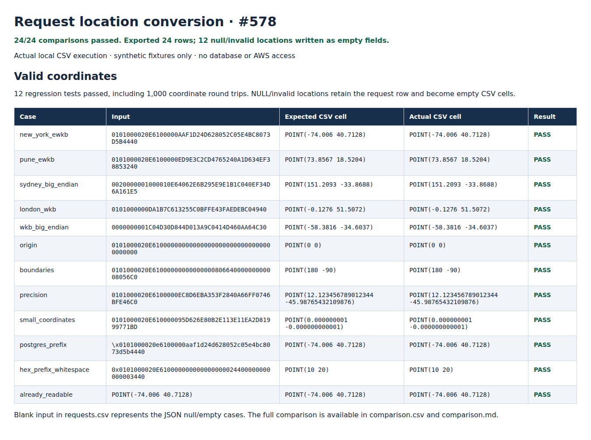
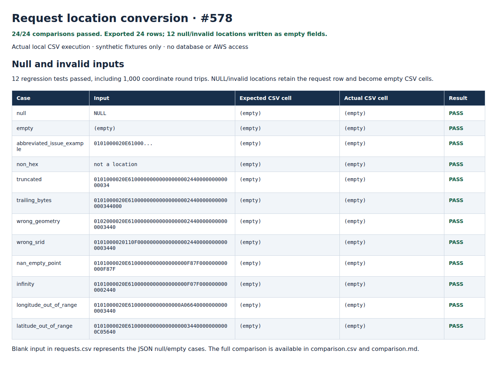

# Readable request locations — issue #578

`req_loc` must remain in the request archive as `POINT(longitude latitude)`.
The new standard-library-only [converter](../../src/utils/request_location.py)
decodes the database representation locally; it does not query PostGIS, AWS, or
an external service and adds no Lambda dependencies.

## Run locally

From the repository root, with Python 3.10+:

```bash
python -m unittest discover -s data-engineering/tests -p test_request_location.py -v
python data-engineering/scripts/verify_request_locations.py
```

The second command runs the tests, runs the actual CSV export CLI, reads its
output back, and compares each location and request ID to the checked-in
expectations. It regenerates [comparison.csv](evidence/comparison.csv),
[comparison.md](evidence/comparison.md), [converted_requests.csv](evidence/converted_requests.csv),
[test-results.txt](evidence/test-results.txt), and [report.html](evidence/report.html).
Any mismatch exits with a nonzero status.

To convert another local **mock** requests CSV:

```bash
python data-engineering/scripts/convert_request_locations.py input.csv output.csv
```

The input must have a `req_loc` header. Output uses UTF-8 CSV with the same
column order and rows, including text containing commas, quotes, newlines, and
non-ASCII characters. Input and output paths must differ. Counts are printed;
raw location values are not logged.

## Conversion contract

| Input | Output / behavior |
|---|---|
| 2D PostGIS EWKB POINT, SRID 4326 | Decode the two doubles as X (longitude), then Y (latitude) |
| Plain 2D WKB POINT with no SRID | Decode as longitude/latitude; this is an explicit assumption, not a projection |
| Little- or big-endian encoding | Respect the byte-order byte for type, SRID, and coordinates |
| Upper/lowercase hex text | Accept bare hex, PostgreSQL `\x` prefix, or `0x` prefix; trim outer whitespace |
| `bytes`, `bytearray`, `memoryview` | Accept raw binary WKB/EWKB as returned by database drivers |
| Already-readable 2D `POINT(...)` | Validate and normalize; repeated conversion is safe |
| `None`, empty string, missing CSV value | Return `None`; CSV output is an empty cell |
| Invalid hex/header/length, wrong geometry, extra Z/M dimensions | Return `None`; retain the request and all other fields |
| Explicit SRID other than 4326 | Return `None`; do not silently label projected values as longitude/latitude |
| NaN, infinity, POINT EMPTY, coordinates outside longitude ±180 / latitude ±90 | Return `None`; retain the request |
| Row without `req_loc` | Leave its columns unchanged in the mapping helper; the CSV CLI requires the header |

The formatter uses Python's shortest round-trip representation of each decoded
IEEE-754 double, expanded to decimal notation. It does not round to a fixed
number of places, swap axes, or transform coordinate systems. The precision
fixture demonstrates the actual representable double, rather than claiming
decimal precision beyond the encoded value. SRID is omitted from the output
because the requested representation is WKT `POINT(...)`, not EWKT.

Invalid values become empty cells by explicit policy, so the export continues.
Their original payload is not retained in the output; retain the source/mock
input separately when investigating invalid values. Null and invalid locations
are indistinguishable in the CSV, and the CLI reports their combined count.

## Archive integration

The base is `dev` at `fb300562d71d86c97f63c4353d5e8b63400968ee`.
There is **no requests archive implementation on that branch** to patch in
place. Archive implementations in PRs [#615](https://github.com/saayam-for-all/data/pull/615),
[#623](https://github.com/saayam-for-all/data/pull/623),
[#633](https://github.com/saayam-for-all/data/pull/633), and
[#638](https://github.com/saayam-for-all/data/pull/638) were still unmerged when
this change was developed. This PR supplies a tested conversion/export path
without choosing or copying an unmerged Lambda implementation.

When the chosen archive implementation lands, apply the helper **after any
masking that could otherwise overwrite `req_loc`, immediately before CSV
serialization** (assuming `data-engineering` is on the import path):

```python
from src.utils.request_location import convert_request_locations

# rows is an iterator of mappings from the existing request extract.
# Keep req_loc in fieldnames; never filter a row because its location is null.
writer.writerows(convert_request_locations(rows))
```

For an existing row loop, use `row["req_loc"] = location_to_point(row["req_loc"])`.
The mapping helper is lazy, copies rows, changes only `req_loc`, and neither
invents missing columns nor mutates its input. Package the utility with the
Lambda at integration time. Production Lambda wiring/deployment is a follow-up
to the selected archive PR, not claimed by this standalone conversion change.

## Mock data and validation evidence

Issue #578 had **no comments or attached complete mock inputs/expected
outputs** when reviewed. Its sample hex is truncated and cannot be decoded.
The committed [24 fixtures](../../tests/fixtures/request_locations/cases.json)
are entirely synthetic, with literal expected outputs; they are not supplied
by a maintainer and contain no database rows. Matching the promised supplied
mock set remains pending its availability. Add those cases and rerun the same
checks when it is attached.

The local result is **24/24 matches**, **24 input/output requests**, and **12
regression tests passed**, including 1,000 deterministic coordinate round
trips with exact double equality, both byte orders, binary driver buffers,
geometry/SRID rejection, corrupt payloads, idempotency, streaming, row/column
retention, and CSV round-tripping. No live database or AWS validation was run.

These screenshots capture the generated local HTML report of actual CLI output
and comparisons; they are not AWS console or terminal screenshots. Open
`evidence/report.html` in a browser and capture the `valid` and `invalid`
sections to regenerate them after running verification.




